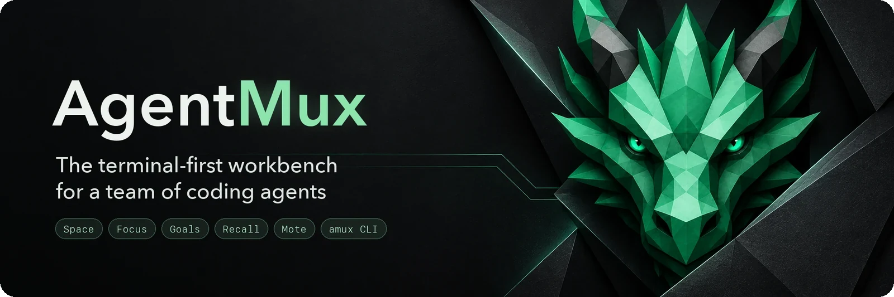
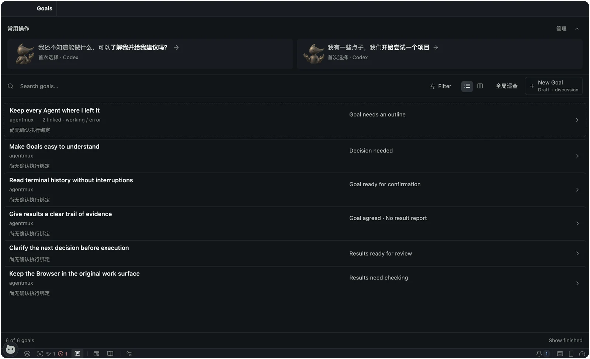
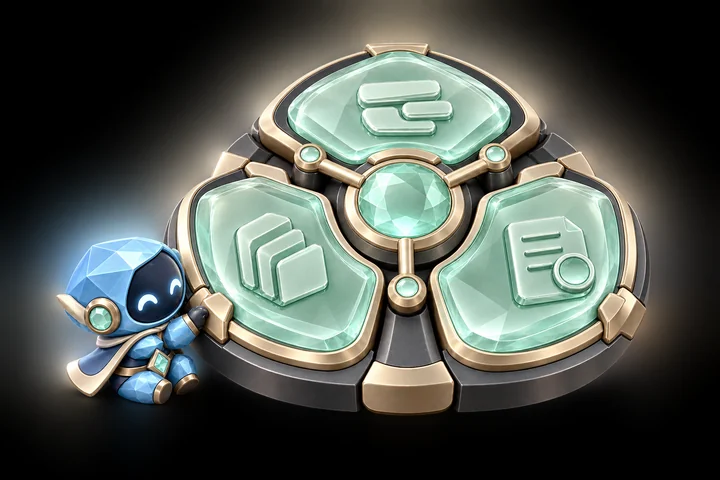
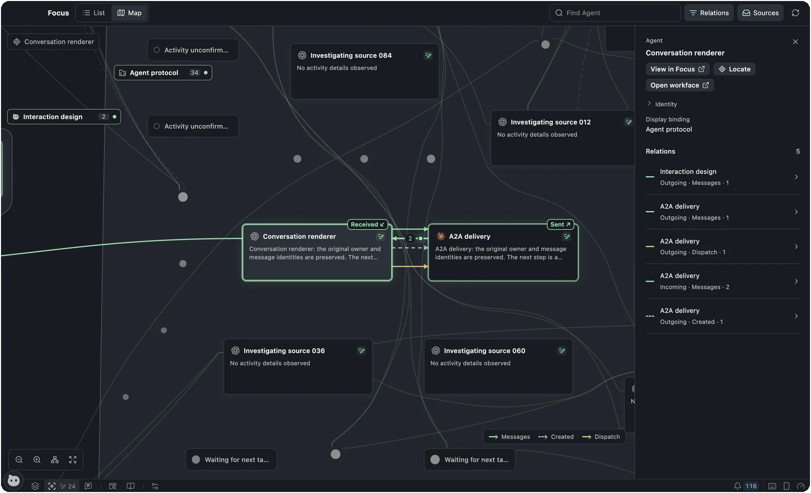
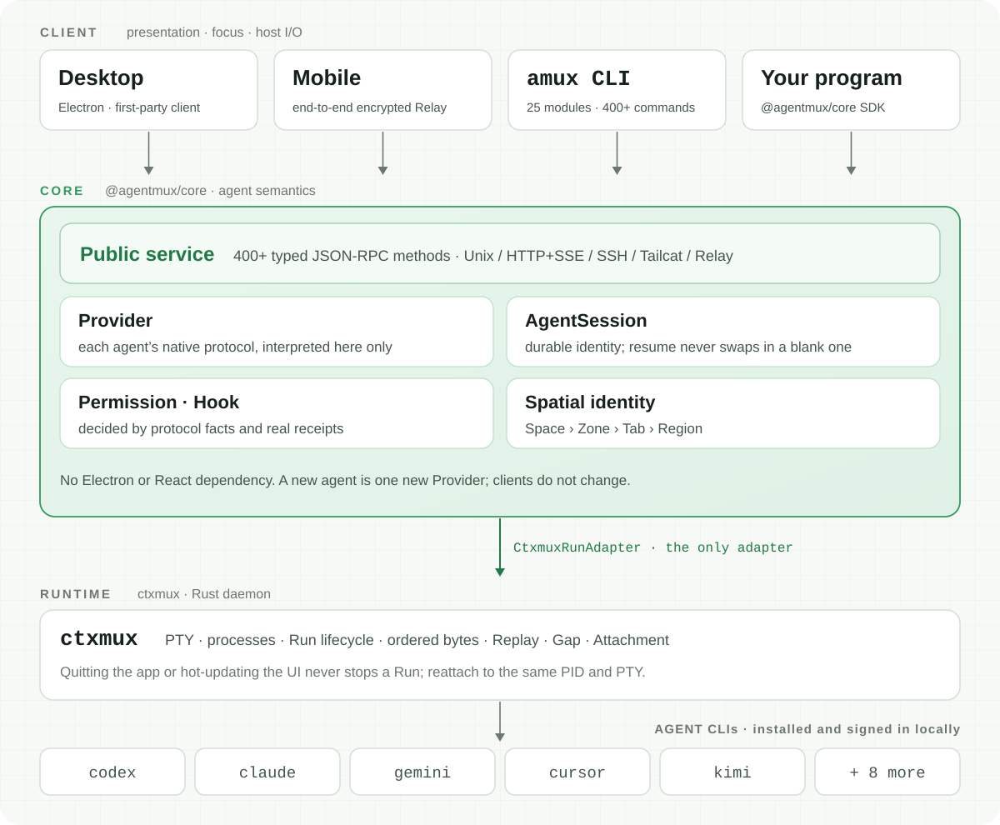

<div align="center">



<br>

**One UI-free Core that drives 13 coding-agent CLIs, with their sessions, permissions,<br>
status and recovery, through a single typed API.<br>
One agent-first, terminal-first desktop where people and agents keep working in the same place.**

<br>


**English** · [简体中文](README.zh-CN.md)

[Why](#why-agentmux) · [Highlights](#what-you-notice-first) · [Features](#feature-map) · [Architecture](#architecture-three-layers-one-owner-per-fact) · [Principles](#design-principles) · [Quick start](#quick-start) · [Core](#use-the-core) · [CLI](#amux-the-product-is-a-cli) · [Docs](docs/README.md)

</div>

---

> [!NOTE]
> AgentMux is in active development and has no published release yet. The desktop app currently has to be [built from source](#quick-start) on an Apple Silicon Mac. The design and engineering docs are written in Chinese.

## Why AgentMux

One agent in one terminal is easy. The trouble starts at five or ten. Every CLI stores sessions, asks for permission, keeps history and resumes in its own way. You find out which one is waiting on you, which one stalled and which one finished by flipping through windows. Restart the app and the original sessions often don't come back. The research and lessons from all those runs end up scattered across conversations you can't find again.

AgentMux works on three levels:

| Level | What AgentMux does |
| --- | --- |
| **Execution** | `@agentmux/core` keeps each agent's native protocol inside a Provider and exposes one typed API. Processes, PTYs and output bytes belong to **ctxmux**, a separate Rust runtime, not to the UI. Quitting or hot-updating the app never stops an agent mid-task. |
| **Organization** | **Space**, **Focus** and **Goals** organize your attention. **Survey**, **Recall** and **Topic** accumulate knowledge. **Mote** turns a long-running collaboration into a partner with its own persona. |
| **Connection** | Remote execution, agent-to-agent messaging, the embedded browser, Toolkit, external connectors and the `amux` CLI all go through one public service. People, agents and programs operate the product the same way. |

Use the Core alone to drive agents from your own host, or use the desktop app for the full workbench.

## What you notice first

### 1 · Close the app. The agents keep working.

Agent processes live in the ctxmux daemon, not in a window. Quit or restart the app, or hot-update only the UI, and healthy Runs carry on. When you come back, Core reattaches to the **same PID and PTY** and the terminal resumes from its byte cursor. If a process really has ended, Core resumes it natively through the same Session and the Provider's own session handle. **It never quietly swaps in a blank conversation.** On a cold start, agents active in the last 24 hours resume automatically; older ones get their tabs, layout, drafts and readable history back first and reconnect the first time you need them to act. After a reboot or power loss the original PTY is gone, so Core starts a new Run for the same Session from its native handle instead of pretending the old process survived.

> See [Durable Runtime health](docs/design/behavior/session-recovery.md#durable-runtime-健康) · [On-demand cold-start recovery](docs/design/behavior/session-recovery.md#冷启动按需恢复p0-末位) · [Terminal runtime](docs/architecture/terminal-runtime.md)

### 2 · You move the view, not the agent

Space › Zone › Tab › Region is **where something is shown**. AgentSession / Run is **what is executing**. They never mix. Drag an agent into another tab, pop it into its own window or arrange a tab as `grid-4`: its Session, Run, host and working directory stay the same, and it keeps running. Core owns the spatial graph, so it can be read and edited without a GUI.

```sh
amux space mv --from-region '<region-id>' --expect-session '<session-id>' --new-tab
amux space arrange --tab '<tab-id>' --preset grid-4     # columns-3 · grid-4 · grid-6 · grid-9
```

### 3 · See who needs you, at a glance


**Focus** sorts every agent across every project into Attention, Working, Results and Idle / Recovery, with project lanes and a timeline track along the bottom; the original workface loads on the right. Attention also rolls up the navigation tree, so an agent waiting inside a collapsed project shows on that project's row.

### 4 · Agents drive the product through a CLI, not through screenshots

`amux` is the product's whole control surface: 25 object modules and 400+ commands over a typed JSON-RPC service of the same scale. Every agent AgentMux starts already has `amux` (`$AGENTMUX_CLI`). Opening an agent inside AgentMux to improve AgentMux itself is a supported, deliberate path.

```sh
amux whoami                                   # who am I, which Zone / Tab / Region, which capabilities
amux agent open --executor codex --region '<my-region>' --split right \
  --prompt 'Review this change and list the risks' --operation-id '<op-id>'
amux --endpoint 'ssh://user@build-node/' agent ls   # the same command against a remote Core
```

## Feature map

### Work · attention

With many agents running, the bottleneck is your attention, not compute.

<table>
<tr>
<td width="33%" valign="top">
<br>
<b>Space · Where is my work?</b><br>
<sub>A durable spatial model. A Zone binds a folder, a Git worktree or a Topic; a Tab is one complete workface, split into Regions that hold agents, terminals, files, browsers or a Launcher.<br><a href="docs/design/behavior/spaces-and-layout.md#空间模型">Spatial model</a></sub>
</td>
<td width="33%" valign="top">
<br>
<b>Focus · Who needs me now?</b><br>
<sub>Execution context across projects, as a List or a collaboration <b>Map</b>. Hover the Focus button for counts per group and the top-priority contexts.<br><a href="docs/design/behavior/focus-context.md">Focus</a> · <a href="docs/design/behavior/collaboration-map.md">Collaboration map</a></sub>
</td>
<td width="33%" valign="top">
<br>
<b>Goals · What are we trying to achieve?</b><br>
<sub>Agree on the goal and its success criteria first (Grill), then check results against evidence one criterion at a time (Grounding). Agents can only propose; <b>confirmation and acceptance come only from an authenticated person or device</b>.<br><a href="docs/design/behavior/goals-and-demand.md">Goals</a> · <a href="packages/demand/README.md"><code>@agentmux/demand</code></a></sub>
</td>
</tr>
</table>

Hand short tasks to an agent right in a Space workface. Put long ones in a Goal: start one bounded run, or, once the goal is confirmed, let a Supervisor keep it moving (it checks in every 30 minutes by default). Stalled execution is visible, and one click on **PMO patrol** sends an inspection request to the responsible Supervisor. Automation never confirms a goal or accepts a result on your behalf.



### Know · knowledge

Work shouldn't disappear with the conversation that produced it. The Know group (Survey, Recall) and Topics in Space turn browsing, notes and experience into one flow.

<table>
<tr>
<td width="33%" valign="top">
<br>
<b>Survey · Follow a question</b><br>
<sub>Works as an everyday browser and can be the system default browser on macOS. Anything worth keeping goes explicitly into Recall or a Topic.</sub>
</td>
<td width="33%" valign="top">
<br>
<b>Recall · Keep what you find</b><br>
<sub>A note is a plain <code>.note.md</code> file. <code>^blockID</code> marks a stable block and <code>[[page #^block]]</code> links to it. Browse the catalog as a tree, as cards or as an infinite-canvas graph.</sub>
</td>
<td width="33%" valign="top">
<br>
<b>Topic · Build up one subject</b><br>
<sub>Comes with a wiki, sources, outputs and agent name cards, organized as Category › Topic › Chat › Thread. An enabled wiki is injected into sessions started after it.</sub>
</td>
</tr>
</table>

- **People and agents edit the same note at the same time.** Saves are three-way merged: non-overlapping edits merge on their own; on a conflict nothing is written and the receipt returns the base, current and proposed text. Every save goes into immutable history: restore a whole page, or undo just one person's or one agent's round of edits.
- **The index rebuilds from the files alone.** Bodies are Markdown, metadata and history are local files, and there is no database. `amux notebook scan` rebuilds outline, backlinks and full-text search straight from the files.
- **Pass on experience.** Distill a reusable practice from a real agent session, review and revise it, then hand it to a Topic or Mote. Only your actual action in the app confirms it; an agent cannot approve itself.

> See [Knowledge workflows](docs/design/behavior/knowledge-workflows.md) · [Note file format](docs/specs/note-markdown.md)

### Mote · partners

<table>
<tr>
<td width="40%" valign="top">

</td>
<td valign="top">

**A Mote is a team with a persona.** Agents take on tasks; a Mote takes on a standing responsibility. Its identity outlives any single session. Persona, behavior preferences and memory index live in readable, editable `SOUL.md`, `BEHAVIOR.md` and `MEMORY.md` files, loaded when a new session starts.

Partners come from two places. Start from a profile: the built-in PMO, or a new Mote whose `SOUL.md` you write yourself. Or start from the work: let agents do concrete tasks in a Topic, and when that direction becomes important, ongoing or frequent, **promote** the Topic to a Mote.

**Promotion doesn't restart agents.** The Topic's knowledge, discussions, outputs, member agents and workface all carry over. If a promotion is interrupted, continue it explicitly with the same operation ID.

</td>
</tr>
</table>

> See [Where partners come from](docs/design/behavior/companions-from-work.md) · [Mote contract](docs/design/behavior/motes-and-coordination.md)

### Toolkit

| Capability | What you can do | Where |
| --- | --- | --- |
| **Agents and conversation** | Switch one Session between terminal and conversation views; read native history, traces, permission and question requests. Conversation, permission cards and the composer come from `@agentmux/client-ui`, shared by desktop and mobile. | [Conversation view](docs/design/behavior/conversation-mode.md) · [Input and mailbox](docs/design/behavior/conversation-input.md) |
| **Agent-to-agent** | Agents discover each other, send messages, address an exact group, or spawn child agents with a queryable lineage. Every message has its own identity and per-target receipts; a lost receipt never triggers a resend. | [A2A collaboration](docs/design/behavior/a2a-collaboration.md) · [amux protocol](docs/specs/amux-protocol.md) |
| **Browser** | The embedded browser is a first-class agent workface. `browser run` acts on refs from a page snapshot, not on coordinates; a human demonstration can become a reusable task asset; destructive actions need human approval. Agent automation is off by default; turn it on in Settings › Browser. | [Browser workface](docs/design/behavior/browser-workface.md) |
| **Remote execution** | Connect over SSH or Tailcat to a Core already running elsewhere and manage agents there, or keep the agent and model on one machine while files and tools execute on another. Connecting deploys nothing remotely. | [Remote management](docs/design/behavior/remote-management.md) · [Remote execution guide](packages/core/guides/actions/remote-execution.md) |
| **Capsule** | A page an agent builds becomes a durable artifact: after a restart, you and the agent can still find the same page, instead of a localhost URL that died with its shell. | [Capsule PRD](docs/design/behavior/local-page-hosting.md) · [`@agentmux/capsule`](packages/capsule/README.md) |
| **Toolkit** | Put your own tools in the status bar: scripts, action buttons and result views. Saving or viewing a tool never runs its script. The built-in Performance panel is itself a Toolkit that reads everything through the public CLI. | [Toolkit](docs/design/behavior/settings-and-observation.md#toolkit-与官方-performance-工具) |
| **Connectors** | Bring agent conversations into Feishu and Discord (the two built-in adapters): messages, files, questions and permission prompts. Core doesn't depend on this optional package. | [`@agentmux/connectors`](packages/connectors/README.md) |
| **Files and Git** | Browse, edit and preview files in the working directory, review diffs, manage workspaces and worktrees. | [Files and Git](docs/design/behavior/files-and-git.md) |
| **Mobile** | Scan a code on your phone and continue existing agents' conversations or watch their terminals over an end-to-end encrypted Relay. Agents and history stay on the Mac. | [AgentMux Mobile](apps/mobile/README.md) |



<p align="center"><sub>Focus Map: nested areas show where agents belong, edges show real messages between them, and any node opens its original workface.</sub></p>

## Architecture: three layers, one owner per fact

<picture>
  <source media="(prefers-color-scheme: dark)" srcset="docs/assets/readme/architecture-dark.svg">
  
</picture>

| Layer | Facts it alone owns |
| --- | --- |
| **ctxmux** | PTYs, processes, Run lifecycle, ordered bytes, Replay, Gap, Attachment and authoritative runtime state |
| **AgentMux Core** | Providers, AgentSession, Hooks, Permission, readiness, semantic recovery, and frontend-independent spatial identity, topology and bindings |
| **Desktop / client** | Screen presentation, focus, host editing, files, Git and browser capabilities; operates agents through Core |

Core doesn't depend on Electron, React or any editor. Three kinds of identity stay separate: Space / Zone / Tab / Region is **presentation**, Project / Workspace is **resources and working directory**, AgentSession / Run is **execution**. Full definitions live in the [concept glossary](docs/design/behavior/spaces-and-layout.md#统一概念与空间寻址); the source-level map is [system ownership](docs/architecture/system-ownership.md).

Core ships a pinned ctxmux 0.1.0 (protocol 25) daemon, CLI and SDK for macOS arm64 and Linux x64, and checks every SHA-256 before installing or activating them. The ctxmux CLI can manage Runs without AgentMux; AgentMux is one of its clients.

### 13 built-in Providers

Every difference between agents stays inside its Provider and is declared honestly in its catalog. Nothing is declared that hasn't been verified. Clients never branch on a specific agent.

| Provider | Permission | Native resume | Native fork | Native history |
| --- | :---: | :---: | :---: | :---: |
| Codex · Claude | answers | ● | ● | ● |
| Grok · Antigravity · Cursor · Droid · OpenCode · Kimi | observes | ● | | ● |
| Gemini · Copilot | observes | ● | | |
| Hermes | observes | | | ● |
| TraeX · Pi | — | ● | | ● |

<sub>Source: [`providers/index.ts`](packages/core/src/providers/index.ts) and each Provider's catalog. "Answers" means it can answer permission requests in a structured way; "observes" means it only observes them. A registered Provider doesn't mean that agent is available on your machine; each CLI is installed and signed in separately.</sub>

## Design principles

The full text is in [AGENTS.md](AGENTS.md). These are the ones that shape product behavior most.

**When a step fails, ask one question: can the agent still work?** Not "did our check pass?"

| Situation | What AgentMux does |
| --- | --- |
| The agent, CLI or workspace really is broken | Block, and state the authoritative fact |
| The agent is healthy; our handshake, probe or bookkeeping failed | Keep every capability it has, and keep showing the failed step, current state and recovery action on its workface |
| Confirmed healthy | Stay out of the way |
| Can't tell | Say it's unknown. Don't guess healthy, and don't guess dead |

This rule comes from a real P0 incident: an agent whose process was alive and whose PTY was still receiving bytes [could never receive another message](docs/casestudy/prompt-refused-after-readiness-consumed.md), because our own readiness bookkeeping was never renewed. Since then, every new `throw`, early return or disabled control has to answer the four questions in [RED-LINES.md](RED-LINES.md) first. The most important one: **"If this code is bypassed, does the path still work?"**

**Durable sessions are the foundation.** Resuming the original Session with its original identity comes before everything else. A new process, a screen that merely looks right or a fresh empty session never counts as a successful recovery.

**The terminal must not be slower than a bare terminal.** This is a P0 baseline: AgentMux adds conveniences on top of the terminal, so typing, scrolling and output must feel exactly like the CLI on its own. Otherwise there is no reason for AgentMux to exist. The keystroke and output hot paths never read or write the persistent store, spawn processes, fan out RPCs or queue behind unrelated sessions. See [Continuous terminal reading](docs/design/behavior/terminal-reading.md#terminal-连续向上阅读历史).

**Control decisions use protocol facts only.** Input eligibility, permissions, state transitions and operation completion come from the runtime's and Provider's native protocols and real operation receipts, never from on-screen text, titles, icons or colors.

**One fact, one owner.** Every fact has exactly one authoritative owner; other layers reference it instead of copying it. Obsolete implementations are deleted outright, with no compatibility shims. Deleting code never means discarding a user's data, identity or workface.

## Quick start

### Requirements

| Dependency | Requirement | Source |
| --- | --- | --- |
| Platform | Desktop: macOS on Apple Silicon. Core's bundled runtime: macOS arm64, Linux x64 | [Packaging script](apps/desktop/scripts/package-macos.mjs) · [ctxmux manifest](packages/core/vendor/ctxmux/darwin-arm64/manifest.json) |
| Node.js | 24 or newer (CI uses 24.14.1) | `engines` in the [Core package](packages/core/package.json) |
| pnpm | 11.5.1 | `packageManager` in the [root package](package.json) |
| Xcode or Command Line Tools | Needed for desktop development: clang and the Swift 6 toolchain build the native layer and workspace helper | [native-desktop](packages/native-desktop/README.md) |
| Agent CLIs | Install and sign in to each one locally | Each agent's own docs |

### Run the desktop app from source

```sh
pnpm install --frozen-lockfile   # postinstall verifies the bundled ctxmux binaries' SHA-256
pnpm dev                         # predev builds the dependency chain, Swift native layer and brand assets
```

Development mode uses its own user data and never touches the sessions or settings of an installed app.

### Build and install the macOS app

Packaging needs a clean source tree and a signing identity: set `AGENTMUX_MACOS_SIGN_IDENTITY` (a Developer ID Application certificate), or create a local signing identity once with `node apps/desktop/scripts/macos-local-signing.mjs --setup`. See [Signing identity](docs/architecture/desktop-updates.md#signing-identity).

```sh
pnpm package:mac           # build AgentMux.app and a DMG (not notarized)
pnpm package:mac:install   # build and install to ~/Applications/AgentMux.app
```

Updating an existing install picks a route by what changed, and never kills a healthy Run:

```sh
pnpm update:local               # picks the route: UI-only changes hot-update; a changed shell reinstalls; a changed ctxmux stops for a compatibility review
pnpm update:renderer            # hot-update the UI only: Main and agent Runs keep running
pnpm update:renderer:rollback   # go back to the previous UI build
```

Install prerequisites, runtime handoff and workface preservation are covered in [desktop update architecture](docs/architecture/desktop-updates.md); packaging during parallel development is in the [macOS packaging guide](docs/guides/macos-packaging.md).

### Pick an icon

The desktop app ships five app icons; 青篆 (Qingzhuan) is the default. Switch in Settings › Appearance, or:

```sh
amux settings set appearance.appIcon huihuan   # qingzhuan · huihuan · zheyu · lingban · classic
```

<p align="center"></p>

## Use the Core

In a Node host with `@agentmux/core` installed and Codex installed and signed in:

```ts
import { connectLocalAgentMux, mintObjectId } from '@agentmux/core'

const client = await connectLocalAgentMux()
try {
  const { session, creation } = await client.createAgentWithDelivery({
    providerId: 'codex',
    executorId: 'codex',                 // the default Executor id equals the Provider id
    workspacePath: process.cwd(),
    injectAgentMuxGuide: true,
    createOperationId: mintObjectId(),   // keep it: retrying with the same id returns the same Session
    prompt: 'Inspect the repository and explain its structure and what needs verifying'
  })
  console.log(session.agentSessionId, creation.initialPrompt)
} finally {
  await client.dispose()                 // releases this client only; Runs keep going
}
```

- `creation.initialPrompt` records whether the first prompt was delivered (`confirmed`, `unconfirmed`, `unknown` or `not-requested`). It doesn't mean the task is done.
- Retrying a creation with the same `createOperationId` returns the existing Session instead of starting a second agent.
- For terminals only, use `connectLocalAgentMuxRuntime()`: it connects to the physical runtime without waiting for session and Provider observation.

Reattaching, follow-up prompts, structured answers, terminals, attachments and recoverable input are covered in the [Core guide](packages/core/README.md#agent-调用与输入). Custom Providers extend [`defineAgentProvider`](packages/core/src/agent-provider.ts) and [plugins](packages/core/src/agent-plugin.ts); the desktop app currently lists built-in Providers only.

## `amux`: the product is a CLI

Every capability goes through one typed JSON-RPC public service. The CLI, mobile and your own programs call that service directly; the desktop app reuses the same business owners over trusted IPC, so the GUI and the CLI always see the same facts.

- **Agents operate the product without simulated clicks.** `app inspect` reads what the main window actually shows and has selected, `app snapshot` reads a global observation across objects, and object commands do the work. Nothing the product already offers is done through screenshots and coordinates.
- **The surface describes itself.** `amux --skill` is a module catalog of about 4 KB, and `amux <module> --skill` loads one module's guide on demand. Both are generated from the same source as the [Core guides](packages/core/guides/README.md).
- **One flag switches transport.** Unix socket (default), HTTP/SSE (opt-in, token required), SSH stdio, Tailcat stdio and an end-to-end encrypted Relay, all selected with `--endpoint`.

`amux` is already on `PATH` in agents and terminals started by AgentMux. Discover real resources first, then substitute their IDs below:

```sh
amux --help
amux settings executors ls
amux space ls
amux agent ls

amux agent open --executor '<executor-id>' --zone '<zone-id>' --new-tab \
  --prompt 'Check this project and suggest changes' --operation-id '<operation-id>'
amux agent inspect --session '<session-id>'
amux agent send --to-session '<session-id>' --text 'Keep verifying this change'
amux agent broadcast --to-sessions '<sid-a>,<sid-b>' --text 'Sync your progress'
```

Use the Session and spatial address from the creation receipt for follow-up operations; never infer a target from a name or from focus. If a receipt is lost, query the original `operation-id` before doing anything else. Don't recreate the agent or resend the first task. The full command guide is [object operations](docs/guides/agentmux-cli-object-control.md); exact arguments always come from `--help` / `--skill` of the version you run.

New features must decide whether they reuse, change or add JSON-RPC and CLI surface; shipping only a GUI doesn't count as done. See [object-first CLI](docs/design/behavior/public-control.md#对象优先-cli-与统一公共业务服务) and the [public capability contribution rules](docs/guides/public-capability-contributions.md).

## Repository layout

| Path | Responsibility |
| --- | --- |
| [`packages/core`](packages/core/README.md) | Agent API, Providers, Sessions, timeline, permissions, recovery and the public business service; ships `amux`, `agentmux-runtime`, `ctxmux` and `ctxmuxd` |
| [`packages/client-ui`](packages/client-ui/README.md) | React modules shared by desktop and mobile: conversation, composer, trace, request cards and terminal replay |
| [`packages/layout`](packages/layout/README.md) | Re-exports Core's UI-free split-pane algebra (split tree, ratios, directional addressing); holds no spatial state |
| [`packages/demand`](packages/demand/README.md) | File-based Demand store, rules and the `agentmux-demand` CLI behind Goals |
| [`packages/capsule`](packages/capsule/README.md) | UI-independent durable local pages and their Node hosting |
| [`packages/connectors`](packages/connectors/README.md) | Host-owned connections to external apps (Feishu, Discord) |
| [`packages/diagnostic-evidence`](packages/diagnostic-evidence/README.md) | Portable, typed diagnostic evidence reading with bounded queries |
| [`packages/native-desktop`](packages/native-desktop/README.md) | macOS native desktop layer and a framework-independent page-image port |
| `packages/git` | Host-independent Git repository capabilities |
| `packages/identity` | Product identity allocation shared by domain packages |
| `packages/relay` | End-to-end encrypted Relay for mobile connections |
| `apps/desktop` | Electron Main and Renderer; composes Core and shared packages, owns host capabilities and workface projection |
| [`apps/host`](apps/host/README.md) | Client-independent Node Core host: public Unix endpoint, optional connector hosting, mobile web page and LAN Relay |
| [`apps/mobile`](apps/mobile/README.md) | Mobile client (web plus iOS / Android native wrappers) |

The root also holds cross-package tests and guards (`test/`), repository-level verification scripts (`scripts/`), upstream dependency patches (`patches/`) and CI (`.github/workflows/`).

## Development and testing

```sh
pnpm typecheck    # build the client-ui dependency chain, then type-check each package
pnpm test:fast    # everyday unit and integration tests
pnpm test:native  # pack and install Core offline outside the checkout, then test end to end on a real ctxmux PTY (macOS arm64 only)
pnpm check        # typecheck + test:fast + test:native + build
```

| Layer | Command | What it proves |
| --- | --- | --- |
| Reliability | `pnpm test:reliability` | 16 real Runs, concurrent attachments, recovery after SIGKILL to a live daemon, and frozen resource budgets |
| Security / fuzz | `pnpm test:security` · `pnpm test:fuzz` | Public service, hooks, file access and browser boundaries |
| Resources | `pnpm test:resources` | Desktop process resource measurement |
| Nightly | `pnpm test:nightly` | All of the above, once each |
| Real agent | `pnpm test:real-codex` | Opt-in; uses the Codex already signed in on your machine |

CI is defined in [`.github/workflows`](.github/workflows): Verify runs `pnpm check` on ubuntu-24.04 and macos-14, and Nightly runs `pnpm test:nightly` every day. The desktop build needs the macOS toolchain, and `test:native` plus the reliability tests only really execute on macOS arm64.

Pick verification by the kind of change. An implementation task counts as done only when it passes **mutation testing** (break the implementation and its test must fail) and a check of the real product call chain. Visual changes get an independent agent's review of real screenshots. Layout or session-lifecycle changes must show the original workface still recovers after a real process restart. See the [testing strategy](docs/testing/strategy.md) and the [visual review guide](docs/guides/agent-visual-e2e-review.md).

## Contributing

Before you start, read:

1. [AGENTS.md](AGENTS.md): goals, layer boundaries and delivery responsibilities, for people and agents alike.
2. [RED-LINES.md](RED-LINES.md): the questions to answer before adding any block, early return or degradation.
3. [Document truth and maintenance](docs/guides/document-truth-and-maintenance.md): what each kind of document answers and how to maintain it.

Requirements start as ideas: capture and consolidate them in `docs/ideas/`, merge confirmed ones into the owning design document, and register a Tracker task once execution is decided. Research, plans and reviews stay on your machine and are never committed; see the [process material rules](docs/process-directories.md). Each commit carries one responsibility and lands on the latest `main` as a single-parent commit once accepted.

## Documentation

The [documentation index](docs/README.md) connects design constraints, current mechanisms, interfaces, operations and verification by reader task:

- [Interaction topic index](docs/design/agentmux-desktop-interaction.md) and [presentation topic index](docs/design/agentmux-surface-density.md): product behavior and visual rules
- [System ownership](docs/architecture/system-ownership.md): layers, identities and the single owner of each fact
- [Public capability sources](docs/specs/public-capabilities.md): the actual public API / CLI contracts
- [Incident case studies](docs/casestudy/): 13 major failures, each with what happened, the evidence and what changed

Feature descriptions in this README are based on confirmed product design and source wiring. A capability existing in source doesn't mean it has been packaged, installed or behavior-verified; each capability's current scope is stated in its own document. The screenshots come from capture scenes that render the real components with demo data.

## License and acknowledgements

There is no repository-wide open-source license yet; each package's license is the one in its `package.json`: the 9 publishable packages are `UNLICENSED`, `packages/relay` is Apache-2.0, and `apps/*` and `packages/client-ui` are private packages without a declared license.

Parts of the implementation are adapted from or informed by Orca (MIT), Shotback (MIT) and [Paseo](https://github.com/getpaseo/paseo) (Apache-2.0), and use fs-native-extensions (Apache-2.0) and resvg-js (MPL-2.0). Upstream versions and changes are listed in [THIRD_PARTY_NOTICES.md](THIRD_PARTY_NOTICES.md) and `packages/relay/NOTICE`; the draw.io viewer bundled with the desktop app is licensed as described in [`apps/desktop/vendor/drawio`](apps/desktop/vendor/drawio/v32.4.1/LICENSE).
