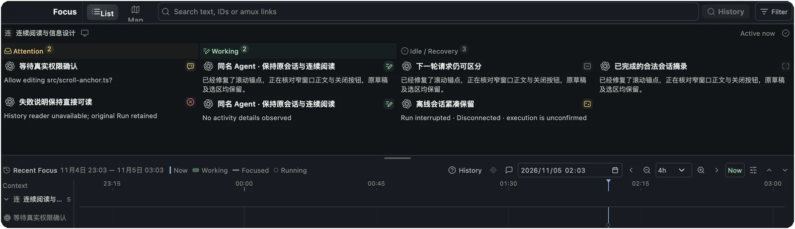

<div align="center">


<br>

**AgentMux runs Codex, Claude Code, Gemini and ten other coding-agent CLIs side by side on your machine.<br>
The agents live in a separate runtime, so closing or updating the app doesn't stop them,<br>
and they can operate the workbench themselves through the `amux` CLI.**

<br>


**English** · [简体中文](README.zh-CN.md)

[What it is](#what-agentmux-is) · [Core](#what-the-core-handles) · [Workbench](#the-desktop-workbench) · [Architecture](#architecture) · [Design rules](#design-rules) · [Quick start](#quick-start) · [SDK](#use-the-core) · [CLI](#use-amux) · [Docs](docs/README.md)

</div>

---

> [!NOTE]
> AgentMux is in active development and has no published release yet. The desktop app currently has to be [built from source](#quick-start) on an Apple Silicon Mac. Most design and engineering docs under `docs/` are written in Chinese. The agent guides are in English, and package READMEs use either language; the Core README is in Chinese.

## What AgentMux is

One agent in one terminal is easy to manage. At five or ten, the differences between CLIs start to cost time: each one stores sessions, asks for permission, keeps history and resumes in its own way. Finding out which agent is waiting on you means flipping through windows, a restart often loses the sessions, and what earlier runs found ends up scattered across conversations.

AgentMux has three parts. The first can be used on its own.

| Part | What it does |
| --- | --- |
| **`@agentmux/core`** | A Node package with no UI dependency. Each CLI's native protocol sits behind a Provider, and one typed API covers sessions, input, permissions, status, history and recovery. It also ships the `amux` CLI and the `agentmux-runtime` server for remote hosts. |
| **ctxmux** | A Rust runtime bundled with Core as `ctxmux` and `ctxmuxd`. It owns the agent processes, PTYs and output bytes, so an agent's lifetime is independent of any window. |
| **AgentMux Desktop** | A macOS workbench built on Core: terminals and conversations, layout, a cross-project attention view, goals, notes, an embedded browser and long-lived agent partners. |

## What the Core handles

### Agents keep running when the app closes

Agent processes run in the ctxmux daemon. Quitting or restarting the app, or hot-updating only its UI, leaves healthy Runs alone. When the app comes back, Core reattaches to the **same PID and PTY**, and the terminal continues from its byte cursor.

If a process has really ended and its CLI supports native resume, Core resumes the same Session through the CLI's own session handle; it does not open a blank conversation in its place. On a cold start, agents active in the last 24 hours (the default window) resume automatically. Older ones get their tabs, layout, drafts and readable history back first, and reconnect the first time you ask them to act. After a reboot or power loss the old PTY is gone, so Core starts a new Run for the same Session from its native handle.

> See [Durable Runtime health](docs/design/behavior/session-recovery.md#durable-runtime-健康) · [On-demand cold-start recovery](docs/design/behavior/session-recovery.md#冷启动按需恢复p0-末位) · [Terminal runtime](docs/architecture/terminal-runtime.md)

### One API across 13 agent CLIs

A Provider absorbs one CLI's differences, and its catalog declares only capabilities that have been verified against that CLI. Clients call the same API for every agent, with no agent-specific branches for protocol behavior.

| Provider | Permission | Native resume | Native fork | Native history |
| --- | :---: | :---: | :---: | :---: |
| Codex · Claude | answers | ● | ● | ● |
| Grok · Antigravity · Cursor · Droid · OpenCode · Kimi | observes | ● | | ● |
| Gemini · Copilot | observes | ● | | |
| Hermes | observes | | | ● |
| TraeX · Pi | — | ● | | ● |

<sub>Source: [`providers/index.ts`](packages/core/src/providers/index.ts) and each Provider's catalog. "Answers" means AgentMux can answer that CLI's permission requests in a structured way; "observes" means it can only see them. A registered Provider doesn't mean the CLI is available on your machine: each one is installed and signed in separately. Custom Providers extend [`defineAgentProvider`](packages/core/src/agent-provider.ts) and [plugins](packages/core/src/agent-plugin.ts); the desktop app currently lists built-in Providers only.</sub>

For the 11 Providers with native history, Core reads the CLI's own session records, either from its files or through the CLI's native app-server: Codex's JSONL session files, Cursor's SQLite `store.db`, Grok's `chat_history.jsonl`, Antigravity's presence lock and transcripts, and so on. The desktop conversation view, the mobile client and `amux agent history --source native` read those records through the same Core interface, and no client keeps a message cache of its own. What Core records itself, such as submission receipts and hook observations, stays a separate source. One Session can switch between its terminal and this conversation view.

> See [Conversation view](docs/design/behavior/conversation-mode.md) · [Conversation protocol](docs/specs/conversation-protocol.md) · [Native conversation reading](packages/core/README.md#原生对话读取)

### Every input is a tracked operation

Sending text to an agent can fail halfway: the PTY may accept the bytes while the reply to the caller is lost. Every agent creation, prompt and structured answer therefore carries an operation ID. If a receipt is lost, look it up by that ID first; even a retry with the same ID never starts a second agent or types the same prompt twice. Receipts record how far an input got, such as saved, accepted by the PTY or confirmed by the CLI's own protocol, and say `unknown` when that can't be established.

Agent-to-agent messages use the same model. Each message has its own identity and a receipt per recipient, and a lost receipt never triggers a resend.

### Layout is separate from execution

Where an agent is placed (Space › Zone › Tab › Region) and what is executing (AgentSession / Run) are separate identities. Dragging an agent into another tab, popping it into its own window or arranging a tab as `grid-4` changes only the layout. The Session, Run, host and working directory stay the same, and the agent keeps running. Core owns the spatial graph, so scripts and agents can read and change it without a GUI:

```sh
amux space mv --from-region '<region-id>' --expect-session '<session-id>' --zone '<zone-id>' --new-tab
amux space arrange --tab '<tab-id>' --preset grid-4     # columns-3 · grid-4 · grid-6 · grid-9
```

### Agents operate the app through `amux`

`amux` is the product's public control surface: 25 modules and 400+ commands over a typed JSON-RPC service of the same scale. Every agent AgentMux starts already has it (`$AGENTMUX_CLI`). An agent can use it to find out which Zone, Tab and Region it sits in, open other agents beside itself and message them, read what the main window shows and has selected (`app inspect`) or a global observation across objects (`app snapshot`), run programs in the embedded browser or schedule a follow-up prompt, all without screenshots or simulated clicks. Opening an agent inside AgentMux to work on AgentMux itself is a supported workflow.

```sh
amux whoami                                   # who am I, which Zone / Tab / Region, which capabilities
amux agent open --executor codex --region '<my-region>' --split right \
  --prompt 'Review this change and list the risks' --operation-id '<op-id>'
amux --endpoint 'ssh://user@build-node/' agent ls   # the same command against a remote Core
```

`amux --skill` prints a module catalog of about 4 KB, and `amux <module> --skill` loads one module's guide on demand. Both are generated from the [Core guides](packages/core/guides/README.md). `--endpoint` selects the transport: Unix socket (default), HTTP/SSE (opt-in, token required), SSH stdio, Tailcat stdio or an end-to-end encrypted Relay.

### Agents and tools on other machines

Over SSH or Tailcat, AgentMux connects to a Core already running on another machine and manages the agents there; connecting deploys nothing on the remote side. A single agent can also be split across two machines, with the agent process and model access on one and the project files and tool execution on the other. Split execution currently works with Claude Code and Codex, each qualified for one specific CLI release.

For a Linux server, build Core, then run `node scripts/linux-release/build.mjs --out DIR` in `packages/core` to produce a Linux x64 tarball that bundles its own Node 24. The target needs glibc 2.34 or newer, and no Node, npm, compiler or network access; the installer starts a headless Core service and prints the connection settings for the desktop app's Hosts list.

> See [Remote management](docs/design/behavior/remote-management.md) · [Remote execution guide](packages/core/guides/actions/remote-execution.md) · [Split execution scope](packages/core/README.md#agent-与工具分端执行) · [Remote Runtime](packages/core/README.md#远程-runtime) · [Linux x64 package](packages/core/README.md#免装-node-的-linux-x64-发布包)

## The desktop workbench

The desktop app groups its views into Work (Space, Focus, Goals), Know (Survey, Recall) and Mote. Topics live inside Space.



<p align="center"><sub>Product screenshots render real components with demo data. The current interface includes both English and Chinese labels.</sub></p>

### Work

**Focus** sorts every agent across every project into Attention, Working, Results and Idle / Recovery, with project lanes and a timeline along the bottom, and opens the selected agent's original workface on the right. Attention also rolls up the navigation tree, so an agent waiting inside a collapsed project shows on that project's row.

<table>
<tr>
<td width="33%" valign="top">
<br>
<b>Space</b><br>
<sub>A Zone binds a folder or a Git worktree; in the knowledge base, each Topic is itself a Zone. Each Tab is one workface, split into Regions that hold agents, terminals, files, browsers or a Launcher for starting new work. The layout survives restarts.<br><a href="docs/design/behavior/spaces-and-layout.md#空间模型">Spatial model</a></sub>
</td>
<td width="33%" valign="top">
<br>
<b>Focus</b><br>
<sub>The attention list above, plus a collaboration <b>Map</b>. Hovering the bottom-left Focus button previews the count per group and the top-priority items.<br><a href="docs/design/behavior/focus-context.md">Focus</a> · <a href="docs/design/behavior/collaboration-map.md">Collaboration map</a></sub>
</td>
<td width="33%" valign="top">
<br>
<b>Goals</b><br>
<sub>Agree on a goal and its success criteria first (Grill), then check results against evidence one criterion at a time (Grounding). Agents can only propose; only an authenticated person or device confirms a goal or accepts a result.<br><a href="docs/design/behavior/goals.md">Goals</a> · <a href="packages/demand/README.md"><code>@agentmux/demand</code></a></sub>
</td>
</tr>
</table>

Short tasks go straight to an agent in a workface. Longer ones go into a Goal: start one bounded run, or, once the goal is confirmed, hand it to a Supervisor that checks in every 30 minutes by default. Stalled execution shows up in the list, and **PMO patrol** sends an inspection request to the responsible Supervisor. Automation never confirms a goal or accepts a result on your behalf.


### Know

Survey and Recall, together with Topics in Space, keep what you and your agents find after the conversation that produced it has ended.

<table>
<tr>
<td width="33%" valign="top">
<br>
<b>Survey</b><br>
<sub>An everyday browser that can also be the macOS default browser. Anything worth keeping goes explicitly into Recall or a Topic.</sub>
</td>
<td width="33%" valign="top">
<br>
<b>Recall</b><br>
<sub>Notes are plain <code>.note.md</code> files. <code>^blockID</code> marks a stable block and <code>[[page #^block]]</code> links to it. Browse the catalog as a tree, as cards or as an infinite-canvas graph.</sub>
</td>
<td width="33%" valign="top">
<br>
<b>Topic</b><br>
<sub>A wiki, sources, outputs and agent name cards, organized as Category › Topic › Chat › Thread. An enabled wiki is injected into sessions started after it.</sub>
</td>
</tr>
</table>

People and agents can edit the same note at the same time. Saves are three-way merged: edits that don't overlap merge automatically, and on a conflict nothing is written and the receipt returns the base, current and proposed text. Every save goes into an immutable history, so you can restore a whole page or undo one person's or one agent's round of edits. Bodies, metadata and history are local files with no database behind them, and `amux notebook scan` rebuilds outline, backlinks and full-text search from the files alone.

You can also distill a reusable practice from a real agent session, revise it and hand it to a Topic or Mote. Only your action in the app confirms that handoff; an agent cannot approve itself.

> See [Knowledge workflows](docs/design/behavior/knowledge-workflows.md) · [Note file format](docs/specs/note-markdown.md)

### Mote

<table>
<tr>
<td width="40%" valign="top">

</td>
<td valign="top">

A **Mote** is a team with a persona. Agents take on individual tasks; a Mote takes on a standing responsibility, and its identity outlives any single session. The agents doing the work inside it keep their own identities. The Mote's persona, behavior preferences and memory index are readable, editable files (`SOUL.md`, `BEHAVIOR.md`, `MEMORY.md`) loaded whenever a new session starts.

A Mote acts on its own instead of waiting to be asked. Its main agent runs a heartbeat, every 30 minutes by default: it checks the main conversation, member work, goals, pending decisions and open commitments, continues work it is already authorized to do, and stays quiet when nothing has changed. Long or parallel work goes to member agents; their results, and instructions you send a member from the Mote, flow back to the main agent. To keep an eye on something, it schedules itself a bounded check-back, and work worth sustained effort becomes a Goal for you to confirm. In progress: sensing what happens in the chats, groups and local environment it can reach, connecting those sources into tasks, and messaging you through its bot when there is a result or a decision for you. Actions with outside consequences, such as merging or publishing, still wait for your confirmation.

A Mote can start from a profile, such as the built-in PMO or a new Mote whose `SOUL.md` you write yourself. It can also grow out of existing work: when a Topic becomes important, ongoing or frequent, promote it. Promotion carries over the Topic's knowledge, discussions, outputs, member agents and workface without restarting any agent. If a promotion is interrupted, continue it explicitly with the same operation ID.

</td>
</tr>
</table>

> See [Where partners come from](docs/design/behavior/companions-from-work.md) · [Mote contract](docs/design/behavior/motes-and-coordination.md) · [Proactive sensing and outreach](docs/design/behavior/motes-and-coordination.md#主动感知与外部沟通)

### Tools

| Capability | What you can do | Docs |
| --- | --- | --- |
| **Requests and conversation** | Permission requests, questions and traces appear as cards in the conversation view, next to a rich composer. These components come from `@agentmux/client-ui` and are shared by desktop and mobile. | [Conversation view](docs/design/behavior/conversation-mode.md) · [Input and mailbox](docs/design/behavior/conversation-input.md) |
| **Agent-to-agent** | Agents discover each other, message one agent or an exact group, and spawn child agents with a queryable lineage. | [A2A collaboration](docs/design/behavior/a2a-collaboration.md) · [amux protocol](docs/specs/amux-protocol.md) |
| **Browser** | The embedded browser is a workface agents can use. `browser run` acts on refs from a page snapshot rather than coordinates, a human demonstration can become a reusable task, and destructive actions need human approval. Agent automation is off until you enable it in Settings › Browser. | [Browser workface](docs/design/behavior/browser-workface.md) |
| **Screenshots** | System and browser screenshots open in one annotation editor. From there you can copy the image, save a PNG, pin it on screen or attach it to an agent's draft. | [Capture and recording](docs/design/behavior/capture-and-recording.md) |
| **macOS native control** | `amux native` lets an authorized agent list apps, windows and displays, read accessibility trees, capture the screen, use the clipboard and send typed input. Each mutating action carries an operation ID and reports its own native verification. | [Native layer](docs/design/behavior/native-desktop.md) · [`native` guide](packages/core/guides/modules/native.md) |
| **Schedules** | Send an agent a prompt at a calendar time (once, daily, weekly, monthly or yearly), after a countdown, or every N minutes. Arrangements within a Mote's scope show up in its calendar. Delivery while the app is closed or the Mac is asleep isn't guaranteed. | [`schedule` guide](packages/core/guides/modules/schedule.md) |
| **Capsule** | A page an agent builds becomes a durable artifact on a fixed local address, so you and the agent can still open the same page after a restart. | [Capsule PRD](docs/design/behavior/local-page-hosting.md) · [`@agentmux/capsule`](packages/capsule/README.md) |
| **Toolkit** | Put your own scripts, action buttons and result views in the status bar. Saving or viewing a tool doesn't run its script. The built-in Performance panel is itself a Toolkit that reads everything through the public CLI. | [Toolkit](docs/design/behavior/settings-and-observation.md#toolkit-与官方-performance-工具) |
| **Connectors** | Connect agent conversations to Lark/Feishu and Discord groups (the two built-in adapters). Replies, files, questions and permission prompts go out; group messages come back in as input, though inbound images and attachments are not fully supported yet. Core doesn't depend on this optional package. | [`@agentmux/connectors`](packages/connectors/README.md) |
| **Application access sync** | With a command connector you configure, compare one application's account authorization between two machines and copy it one way, then check that the target can use it. It runs manually, one application at a time, and is currently available only in the desktop app, not the headless Host. | [Application access sync](docs/design/behavior/remote-application-access.md) |
| **Files and Git** | Browse, edit and preview files in the working directory, review diffs, and manage workspaces and worktrees. | [Files and Git](docs/design/behavior/files-and-git.md) |
| **Mobile** | On the same Wi-Fi as the Mac, scan a code on your phone to continue existing agents' conversations or watch their terminals over the Mac's end-to-end encrypted local Relay. Agents and history stay on the Mac. | [AgentMux Mobile](apps/mobile/README.md) |


<p align="center"><sub>Focus Map: nested areas show where agents belong, edges show real messages and creation links between them, and any node opens its original workface.</sub></p>

## Architecture

<picture>
  <source media="(prefers-color-scheme: dark)" srcset="docs/assets/readme/architecture-dark.svg">
  
</picture>

<p align="center"><sub>Target architecture. Desktop currently reuses the same business owners through trusted IPC.</sub></p>

| Layer | Facts it alone owns |
| --- | --- |
| **ctxmux** | PTYs, processes, Run lifecycle, ordered bytes, Replay, Gap, Attachment and authoritative runtime state |
| **AgentMux Core** | Providers, AgentSession, Hooks, Permission, readiness, semantic recovery, and frontend-independent spatial identity, topology and bindings |
| **Desktop / client** | Screen presentation, focus, host editing, files, Git and browser capabilities; operates agents through Core |

Core doesn't depend on Electron, React or any editor. Three kinds of identity stay separate: Space / Zone / Tab / Region is **spatial identity**, Project / Workspace is **resources and working directory**, and AgentSession / Run is **execution**. Full definitions live in the [concept glossary](docs/design/behavior/spaces-and-layout.md#统一概念与空间寻址); the source-level map is [system ownership](docs/architecture/system-ownership.md).

The CLI, mobile client and your own programs call Core's public JSON-RPC service. The desktop app reuses the same business owners over trusted IPC, so the GUI and the CLI read the same facts. Moving every capability onto that one public service is the architectural target.

Core ships a pinned ctxmux daemon, CLI and SDK for macOS arm64 and Linux x64 (exact versions in the [darwin-arm64](packages/core/vendor/ctxmux/darwin-arm64/manifest.json) and [linux-x64](packages/core/vendor/ctxmux/linux-x64/manifest.json) manifests), and checks every SHA-256 before installing or activating them. The ctxmux CLI can manage Runs without AgentMux; AgentMux is one of its clients.

## Design rules

The full text is in [AGENTS.md](AGENTS.md). These five shape most of the product's behavior.

### A failed check doesn't take away a working agent

When a handshake, probe or bookkeeping step fails, AgentMux decides by whether the agent itself can still work:

| Situation | What AgentMux does |
| --- | --- |
| The agent, CLI or workspace really is broken | Block, and state the authoritative fact |
| The agent is healthy; our handshake, probe or bookkeeping failed | Keep every capability it has, and keep showing the failed step, current state and recovery action on its workface |
| Confirmed healthy | Stay out of the way |
| Can't tell | Say it's unknown. Don't guess healthy, and don't guess dead |

A real P0 incident showed that stating the rule was not enough: an agent whose process was alive and whose PTY was still receiving bytes [could never receive another message](docs/casestudy/prompt-refused-after-readiness-consumed.md), because AgentMux's own readiness bookkeeping was never renewed. Since then, every new `throw`, early return or disabled control has to answer the four questions in [RED-LINES.md](RED-LINES.md), with file or symbol evidence for each in its commit message. Question 2 must be answered explicitly: "If this code is bypassed, does the path still work?"

### Recovery means the original Session

Resuming the original Session with its original identity comes before everything else. A new process, a screen that looks right or a fresh empty session doesn't count as a recovery.

### The terminal must keep up with a bare terminal

This is a P0 baseline: typing, scrolling and output have to feel the same as running the CLI on its own. The keystroke and output hot paths don't read or write the persistent store, spawn processes, fan out RPCs or queue behind unrelated sessions. See [Continuous terminal reading](docs/design/behavior/terminal-reading.md#terminal-连续向上阅读历史).

### Control decisions use protocol facts

Input eligibility, permissions, state transitions and operation completion come from the runtime's and the Provider's native protocols and from real operation receipts. On-screen text, titles, icons and colors are never used to decide them.

### One owner per fact

Each fact has one authoritative owner, and other layers reference it. Obsolete implementations are deleted outright, without compatibility shims; deleting code never means discarding a user's data, identity or workface.

## Quick start

### Requirements

| Dependency | Requirement | Source |
| --- | --- | --- |
| Platform | Desktop: macOS on Apple Silicon. Core's bundled runtime: macOS arm64, Linux x64 | [Packaging script](apps/desktop/scripts/package-macos.mjs) · ctxmux manifests ([darwin-arm64](packages/core/vendor/ctxmux/darwin-arm64/manifest.json) · [linux-x64](packages/core/vendor/ctxmux/linux-x64/manifest.json)) |
| Node.js | 24 or newer | `engines` in the [Core package](packages/core/package.json) |
| pnpm | The version declared by `packageManager` | [Root package](package.json) |
| Xcode or Command Line Tools | Needed for desktop development: clang and the Swift 6 toolchain build the native layer and workspace helper | [native-desktop](packages/native-desktop/README.md) |
| Agent CLIs | Install and sign in to each one locally | Each agent's own docs |

### Run the desktop app from source

```sh
pnpm install --frozen-lockfile   # postinstall verifies the bundled ctxmux binaries' SHA-256
pnpm dev                         # predev builds the dependency chain, Swift native layer and brand assets
```

Development mode uses its own user data and doesn't touch the sessions or settings of an installed app.

### Build and install the macOS app

Build from a clean checkout with a [signing identity](docs/guides/macos-packaging.md#签名身份).

```sh
pnpm package:mac:install --app-only   # install the complete App locally
pnpm update:local                    # update the local App, allowing a GUI relaunch
```

For frontend-only updates, rollback, Runtime upgrades or a distributable DMG, see the [macOS packaging guide](docs/guides/macos-packaging.md#入口产物与安装位置).

### Pick an icon

The desktop app ships five app icons; 青篆 (Qingzhuan) is the default. Switch in Settings › Appearance, or:

```sh
amux settings set appearance.appIcon huihuan   # qingzhuan · huihuan · zheyu · lingban · classic
```

<p align="center"></p>

## Use the Core

In a Node host with `@agentmux/core` installed and Codex installed and signed in:

```ts
import { connectLocalAgentMux, mintObjectId } from '@agentmux/core'

const client = await connectLocalAgentMux()
try {
  const { session, creation } = await client.createAgentWithDelivery({
    providerId: 'codex',
    executorId: 'codex',                 // the default Executor id equals the Provider id
    workspacePath: process.cwd(),
    injectAgentMuxGuide: true,
    createOperationId: mintObjectId(),   // keep it: it identifies this creation if the result is unclear
    prompt: 'Inspect the repository and explain its structure and what needs verifying'
  })
  console.log(session.agentSessionId, creation.initialPrompt)
} finally {
  await client.dispose()                 // releases this client only; Runs keep going
}
```

- `creation.initialPrompt` records whether the first prompt was delivered: `confirmed`, `unconfirmed`, `unknown` or `not-requested`. It says nothing about whether the task is done.
- Keep the `createOperationId`. If the result is unclear, check this creation with it as the [Core guide](packages/core/README.md#agent-调用与输入) describes; the same ID never starts a second agent. Don't create again with a new ID.
- For terminals only, use `connectLocalAgentMuxRuntime()`. It connects to the physical runtime without waiting for session and Provider observation.

Reattaching, follow-up prompts, structured answers, terminals, attachments and recoverable input are covered in the [Core guide](packages/core/README.md#agent-调用与输入).

## Use `amux`

`amux` is already on `PATH` in agents and terminals started by AgentMux. Discover real resources first, then substitute their IDs below:

```sh
amux --help
amux settings executors ls
amux space ls
amux agent ls

amux agent open --executor '<executor-id>' --zone '<zone-id>' --new-tab \
  --prompt 'Check this project and suggest changes' --operation-id '<operation-id>'
amux agent inspect --session '<session-id>'
amux agent send --to-session '<session-id>' --text 'Keep verifying this change'
amux agent broadcast --to-sessions '<sid-a>,<sid-b>' --text 'Sync your progress'
```

Follow-up operations use the Session and spatial address from the creation receipt, not a name or the current focus. If a receipt is lost, query the original `operation-id` first; don't recreate the agent or resend the first task. Commands and exact arguments come from `--help` / `--skill` of the version you run, which serve the [Core guides](packages/core/guides/README.md). For choosing how to delegate and where to open an agent, see the [delegation and opening playbook](packages/core/guides/shared/spatial.md#delegation-and-opening-playbook-advisory).

## Repository layout

| Path | Responsibility |
| --- | --- |
| [`packages/core`](packages/core/README.md) | Agent API, Providers, Sessions, timeline, permissions, recovery and the public business service; ships `amux`, `agentmux-runtime`, `ctxmux` and `ctxmuxd` |
| [`packages/client-ui`](packages/client-ui/README.md) | React modules shared by desktop and mobile: conversation, composer, trace, request cards and terminal replay |
| [`packages/layout`](packages/layout/README.md) | Re-exports Core's UI-free split-pane algebra (split tree, ratios, directional addressing); holds no spatial state |
| [`packages/demand`](packages/demand/README.md) | File-based Demand store, rules and the `agentmux-demand` CLI behind Goals |
| [`packages/capsule`](packages/capsule/README.md) | UI-independent durable local pages and their Node hosting |
| [`packages/connectors`](packages/connectors/README.md) | Host-owned connections to external apps (Feishu, Discord) |
| [`packages/diagnostic-evidence`](packages/diagnostic-evidence/README.md) | Portable, typed diagnostic evidence reading with bounded queries |
| [`packages/native-desktop`](packages/native-desktop/README.md) | macOS native desktop layer and a framework-independent page-image port |
| `packages/git` | Host-independent Git repository capabilities |
| `packages/identity` | Product identity allocation shared by domain packages |
| `packages/relay` | End-to-end encrypted Relay for mobile connections |
| `apps/desktop` | Electron Main and Renderer; composes Core and shared packages, owns host capabilities and workface projection |
| [`apps/host`](apps/host/README.md) | Client-independent Node Core host: public Unix endpoint, optional connector hosting, mobile web page and LAN Relay |
| [`apps/mobile`](apps/mobile/README.md) | Mobile client (web plus iOS / Android native wrappers) |

The root also holds cross-package tests and guards (`test/`), repository-level verification scripts (`scripts/`), upstream dependency patches (`patches/`) and CI (`.github/workflows/`).

## Development and testing

```sh
pnpm typecheck    # build the client-ui dependency chain, then type-check each package
pnpm test:fast    # everyday unit and integration tests
pnpm test:native  # pack and install Core offline outside the checkout, then test end to end on a real ctxmux PTY (macOS arm64 only)
pnpm check        # typecheck + test:fast + test:native + build
```

| Layer | Command | What it proves |
| --- | --- | --- |
| Reliability | `pnpm test:reliability` | 16 real Runs, concurrent attachments, recovery after SIGKILL to a live daemon, and frozen resource budgets |
| Security / fuzz | `pnpm test:security` · `pnpm test:fuzz` | Public service, hooks, file access and browser boundaries |
| Resources | `pnpm test:resources` | Desktop process resource measurement |
| Nightly | `pnpm test:nightly` | All of the above, once each |
| Real agent | `pnpm test:real-codex` | Opt-in; uses the Codex already signed in on your machine |

CI is defined in [`.github/workflows`](.github/workflows): Verify runs `pnpm check` on ubuntu-24.04 and macos-14, and Nightly runs `pnpm test:nightly` every day. The desktop build needs the macOS toolchain, and `test:native` plus the reliability tests only really execute on macOS arm64.

Pick verification by the kind of change. An implementation task counts as done only when it passes **mutation testing** (break the implementation and its test must fail) and a check of the real product call chain. Visual changes get an independent agent's review of real screenshots, and layout or session-lifecycle changes must show the original workface still recovers after a real process restart. See the [testing strategy](docs/testing/strategy.md) and the [visual review guide](docs/guides/agent-visual-e2e-review.md).

## Contributing

Before you start, read:

1. [AGENTS.md](AGENTS.md): goals, layer boundaries and delivery responsibilities, for people and agents alike.
2. [RED-LINES.md](RED-LINES.md): the questions to answer before adding any block, early return or degradation.
3. [Document truth and maintenance](docs/guides/document-truth-and-maintenance.md): what each kind of document answers and how to maintain it.

Requirements start as ideas: capture and consolidate them in `docs/ideas/`, merge confirmed ones into the owning design document, and register a Tracker task once execution is decided. Research, plans and reviews stay on your machine and are never committed; see the [process material rules](docs/process-directories.md). Each commit carries one responsibility and lands on the latest `main` as a single-parent commit once accepted.

A new feature must decide whether it reuses, changes or adds JSON-RPC and CLI surface; a GUI alone doesn't count as done. See [object-first CLI](docs/design/behavior/public-control.md#对象优先-cli-与统一公共业务服务) and the [public capability contribution rules](docs/guides/public-capability-contributions.md).

## Documentation

The [documentation index](docs/README.md) connects design constraints, current mechanisms, interfaces, operations and verification by reader task:

- [Interaction topic index](docs/design/agentmux-desktop-interaction.md) and [presentation topic index](docs/design/agentmux-surface-density.md): product behavior and visual rules
- [System ownership](docs/architecture/system-ownership.md): layers, identities and the single owner of each fact
- [Public capability sources](docs/specs/public-capabilities.md): the actual public API / CLI contracts
- [Incident case studies](docs/casestudy/): major failures, each with what happened, the evidence and what changed

Feature descriptions in this README are based on confirmed product design and source wiring. A capability existing in source doesn't mean it has been packaged, installed or behavior-verified; each capability's current scope is stated in its own document. The screenshots come from capture scenes that render the real components with demo data.

## License and acknowledgements

There is no repository-wide open-source license yet; each package's license is the one in its `package.json`: the 9 publishable packages are `UNLICENSED`, `packages/relay` is Apache-2.0, and `apps/*` and `packages/client-ui` are private packages without a declared license.

Parts of the implementation are adapted from or informed by Orca (MIT), Shotback (MIT) and [Paseo](https://github.com/getpaseo/paseo) (Apache-2.0), and use fs-native-extensions (Apache-2.0) and resvg-js (MPL-2.0). Upstream versions and changes are listed in [THIRD_PARTY_NOTICES.md](THIRD_PARTY_NOTICES.md) and `packages/relay/NOTICE`; the draw.io viewer bundled with the desktop app is licensed as described in [`packages/editor-extensions/vendor/drawio`](packages/editor-extensions/vendor/drawio/v32.4.1/LICENSE).
