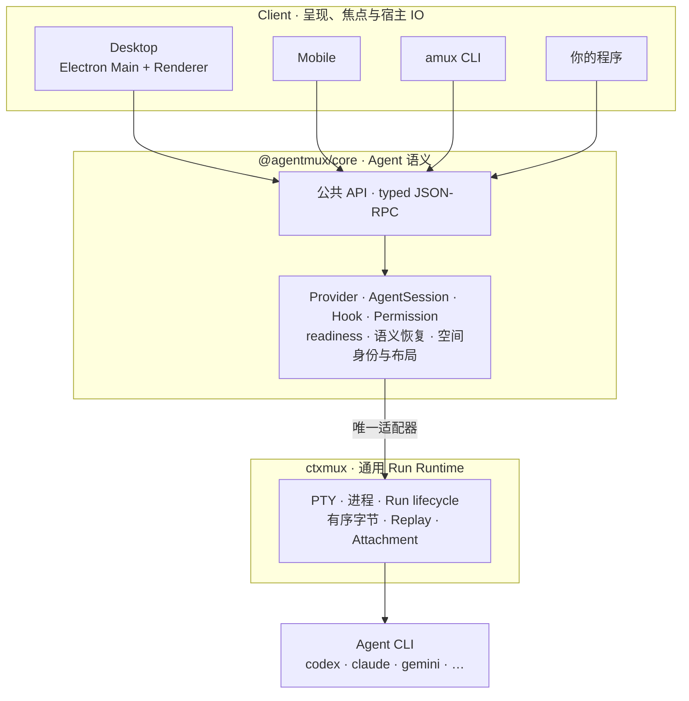

<div align="center">

# AgentMux

**为多 Agent 协作而生的本地工作台。**

一套与宿主无关的 Agent Core，统一十余种 Coding Agent 的会话、权限、状态与恢复；<br>
一个 Agent-first、terminal-first 的桌面工作区，让人与 Agent 在同一现场长期共事。

[设计原则](#设计原则) · [功能体系](#功能体系) · [快速开始](#快速开始) · [接入 Core](#接入-core) · [CLI](#amuxagentmux-本身就是-cli) · [架构](#架构) · [文档](docs/README.md) · [参与贡献](#参与贡献)

</div>

---

## 为什么是 AgentMux

一个 Agent 在一个终端里工作，问题不大。真正的难处在规模上：同时开着五个、十个 Agent，每家 CLI 的 Session 格式、权限请求、历史存储和恢复方式都不相同；哪个在等你回答、哪个已经停住、哪个做完了，只能逐个窗口去翻；应用一重启，原会话往往接不回来；而跑完的研究和经验，散落在一次次对话里，之后再也找不回来。

AgentMux 从三个层面回应这些问题：

- **执行层**：`@agentmux/core` 把各家 Agent 的原生协议收进 Provider，对外只提供一套类型安全的 API；Session 持久化，重启后以原身份恢复。终端由独立 Runtime **ctxmux** 承载，性能不低于直接打开 CLI。
- **组织层**：Space、Focus、Goals 组织人的注意力；Survey、Recall、Topic 积累知识；Mote 把长期合作确立为有人格的团队。
- **连接层**：远端执行、A2A 协作、Browser、Toolkit、外部连接器与 `amux` CLI，全部经由同一公共服务，人、Agent 与程序用同一种方式操作产品。

你可以只用 Core，在自己的宿主里驱动 Agent；也可以直接使用 Desktop，获得完整的工作台。

## 设计原则

AgentMux 只用一个问题判断对错：**「Agent 还能干活吗」，而不是「我们的检查过了吗」。** 以下原则约束全部实现，完整表述见 [AGENTS.md](AGENTS.md)。

**持久 Session 是地基。** 原 Session 能以原身份恢复，是其余一切的前提。修复、更新与资源治理都优先保全原身份和可恢复数据；新开一个进程、当前画面正常或另起空会话，都不能冒充恢复成功。Session 丢失按重大故障处理。见 [Durable Runtime 健康](docs/design/behavior/session-recovery.md#durable-runtime-健康)。

**终端不慢于裸终端。** AgentMux 在终端之上增加便利，因此打字、滚动与输出必须和直接打开 CLI 一样流畅，否则它没有存在的理由。按键与输出的热路径上不做持久化读写、进程派生或 RPC 扇出，工作量只随真正相关的 Session 增长。见 [Terminal 连续阅读](docs/design/behavior/terminal-reading.md#terminal-连续向上阅读历史)。

**流程失败不拿走健康能力。** 握手超时、探测失败或内部记账出错，而 Agent 本身健康时，保留它的全部能力，并在原工作面持续说明失败步骤、当前状态与恢复动作。新增 `throw`、早退或置灰之前，先回答 [RED-LINES.md](RED-LINES.md) 的四个问题，其中最关键的一问是：「绕过这段代码，这条路还通不通？」

**分不清时，明说未知。** 观察不到的事实保持未知，既不猜正常，也不猜死亡。空快照、超时或断连都不是删除工作面的理由；只有 Core 确认的终局事实才是。未知的投递不自动重放，进程活着也不等于任务完成。

**控制只依据协议事实。** 输入资格、权限、状态迁移与操作完成，以 Runtime 与 Provider 的原生协议和真实操作回执为准，从不由屏幕文案、标题、图标或颜色推断。显示怎么变，已确认的能力都不变。见 [通用机制与 Provider 适配](AGENTS.md#通用机制与-provider-适配)。

**差异只留在 Provider 内。** 各 Agent 的原生协议由各自的 Provider 解释，不泄漏为 client 分支；Core、Desktop 与公共测试中不出现具体站点、产品名或厂商特例。接入新 Agent，只需新增一个 Provider。

**一个事实，一个 owner。** 每项事实只有一个权威持有者，其余各层引用而不复制：ctxmux 持有 Run，Core 持有 Agent 语义与空间身份，client 持有呈现。实现取满足当前需求的最简形态，过时的实现直接删除，不留兼容层；但删除实现从不等于丢弃用户的数据、身份或工作面。

## 功能体系

### 注意力：Space · Focus · Goals

多 Agent 工作的瓶颈不在算力，而在人的注意力。AgentMux 用三个入口组织它，合称 **Work**：

| 入口 | 回答的问题 | 要点 |
| --- | --- | --- |
| **Space** | 我的工作在哪里？ | 持久的空间模型：Space › Zone › Tab › Region。Zone 可绑定目录、Git worktree 或 Topic；一个 Tab 是一张完整工作面，Region 承载 Agent、终端、文件、Browser 等内容。需要你处理的 Agent 状态沿导航树逐层上卷，折叠的项目也一眼可辨。 |
| **Focus** | 现在谁需要我？ | 跨项目的执行上下文：按 Working、Attention、Results、Idle / Recovery 分组呈现全部 Agent，以项目泳道、最近上下文与底部时间音轨帮助你在多个 Session 之间切换注意力，并直接回到原工作面继续。 |
| **Goals** | 我们要达成什么？ | 跨 Session 的持续目标：先讨论并确认目标与成功标准，再关联实际执行的 Agent，最后核验和接受结果。执行责任、停滞与下一步负责人始终可辨。底层实体为独立包 [`@agentmux/demand`](packages/demand/README.md) 中的 Demand。 |

短任务直接在 Space 的工作面里交给 Agent；长任务以 Goal 承载，既可以发起一次有限的执行，也可以在你单独授权后由 Supervisor 持续推进，但自动推进从不替你确认目标或接受成果。Focus 则汇总所有执行的实时状态，告诉你注意力该落在哪里。三者共享同一份空间身份：**展示位置可以移动，Agent 的执行身份与工作目录始终不变。** 见 [空间模型](docs/design/behavior/spaces-and-layout.md#空间模型)、[Focus](docs/design/behavior/focus-context.md)、[Goals](docs/design/behavior/goals-and-demand.md)。

### 知识：Survey · Recall · Topic

Agent 的工作成果不应随对话一起消失。**Know** 分组把研究、记录与经验串成一条完整流程：浏览中得到的成果被显式收存，积累成知识，再回到下一次工作中。

- **Survey**：研究的起点，可以直接当作日常浏览器使用。浏览中得到的成果，显式收入 Recall 或整理进某个 Topic。
- **Recall**：知识的积累与回顾。Notebook 是持久的页面集合，Note 的正文只保存为 `.note.md` 文件，块以 `^blockID` 标记稳定身份，可用 `[[页 #块]]` 引用与嵌入；文件自足，仅凭它们即可重建索引。目录可按树、卡片或无限画布图谱浏览，关系一直追溯到原块。人与 Agent 可以同时编辑同一篇 Note，冲突时双方内容都保留。内容完整性不可妥协：任何更新、重启或读取失败都不能造成正文丢失。
- **Topic**：围绕一件事情的知识库，自带 Wiki、资料、产出与 Agent 铭牌，Wiki 启用后注入会话上下文。相似的讨论在同一 Topic 中聚集，可复用的知识与讨论过程分开保存，并保留来源，随时回到原处继续。
- **经验转正**：从某个 Agent Session 的真实工作中提炼可复用的做法，经你审阅、确认目标后，交给指定的 Topic 或 Mote 学习。

见 [知识工作流](docs/design/behavior/knowledge-workflows.md) 与 [Note 文件格式](docs/specs/note-markdown.md)。

### 伙伴：Mote 与晋升

**Mote** 是具有持久人格的协作团队，可以理解为 Agent 之上的元 Agent 层：Agent 承担具体任务，Mote 承担长期职责。它的身份独立于任何一次 Session，Session 结束、更换或恢复时依然存在；人格、价值取向与行为边界写在可读可改的 `SOUL.md` 中。

伙伴有两条来源：

1. **从画像出发**：已经清楚需要怎样的伙伴，就按专家画像直接建立，例如负责组织目标与协作的 PMO。
2. **从事情出发**：还不知道最终需要什么专家，就先在 Topic 里让 Agent 做具体的事。当这个方向变得重要、持续或高频，你可以把 Topic **晋升**为 Mote。

晋升是你对一个准确 Topic 发起的显式操作，经一次轻量确认即完成。原 Topic 的知识、讨论历史、成果、成员 Agent 与工作面完整延续；健康的 Agent 不重启，原 Session 不替换。此后 Mote 在合作中成长：成员从具体任务中积累经验，可能逐渐承担领域专家或协调管理的职责；你的纠正经保存与读回后进入 Mote 的记忆，改进它的方法。组织晋升与成员成长分开表达，对外的团队人格从不遮蔽实际执行者。见 [伙伴从哪里来](docs/design/behavior/companions-from-work.md) 与 [Mote 合同](docs/design/behavior/motes-and-coordination.md)。

### 工具集

| 能力 | 作用 | 入口 |
| --- | --- | --- |
| **Agent 与对话** | 发现和配置 Executor，启动 Agent；同一 Session 可在终端与对话视图之间切换，查看原生历史、Trace、权限与问题请求。 | [对话视图](docs/design/behavior/conversation-mode.md)、[输入与邮箱](docs/design/behavior/conversation-input.md) |
| **远程连接与执行** | 通过 SSH 连接远端已有的 Core，在远端创建和管理 Agent；也可以让 Agent 与模型访问在一台机器，文件与工具在另一台执行，两端角色可以互换，模型授权与资源授权各自独立。连接不部署远端服务，断连不丢 Session。分端执行当前适配 Claude Code。 | [Remote 管理](docs/design/behavior/remote-management.md)、[远程执行指南](packages/core/guides/actions/remote-execution.md) |
| **A2A 协作** | Agent 之间相互发现、发信、一次发给一组明确的 Agent、创建子 Agent 并保留可查询的出生关系；每封信有独立身份与逐目标回执，丢回执不重投。 | [A2A 协作](docs/design/behavior/a2a-collaboration.md)、[amux 协议](docs/specs/amux-protocol.md) |
| **Browser** | 内嵌浏览器是 Agent 的一等工作面：Agent 操作页面时不抢你的焦点，操作过程可见、可记录、可回放；人工演示可以整理成可复用的任务资产；破坏性操作需要人工批准。 | [Browser 工作面](docs/design/behavior/browser-workface.md) |
| **Toolkit** | 在状态栏放置自己的工具：脚本、动作按钮与结果展示，可打包为本地扩展独立分发；保存和查看从不执行脚本。官方 Performance 面板本身也是一个 Toolkit，完全经由公开 CLI 取数。 | [Toolkit 合同](docs/design/behavior/settings-and-observation.md#toolkit-与官方-performance-工具) |
| **连接器** | 把 Agent 对话接入飞书、Discord 等外部应用，收发消息、文件、问题与权限确认；每个受众与每次操作单独授权，回执未知时按原操作对账，不重投。Core 不依赖这个可选包。 | [`@agentmux/connectors`](packages/connectors/README.md) |
| **Capsule** | Agent 开发的页面成为持久成果：重启后用户与 Agent 仍能找到同一页面、读取状态并继续交互，而不是只剩一个随 shell 消失的 localhost 地址。 | [Capsule PRD](docs/design/behavior/local-page-hosting.md)、[`@agentmux/capsule`](packages/capsule/README.md) |
| **文件与 Git** | 浏览、编辑、预览工作目录中的文件，查看差异，管理工作区与 worktree。 | [文件与 Git](docs/design/behavior/files-and-git.md) |
| **Mobile** | 在同一 Wi-Fi 下用手机继续已有 Agent 的对话、观看终端；Agent 与历史仍由 Mac 持有。 | [AgentMux Mobile](apps/mobile/README.md) |

### `amux`：AgentMux 本身就是 CLI

AgentMux 的目标是让产品的每一项能力都通过同一套 typed JSON-RPC 公共服务开放，Desktop、Mobile、`amux` CLI 与你的程序都是这套服务的平等消费者。传输支持 Unix socket、HTTP/SSE 与 SSH stdio。由此带来两个结果：

- **Agent 操作产品，不需要模拟点击。** Agent 通过 `amux` 打开工作面、发送消息、查询状态，并用 `app inspect`、`app snapshot` 回看结果。在 AgentMux 里开一个 Agent 去优化 AgentMux 本身，是明确支持的自举路径；Agent 不通过截图和坐标点击操作产品已有的功能。
- **能力面自描述。** `amux --skill` 与 `amux <module> --skill` 输出给 Agent 阅读的使用指南，与 [Core guides](packages/core/guides/README.md) 同源生成，按需渐进加载。

新增功能时，作者必须同时判断 JSON-RPC 与 CLI 是复用、修改还是新增，只交付 GUI 不算完成。见 [对象优先 CLI](docs/design/behavior/public-control.md#对象优先-cli-与统一公共业务服务) 与 [公共能力贡献约定](docs/guides/public-capability-contributions.md)。

## 架构



| 层 | 唯一持有的事实 |
| --- | --- |
| **ctxmux** | PTY、进程、Run lifecycle、有序字节、Replay、Gap、Attachment 与权威 Runtime 状态 |
| **AgentMux Core** | Provider、AgentSession、Hook、Permission、readiness、语义恢复，以及与前端无关的空间身份、拓扑和绑定 |
| **Desktop / client** | 屏幕呈现、焦点、宿主编辑、文件、Git 与 Browser 能力；通过 Core 操作 Agent |

Core 不依赖 Electron、React 或任何编辑器实现。三类身份严格区分：Space / Zone / Tab / Region 是**展示位置**，Project / Workspace 是**资源与工作目录**，AgentSession / Run 是**执行身份**。完整定义见 [概念词典](docs/design/behavior/spaces-and-layout.md#统一概念与空间寻址)，源码机制见 [系统职责地图](docs/architecture/system-ownership.md)。ctxmux 可独立发布和使用，AgentMux 是它的高级 client。

内置 Provider：Codex、Claude、TraeX、Hermes、Pi、Grok、Gemini、Antigravity、Cursor、Kimi、Droid、Copilot、OpenCode，组合见 [Provider 入口](packages/core/src/providers/index.ts)。Provider 已注册不代表该 Agent 在本机可用，各 Provider 的真实运行覆盖分别核对。

## 快速开始

### 环境要求

| 依赖 | 要求 | 来源 |
| --- | --- | --- |
| 平台 | Desktop 面向 macOS Apple Silicon；Core 随包 Runtime 支持 macOS arm64 与 Linux x64 | [Darwin manifest](packages/core/vendor/ctxmux/darwin-arm64/manifest.json)、[Linux manifest](packages/core/vendor/ctxmux/linux-x64/manifest.json) |
| Node.js | 24 或更高 | [Core package](packages/core/package.json) 的 `engines` |
| pnpm | 根 package 声明的版本 | [根 package](package.json) 的 `packageManager` |
| Xcode Command Line Tools | 开发 Desktop 时需要（`xcrun` / `clang`），用于构建原生工作区辅助程序 | |
| Agent CLI | 在本机单独安装并完成登录 | 各 Agent 官方文档 |

### 从源码运行 Desktop

```sh
pnpm install --frozen-lockfile
pnpm --filter @agentmux/client-ui... build
pnpm dev
```

### 构建并安装 macOS 应用

从已提交的干净源码构建安装包：

```sh
pnpm package:mac
pnpm package:mac:install
```

更新已有安装：

```sh
pnpm update:local               # 完整更新
pnpm update:renderer            # 仅 Renderer 的兼容更新
pnpm update:renderer:rollback   # 回退 Renderer 更新
```

安装前提、Runtime 变更与原工作面保全见 [Desktop 更新架构](docs/architecture/desktop-updates.md)，并行开发中的打包流程见 [macOS 打包指南](docs/guides/macos-packaging.md)。

## 接入 Core

在已安装 `@agentmux/core`、本机已安装并登录 Codex 的 Node 宿主中：

```ts
import { randomUUID } from 'node:crypto'
import { connectLocalAgentMux } from '@agentmux/core'

const client = await connectLocalAgentMux()
try {
  const { session, creation } = await client.createAgentWithDelivery({
    providerId: 'codex',
    executorId: 'codex-full-auto',
    workspacePath: process.cwd(),
    createOperationId: randomUUID(),
    prompt: '检查仓库，说明当前结构和需要验证的内容'
  })
  console.log(session.agentSessionId, creation.initialPrompt)
} finally {
  await client.dispose()
}
```

- 创建回执说明初始 Prompt 的投递情况，不代表任务已经完成。
- `dispose()` 只释放当前 client 与 attachment，不会停止 Run。

会话接回、后续 Prompt、结构化回答、停止 Agent、本地纯 Terminal 与自定义 Provider，见 [Core 接入说明](packages/core/README.md)。

## 用 CLI 操作 Agent

先运行 Desktop 或自己的服务宿主，确保 `amux` 已在 `PATH` 中，再发现实际资源：

```sh
amux --help
amux --skill                  # 输出给 Agent 阅读的使用指南
amux settings executors ls
amux space ls
amux agent ls
amux app snapshot
```

用发现结果替换下例中的 ID。`operation-id` 由调用者为本次操作生成并保留：

```sh
amux agent open --executor '<executor-id>' --zone '<zone-id>' --new-tab \
  --prompt '检查当前项目并给出修改建议' --operation-id '<operation-id>'
amux agent inspect --session '<session-id>'
amux agent send --to-session '<session-id>' --text '继续验证这项修改'
```

后续操作使用创建回执返回的 Session 与空间地址，不要从名称或焦点猜测目标。回执丢失时，先用原 `operation-id` 查询这次操作，不要重建 Agent 或重发首任务。完整命令见 [对象操作指南](docs/guides/agentmux-cli-object-control.md)，准确参数以所执行版本的 `--help` / `--skill` 为准。

远端 Agent 的接入与授权见 [Core 远程 Runtime](packages/core/README.md#远程-runtime)，恢复约束见 [联邦 Runtime 与远端恢复边界](docs/design/behavior/session-recovery.md#联邦-runtime-与远端恢复边界)。HTTP 入口默认关闭，开启时需要宿主显式配置 token。

## 仓库结构

| 位置 | 职责 |
| --- | --- |
| [`packages/core`](packages/core/README.md) | 通用 Agent API、Provider、Session、Timeline、权限、恢复与公共业务服务；附带 `amux`、`agentmux-runtime` 等可执行文件 |
| [`packages/client-ui`](packages/client-ui/README.md) | 共享的 Conversation、Composer、Trace、请求卡片与终端回放等 React 模块 |
| [`packages/layout`](packages/layout/README.md) | 分屏树、比例与布局计算 |
| [`packages/demand`](packages/demand/README.md) | Goal 背后的文件 Demand Store、规则与 CLI |
| [`packages/capsule`](packages/capsule/README.md) | 与 UI 无关的持久本地页面及其 Node 托管 |
| [`packages/connectors`](packages/connectors/README.md) | 由宿主持有的外部应用连接 |
| [`packages/diagnostic-evidence`](packages/diagnostic-evidence/README.md) | 可移植的类型化诊断证据读取与有界查询 |
| [`packages/native-desktop`](packages/native-desktop/README.md) | macOS 原生桌面层与框架无关的页面图像端口 |
| `packages/git` | 与宿主无关的 Git 仓库能力 |
| `packages/identity` | 各领域包共用的产品身份分配 |
| `packages/relay` | 手机连接使用的端到端加密 Relay |
| `apps/desktop` | Electron Main 与 Renderer，组合 Core 与共享包，持有宿主能力和工作面投影 |
| [`apps/host`](apps/host/README.md) | 独立于 client 的 Node Core 宿主 |
| [`apps/mobile`](apps/mobile/README.md) | 手机 client（Web 与 iOS / Android 原生包装） |

## 开发与测试

```sh
pnpm typecheck    # 构建共享包并对全部包做类型检查
pnpm test:fast    # 日常单元与集成测试
pnpm test:native  # 打包后的 Core 消费者集成测试
```

按改动类型选择验证，命令定义在 [根 package](package.json)。实现任务同时通过变异测试与真实产品调用链检查；视觉改动经独立 Agent 看图评审；布局或 Session 生命周期改动须验证真实进程重启后原工作面仍可恢复。见 [测试策略](docs/testing/strategy.md) 与 [视觉验收指南](docs/guides/agent-visual-e2e-review.md)。

## 参与贡献

开始之前，请先阅读：

1. [AGENTS.md](AGENTS.md)：目标、分层边界与交付责任，对人和 Agent 同样适用。
2. [RED-LINES.md](RED-LINES.md)：新增拦截、早退或降级前必须回答的问题。
3. [文档事实与维护规范](docs/guides/document-truth-and-maintenance.md)：每类文档回答什么问题、怎样维护。

需求从 idea 开始：先在 `docs/ideas/` 记录与整合，经确认后合入 owning 设计文档，决定执行时再登记 Tracker 任务。调研、计划、评审等过程资料留在本机，不提交，边界见 [过程资料规则](docs/process-directories.md)。每个提交只承载一个职责，验收后基于最新 `main` 以单亲提交合入。

## 文档

[文档导航](docs/README.md) 按读者任务连接设计约束、当前机制、接口、操作与验证来源：

- [交互专题索引](docs/design/agentmux-desktop-interaction.md) 与 [呈现专题索引](docs/design/agentmux-surface-density.md)：产品行为与视觉规则
- [系统职责地图](docs/architecture/system-ownership.md)：分层、身份与唯一事实 owner
- [公共能力源码入口](docs/specs/public-capabilities.md)：公开 API / CLI 的实际合同
- [事故复盘](docs/casestudy/)：重大故障的现场、证据与改进

功能体系一节描述的是已确认的产品设计。源码中存在某项能力，不代表它已经打包、安装或通过行为验收；各能力的当前实现范围以对应文档中的说明为准。

## 许可证与致谢

仓库根目前没有统一的开源许可证，各包的许可以其 `package.json` 为准：多数包为 `UNLICENSED`，`packages/relay` 为 Apache-2.0。

部分实现改编自 Orca（MIT）与 [Paseo](https://github.com/getpaseo/paseo)（Apache-2.0），上游版本与改动见 [THIRD_PARTY_NOTICES.md](THIRD_PARTY_NOTICES.md) 与 `packages/relay/NOTICE`。
