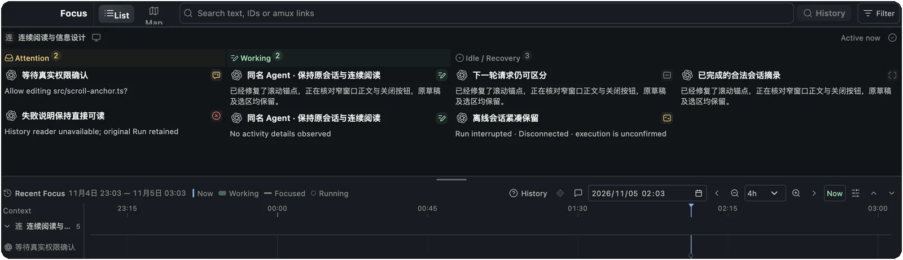
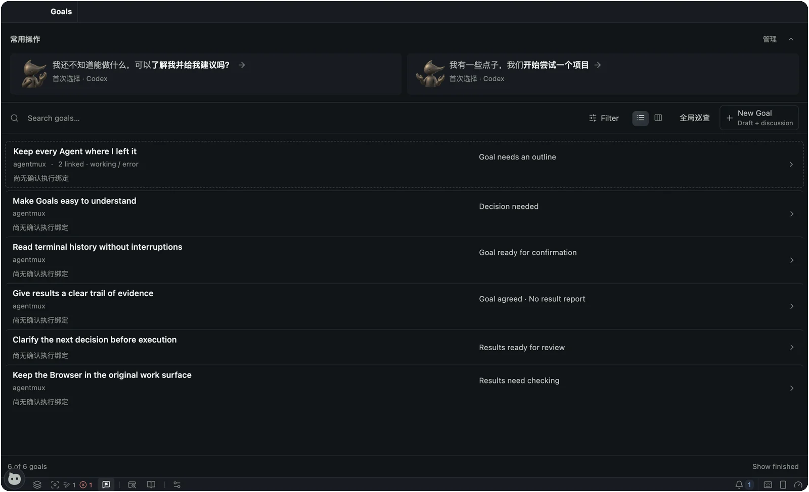

<div align="center">


<br>

**一套无 UI 依赖的 Agent Core，统一 13 种 Coding Agent CLI 的会话、权限、状态与恢复；<br>
一个 Agent-first、terminal-first 的桌面工作台，让人与 Agent 在同一现场长期共事。**

<br>


[English](README.md) · **简体中文**

[为什么](#为什么是-agentmux) · [亮点](#四件你会立刻感觉到的事) · [功能](#功能地图) · [架构](#架构三层三个唯一-owner) · [原则](#设计原则) · [快速开始](#快速开始) · [Core](#接入-core) · [CLI](#amuxagentmux-本身就是-cli) · [文档](docs/README.md)

</div>

---

> [!NOTE]
> AgentMux 处于活跃开发期，暂无发布版本。Desktop 目前需要在 Apple Silicon Mac 上[从源码构建](#快速开始)。

## 为什么是 AgentMux

一个 Agent 在一个终端里工作，问题不大。难处出在规模上：同时开着五个、十个 Agent，每家 CLI 的 Session 格式、权限请求、历史存储和恢复方式都不一样；哪个在等你回答、哪个停住了、哪个已经做完，只能逐个窗口去翻；App 一重启，原会话往往接不回来；跑完的研究和经验散落在一次次对话里，之后再也找不到。

AgentMux 在三个层面处理这些问题：

| 层面 | AgentMux 的做法 |
| --- | --- |
| **执行** | `@agentmux/core` 把各家 Agent 的原生协议收进 Provider，对外只给一套类型化 API。进程、PTY 与输出字节由独立的 Rust Runtime **ctxmux** 持有，与界面分开；App 退出或热更新都不会停掉正在干活的 Agent。 |
| **组织** | **Space**、**Focus**、**Goals** 组织人的注意力；**Survey**、**Recall**、**Topic** 积累知识；**Mote** 把长期合作确立为有人格的伙伴。 |
| **连接** | 远端执行、A2A 协作、内嵌 Browser、Toolkit、外部连接器和 `amux` CLI 都走同一套公共服务。人、Agent 与程序用同一种方式操作产品。 |

你可以只用 Core，在自己的宿主里驱动 Agent；也可以直接用 Desktop，得到完整的工作台。

## 四件你会立刻感觉到的事

### 1 · 关掉 App，Agent 照样在干活

Agent 进程活在 ctxmux daemon 里，不在窗口里。关闭或重启 App、只热更新界面时，健康的 Run 不受影响；回来时 Core 接回**同一个 PID 和 PTY**，终端从字节游标续读。进程确实已经结束时，Core 沿同一个 Session 和 Provider 原生会话句柄做 native resume，**不会悄悄换成一个空白新会话**。冷启动时，最近 24 小时内活动过的 Agent 自动恢复；更早的先恢复 Tab、布局、草稿和可读历史，等你第一次需要它执行时再接上。宿主机重启或断电后原 PTY 不再存在，这时由 Core 沿原生句柄为同一 Session 创建新的 Run，而不是冒充原进程还在。

> 见 [Durable Runtime 健康](docs/design/behavior/session-recovery.md#durable-runtime-健康) · [冷启动按需恢复](docs/design/behavior/session-recovery.md#冷启动按需恢复p0-末位) · [Terminal 运行时](docs/architecture/terminal-runtime.md)

### 2 · 移动的是位置，不是 Agent

Space › Zone › Tab › Region 是**展示位置**，AgentSession / Run 是**执行身份**，两者严格分开。把一个 Agent 拖到另一个 Tab、放进独立窗口或一键排成 `grid-4`，它的 Session、Run、Host 和工作目录都不变，也不会停下来。空间图由 Core 持有，没有 GUI 时同样能读写。

```sh
amux space mv --from-region '<region-id>' --expect-session '<session-id>' --new-tab
amux space arrange --tab '<tab-id>' --preset grid-4     # columns-3 · grid-4 · grid-6 · grid-9
```

### 3 · 一眼看出谁需要你



**Focus** 把所有项目里的 Agent 分成 Attention、Working、Results、Idle / Recovery 四组，配上项目泳道和底部的时间音轨，右侧直接加载原工作面。导航树上的注意力会逐层上卷：某个折叠项目里有 Agent 在等你，你在项目那一行就能看到。

### 4 · Agent 用 CLI 操作产品，而不是模拟点击

`amux` 是这个产品的完整控制面：25 个对象模块、400 多条命令，背后是同样数量级的 typed JSON-RPC 方法。AgentMux 启动的每个 Agent 都自带 `amux`（`$AGENTMUX_CLI`）。所以在 AgentMux 里开一个 Agent 去优化 AgentMux 本身，是明确支持的自举路径。

```sh
amux whoami                                   # 我是谁、在哪个 Zone / Tab / Region、有哪些能力
amux agent open --executor codex --region '<my-region>' --split right \
  --prompt '审查这次改动并列出风险' --operation-id '<op-id>'
amux --endpoint 'ssh://user@build-node/' agent ls   # 同一条命令，打到远端 Core
```

## 功能地图

### Work · 注意力

多 Agent 工作的瓶颈在人的注意力，不在算力。

<table>
<tr>
<td width="33%" valign="top">
<br>
<b>Space · 我的工作在哪里？</b><br>
<sub>持久的空间模型。Zone 可绑定目录、Git worktree 或 Topic；一个 Tab 是一张完整工作面，Tab 内的分割树以 Region 为叶子，承载 Agent、终端、文件、Browser 或 Launcher。<br><a href="docs/design/behavior/spaces-and-layout.md#空间模型">空间模型</a></sub>
</td>
<td width="33%" valign="top">
<br>
<b>Focus · 现在谁需要我？</b><br>
<sub>跨项目的执行上下文，有 List 和协作 <b>Map</b> 两种视图。悬停左下角的 Focus 按钮，就能预览各组计数和最优先的上下文。<br><a href="docs/design/behavior/focus-context.md">Focus</a> · <a href="docs/design/behavior/collaboration-map.md">协作图</a></sub>
</td>
<td width="33%" valign="top">
<br>
<b>Goals · 我们要达成什么？</b><br>
<sub>先对齐目标与成功标准（Grill），再逐条核对结果和证据（Grounding）。Agent 只能提交提案，<b>确认和接受只认通过认证的人或设备</b>。<br><a href="docs/design/behavior/goals-and-demand.md">Goals</a> · <a href="packages/demand/README.md"><code>@agentmux/demand</code></a></sub>
</td>
</tr>
</table>

短任务直接在 Space 的工作面里交给 Agent。长任务用 Goal 承载：可以发起一次有限的执行，也可以在目标确认后交给 Supervisor 持续推进（默认每 30 分钟检查一次）。执行停滞会显示出来，一键「PMO 巡查」就能把检查请求交给负责的 Supervisor。自动推进从不替你确认目标或接受成果。



### Know · 知识

Agent 的工作成果不该随对话一起消失。Know 分组（Survey、Recall）和 Space 中的 Topic 一起，把浏览、笔记和经验串成一条流程。

<table>
<tr>
<td width="33%" valign="top">
<br>
<b>Survey · 发现新的线索</b><br>
<sub>可以直接当日常浏览器用，在 macOS 上还能设为系统默认浏览器。浏览中的收获显式存入 Recall，或整理进某个 Topic。</sub>
</td>
<td width="33%" valign="top">
<br>
<b>Recall · 把知识留在手边</b><br>
<sub>Note 就是普通的 <code>.note.md</code> 文件，用 <code>^blockID</code> 标记稳定块，用 <code>[[页面 #^块]]</code> 链接。目录可按 Tree、Cards 或无限画布 Graph 浏览。</sub>
</td>
<td width="33%" valign="top">
<br>
<b>Topic · 围绕一件事积累</b><br>
<sub>自带 Wiki、资料、产出与 Agent 铭牌，层级是 Category › Topic › Chat › Thread。Wiki 启用后，会注入此后新启动的 Session。</sub>
</td>
</tr>
</table>

- **人与 Agent 同时编辑同一篇 Note。** 提交时做三向合并：互不冲突的修改自动合入；有冲突时不写盘，回执带回基线、当前、提议三份正文。每次保存都进入不可变历史，可以整篇恢复，也可以只撤销某个人或某个 Agent 的一轮编辑。
- **索引只靠原文件就能重建。** 正文只存 Markdown，元数据与历史也是本地文件，没有数据库。`amux notebook scan` 直接从原文件重建大纲、反链和全文检索。
- **经验转正。** 从某个 Agent Session 的真实工作中提炼可复用的做法，经你审阅修订后交给指定的 Topic 或 Mote。确认只认 App 里你的实际操作，Agent 无法自我批准。

> 见 [知识工作流](docs/design/behavior/knowledge-workflows.md) · [Note 文件格式](docs/specs/note-markdown.md)

### Mote · 伙伴

<table>
<tr>
<td width="40%" valign="top">

</td>
<td valign="top">

**Mote 是有人格的团队。** Agent 承担具体任务，Mote 承担长期职责。它的身份独立于任何一次 Session，人格、行为偏好和记忆索引写在可读可改的 `SOUL.md`、`BEHAVIOR.md`、`MEMORY.md` 里，由新 Session 启动时载入。

伙伴有两条来源：从画像出发（内置 PMO 预设，或直接新建一个 Mote 再写它的 `SOUL.md`）；或者从事情出发，先在 Topic 里让 Agent 做具体的事，这个方向变得重要、持续或高频时，把 Topic **晋升**为 Mote。

**晋升不重启 Agent。** 原 Topic 的知识、讨论、成果、成员 Agent 与工作面完整延续。晋升中断时，用同一个 operation ID 显式接续。

</td>
</tr>
</table>

> 见 [伙伴从哪里来](docs/design/behavior/companions-from-work.md) · [Mote 合同](docs/design/behavior/motes-and-coordination.md)

### 工具集

| 能力 | 你能做什么 | 入口 |
| --- | --- | --- |
| **Agent 与对话** | 同一个 Session 可在终端和对话视图之间切换，查看原生历史、Trace、权限和问题请求。对话、权限卡片与 Composer 来自 `@agentmux/client-ui`，Desktop 和 Mobile 共用。 | [对话视图](docs/design/behavior/conversation-mode.md) · [输入与邮箱](docs/design/behavior/conversation-input.md) |
| **A2A 协作** | Agent 之间相互发现、发信，一次发给一组明确的 Agent，或创建子 Agent 并保留可查询的出生关系。每封信有独立身份和逐目标回执，丢回执不重投。 | [A2A 协作](docs/design/behavior/a2a-collaboration.md) · [amux 协议](docs/specs/amux-protocol.md) |
| **Browser** | 内嵌浏览器是 Agent 的一等工作面。`browser run` 用 snapshot 给出的 ref 操作页面，不用坐标；人工演示可以整理成可复用的任务资产；破坏性操作需要人工批准。Agent 自动化默认关闭，需在 Settings › Browser 开启。 | [Browser 工作面](docs/design/behavior/browser-workface.md) |
| **远程执行** | 通过 SSH 或 Tailcat 连接远端已在运行的 Core，在远端创建和管理 Agent；也可以让 Agent 与模型在一台机器上，文件和工具在另一台机器上执行。连接本身不部署远端服务。 | [Remote 管理](docs/design/behavior/remote-management.md) · [远程执行指南](packages/core/guides/actions/remote-execution.md) |
| **Capsule** | Agent 做出的页面成为持久成果：重启后用户与 Agent 仍能找到同一页面，而不是只剩一个随 shell 消失的 localhost 地址。 | [Capsule PRD](docs/design/behavior/local-page-hosting.md) · [`@agentmux/capsule`](packages/capsule/README.md) |
| **Toolkit** | 在状态栏放自己的工具：脚本、动作按钮和结果展示。保存和查看从不执行脚本。官方 Performance 面板本身也是一个 Toolkit，完全经由公开 CLI 取数。 | [Toolkit](docs/design/behavior/settings-and-observation.md#toolkit-与官方-performance-工具) |
| **连接器** | 把 Agent 对话接入飞书和 Discord（当前内置的两个适配器），收发消息、文件、问题和权限确认。Core 不依赖这个可选包。 | [`@agentmux/connectors`](packages/connectors/README.md) |
| **文件与 Git** | 浏览、编辑、预览工作目录里的文件，查看差异，管理工作区与 worktree。 | [文件与 Git](docs/design/behavior/files-and-git.md) |
| **Mobile** | 手机扫码接入，经端到端加密 Relay 继续已有 Agent 的对话、观看终端。Agent 与历史仍由 Mac 持有。 | [AgentMux Mobile](apps/mobile/README.md) |


<p align="center"><sub>Focus Map：Agent 之间的消息与出生关系画成一张协作图，点开任一节点即可回到它的原工作面。</sub></p>

## 架构：三层，三个唯一 owner

<picture>
  <source media="(prefers-color-scheme: dark)" srcset="docs/assets/readme/architecture-dark.zh-CN.svg">
  
</picture>

| 层 | 唯一持有的事实 |
| --- | --- |
| **ctxmux** | PTY、进程、Run lifecycle、有序字节、Replay、Gap、Attachment 与权威 Runtime 状态 |
| **AgentMux Core** | Provider、AgentSession、Hook、Permission、readiness、语义恢复，以及与前端无关的空间身份、拓扑和绑定 |
| **Desktop / client** | 屏幕呈现、焦点、宿主编辑、文件、Git 与 Browser 能力；通过 Core 操作 Agent |

Core 不依赖 Electron、React 或任何编辑器实现。三类身份严格区分：Space / Zone / Tab / Region 是**展示位置**，Project / Workspace 是**资源与工作目录**，AgentSession / Run 是**执行身份**。完整定义见 [概念词典](docs/design/behavior/spaces-and-layout.md#统一概念与空间寻址)，源码机制见 [系统职责地图](docs/architecture/system-ownership.md)。

Core 随包固定一份 ctxmux 0.1.0（protocol 25）的 daemon、CLI 与 SDK，覆盖 macOS arm64 与 Linux x64；安装和激活前逐项校验 SHA-256。ctxmux CLI 能脱离 AgentMux 独立管理 Run，AgentMux 是它的 client。

### 13 个内置 Provider

各家差异只留在 Provider 里，由各自的 catalog 如实声明；能力未经核实就不声明。client 不需要为任何一家写分支。

| Provider | 权限 | 原生恢复 | 原生 fork | 原生历史 |
| --- | :---: | :---: | :---: | :---: |
| Codex · Claude | 可回答 | ● | ● | ● |
| Grok · Antigravity · Cursor · Droid · OpenCode · Kimi | 可观察 | ● | | ● |
| Gemini · Copilot | 可观察 | ● | | |
| Hermes | 可观察 | | | ● |
| TraeX · Pi | — | ● | | ● |

<sub>来源：[`providers/index.ts`](packages/core/src/providers/index.ts) 与各 Provider 的 catalog。「可回答」指能结构化回答授权请求，「可观察」指只观察不代答。Provider 已注册不代表该 Agent 在本机可用，CLI 需要在本机单独安装并登录。</sub>

## 设计原则

完整表述见 [AGENTS.md](AGENTS.md)。这里是塑造了产品行为的几条。

**流程失败时只问一件事：Agent 还能干活吗？** 而不是「我们的检查过了吗」。

| 情形 | AgentMux 怎么做 |
| --- | --- |
| Agent、CLI 或工作区确实坏了 | 如实阻断，说明权威事实 |
| Agent 健康，是我们的握手、探测或记账失败 | 保留它的全部能力，在原工作面持续说明失败步骤、当前状态与恢复动作 |
| 已确认完全正常 | 不打扰 |
| 分不清 | 明说未知，不猜正常也不猜死亡 |

这条原则来自一次真实的 P0 事故：一个进程活着、PTY 仍在收字节的 Agent，因为我们自己的 readiness 记账没有续期，[永远收不到消息](docs/casestudy/prompt-refused-after-readiness-consumed.md)。从那以后，新增任何 `throw`、早退或置灰之前，都要先回答 [RED-LINES.md](RED-LINES.md) 的四个问题，其中最关键的一问是：**「绕过这段代码，这条路还通不通？」**

**持久 Session 是地基。** 原 Session 能以原身份恢复，是其余一切的前提。新开一个进程、当前画面看起来正常或另起空会话，都不能冒充恢复成功。

**终端不慢于裸终端。** 这是 P0 基线：AgentMux 在终端之上增加便利，打字、滚动与输出必须和直接打开 CLI 一样流畅，否则它没有存在的理由。按键与输出的热路径上不读写持久 Store、不派生进程、不扇出 RPC，也不排在无关 Session 之后。见 [Terminal 连续阅读](docs/design/behavior/terminal-reading.md#terminal-连续向上阅读历史)。

**控制只依据协议事实。** 输入资格、权限、状态迁移与操作完成，以 Runtime 与 Provider 的原生协议和真实操作回执为准，从不从屏幕文案、标题、图标或颜色推断。

**一个事实，一个 owner。** 每项事实只有一个权威持有者，其余各层引用而不复制。过时的实现直接删除，不留兼容层；但删除实现从不等于丢弃用户的数据、身份或工作面。

## 快速开始

### 环境要求

| 依赖 | 要求 | 来源 |
| --- | --- | --- |
| 平台 | Desktop：macOS Apple Silicon。Core 随包 Runtime：macOS arm64、Linux x64 | [打包脚本](apps/desktop/scripts/package-macos.mjs) · [ctxmux manifest](packages/core/vendor/ctxmux/darwin-arm64/manifest.json) |
| Node.js | 24 或更高（CI 使用 24.14.1） | [Core package](packages/core/package.json) 的 `engines` |
| pnpm | 11.5.1 | [根 package](package.json) 的 `packageManager` |
| Xcode 或 Command Line Tools | 开发 Desktop 时需要：clang 与 Swift 6 工具链，用于构建原生层和工作区辅助程序 | [native-desktop](packages/native-desktop/README.md) |
| Agent CLI | 在本机单独安装并完成登录 | 各 Agent 官方文档 |

### 从源码运行 Desktop

```sh
pnpm install --frozen-lockfile   # postinstall 校验随包 ctxmux 二进制的 SHA-256
pnpm dev                         # predev 自动构建依赖链、Swift 原生层与品牌资源
```

开发模式使用独立的 user data，不会碰到已安装 App 的 Session 和配置。

### 构建并安装 macOS 应用

打包要求源码树干净，并需要一个签名身份：设置 `AGENTMUX_MACOS_SIGN_IDENTITY`（Developer ID Application 证书），或先用 `node apps/desktop/scripts/macos-local-signing.mjs --setup` 建立本机签名身份。详见 [Signing identity](docs/architecture/desktop-updates.md#signing-identity)。

```sh
pnpm package:mac           # 构建 AgentMux.app 与 DMG（未公证）
pnpm package:mac:install   # 构建并安装到 ~/Applications/AgentMux.app
```

更新已有安装时，AgentMux 按变化的范围选择路线，不杀健康的 Run：

```sh
pnpm update:local               # 自动选路：只改了界面就热更新，壳变了就完整重装，ctxmux 变了先停下做兼容审查
pnpm update:renderer            # 只热更新界面：Main 与 Agent Run 都不重启
pnpm update:renderer:rollback   # 回到上一个界面版本
```

安装前提、Runtime 交接与原工作面保全见 [Desktop 更新架构](docs/architecture/desktop-updates.md)，并行开发中的打包流程见 [macOS 打包指南](docs/guides/macos-packaging.md)。

### 换一个图标

Desktop 自带五款 App 图标，默认是青篆。在设置的外观里切换，或者：

```sh
amux settings set appearance.appIcon huihuan   # qingzhuan · huihuan · zheyu · lingban · classic
```

<p align="center"></p>

## 接入 Core

在已安装 `@agentmux/core`、本机已安装并登录 Codex 的 Node 宿主中：

```ts
import { connectLocalAgentMux, mintObjectId } from '@agentmux/core'

const client = await connectLocalAgentMux()
try {
  const { session, creation } = await client.createAgentWithDelivery({
    providerId: 'codex',
    executorId: 'codex',                 // 默认 Executor 的 id 与 Provider id 相同
    workspacePath: process.cwd(),
    injectAgentMuxGuide: true,
    createOperationId: mintObjectId(),   // 保留它：用同一 ID 重试会回到同一个 Session
    prompt: '检查仓库，说明当前结构和需要验证的内容'
  })
  console.log(session.agentSessionId, creation.initialPrompt)
} finally {
  await client.dispose()                 // 只释放这个 client，不停止 Run
}
```

- `creation.initialPrompt` 是首个 Prompt 的投递事实（`confirmed`、`unconfirmed`、`unknown` 或 `not-requested`），不代表任务已经完成。
- 用同一个 `createOperationId` 重试创建，返回的是已有的 Session，不会重复启动 Agent。
- 只需要终端时，用 `connectLocalAgentMuxRuntime()`：它只连接物理 Runtime，不等待 Session 与 Provider 观察。

会话接回、后续 Prompt、结构化回答、Terminal、Attachment 与可恢复输入，见 [Core 接入说明](packages/core/README.md#agent-调用与输入)。自定义 Provider 的扩展点是 [`defineAgentProvider`](packages/core/src/agent-provider.ts) 与 [plugins](packages/core/src/agent-plugin.ts)；Desktop 目前只列出内置 Provider。

## `amux`：AgentMux 本身就是 CLI

产品的每项能力都经同一套 typed JSON-RPC 公共服务开放。CLI、Mobile 和你的程序直接调用这套服务；Desktop 经可信 IPC 复用同一批业务 owner，所以 GUI 与 CLI 看到的是同一份事实。

- **Agent 操作产品，不需要模拟点击。** Agent 用 `app inspect` 读主画面的真实选择与呈现，用 `app snapshot` 读跨对象的全局观察，再用对象命令操作。产品已有的功能，不靠截图和坐标点击来用。
- **能力面自描述。** `amux --skill` 是一份约 4 KB 的模块目录，`amux <module> --skill` 按需加载模块指南。正文与 [Core guides](packages/core/guides/README.md) 同源生成。
- **一个参数切换传输。** Unix socket（默认）、HTTP/SSE（显式开启，需要 token）、SSH stdio、Tailcat stdio 和端到端加密 Relay，用 `--endpoint` 选择。

在 AgentMux 启动的 Agent 和终端里，`amux` 已经在 `PATH` 中。先发现真实资源，再用发现结果替换下例中的 ID：

```sh
amux --help
amux settings executors ls
amux space ls
amux agent ls

amux agent open --executor '<executor-id>' --zone '<zone-id>' --new-tab \
  --prompt '检查当前项目并给出修改建议' --operation-id '<operation-id>'
amux agent inspect --session '<session-id>'
amux agent send --to-session '<session-id>' --text '继续验证这项修改'
amux agent broadcast --to-sessions '<sid-a>,<sid-b>' --text '同步一下进度'
```

后续操作使用创建回执返回的 Session 与空间地址，不要从名称或焦点猜测目标。回执丢失时，先用原 `operation-id` 查询这次操作，不要重建 Agent 或重发首任务。完整命令见 [对象操作指南](docs/guides/agentmux-cli-object-control.md)，准确参数以所执行版本的 `--help` / `--skill` 为准。

新增功能时，作者必须同时判断 JSON-RPC 与 CLI 是复用、修改还是新增，只交付 GUI 不算完成。见 [对象优先 CLI](docs/design/behavior/public-control.md#对象优先-cli-与统一公共业务服务) 与 [公共能力贡献约定](docs/guides/public-capability-contributions.md)。

## 仓库结构

| 位置 | 职责 |
| --- | --- |
| [`packages/core`](packages/core/README.md) | 通用 Agent API、Provider、Session、Timeline、权限、恢复与公共业务服务；附带 `amux`、`agentmux-runtime`、`ctxmux`、`ctxmuxd` 四个可执行文件 |
| [`packages/client-ui`](packages/client-ui/README.md) | Desktop 与 Mobile 共用的 Conversation、Composer、Trace、请求卡片与终端回放等 React 模块 |
| [`packages/layout`](packages/layout/README.md) | 重导出 Core 的无 UI 分屏代数（分割树、比例、方向寻址），不持有空间状态 |
| [`packages/demand`](packages/demand/README.md) | Goal 背后的文件 Demand Store、规则与 `agentmux-demand` CLI |
| [`packages/capsule`](packages/capsule/README.md) | 与 UI 无关的持久本地页面及其 Node 托管 |
| [`packages/connectors`](packages/connectors/README.md) | 由宿主持有的外部应用连接（飞书、Discord） |
| [`packages/diagnostic-evidence`](packages/diagnostic-evidence/README.md) | 可移植的类型化诊断证据读取与有界查询 |
| [`packages/native-desktop`](packages/native-desktop/README.md) | macOS 原生桌面层与框架无关的页面图像端口 |
| `packages/git` | 与宿主无关的 Git 仓库能力 |
| `packages/identity` | 各领域包共用的产品身份分配 |
| `packages/relay` | 手机连接使用的端到端加密 Relay |
| `apps/desktop` | Electron Main 与 Renderer，组合 Core 与共享包，持有宿主能力和工作面投影 |
| [`apps/host`](apps/host/README.md) | 独立于 client 的 Node Core 宿主：公开 Unix endpoint，可选托管连接器，提供手机网页与局域网 Relay |
| [`apps/mobile`](apps/mobile/README.md) | 手机 client（Web 与 iOS / Android 原生包装） |

根目录另有跨包测试与守卫（`test/`）、仓库级校验脚本（`scripts/`）、上游依赖补丁（`patches/`）和 CI（`.github/workflows/`）。

## 开发与测试

```sh
pnpm typecheck    # 构建 client-ui 依赖链，再对各包做类型检查
pnpm test:fast    # 日常单元与集成测试
pnpm test:native  # 在 checkout 外打包并离线安装 Core，用真实 ctxmux PTY 端到端测试（仅 macOS arm64）
pnpm check        # typecheck + test:fast + test:native + build
```

| 测试层 | 命令 | 证明什么 |
| --- | --- | --- |
| 可靠性 | `pnpm test:reliability` | 16 个真实 Run、并发 Attachment、对活 daemon 发 SIGKILL 后的恢复，以及冻结的资源预算 |
| 安全 / fuzz | `pnpm test:security` · `pnpm test:fuzz` | 公共服务、Hook、文件访问与 Browser 边界 |
| 资源 | `pnpm test:resources` | Desktop 的进程资源测量 |
| 每晚 | `pnpm test:nightly` | 以上全部各跑一次 |
| 真实 Agent | `pnpm test:real-codex` | 需主动开启，使用本机已登录的 Codex |

CI 的定义见 [`.github/workflows`](.github/workflows)：Verify 在 ubuntu-24.04 与 macos-14 上运行 `pnpm check`，Nightly 每天运行 `pnpm test:nightly`。Desktop 构建依赖 macOS 工具链，`test:native` 与可靠性测试只在 macOS arm64 上真正执行。

按改动类型选择验证。实现任务判 done 要同时通过**变异测试**（把实现改坏，对应测试必须变红）和真实产品调用链检查；视觉改动经独立 Agent 看图评审；布局或 Session 生命周期改动，须验证真实进程重启后原工作面仍可恢复。见 [测试策略](docs/testing/strategy.md) 与 [视觉验收指南](docs/guides/agent-visual-e2e-review.md)。

## 参与贡献

开始之前，请先阅读：

1. [AGENTS.md](AGENTS.md)：目标、分层边界与交付责任，对人和 Agent 同样适用。
2. [RED-LINES.md](RED-LINES.md)：新增拦截、早退或降级前必须回答的问题。
3. [文档事实与维护规范](docs/guides/document-truth-and-maintenance.md)：每类文档回答什么问题、怎样维护。

需求从 idea 开始：先在 `docs/ideas/` 记录与整合，经确认后合入 owning 设计文档，决定执行时再登记 Tracker 任务。调研、计划、评审等过程资料留在本机，不提交，边界见 [过程资料规则](docs/process-directories.md)。每个提交只承载一个职责，验收后基于最新 `main` 以单亲提交合入。

## 文档

[文档导航](docs/README.md) 按读者任务连接设计约束、当前机制、接口、操作与验证来源：

- [交互专题索引](docs/design/agentmux-desktop-interaction.md) 与 [呈现专题索引](docs/design/agentmux-surface-density.md)：产品行为与视觉规则
- [系统职责地图](docs/architecture/system-ownership.md)：分层、身份与唯一事实 owner
- [公共能力源码入口](docs/specs/public-capabilities.md)：公开 API / CLI 的实际合同
- [事故复盘](docs/casestudy/)：13 次重大故障的现场、证据与改进

本 README 的功能描述以已确认的产品设计和源码接线为依据。源码中存在某项能力，不代表它已经打包、安装或通过行为验收；各能力的当前实现范围以对应文档中的说明为准。文中的界面截图来自用正式组件和演示数据渲染的采图场景。

## 许可证与致谢

仓库根目前没有统一的开源许可证，各包的许可以其 `package.json` 为准：9 个可发布包为 `UNLICENSED`，`packages/relay` 为 Apache-2.0，`apps/*` 与 `packages/client-ui` 为未声明许可的私有包。

部分实现改编自或参考了 Orca（MIT）、Shotback（MIT）与 [Paseo](https://github.com/getpaseo/paseo)（Apache-2.0），并使用了 fs-native-extensions（Apache-2.0）与 resvg-js（MPL-2.0）。上游版本与改动见 [THIRD_PARTY_NOTICES.md](THIRD_PARTY_NOTICES.md) 与 `packages/relay/NOTICE`；Desktop 随附的 draw.io viewer 许可见 [`apps/desktop/vendor/drawio`](apps/desktop/vendor/drawio/v32.4.1/LICENSE)。
