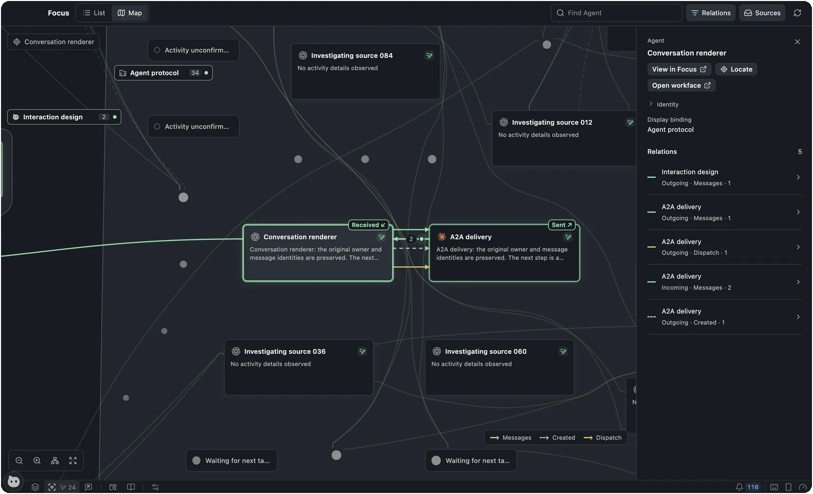
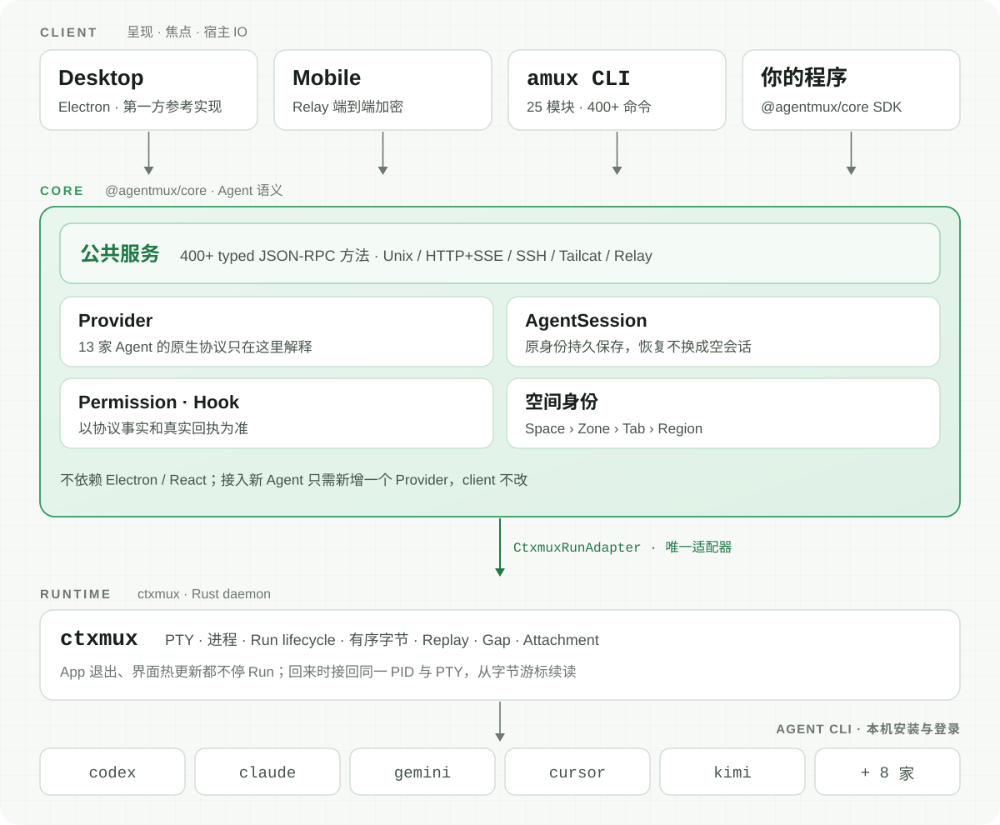

<div align="center">


<br>

**AgentMux 让 Codex、Claude Code、Gemini、Antigravity 等 Coding Agent CLI 在你的电脑上并排工作。<br>
Agent 进程跑在独立的 Runtime 里，关闭或更新 App 都不会让它们停下；<br>
Agent 还能用 `amux` 命令行直接操作这个工作台。**

<br>


[English](README.md) · **简体中文**

[是什么](#agentmux-是什么) · [Core](#core-负责的事) · [工作台](#桌面工作台) · [架构](#架构) · [设计规则](#设计规则) · [快速开始](#快速开始) · [SDK](#接入-core) · [CLI](#使用-amux) · [文档](docs/README.md)

</div>

---

> [!NOTE]
> AgentMux 处于活跃开发期，暂无发布版本。Desktop 目前需要在 Apple Silicon Mac 上[从源码构建](#快速开始)。

## AgentMux 是什么

一个终端里跑一个 Agent，管理起来不难。开到五个、十个，各家 CLI 的差异就开始耗时间：Session 格式、权限请求、历史存储和恢复方式各不相同；想知道哪个 Agent 在等你，只能逐个窗口去翻；App 一重启，会话常常接不回来；之前跑出来的结论散落在各次对话里。

AgentMux 由三部分组成，其中 Core 可以单独使用。

| 部分 | 作用 |
| --- | --- |
| **`@agentmux/core`** | 不依赖任何 UI 的 Node 包。各家 CLI 的原生协议收在各自的 Provider 里，对外只有一套类型化 API，覆盖 Session、输入、权限、状态、历史和恢复。包里还带有 `amux` 命令行，以及供远端主机使用的 `agentmux-runtime` 服务。 |
| **ctxmux** | 随 Core 打包的 Rust Runtime（`ctxmux`、`ctxmuxd`），持有 Agent 进程、PTY 和输出字节，所以 Agent 的生命周期与任何窗口无关。 |
| **AgentMux Desktop** | 基于 Core 的 macOS 工作台：终端与对话、布局、跨项目的注意力视图、目标、笔记、内嵌浏览器，以及长期合作的 Agent 伙伴。 |

## Core 负责的事

### App 关闭后 Agent 继续运行

Agent 进程跑在 ctxmux daemon 里。退出、重启 App，或者只热更新界面，健康的 Run 都不受影响。App 回来后，Core 重新接上**同一个 PID 和 PTY**，终端从字节游标处接着显示。

如果进程确实已经结束，并且这家 CLI 支持原生恢复，Core 会通过 CLI 自己的会话句柄恢复同一个 Session，不会拿一个空白新会话顶替。冷启动时，最近 24 小时内（默认窗口）活动过的 Agent 自动恢复；更早的先恢复 Tab、布局、草稿和可读历史，等你第一次让它干活时再接上。宿主机重启或断电后原 PTY 已经不在，这时 Core 用原生句柄为同一个 Session 启动新的 Run。

> 见 [Durable Runtime 健康](docs/design/behavior/session-recovery.md#durable-runtime-健康) · [冷启动按需恢复](docs/design/behavior/session-recovery.md#冷启动按需恢复p0-末位) · [Terminal 运行时](docs/architecture/terminal-runtime.md)

### 一套 API 接入 Agent CLI

每个 Provider 适配对应 CLI 的原生协议，并声明支持的能力。Core 提供统一的类型化 API，覆盖 Session、输入、权限、状态、历史和恢复。

| Provider（默认命令） | 对话 | 权限 | 原生恢复 | 原生 fork | 原生历史 | Hook 配置 | ACP | 启动选项 |
| --- | --- | --- | :---: | :---: | :---: | --- | :---: | --- |
| Codex (`codex`) | 已记录事件 | 可回答 | ✓ | ✓ | ✓ | 随启动加载 | — | 沙箱、审批策略 |
| Claude (`claude`) | 已记录事件 | 可回答 | ✓ | ✓ | ✓ | 启动时加载受管插件 | — | 模型、推理强度、权限模式 |
| TraeX (`traex`) | 仅终端 | CLI 内处理 | ✓ | — | ✓ | — | — | 沙箱、权限模式 |
| Hermes (`hermes`) | 已记录事件 | 可观察 | — | — | ✓ | 受管配置 | — | 审批 |
| Pi (`pi`) | 已记录事件 | CLI 内处理 | ✓ | — | ✓ | 受管配置 | — | — |
| Grok (`grok`) | 已记录事件 | 可观察 | ✓ | — | ✓ | 受管配置 | — | 权限模式 |
| Gemini (`gemini`) | 已记录事件 | 可观察 | ✓ | — | — | 受管配置 | — | 审批模式 |
| Antigravity (`agy`) | 已记录事件 | 可观察 | ✓ | — | ✓ | 受管配置 | 适配器 | 交互方式、沙箱 |
| Cursor (`cursor-agent`) | 已记录事件 | 可观察 | ✓ | — | ✓ | 受管配置 | — | 执行模式、沙箱、审批 |
| Kimi (`kimi`) | 已记录事件 | 可观察 | ✓ | — | ✓ | Provider 自管 | — | — |
| Droid (`droid`) | 已记录事件 | 可观察 | ✓ | — | ✓ | 受管配置 | — | — |
| Copilot (`copilot`) | 已记录事件 | 可观察 | ✓ | — | — | 受管配置 | — | — |
| OpenCode (`opencode`) | 已记录事件 | 可观察 | ✓ | — | ✓ | 受管配置 | — | — |

表中是内置 Provider 的能力声明。「可回答」表示 AgentMux 可结构化回答授权请求，「可观察」表示可以展示请求。「—」表示该项未声明。各 CLI 在实际执行的 Host 上安装和登录。目录来自 [Core Provider 注册表](packages/core/src/providers/index.ts)。Core 通过 [`defineAgentProvider`](packages/core/src/agent-provider.ts) 和[插件 API](packages/core/src/agent-plugin.ts)接入自定义 Provider。

**Settings → Agent CLIs → Providers** 显示所选 Host 的目录、Executor 与 Session 数量，以及 Hook 检查。命令行可用 [`amux agent provider ls --host HOST`](packages/core/guides/modules/agent.md) 读取同一 Host 的目录。Antigravity 的 Terminal 和 ACP 设置见 [ACP 指南](docs/guides/provider-acp.md)。

对支持原生历史的 Provider，Core 从 CLI 的文件或原生服务读取会话记录，例如 Codex 的 JSONL 文件、Cursor 的 SQLite 数据库，以及 Grok 和 Antigravity 的会话记录。Desktop 的对话视图、手机端和 `amux agent history --source native` 都经同一个 Core 接口读取这些记录，各个 client 不另存消息缓存。Core 自己记下的提交回执和 Hook 观察是另一个来源，单独保留。同一个 Session 可以在终端和对话视图之间切换。

> 见 [对话视图](docs/design/behavior/conversation-mode.md) · [对话协议](docs/specs/conversation-protocol.md) · [原生对话读取](packages/core/README.md#原生对话读取)

### 每次输入都是可追踪的操作

给 Agent 发文本可能在半路出错：PTY 已经收下字节，回给调用方的结果却丢了。所以创建 Agent、发送 Prompt、结构化回答都带一个 operation ID。回执丢了，先凭这个 ID 查询；即使用同一个 ID 重试，也不会再启动第二个 Agent，或把同一段 Prompt 输入两次。回执记录输入走到了哪一步，例如已保存、PTY 已接收或 CLI 原生协议已确认；确认不了时返回 `unknown`。

Agent 之间的消息沿用同一套模型：每封消息有独立身份，每个收件人各有一份回执，丢了回执也不会触发重发。

### 布局与执行分开

Agent 放在哪里（Space › Zone › Tab › Region）和正在执行什么（AgentSession / Run）是两套身份。把 Agent 拖到另一个 Tab、放进独立窗口，或把一个 Tab 排成 `grid-4`，改变的只是布局；Session、Run、Host 和工作目录都不变，Agent 也不会停。空间图由 Core 持有，脚本和 Agent 不开 GUI 也能读写：

```sh
amux space mv --from-region '<region-id>' --expect-session '<session-id>' --zone '<zone-id>' --new-tab
amux space arrange --tab '<tab-id>' --preset grid-4     # columns-3 · grid-4 · grid-6 · grid-9
```

### Agent 通过 `amux` 操作 App

`amux` 是产品的公共控制面：25 个模块、400 多条命令，背后是同样规模的 typed JSON-RPC 服务。AgentMux 启动的每个 Agent 都自带 `amux`（`$AGENTMUX_CLI`）。Agent 可以用它查自己在哪个 Zone、Tab 和 Region，在旁边开新的 Agent 并给它们发消息，读取主窗口当前显示和选中的内容（`app inspect`）或跨对象的全局观察（`app snapshot`），在内嵌浏览器里运行页面程序，或者安排一条定时 Prompt，全程不需要截图或模拟点击。在 AgentMux 里开一个 Agent 去改进 AgentMux 本身，也是明确支持的用法。

```sh
amux whoami                                   # 我是谁、在哪个 Zone / Tab / Region、有哪些能力
amux agent open --executor codex --region '<my-region>' --split right \
  --prompt '审查这次改动并列出风险' --operation-id '<op-id>'
amux --endpoint 'ssh://user@build-node/' agent ls   # 同一条命令，打到远端 Core
```

`amux --skill` 输出约 4 KB 的模块目录，`amux <module> --skill` 按需加载单个模块的指南，两者都由 [Core guides](packages/core/guides/README.md) 生成。`--endpoint` 选择传输方式：Unix socket（默认）、HTTP/SSE（需显式开启并提供 token）、SSH stdio、Tailcat stdio 或端到端加密 Relay。

### Agent 和工具可以在别的机器上

AgentMux 可以通过 SSH 或 Tailcat 连接另一台机器上已经在运行的 Core，管理那里的 Agent；连接本身不会在远端部署任何东西。一个 Agent 也可以拆到两台机器上：Agent 进程和模型访问在一台，项目文件和工具执行在另一台。这种分端执行目前支持 Claude Code 和 Codex，各自限定在一个核验过的 CLI 版本。

部署到 Linux 服务器时，先构建 Core，再在 `packages/core` 下运行 `node scripts/linux-release/build.mjs --out DIR`，产出自带 Node 24 的 Linux x64 包。目标机只需要 glibc 2.34 以上，不需要 Node、npm、编译器或外网；安装器会启动无界面的 Core 服务，并打印填进 Desktop Hosts 设置的连接参数。

> 见 [Remote 管理](docs/design/behavior/remote-management.md) · [远程执行指南](packages/core/guides/actions/remote-execution.md) · [分端执行适配范围](packages/core/README.md#agent-与工具分端执行) · [远程 Runtime](packages/core/README.md#远程-runtime) · [Linux x64 发布包](packages/core/README.md#免装-node-的-linux-x64-发布包)

## 桌面工作台

Desktop 把视图分成三组：Work（Space、Focus、Goals）、Know（Survey、Recall）和 Mote。Topic 位于 Space 中。


<p align="center"><sub>产品截图使用真实组件和演示数据；当前界面包含中英文标签。</sub></p>

### Work

**Focus** 把所有项目里的 Agent 分成 Attention、Working、Results、Idle / Recovery 四组，配有项目泳道和底部时间线，右侧直接打开所选 Agent 的原工作面。注意力会沿导航树向上汇总：折叠的项目里有 Agent 在等你，项目那一行就会显示出来。

<table>
<tr>
<td width="33%" valign="top">
<br>
<b>Space</b><br>
<sub>Zone 可以绑定目录或 Git worktree；知识库里的每个 Topic 本身就是一个 Zone。一个 Tab 是一张完整工作面，按分割树拆成多个 Region，放 Agent、终端、文件、浏览器，或用来开始新工作的 Launcher。布局在重启后保留。<br><a href="docs/design/behavior/spaces-and-layout.md#空间模型">空间模型</a></sub>
</td>
<td width="33%" valign="top">
<br>
<b>Focus</b><br>
<sub>除了上面的注意力列表，还有协作 <b>Map</b> 视图。悬停左下角的 Focus 按钮，可以预览各组数量和最优先的几项。<br><a href="docs/design/behavior/focus-context.md">Focus</a> · <a href="docs/design/behavior/collaboration-map.md">协作图</a></sub>
</td>
<td width="33%" valign="top">
<br>
<b>Goals</b><br>
<sub>先对齐目标和成功标准（Grill），再逐条对照证据核对结果（Grounding）。Agent 只能提交提案，确认目标和接受结果只认通过认证的人或设备。<br><a href="docs/design/behavior/goals.md">Goals</a> · <a href="packages/demand/README.md"><code>@agentmux/demand</code></a></sub>
</td>
</tr>
</table>

短任务直接在 Space 的工作面里交给 Agent。长任务放进 Goal：可以发起一次有限的执行，也可以在目标确认后交给 Supervisor 持续推进（默认每 30 分钟检查一次）。停滞的执行会在列表里显示出来，点 **PMO 巡查** 就能把检查请求发给负责的 Supervisor。自动推进从不替你确认目标或接受成果。


### Know

对话结束后，你和 Agent 找到的东西由 Survey、Recall 和 Space 中的 Topic 留存下来。

<table>
<tr>
<td width="33%" valign="top">
<br>
<b>Survey</b><br>
<sub>可以当日常浏览器用，在 macOS 上还能设为系统默认浏览器。值得保留的内容显式存入 Recall 或某个 Topic。</sub>
</td>
<td width="33%" valign="top">
<br>
<b>Recall</b><br>
<sub>Note 就是普通的 <code>.note.md</code> 文件，用 <code>^blockID</code> 标记稳定块，用 <code>[[页面 #^块]]</code> 链接。目录可以按树、卡片或无限画布图谱浏览。</sub>
</td>
<td width="33%" valign="top">
<br>
<b>Topic</b><br>
<sub>自带 Wiki、资料、产出和 Agent 铭牌，层级是 Category › Topic › Chat › Thread。Wiki 启用后，会注入此后新启动的 Session。</sub>
</td>
</tr>
</table>

人和 Agent 可以同时编辑同一篇 Note。保存时做三向合并：互不重叠的修改自动合入；有冲突时不写盘，回执带回基线、当前和提议三份正文。每次保存都进入不可变历史，可以恢复整页，也可以只撤销某个人或某个 Agent 的一轮编辑。正文、元数据和历史都是本地文件，没有数据库；`amux notebook scan` 只靠这些文件就能重建大纲、反链和全文检索。

你也可以从某个 Agent Session 的真实工作中提炼一条可复用的做法，审阅修改后交给指定的 Topic 或 Mote。这一步只认你在 App 里的实际操作，Agent 无法自我批准。

> 见 [知识工作流](docs/design/behavior/knowledge-workflows.md) · [Note 文件格式](docs/specs/note-markdown.md)

### Mote

<table>
<tr>
<td width="40%" valign="top">

</td>
<td valign="top">

**Mote** 是有人格的团队。Agent 承担具体任务，Mote 承担长期职责，它的身份独立于任何一次 Session；在里面实际干活的 Agent 各自保留自己的身份。Mote 的人格、行为偏好和记忆索引写在可读可改的 `SOUL.md`、`BEHAVIOR.md`、`MEMORY.md` 里，每次新 Session 启动时载入。

Mote 主动做事，不是一问一答。它的主 Agent 默认每 30 分钟心跳一次：检查主对话、成员工作、目标、待定的决定和没兑现的承诺，在已授权的范围内接着推进，没有变化就不出声。耗时或并行的活交给成员 Agent，成员的结果和你在 Mote 里直接发给成员的指令都会回到主 Agent；需要盯一件事时，它给自己安排有期限的回看，值得长期推进的事整理成 Goal 交你确认。正在实现的下一步：让它感知所在私聊、群和本地环境里发生的事，把不同来源串起来转成任务，有结果或需要你决定时经机器人私聊找你；合入、发布这类有外部后果的动作，仍先取得你的确认。

Mote 可以从画像开始，比如内置的 PMO，或者新建一个 Mote 再自己写它的 `SOUL.md`；也可以从已有工作中来：某个 Topic 变得重要、持续或高频时，把它晋升为 Mote。晋升会带上 Topic 的知识、讨论、产出、成员 Agent 和工作面，不重启任何 Agent；晋升中断时，用同一个 operation ID 显式接续。

</td>
</tr>
</table>

> 见 [伙伴从哪里来](docs/design/behavior/companions-from-work.md) · [Mote 合同](docs/design/behavior/motes-and-coordination.md) · [主动感知与外部沟通](docs/design/behavior/motes-and-coordination.md#主动感知与外部沟通)

### 工具

| 能力 | 你能做什么 | 文档 |
| --- | --- | --- |
| **请求与对话** | 权限请求、问题和 Trace 以卡片形式出现在对话视图里，旁边是富文本 Composer。这些组件来自 `@agentmux/client-ui`，Desktop 和 Mobile 共用。 | [对话视图](docs/design/behavior/conversation-mode.md) · [输入与邮箱](docs/design/behavior/conversation-input.md) |
| **Agent 间协作** | Agent 之间可以相互发现，给单个 Agent 或一组明确的 Agent 发消息，也可以创建子 Agent 并保留可查询的出生关系。 | [A2A 协作](docs/design/behavior/a2a-collaboration.md) · [amux 协议](docs/specs/amux-protocol.md) |
| **浏览器** | 内嵌浏览器是 Agent 也能使用的工作面。`browser run` 用页面 snapshot 给出的 ref 定位元素，不依赖坐标；人工演示可以整理成可复用的任务；破坏性操作需要人工批准。Agent 自动化默认关闭，需在 Settings › Browser 开启。 | [Browser 工作面](docs/design/behavior/browser-workface.md) |
| **截图** | 系统截图和浏览器截图都进入同一个标注编辑器，标完可以复制、存成 PNG、贴在屏幕上，或附到 Agent 的草稿里。 | [截图与录制](docs/design/behavior/capture-and-recording.md) |
| **macOS 原生控制** | 获得授权的 Agent 可以用 `amux native` 列出应用、窗口和显示器，读取辅助功能树，截取屏幕，使用剪贴板，发送键盘输入。每个变更动作都带 operation ID，并返回自己的原生核验结果。 | [AgentMux 原生层](docs/design/behavior/native-desktop.md) · [`native` 指南](packages/core/guides/modules/native.md) |
| **定时任务** | 在指定日历时间（单次、每天、每周、每月、每年）、倒计时结束后或每隔 N 分钟，给 Agent 发一条 Prompt。属于某个 Mote 范围的安排会显示在它的日历里。App 关闭或 Mac 休眠期间不保证送达。 | [`schedule` 指南](packages/core/guides/modules/schedule.md) |
| **Capsule** | Agent 做出的页面会成为持久成果，固定在一个本地地址上；重启之后，你和 Agent 仍能打开同一个页面。 | [Capsule PRD](docs/design/behavior/local-page-hosting.md) · [`@agentmux/capsule`](packages/capsule/README.md) |
| **Toolkit** | 在状态栏放自己的脚本、动作按钮和结果视图。保存或查看工具不会执行脚本。官方 Performance 面板本身也是一个 Toolkit，所有数据都经公开 CLI 读取。 | [Toolkit](docs/design/behavior/settings-and-observation.md#toolkit-与官方-performance-工具) |
| **连接器** | 把 Agent 对话接入飞书 / Lark 和 Discord 群（当前内置的两个适配器）。回复、文件、问题和权限确认可以发到群里，群消息也能作为输入回到 Agent；入站图片和附件还没有完整支持。Core 不依赖这个可选包。 | [`@agentmux/connectors`](packages/connectors/README.md) |
| **应用授权同步** | 通过你配置的命令连接器，比较某个应用在两台机器上的账户授权，单向复制过去，再确认目标机能用。手动执行，一次一个应用；目前只有桌面应用提供，headless Host 不提供。 | [应用授权同步](docs/design/behavior/remote-application-access.md) |
| **文件与 Git** | 浏览、编辑、预览工作目录里的文件，查看差异，管理工作区与 worktree。 | [文件与 Git](docs/design/behavior/files-and-git.md) |
| **Mobile** | 手机和 Mac 在同一 Wi-Fi 下扫码接入，经 Mac 自带的端到端加密局域网 Relay 继续已有 Agent 的对话、观看终端。Agent 和历史仍留在 Mac 上。 | [AgentMux Mobile](apps/mobile/README.md) |



<p align="center"><sub>Focus Map：嵌套区域表示 Agent 所在的空间，连线表示它们之间真实的消息与创建关系，点开任一节点即可回到它的原工作面。</sub></p>

## 架构

<picture>
  <source media="(prefers-color-scheme: dark)" srcset="docs/assets/readme/architecture-dark.zh-CN.svg">
  
</picture>

<p align="center"><sub>架构目标示意。Desktop 当前通过可信 IPC 复用同一批业务 owner。</sub></p>

| 层 | 唯一持有的事实 |
| --- | --- |
| **ctxmux** | PTY、进程、Run lifecycle、有序字节、Replay、Gap、Attachment 与权威 Runtime 状态 |
| **AgentMux Core** | Provider、AgentSession、Hook、Permission、readiness、语义恢复，以及与前端无关的空间身份、拓扑和绑定 |
| **Desktop / client** | 屏幕呈现、焦点、宿主编辑、文件、Git 与 Browser 能力；通过 Core 操作 Agent |

Core 不依赖 Electron、React 或任何编辑器实现。三类身份严格区分：Space / Zone / Tab / Region 是**空间身份**，Project / Workspace 是**资源与工作目录**，AgentSession / Run 是**执行身份**。完整定义见 [概念词典](docs/design/behavior/spaces-and-layout.md#统一概念与空间寻址)，源码机制见 [系统职责地图](docs/architecture/system-ownership.md)。

CLI、手机端和你自己的程序调用 Core 的公开 JSON-RPC 服务；Desktop 经可信 IPC 复用同一批业务 owner，所以 GUI 和 CLI 读到的是同一份事实。把所有能力都收到这一个公共服务上，是架构目标。

Core 随包固定一份 ctxmux 的 daemon、CLI 与 SDK，覆盖 macOS arm64 与 Linux x64（精确版本见 [darwin-arm64](packages/core/vendor/ctxmux/darwin-arm64/manifest.json) 与 [linux-x64](packages/core/vendor/ctxmux/linux-x64/manifest.json) manifest），安装和激活前逐项校验 SHA-256。ctxmux CLI 能脱离 AgentMux 独立管理 Run，AgentMux 是它的一个 client。

## 设计规则

完整表述见 [AGENTS.md](AGENTS.md)。下面五条对产品行为影响最大。

### 检查失败不拿走健康 Agent 的能力

握手、探测或记账步骤失败时，AgentMux 按 Agent 本身还能不能干活来决定怎么做：

| 情形 | AgentMux 怎么做 |
| --- | --- |
| Agent、CLI 或工作区确实坏了 | 如实阻断，说明权威事实 |
| Agent 健康，是我们的握手、探测或记账失败 | 保留它的全部能力，在原工作面一直显示失败步骤、当前状态与恢复动作 |
| 已确认完全正常 | 不打扰 |
| 分不清 | 明说未知，不猜正常也不猜死亡 |

一次真实的 P0 事故说明，只把它写成原则还不够：一个进程活着、PTY 仍在收字节的 Agent，因为 AgentMux 自己的 readiness 记账没有续期，[再也收不到消息](docs/casestudy/prompt-refused-after-readiness-consumed.md)。从那以后，新增任何 `throw`、早退或置灰之前，都要先回答 [RED-LINES.md](RED-LINES.md) 的四个问题，并在提交说明里逐条作答、附上文件或符号证据；其中第 2 问必须明确回答：「绕过这段代码，这条路还通不通？」

### 恢复指的是原 Session

原 Session 以原身份恢复，优先于其他一切。新开一个进程、画面看起来正常或另起空会话，都不算恢复成功。

### 终端不能慢于裸终端

这是 P0 基线：打字、滚动和输出的手感必须和直接运行 CLI 一样。按键与输出的热路径上不读写持久 Store、不派生进程、不扇出 RPC，也不排在无关 Session 后面。见 [Terminal 连续阅读](docs/design/behavior/terminal-reading.md#terminal-连续向上阅读历史)。

### 控制判断只看协议事实

输入资格、权限、状态迁移与操作完成，以 Runtime 与 Provider 的原生协议和真实操作回执为准；屏幕文案、标题、图标和颜色从不参与这些判断。

### 一个事实一个 owner

每项事实只有一个权威持有者，其他层引用而不复制。过时的实现直接删除，不留兼容层；但删除代码从不等于丢弃用户的数据、身份或工作面。

## 快速开始

### 环境要求

| 依赖 | 要求 | 来源 |
| --- | --- | --- |
| 平台 | Desktop：macOS Apple Silicon。Core 随包 Runtime：macOS arm64、Linux x64 | [打包脚本](apps/desktop/scripts/package-macos.mjs) · ctxmux manifest（[darwin-arm64](packages/core/vendor/ctxmux/darwin-arm64/manifest.json) · [linux-x64](packages/core/vendor/ctxmux/linux-x64/manifest.json)） |
| Node.js | 24 或更高 | [Core package](packages/core/package.json) 的 `engines` |
| pnpm | `packageManager` 声明的版本 | [根 package](package.json) |
| Xcode 或 Command Line Tools | 开发 Desktop 时需要：clang 与 Swift 6 工具链，用于构建原生层和工作区辅助程序 | [native-desktop](packages/native-desktop/README.md) |
| Agent CLI | 在本机单独安装并完成登录 | 各 Agent 官方文档 |

### 从源码运行 Desktop

```sh
pnpm install --frozen-lockfile   # postinstall 校验随包 ctxmux 二进制的 SHA-256
pnpm dev                         # predev 自动构建依赖链、Swift 原生层与品牌资源
```

开发模式使用独立的 user data，不会碰到已安装 App 的 Session 和配置。

### 构建并安装 macOS 应用

从干净的已提交源码构建，首次打包先[配置签名身份](docs/guides/macos-packaging.md#签名身份)。

```sh
pnpm package:mac:install --app-only   # 本机安装完整 App
pnpm update:local                    # 更新本机 App，允许按需重启 GUI
```

仅热更、回切、升级 Runtime 或交付 DMG 时，按目标查看 [macOS 打包指南](docs/guides/macos-packaging.md#入口产物与安装位置)。

### 换一个图标

Desktop 自带五款 App 图标，默认是青篆。在设置的外观里切换，或者：

```sh
amux settings set appearance.appIcon huihuan   # qingzhuan · huihuan · zheyu · lingban · classic
```

<p align="center"></p>

## 接入 Core

在已安装 `@agentmux/core`、本机已安装并登录 Codex 的 Node 宿主中：

```ts
import { connectLocalAgentMux, mintObjectId } from '@agentmux/core'

const client = await connectLocalAgentMux()
try {
  const { session, creation } = await client.createAgentWithDelivery({
    providerId: 'codex',
    executorId: 'codex',                 // 默认 Executor 的 id 与 Provider id 相同
    workspacePath: process.cwd(),
    injectAgentMuxGuide: true,
    createOperationId: mintObjectId(),   // 保留它：结果不确定时用它核对这次创建
    prompt: '检查仓库，说明当前结构和需要验证的内容'
  })
  console.log(session.agentSessionId, creation.initialPrompt)
} finally {
  await client.dispose()                 // 只释放这个 client，不停止 Run
}
```

- `creation.initialPrompt` 记录首个 Prompt 是否送达：`confirmed`、`unconfirmed`、`unknown` 或 `not-requested`。它不说明任务是否完成。
- 保留 `createOperationId`。结果不确定时，按 [Core 接入说明](packages/core/README.md#agent-调用与输入) 用它核对这次创建，同一个 ID 不会启动第二个 Agent；不要换新 ID 重建。
- 只需要终端时，用 `connectLocalAgentMuxRuntime()`：它只连接物理 Runtime，不等待 Session 与 Provider 观察。

会话接回、后续 Prompt、结构化回答、Terminal、Attachment 与可恢复输入，见 [Core 接入说明](packages/core/README.md#agent-调用与输入)。

## 使用 `amux`

在 AgentMux 启动的 Agent 和终端里，`amux` 已经在 `PATH` 中。先发现真实资源，再用发现结果替换下例中的 ID：

```sh
amux --help
amux settings executors ls
amux space ls
amux agent ls

amux agent open --executor '<executor-id>' --zone '<zone-id>' --new-tab \
  --prompt '检查当前项目并给出修改建议' --operation-id '<operation-id>'
amux agent inspect --session '<session-id>'
amux agent send --to-session '<session-id>' --text '继续验证这项修改'
amux agent broadcast --to-sessions '<sid-a>,<sid-b>' --text '同步一下进度'
```

后续操作使用创建回执返回的 Session 与空间地址，不要从名称或焦点猜测目标。回执丢失时，先用原 `operation-id` 查询这次操作，不要重建 Agent 或重发首任务。命令和准确参数以所执行版本的 `--help` / `--skill` 为准，它们提供的就是 [Core 指南](packages/core/guides/README.md)。委派方式和 Agent 打开位置怎么选，见 [Delegation and opening playbook](packages/core/guides/shared/spatial.md#delegation-and-opening-playbook-advisory)。

## 仓库结构

| 位置 | 职责 |
| --- | --- |
| [`packages/core`](packages/core/README.md) | 通用 Agent API、Provider、Session、Timeline、权限、恢复与公共业务服务；附带 `amux`、`agentmux-runtime`、`ctxmux`、`ctxmuxd` 四个可执行文件 |
| [`packages/client-ui`](packages/client-ui/README.md) | Desktop 与 Mobile 共用的 Conversation、Composer、Trace、请求卡片与终端回放等 React 模块 |
| [`packages/layout`](packages/layout/README.md) | 重导出 Core 的无 UI 分屏代数（分割树、比例、方向寻址），不持有空间状态 |
| [`packages/demand`](packages/demand/README.md) | Goal 背后的文件 Demand Store、规则与 `agentmux-demand` CLI |
| [`packages/capsule`](packages/capsule/README.md) | 与 UI 无关的持久本地页面及其 Node 托管 |
| [`packages/connectors`](packages/connectors/README.md) | 由宿主持有的外部应用连接（飞书、Discord） |
| [`packages/diagnostic-evidence`](packages/diagnostic-evidence/README.md) | 可移植的类型化诊断证据读取与有界查询 |
| [`packages/native-desktop`](packages/native-desktop/README.md) | macOS 原生桌面层与框架无关的页面图像端口 |
| `packages/git` | 与宿主无关的 Git 仓库能力 |
| `packages/identity` | 各领域包共用的产品身份分配 |
| `packages/relay` | 手机连接使用的端到端加密 Relay |
| `apps/desktop` | Electron Main 与 Renderer，组合 Core 与共享包，持有宿主能力和工作面投影 |
| [`apps/host`](apps/host/README.md) | 独立于 client 的 Node Core 宿主：公开 Unix endpoint，可选托管连接器，提供手机网页与局域网 Relay |
| [`apps/mobile`](apps/mobile/README.md) | 手机 client（Web 与 iOS / Android 原生包装） |

根目录另有跨包测试与守卫（`test/`）、仓库级校验脚本（`scripts/`）、上游依赖补丁（`patches/`）和 CI（`.github/workflows/`）。

## 开发与测试

```sh
pnpm typecheck    # 构建 client-ui 依赖链，再对各包做类型检查
pnpm test:fast    # 日常单元与集成测试
pnpm test:native  # 在 checkout 外打包并离线安装 Core，用真实 ctxmux PTY 端到端测试（仅 macOS arm64）
pnpm check        # typecheck + test:fast + test:native + build
```

| 测试层 | 命令 | 证明什么 |
| --- | --- | --- |
| 可靠性 | `pnpm test:reliability` | 16 个真实 Run、并发 Attachment、对活 daemon 发 SIGKILL 后的恢复，以及冻结的资源预算 |
| 安全 / fuzz | `pnpm test:security` · `pnpm test:fuzz` | 公共服务、Hook、文件访问与 Browser 边界 |
| 资源 | `pnpm test:resources` | Desktop 的进程资源测量 |
| 每晚 | `pnpm test:nightly` | 以上全部各跑一次 |
| 真实 Agent | `pnpm test:real-codex` | 需主动开启，使用本机已登录的 Codex |

CI 的定义见 [`.github/workflows`](.github/workflows)：Verify 在 ubuntu-24.04 与 macos-14 上运行 `pnpm check`，Nightly 每天运行 `pnpm test:nightly`。Desktop 构建依赖 macOS 工具链，`test:native` 与可靠性测试只在 macOS arm64 上真正执行。

按改动类型选择验证。实现任务判 done 要同时通过**变异测试**（把实现改坏，对应测试必须变红）和真实产品调用链检查。视觉改动要经独立 Agent 看真实截图评审；布局或 Session 生命周期改动，要验证真实进程重启后原工作面仍可恢复。见 [测试策略](docs/testing/strategy.md) 与 [视觉验收指南](docs/guides/agent-visual-e2e-review.md)。

## 参与贡献

开始之前，请先阅读：

1. [AGENTS.md](AGENTS.md)：目标、分层边界与交付责任，对人和 Agent 同样适用。
2. [RED-LINES.md](RED-LINES.md)：新增拦截、早退或降级前必须回答的问题。
3. [文档事实与维护规范](docs/guides/document-truth-and-maintenance.md)：每类文档回答什么问题、怎样维护。

需求从 idea 开始：先在 `docs/ideas/` 记录与整合，经确认后合入 owning 设计文档，决定执行时再登记 Tracker 任务。调研、计划、评审等过程资料留在本机，不提交，边界见 [过程资料规则](docs/process-directories.md)。每个提交只承载一个职责，验收后基于最新 `main` 以单亲提交合入。

新增功能时，作者必须同时判断 JSON-RPC 与 CLI 是复用、修改还是新增，只交付 GUI 不算完成。见 [对象优先 CLI](docs/design/behavior/public-control.md#对象优先-cli-与统一公共业务服务) 与 [公共能力贡献约定](docs/guides/public-capability-contributions.md)。

## 文档

[文档导航](docs/README.md) 按读者任务连接设计约束、当前机制、接口、操作与验证来源：

- [交互专题索引](docs/design/agentmux-desktop-interaction.md) 与 [呈现专题索引](docs/design/agentmux-surface-density.md)：产品行为与视觉规则
- [系统职责地图](docs/architecture/system-ownership.md)：分层、身份与唯一事实 owner
- [公共能力源码入口](docs/specs/public-capabilities.md)：公开 API / CLI 的实际合同
- [事故复盘](docs/casestudy/)：重大故障的现场、证据与改进

本 README 的功能描述以已确认的产品设计和源码接线为依据。源码中存在某项能力，不代表它已经打包、安装或通过行为验收；各能力的当前实现范围以对应文档中的说明为准。文中截图来自用正式组件和演示数据渲染的采图场景。

## 许可证与致谢

仓库根目前没有统一的开源许可证，各包的许可以其 `package.json` 为准：9 个可发布包为 `UNLICENSED`，`packages/relay` 为 Apache-2.0，`apps/*` 与 `packages/client-ui` 为未声明许可的私有包。

部分实现改编自或参考了 Orca（MIT）、Shotback（MIT）与 [Paseo](https://github.com/getpaseo/paseo)（Apache-2.0），并使用了 fs-native-extensions（Apache-2.0）与 resvg-js（MPL-2.0）。上游版本与改动见 [THIRD_PARTY_NOTICES.md](THIRD_PARTY_NOTICES.md) 与 `packages/relay/NOTICE`；Desktop 随附的 draw.io viewer 许可见 [`packages/editor-extensions/vendor/drawio`](packages/editor-extensions/vendor/drawio/v32.4.1/LICENSE)。
