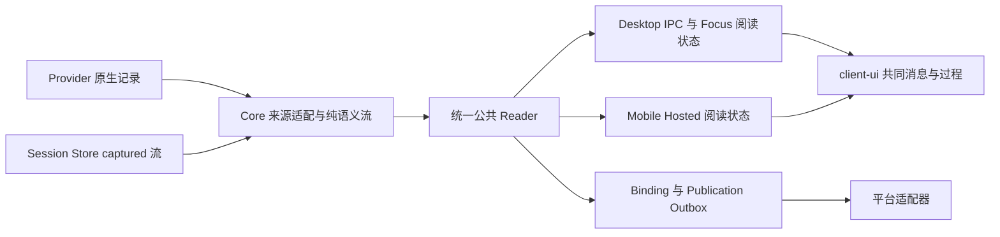

# 对话模式的机制与接线

本文说明对话模式的当前源码机制：谁持有哪类事实、读取与呈现怎样接线、输入与 Mailbox 怎样核对来源，以及外部连接器怎样消费同一份对话。行为归[对话行为 SSOT](../design/behavior/conversation-mode.md)，呈现归[对话呈现 SSOT](../design/presentation/conversation-mode.md)，字段、关系、分页与覆盖的合同归[公共协议](../specs/conversation-protocol.md)。本页不持有任务、构建、安装或运行验收状态；源码接线不代表某个安装实例或未验证的平台已通过验收。

全文分四节：[数据流与 owner](#数据流与-owner)、[Desktop 阅读链](#desktop-阅读链)、[输入与 Mailbox](#输入与-mailbox)、[Connector publication](#connector-publication)。

## 数据流与 owner

### 记录、身份与唯一 owner

| 事实 | owner 与源码入口 |
| --- | --- |
| 原生记录、parts、回合、问题与原生延续位置 | Provider；[`AgentProvider`](../../packages/core/src/agent-provider.ts)、[`AgentSessionHistoryItem`](../../packages/core/src/types.ts) |
| Session、原生绑定、输入／交互回执与 captured 记录 | Core；[`AgentMuxClient`](../../packages/core/src/client.ts) 与 Session Store 接口 [`AgentMuxAgentSessionStore`](../../packages/core/src/agent-session-store.ts) |
| captured 流、提交序号与旧版本 | Session Store 的 [`captured-history`](../../packages/core/src/captured-history.ts)；[`captured-history-import`](../../packages/core/src/captured-history-import.ts) 在同一 writer 与事务内接管旧 JSONL，保留原始文件（见 [captured 记录的存储与版本退休](#captured-记录的存储与版本退休)） |
| 记录到事件、角色、作者、顺序、关系与内容归属 | Core 的纯函数 [`projectConversationStream`](../../packages/core/src/conversation-stream.ts)；浏览器与 Node 消费同一实现 |
| 通用 Run、PTY 有序字节、Replay 与 Gap | ctxmux；Core 经 [`CtxmuxRunAdapter`](../../packages/core/src/ctxmux-run-adapter.ts) 消费，见 [Terminal 运行时](terminal-runtime.md) |
| 消息、过程、Question、来源与载荷的共同呈现 | [`client-ui`](../../packages/client-ui/src/components/ConversationView.tsx)；宿主注入 [`ClientUiPlatform`](../../packages/client-ui/src/platform.tsx) 能力 |
| 公共读取的已接受贡献、页邻接与有界临时窗 | [`conversation-reader`](../../packages/core/src/conversation-reader.ts)；持久记录仍归各自 owner |
| 草稿、阅读位置、选区、展开、可见性与 caret 意图 | 客户端；不是第二份对话事实 |
| 外部受众、内容表示、待投意图与平台回执 | 连接器的 Binding／Publication Store；不拥有原生或 captured 记录 |

公共 Reader 的完整窗口经 [`projectConversationWindow`](../../packages/core/src/conversation.ts) 适配为共同消息行及可访问的 originals；适配保留已接受的事件、角色和顺序，不重新关联记录。`projectConversationReading` 与 `projectConversationRecords` 仍提供纯投影能力。共同的 `useConversationView` 为已接受窗口生成 Core reading，Desktop、Mobile 与 Focus 复用这一结果，再经 UI 的 [`describeConversationWindow`](../../packages/client-ui/src/lib/conversation-records.ts) 添加 speaker、来源标签及 coverage 的呈现，不为同一窗口再次展开记录或建立输入索引。提交前的候选窗口尚未被接受，仍由 `projectConversationWindow(snapshot)` 独立投影，不复用当前保留帧的 reading。缺少记录的 source Host 时仍保留正文，不从当前焦点补一个引用。source namespace 与 client route 的区别见[协议](../specs/conversation-protocol.md#unified-reading-and-changes)。

共同输入的消费直接使用 `projectConversationWindow` 结果中的 `inputs` 实体列表，保留 canonical event、revision、作者与全部贡献；`record.input` 仍供单来源详情使用。Desktop 的 [`useSessionUserMessages`](../../apps/desktop/src/renderer/src/lib/session-user-messages.ts) 与 Agent 卡片的 Recent inputs 直接消费实体。Desktop Composer 与 Mobile 邮箱的来源检索，则以 `originalRecords` 中的 raw inputs 为种子，与 `agent.history` 的记录身份对应，不把实体 ID 混入来源分页。固定预览补入在途实体时，经 Core 的纯函数 `retainConversationInputs` 按当前 coalescence 保留已显示的实体及其阅读版本，不按 native 记录 ID 再拼一次消息列表。

### 语义流的模块边界

公开入口是 `@agentmux/core/conversation`。来源适配、语义归一、读取协调与客户端呈现分别持有自己的事实：

| 边界 | 实现与责任 |
| --- | --- |
| 来源适配 | [`conversation-timeline`](../../packages/core/src/conversation-timeline.ts) 把 SDK 的 native page 与 captured timeline 转为源记录，保留 source Host、来源顺序与 writer 版本。Provider 继续解释各自的原生协议。 |
| 纯语义流 | [`conversation-stream`](../../packages/core/src/conversation-stream.ts) 的 `projectConversationStream` 消费已接受的 `ConversationSourceRecord`，统一事件、作者、关系、版本、覆盖与部分顺序；没有 IO、订阅或持久 Store，不决定输入资格。 |
| 读取协调 | [`conversation-reader`](../../packages/core/src/conversation-reader.ts) 持有来源读取、cut、分页及临时阅读窗，把带版本的源记录直接交给语义流，不从 page／timeline 还原后再造记录或重算版本。scope、frontier 与分页位置的相等比较复用 `conversationValuesEqual` 的 canonical value 语义，不为纯比较生成内容摘要；记录与事件的版本校验、签名续读资格仍在协议边界执行。页预算在本次读取内累计已接受条目的 JSON 字节与分隔符，候选保留游标与 envelope 大小，不逐项重编码整个已接受前缀；最终的完整页仍执行字节预算与严格解析。 |
| 公共输送 | [`conversation-changes`](../../packages/core/src/conversation-changes.ts) 校验并组装完整的版本化窗口；尚未收齐的 wire fragment 不表示语义节点处于半开状态。 |
| 客户端消费 | Desktop、Mobile 与 Connectors 消费同一公共 Reader；`projectConversationWindow` 只适配已接受的事件，不重判关联、作者或顺序。 |

实时合同是：来源的 `invalidated`／`unavailable` 通知唤醒读取，再交付新版的完整窗口。`ConversationEvent` 保留贡献版本与关系，没有一个同时代表身份、正文结束、投递和采用的 `final` 位；每项确认都来自对应的协议事实。晚到的关系由同一语义流更新事件与 coalescence；关联缺证时保留独立记录，不能从相同正文、时间或终端 ACK 补造。

### 三种来源怎样读取

Provider 的原生历史解释与 Hook 回调解释消费不同的原始信号，提交记录则由 Core 的输入 writer 产生；出现多路记录本身不表示同一 payload 被解析了两次。它们进入同一个 Conversation 处理边界，接入方不承担厂商信号的整合。Core Reader 持有有界的接受窗口与跨批贡献，Desktop、Mobile 与 Focus 消费该 Reader 的完整窗口。

| 来源／需求 | 读取 owner |
| --- | --- |
| Provider 原生页、精确记录及资源 | `sessionHistoryPage` 与 Provider 的 history 能力；精确回读保留 Provider source 和签名资源引用 |
| captured 近期快照、完整分页与旧版本 | `sessionTimeline`／`readAgentSessionHistory` → Session Store；近期快照不代表全量历史 |
| 统一事件页、精确锚点与耐久变化 | [`conversation-reader`](../../packages/core/src/conversation-reader.ts) → native 与 captured 端口 → `projectConversationStream` |
| Terminal Replay | Run output／Attachment → terminal viewport；PTY 字节不自动成为对话或作者事实 |

历史来源由 Store 的 `readHistorySource` 按 Session ID 读取。SQLite 中的活跃记录只校验并投影 source Host、Provider 及当前、观察到与已确认的前序来源，不为读取描述重新校验或克隆无关的恢复账本；行 JSON 的解析照常进行。完整元数据的读写仍执行完整校验，退休与 reopen 的关联沿各自分支；历史描述不授予输入或生命周期权限。

Provider 在 Launch／Resume Plan 中贡献 Hook 载体。需要受管文件的声明由 [`AgentManagedHookInstaller`](../../packages/core/src/managed-hook-installer.ts) 在创建或恢复时准备，只随启动参数携带的声明不进入文件安装器；工作区隔离与原生加载事实见 [Hook 配置隔离](../design/behavior/agent-capabilities-and-messaging.md#hook-配置隔离与非-agentmux-会话)。安装器在 receipt／backup owner 内记录按 Provider、目标与 merge 范围限定的实际新增声明；之后的更新经 [`prepareMergedHookContent`](../../packages/core/src/hook-config-merge.ts) 只替换能够确认是自己写入的旧声明，保留用户、手改与来历不明的条目。目标与声明归属同时参与预览校验；同一目标的写入由文件锁互斥并在锁内复核，写入前保存 pending 的前后哈希，重建的实例据实际字节判定所属代次。出现竞争或归属未知时，保留原回调并给出具名问题，不阻断健康 Agent。这一机制防止安装更新不断累加采集入口；它不补造旧回复快照的消息关联，也不改变 Conversation 或记录读取接口。

客户端的 [`useConversationView`](../../packages/client-ui/src/lib/use-conversation-view.ts) 在读取状态中分别记录当前操作与失败操作的种类。后台变化更新或保留帧的回放成功，不收起另一次相邻页读取的失败；该操作重试成功或新的明确读取成功后，才收起它的失败。已接受帧的来源不可用由来源服务反馈表达，不借自动补读意图改称分页操作失败。这些呈现事实不改变 Core 窗口、游标、来源覆盖或公开读取回执。

Inputs 的有界搜索与分页由 `agent.history` 与 `agent.input.ls` 提供。[`projectSessionInputs`](../../packages/core/src/session-inputs.ts) 在 Core 内复用同一套 same-event／adoption 判定，把 input key、已查询的记录与当前已接受输入之间的关系投影为阅读组：当前实体只贡献关联证明，不把未命中查询的正文塞回结果；记录版本改变或 native 采用出现歧义时撤销相应归并，保留正文与未知回执；source Host 未确认时不拿路由 Host 替代。Desktop Composer／Mailbox 与 Mobile Mailbox 消费这一个纯投影：发送回执占主行时，各来源正文在同一详情内逐份展开；没有回执的组以原生记录优先的源记录作主行。Copy、填草稿、资源读取与定位都指向具体的源记录，列表不创建新发送，也不另建事实 Store。

共同的 [`inputHistoryText`](../../packages/client-ui/src/lib/input-history-text.ts) 在一次资源读取中给出两种结果：`text` 按答案与阅读范围投影，供填入草稿；`originalText` 按 text parts 的顺序保留完整正文，供 Copy。Desktop 的 [`useComposerInputHistory`](../../apps/desktop/src/renderer/src/lib/use-composer-input-history.tsx) 与 Mobile 的 [`MobileConversationSurface`](../../apps/mobile/src/conversation/MobileConversationSurface.tsx) 消费同一结果，各自保留取消、平台回执与编辑器 Undo，不从可读答案反推原 wire。复制与回填的行为合同见[对话消息的阅读、复制与标注](../design/behavior/conversation-mode.md#对话消息的阅读复制与标注)。

统一的公共读取合同由 `readAgentConversation`、`conversationCheckpoint`、`readConversationChanges` 与 `observeConversation` 持有。Reader 的临时 view 保留已接受的记录、版本、页邻接与切点；`consumeConversationWindowPage` 只校验并重组完整的替换窗口，客户端不做跨批的语义合并。

- watch 核对 view 的来源范围；绑定观察的 `dispose` 只释放订阅。隐藏的展示仍拥有它的阅读窗，不因其他窗口的数量被淘汰。
- 只有显式 `releaseConversationView` 或 Core Client 的 dispose 释放临时 view。首个响应未交回就失败的候选由 Reader 清理；客户端释放失败或被取消读取时取得的 fragment replay。外部调用者负责释放自己的 view，未释放的 CLI token 会保留到 owner disposal。
- deferred part 仍沿资源接口读取。窗口 cursor、耐久 source frontier 与通知各由[协议](../specs/conversation-protocol.md)定义，通知只唤醒读取。
- `sessionHistoryCheckpoint`／`readSessionHistoryChanges` 保留为原生 primitive，`agent.history` 继续提供来源读取。
- Store 事务仍返回 stream 与 changed position，经既有事件进入 raw applier 与 Renderer；临时 view 的合同不替代这条路径。

声明 `changesCursor` 与 `replayCursor` 的 Provider（字段见 [`AgentSessionHistoryPage`](../../packages/core/src/types.ts)）从同一次冻结读取取得页快照的 changes 边界与页起点，通常经共享的 [`NativeJsonlHistoryReader`](../../packages/core/src/native-jsonl-history-reader.ts)；这避免了另做一次 checkpoint 时，checkpoint 与页读取之间同一 ID 的版本竞态。支持耐久变化读取的 Provider 在 `AgentProvider` 上声明 `readConversationChanges`（[agent-provider.ts](../../packages/core/src/agent-provider.ts)）。Pi 的 [`readPiConversationChanges`](../../packages/core/src/providers/pi-native-history.ts) 从切点之前的叶记录继续逐项校验 parent 关系；分支改变由 Reader 表达为来源 gap，之后的 Current 读取重新读取选中的分支。

调用关联以每个 part 对其 scoped invocation 的 `invocation-member` 归属表达，单个成员也保留；`conversationInvocationId` 由 Core 唯一定义。归属及其所在事件的版本，不依赖同一批是否读到另一个成员，公共 Reader 也不为此反查全部历史。相同的调用身份不合并父发言，也不表示未读的对端内容已经可读。

每条原生答案的 typed `questionAnswers` 独立产生 `answers` 关系，目标只持 source Host、Session、Provider／native source 与完整的不透明 question ID，不要求同批读到问题，也不猜问题所在的记录或 turn。`conversation-questions` 限定读卡片的 Host 与来源；`conversation-stream` 的关系函数同时供投影与严格 codec 使用。`answers` 与 `observes` 只归发起记录所在的事件，读到目标不会改变目标事件的版本；未读的目标保留 gap。多条答案分别保留，卡片显示哪个选择不代替关系的保全。

其他关系只在 Reader 当前已接受的记录之间闭合：

- 之后的 source page 或 changes 加入同一 view 后，纯投影重新形成完整窗口；晚到的 same-event 贡献保留先前的原文并更新同一个事件。
- 暂未读取或已离开有界窗口的关系目标保留 gap，可沿带版本的 anchor 回读。
- 较早、较新页沿 Core 签发的页邻接位置读取；previous-source 意图只选择 Session 保留的原生绑定。客户端保存 DOM 锚点、选区与已接受 frame，不解码 Provider cursor，也不重新拼接贡献。
- 以 `record` 定位时，Core 沿来源分页找到该记录所在的正常阅读窗，保留已接纳的前后文与双向导航；客户端在候选完整接纳后才释放旧窗。`window.anchor` 只表示按版本 anchor 读取的单记录 inspect，与可前后翻页的历史窗分开；park／resume 保留该版本，后到的通知不令它自动跟随，显式返回当前历史时重新打开正常窗口。
- 自动预读较早页而首页仍在窗口中时，`navigation.newer` 为空，实时尾部继续接入；只有首页实际被逐出才保留历史位置，沿 newer 返回后从原 cut 补齐变化。精确原文、来源覆盖与已闭合关系分别解释。

Core 经 [`SessionHistoryObservationPool`](../../packages/core/src/session-history-observation-pool.ts) 共享同一 native source 的 watch；captured 通知沿 Session Timeline publisher 发出。取消一个 reader 不终止 Run。来源失败时保留其他已接受的记录、gap 与重试位置，不用最新版本替换失效的锚点。

来源标签集中在 [`conversation-sources`](../../packages/client-ui/src/lib/conversation-sources.ts)，只索引已接受的 Core 记录与已确认的关系；同一事件可以有多个来源，invocation 来源按 Core 的归属与唯一调用身份只标记对应的 selector。Focus、搜索与 Mobile 复用这个映射；来源标签不产生关联、作者、采用或完成事实。

### captured 记录的存储与版本退休

captured 历史由 Session Store 持有，当前或近期窗口只是查询，不是保留上限。Session 的 SQLite 数据库保存 captured 流身份、版本头与最新记录／顺序指针，原生历史不复制进来（[captured-history.ts](../../packages/core/src/captured-history.ts)）：

- 每个流有一个私有、耐久、排他的退休切点（`captured_retirement_cuts`），由该规则下第一次改动内容的普通写入，从写入前的序号原子建立。切点及之前的正文保持原样，直到用户确认的显式回收；新写入首次替代规则之前的头版本时，该头版本同样受保护。打开、读取、内容不变的写入与旧格式接管都不建立或移动切点；接管来的原件在之后第一次普通写入前已受保护。
- 合格的新 writer 只在同一事务里、随新版本一起退休切点之后紧邻被替代的头版本正文。所有版本头、内容 revision、序号与 epoch 都保留。
- 旧 writer 仍可创建流、写入并读取当前或切点前的正文，也可能保留额外的版本；不支持可空正文的旧 decoder，读到退休正文时可能以 `INVALID_AGENT_TIMELINE` 拒绝。在共享的用户数据上启用新 writer，需要先确认正在服务的 Core 与受影响的读者已更新；来源资格不代表这次启用，也不授权关闭仍健康的旧 Core。
- 读到已退休的正文时，`capturedBodyGaps` 生成一个读取范围内的 `AGENT_CONVERSATION_VERSION_UNAVAILABLE` gap（不为每个退休版本持久化一条 gap）；分页沿版本头前进，使用该 Session 的索引与有界结果，不加载累计历史，也不扫描无关 Session。读者可见的合同见[协议《Ordering and coverage》](../specs/conversation-protocol.md#ordering-and-coverage)。

已有的 captured JSONL 只接管一次（[captured-history-import.ts](../../packages/core/src/captured-history-import.ts) 的 `importCapturedFile`）：沿 writer、事务、source generation 与 durability 边界进行，保留全部完整记录与原文件（`archiveCapturedOriginal` 按内容摘要归档），确认同一个 source witness，之后只有一个活跃的事实 owner，没有双写或 fallback reader。确认结果不确定时，按原事务对账。末尾不完整的记录保留字节与诊断，之前完整的历史照常保留。

### Provider 原生来源

对话读取的公共合同在[对话协议](../specs/conversation-protocol.md)。下表列出部分内置 Provider 实际打开的原生来源与变化观察（核自各 history／session 适配器）；是否提供原生读取以该 Provider 是否实现 `readSessionHistoryPage`／`observeSessionHistory` 为准，不代表任意安装或厂商版本已验收。

| Provider | 原生来源与身份 | 变化观察 | 原生 Resume |
| --- | --- | --- | --- |
| Grok | [`grok-native-history.ts`](../../packages/core/src/providers/grok-native-history.ts)：耐久对话 owner 为 `updates.jsonl`；`chat_history.jsonl` 可被 compaction 替换；身份与同目录 `summary.json` 及 Session 目录对齐 | 已核验的 JSONL（含首次落盘） | Session ID |
| Pi | [`pi.ts`](../../packages/core/src/providers/pi.ts)／[`pi-native-history.ts`](../../packages/core/src/providers/pi-native-history.ts)：`session_file` 的分支 JSONL；身份来自原生 session header 与受信 Hook binding | 同一份 JSONL | session file |
| Antigravity | [`antigravity-native-session.ts`](../../packages/core/src/providers/antigravity-native-session.ts)：主 CLI 持有的 `presence/<UUID>.lock`；[`antigravity-native-history.ts`](../../packages/core/src/providers/antigravity-native-history.ts) 读 compact `transcript.jsonl` 与同目录 `transcript_full.jsonl` | 两份 transcript，一起清理 | Conversation UUID |
| Cursor | [`cursor-native-history.ts`](../../packages/core/src/providers/cursor-native-history.ts)：当前 Run 打开的 `store.db` 与原生 metadata／conversation protobuf | DB／WAL／journal 原生提交的实际 revision（`observeNativeSqliteHistory`） | Conversation UUID |
| TraeX | [`traex.ts`](../../packages/core/src/providers/traex.ts) 经 [`app-server-native-session.ts`](../../packages/core/src/providers/app-server-native-session.ts)／[`app-server-native-history.ts`](../../packages/core/src/providers/app-server-native-history.ts)：当前 Run 打开的 `rollout-*.jsonl` 与 `session_meta`；页读取由原生 app-server 解释 indexed history | 同一份 rollout（`observeNativeJsonlHistory`） | Session ID |

Hook、Permission、Usage 与问题回答各自单独声明；history reader 可用不代表它们已接入。

### Provider 的原生格式差异

公开消息的 `messagePhase` 由各 Provider 解释，公共 `agent.history`、`agent.conversation.inspect/changes` 与共同 UI 直接消费这些记录与阶段，不按厂商另分消息呈现，也不从正文推断完成：

- [Claude](../../packages/core/src/providers/claude-native-history.ts) 对未中断的真实助手消息读取 `message.stop_reason`，把 `tool_use` 映射为 progress、`end_turn` 映射为 final；未知原因保留为未分类的正文。
- [Codex](../../packages/core/src/providers/codex-saved-history.ts) 消费消息的 `commentary`／`final_answer`。
- [Grok](../../packages/core/src/providers/grok-native-history.ts) 把同一 Session／prompt 的连续公开文本块组成一条消息：首块的字节位置持有稳定身份，之后的文字与成功终局更新这条消息；工具、思考与其他原生记录各保用途。组装只存在于本次 Provider 读取中：历史页保留快照切点，精确读取沿字节位置定位，旧的成功终局引用仍能读到完整回复。

Codex 保存的 rollout 由首条 `session_meta` 中的 `history_mode` 声明格式；之后被复制进 fork 的元数据不能改写它（[codex-saved-history.ts](../../packages/core/src/providers/codex-saved-history.ts) 的 `open`）：

- `history_mode` 为 `paginated` 时，canonical 用户发言是同一 thread、带 turn 的 `event_msg`／`item_completed` 中的 `UserMessage` TurnItem；`response_item` 中 role 为 user 的消息只作为「Model context」过程记录保留原文，内容资格为 private。typed MCP 工具结果中的文件 part 也只在这种格式下提取。
- 其他格式保留各自原有的合同：`response_item` 的用户消息仍是用户发言。
- 有界的 app-server indexed history（[app-server-native-history.ts](../../packages/core/src/providers/app-server-native-history.ts)）要求 `thread/read` 返回的 `historyMode` 为 `paginated`，否则页读取报告 `AGENT_SESSION_HISTORY_UNSUPPORTED`，精确记录读取报告记录不受支持；保存的 JSONL 读取不依赖这个 helper。

原生协作回报由 Provider 的历史适配解释，沿 `collaboration.kind = message` 保留 source、发送者、接收者、记录与回合；[`session-history`](../../packages/core/src/session-history.ts) 核对其原生命名空间，[Core 语义流](../../packages/core/src/conversation-stream.ts) 把它当作真实的消息边界，不借用父 Session 的作者。共同的 `ConversationView` 显示原生参与者与正文，不以 actor 字符串查询 AgentMux 身份或补头像。没有消息关联的 Hook 快照仍是独立的观察；[`conversation-reply-preview`](../../packages/client-ui/src/lib/conversation-reply-preview.ts) 只生成有界的阅读摘要，不持有关联或正文事实。

### 原生结果的接线与能力边界

[`AgentTurnOutcome`](../../packages/core/src/types.ts) 是记录上的结果合同，与计量、当前活动和 Run 健康分开。Codex 的 [`codexTurnOutcome`](../../packages/core/src/providers/codex-turn-outcome.ts) 由原生状态观察、输入完成证据与 saved-history 共用；[`codexFailure`](../../packages/core/src/providers/codex-errors.ts) 保留原生错误码、有限诊断以及 Provider 明确提供的公开摘要。Claude 的结构化主轮错误由它自己的 Hook 适配贡献，缺少可信 turn 身份的信号只作诊断。

Core 在当前活动排序与显示资格判断之前保存结果。历史归一、公共 wire、changes 与 deferred header 都保留 `turnOutcome`；native 记录与 captured witness 只凭明确的 `same-event` 关系归并，迟到的失败不覆盖新的一轮，也不被新的一轮抹去。共享 [`ConversationView`](../../packages/client-ui/src/components/ConversationView.tsx) 把失败卡放在过程折叠之外，原始详情按需读取。外部发布如何使用结果见 [Connector publication](#外部-publication-的接线)。

Provider catalog 的 `turnOutcomes.observation`／`history` 只声明对应适配器已验证能解释的结果类别，不保证所有来源完整。Codex 当前只声明 observation 的结果覆盖：有界的 app-server indexed history 没有轮结果 envelope，因此不声明 history 覆盖；保存的 JSONL 与实时观察仍可提供结果，缺字段时不补成功，也不为补结果无界读取所有 turn。读取故障与模型请求失败由不同 owner 表达。协议见[原生结果协议](../specs/conversation-protocol.md#native-request-and-turn-outcomes)。

### 可读信封与原输入

Core 的 [`agent-outbound-message`](../../packages/core/src/agent-outbound-message.ts) 生成无 `from` 属性的 `<amux>` 平台说明；[`agent-message-render`](../../packages/core/src/agent-message-render.ts) 生成并共享解析 `amux:a2a` 的 canonical `from`、稳定 `msg-id`、原正文与末尾的 Core reminder。这个 codec 没有 Node 或 UI 依赖；精确语法由 [amux 可读协议](../specs/amux-protocol.md)唯一持有，共同记录与资源的消费合同见[对话协议](../specs/conversation-protocol.md#readable-agentmux-envelopes)。外部来源保留其 typed participant，人工或未核实的原文不会被格式化成 Agent 身份。

客户端读取声明不改变作者、投递与权限事实。共同的 [`ConversationInputText`](../../packages/client-ui/src/components/ConversationInputText.tsx) 只呈现 Core 返回的上下文、正文、既有 packet 引用与末尾 reminder，不重新解析。消息的首个 text part 与显式打开的首 part 完整文本资源复用同一阅读面，之后的 parts 保留原正文；Copy 从 parts 与资源取完整 wire，与阅读投影分开。

输入 coordinator 的 admission intent 保存实际 wire 与 producer 事实。`AgentMuxClient` 重试已保存的 A2A Input 时复用这份配方；人工 note 的重试还要求显式正文、平台内容与来源一致。claim、条件与当前授权照常核验，unknown 不因为格式更新而获得第二次发送。Connector publication 沿 captured writer 的 typed `inputRef`／`publicContent` 核对来源，不用当前的显示模板去比较历史 wire；普通的正文编辑仍由 reducer 取消这条已核对的边界。

### 注入上下文与发现入口

下表记录当前的 producer 与输入 owner 接线；产品要求见[注入上下文行为](../design/behavior/agent-capabilities-and-messaging.md#agentmux-注入上下文)，格式见 [amux 协议](../specs/amux-protocol.md)。独立的热上下文、用户正文与首次 Input 各有 producer 边界，不因共享 formatter 而合并。

| 路径 | 接线 |
| --- | --- |
| 启动 guide、Scratch Topic／Wiki／SOUL | [Core `composeAgentLaunchPrompt`](../../packages/core/src/agent-outbound-message.ts) 把 guide 与 `agentMuxNote` 放进同一个 amux 包装；[Desktop `RuntimeController`](../../apps/desktop/src/main/runtime-controller.ts) 提供 Topic note，[Core Client](../../packages/core/src/client.ts) 按实际 producer 保留独立的 `systemContext` 记录。 |
| Goal／PMO 任务上下文 | [Desktop `openGoalPmo`](../../apps/desktop/src/renderer/src/store.ts) 把职责、项目与执行上下文作为显式 `agentMuxNote`，与用户请求分开交给 Core；队列与同 Region 启动器分别保留 note 与可编辑正文，重试不重算已冻结的上下文，正文中的 amux 标签不升级为平台来源。 |
| Goals 探索与 Browser annotations | [Goals `startGoalExploration`](../../apps/desktop/src/renderer/src/lib/goals-entry-actions.ts) 在请求发起时冻结项目说明，以显式 `agentMuxNote` 沿 Region 草稿与启动通路交给 Core，正文独立保留；缺少 Executor 或准备未确认时，两者仍留在同一个启动器。[Browser context formatter](../../apps/desktop/src/renderer/src/lib/browser-annotations.ts) 沿共用的分享外框，经 [Browser Tools Panel](../../apps/desktop/src/renderer/src/components/BrowserToolsPanel.tsx) 加入可编辑草稿；用户编辑、审批后的整段仍按用户正文发送。两者都不新增专用信封，也不从正文标签恢复平台来源。 |
| Core 的普通提交、恢复与 Host 通路 | [Core `composeAgentPrompt`](../../packages/core/src/agent-outbound-message.ts) 统一组合显式平台内容与用户正文，启动引导委托同一个组合 owner；独立的热上下文不附加启动等待语。公开 SDK、Hosted RPC、Main 与 Preload 显式传递 `agentMuxNote`，Core 分别记录平台来源与正文来源。首次 Input 的完整 wire、来源分界与作者冻结在持久意图里；同一 operation 的相同 wire 不允许改变来源，缺少来源事实时明确未知，并保留 Input 与健康 Run。原生 resume 保留用户的空白与换行。 |
| Mailbox Progress | [Host Loop Manager](../../apps/host/src/continuous-progress-loop-manager.ts) 在符合资格的发送首次 claim 时，保存 `loop.prompt` 与 Core 同源的共享消息规则；[Host `deliverContinuousProgress`](../../apps/host/src/continuous-progress-delivery.ts) 把冻结的正文与显式平台说明分开提交。同一次重试或冷恢复沿 operation、condition 与内容进行；缺少内容事实时明确未知，保留健康 Run 与手动输入。规则只伴随既有的自动发送，不新增 Reminder 周期、任务或配置；用户的 continuation prompt 不升级为平台自产内容。 |

启动引导与非空 resume 由 [`agent-outbound-message`](../../packages/core/src/agent-outbound-message.ts) 组合；[`agent-messaging-guidance`](../../packages/core/src/agent-messaging-guidance.ts) 持有完整协作合同、短通信入口与 A2A 接收提醒。启动给出短的发现路线，resume 与新的 Progress 输入使用短通信入口，完整协作合同只由 `message --skill` 展开。已冻结的输入与安排保留原平台内容，不按新版指南重组。

`whoami` 的[公共类型、服务与严格 codec](../specs/public-capabilities.md) 只返回 Session、状态、View 与 unavailable，不带静态 Topic 提示或通信指南。模块目录与本地 Skill 由 [`agentmux-cli-module-skills`](../../packages/core/src/agentmux-cli-module-skills.ts) 按实际命令根生成，基础目录不内联模块全文。已知任务域可以直接读取对应模块；root／object help 由注册表列出下一层，叶子 help 给出该操作的参数、选项与回执说明。Browser program／task、原生恢复、空间 playbook 等各在自己的入口可达，不在所有相邻模块与叶子重复展开。路由由 [`agentmux-cli-help`](../../packages/core/src/agentmux-cli-help.ts) 持有，不新增规则或已读状态 Store；文本可达和被读取，不证明当前模型已经采用。

## Desktop 阅读链

### Desktop 的共同阅读链

[`SessionPane`](../../apps/desktop/src/renderer/src/components/SessionPane.tsx) 按实际阅读需求启用 [`useSessionUserMessages`](../../apps/desktop/src/renderer/src/lib/session-user-messages.ts)。共同的 [`useConversationView`](../../packages/client-ui/src/lib/use-conversation-view.ts) 经 Desktop 的 [`conversation-read-api`](../../apps/desktop/src/renderer/src/lib/conversation-read-api.ts)、preload 与 Main 的 [`conversation-read-ipc`](../../apps/desktop/src/main/conversation-read-ipc.ts) 调用公共服务。IPC 只持有 sender trust、取消与观察资源，完整窗口严格校验后才交给呈现。

- 首次读取同时取得同一页的 changes cut，关闭 read→watch 之间的空隙；短暂的通知合并只唤醒变化读取。
- 隐藏时取消观察而保留 frame，重新可见时按同一个 view 恢复；卸载或身份切换时显式释放 view。观察断开时，在仍相关的消费者内重开同一个 view，不更换来源，也不重放输入。
- 首次读取与显式 Current 在同一次操作内先尝试取得当前来源的观察，再交给该窗口的观察；Core 的 `activeNativeHistoryBinding` 从观察资源借用尚未保存的 locator，来源参数贯穿页、切点与变化读取。没有 prior／record／anchor 的首次普通 latest 完整帧先经原 `beforeCommit` 与状态提交，再在同一 pending 操作内等待 view bind；来源观察仍持有到原 finally，观察失败保留正文并沿原重连恢复。记录定位的 prepared／cancel／admission 事务及其他导航顺序保持。固定 view、cursor 与记录定位沿各自来源读取，临时观察随操作释放，不形成会话级的来源缓存。
- 阅读来源身份与确认操作身份分开：前者使用完整的原生 locator（Provider／Adapter、原生 ID 与记录路径），后者保留确认操作，以隔离并发选择与 A→B→A 的旧资格。对同一 locator 的重新确认不会把阅读窗误标为来源改变，已接受另一来源的窗口仍需显式导航（[session-conversation-window.ts](../../apps/desktop/src/renderer/src/lib/session-conversation-window.ts) 的 `bindingKey`）。宿主只收窄自己的来源变化提示，不清除 Core 的 scope、过期、held、错误或未知事实。

Renderer 桥使用 Core [`conversation-changes`](../../packages/core/src/conversation-changes.ts) 的 `parseConversationReadPageForWindow`／`parseConversationChangesPageForWindow`，严格解析后持有本次响应的不可变副本。窗口组装只复用这个对象已完成的 unit 校验，不重复规范化记录或计算 revision；拷贝或 raw 页仍走严格校验，fragment 收齐后仍校验其内容。这份私有持有权不跨响应缓存、不进入 wire，不改变普通 SDK parser 返回可变 DTO 的行为，也不授予作者、输入或恢复权限。

[`ActivityView`](../../apps/desktop/src/renderer/src/components/ActivityView.tsx) 用 [`useSessionConversationWindow`](../../apps/desktop/src/renderer/src/lib/session-conversation-window.ts) 保持阅读锚点与返回位置，沿同一 view 的 `navigation.older`／`navigation.newer` 补充相邻范围。时间范围读取与 Current／Previous source 是明确的阅读意图。退休 Session、History 与当前对话复用共同读取与呈现，来源失败时保留内容与恢复入口。窗口提交调用共同呈现端口，待提交数据仍由 Reader 持有；Focus pin 保留完整的已接受 frame，不裁出记录再重新投影。

[`RecentFocusTimeline`](../../apps/desktop/src/renderer/src/components/RecentFocusTimeline.tsx) 只为已选择的 Context 挂载共同 view；已读 Context 的完整 frame 在呈现预算内保留，未选中的观察停放而不读取。淘汰以完整 frame 为单位，当前与 pin 的内容保留；Core 暂存的 view 已过期时明确显示错误，不把旧 frame 当成可继续的 cursor。Context 目录、已记录的工作区间与时间尺由 Focus owner 提供，不成为对话关联的来源。

用户命名的阅读点由 [`ConversationLandmarks`](../../apps/desktop/src/renderer/src/components/ConversationLandmarks.tsx) 经 Main 与公共控制服务写入 [`ConversationLandmarkStore`](../../packages/core/src/conversation-landmark-store.ts)，该 Store 只持引用元数据。返回沿 SessionPane 的导航 owner；写入未确认时保留 operation 与暂存草稿，不另建一份已保存事实。

资源读取沿 `SessionPane.readHistoryResource` → IPC → [`RuntimeController`](../../apps/desktop/src/main/runtime-controller.ts) → `sessionHistoryResource`。共同的 [`ConversationResourceImage`](../../packages/client-ui/src/components/ConversationResourceImage.tsx) 与 [`readSessionHistoryTextResource`](../../packages/core/src/session-history-content.ts) 校验记录、part、引用、完整 extent 与 digest。粘贴的图片另经 Main 受限的 [`readPastedImage`](../../apps/desktop/src/main/pasted-image-read.ts) 读取，它不能替代原生资源 owner。

### 共同呈现的职责分层

| 层 | 持有的事实与责任 | 不持有 |
| --- | --- | --- |
| Core 已接受窗口 | 记录、事件、贡献关系、角色、顺序、覆盖、版本、分页与资源引用 | DOM、选区、卡片外壳与滚动位置 |
| 共同阅读适配（`describeConversationWindow`） | 把完整窗口投影为统一的 records／originals，附加来源与 speaker 的呈现 | 第二次关联、按正文去重、来源页拼接 |
| 共同呈现序列（[`conversation-record-sequence`](../../packages/client-ui/src/lib/conversation-record-sequence.ts)） | 按顺序生成消息与过程布局、稳定的展示身份与纯视图锚点 | Provider 特例、输入资格、完成或历史完整性 |
| 一个阅读位置的呈现事务（[`useConversationRecordLayout`](../../packages/client-ui/src/lib/use-conversation-record-layout.ts)） | 已呈现版本、候选布局、锚点、选区／焦点保护、展开与提交反馈 | 新的消息账本、持久状态、其他位置的阅读选择 |
| 共同正文与卡片（`ConversationMessage` 等） | 原文、资源、Copy、来源详情、可访问的披露与薄外壳 | 读取调度、发送／恢复状态机 |
| 宿主容器 | Host／Session 绑定、平台能力、输入控制器、布局槽与可见性 | 独立的消息归并或同类的过程 renderer |

Core 语义窗口、已呈现布局与视口是三个不同的范围。取得完整合法的窗口，不要求在同一帧挂载全部重内容；延后呈现也不能把部分传输片段当作已接受的窗口。

### 统一序列与展示身份

[`ConversationView`](../../packages/client-ui/src/components/ConversationView.tsx) 把统一有序的 records 直接交给 [`ConversationRecordSequence`](../../packages/client-ui/src/components/ConversationRecordSequence.tsx)，不把 canonical records 拆成 native 主干与 captured 插入列表再恢复顺序。来源差异留在记录与资源的内容适配中，不形成第二套定位、折叠与排序协议；`originalRecords` 继续供完整原文、来源详情与资源定位使用。

纯函数 `projectConversationRecordSequence` 的分组规则：

- 连续的 `process` 记录组成一个过程组。observation，以及 native 协作消息（`collaboration.kind = message`），在已有过程组打开时作为组内成员加入，Core 角色不变；没有打开的过程组时，它们作为独立记录呈现。turn metrics 与 observation 保留各自的实际范围：[`projectConversationMetrics`](../../packages/client-ui/src/lib/conversation-metrics.ts) 只把 metrics 贴到原 native 记录上（同一 turn 的读数合并后，挂在本窗口已载入、带该 turn 读数的最后一条记录），是叶节点适配，不参与排序，也不代表完整回合的覆盖。
- 来源或 turn 改变时分组断开；两个已挂载的过程组不会被合并，已保留的成员持有它所在的组。
- 带失败 `turnOutcome` 的记录总是断开分组单独呈现，过程被折叠时失败仍然可读。历史分界与尾部标记是独立的纯视图锚点，没有业务记录、作者或回合身份。
- 过程组 ID 沿上一次布局的成员映射复用：只要任一成员曾属于某个组，就沿用该组 ID；否则由首个成员的展示 key 派生。首个成员离开窗口、后续追加或跨源输入分割时，已挂载的过程不会因为数组下标或新的首项而整组重挂载。

相邻的 `process` 并不自动构成一个业务回合，未知的回合也不从标题、时间或工具名补齐。展示定位以统一记录身份进入，raw 引用经贡献映射回该记录；canonical event、源记录与 DOM key 分别表达。合并贡献使代表记录或事件的身份变化时，只沿 Core 的关系保持阅读连续性，不以正文相同猜测同一个节点。折叠选择属于统一记录或稳定的过程身份。过程组的成员映射同时供时间尺与定位消费：过程组节点以 `data-conversation-process-members` 公布全部成员及其原记录引用（含 captured），折叠的组头代表组内全部成员，时间尺据此计算可见范围，不遗漏未挂载的成员；点击已加载记录的时间点时，沿同一身份先显露所在的过程组与步骤，再定位记录。宿主的标尺与定位索引派生自同一序列，不为取得坐标另做一次跨来源拆合。

### 一个阅读位置的呈现事务

共同的 [`useConversationRecordLayout`](../../packages/client-ui/src/lib/use-conversation-record-layout.ts) 是每个阅读位置唯一的呈现准入 owner：同时比较版本、canonical 代表项、角色、过程父节点与纯视图锚点，沿实际的 `ownerDocument` 保护 Range、焦点与阅读偏移。`beforeCommit` 调用同一端口，直接传入 records 的共同消费者也经过这个边界。

- 只有存在非折叠选区，或焦点位于本阅读位置内时，事务才遍历带 `data-conversation-layout-key` 的节点检查交集；无法判断交集时按选区处理。版本、父节点与挂载 key 都未变的节点直接跳过。滚动锚点的保护独立执行，不因为没有选区而略过。
- records、originals、coverage 与布局保持同一个已接受版本；保护解除后由 Reader 核对当前意图再提交。候选帧与提交准入用的选区判定只在这一个事务中（`useConversationReadingSelection`），Desktop 的段落与 Sequence 不各自保留。共享的 `ConversationMessageDisclosure` 与 `CapturedConversationMessage` 目前仍在自身正文含选区时各自监听 `selectionchange`，只用来让含选区的披露保持展开，不参与提交准入；这与[同一阅读位置只有一份阅读保护](../design/behavior/conversation-mode.md#history-使用共同对话阅读面)的约束仍有差距，是实现缺口，不是第二个准入 owner。
- 普通滚动与选区通知复用既有的序列和 placement，不重复计算全窗记录。独立的输入与权限回执由各自 owner 更新，保护不会冻结这些操作事实，也不授予旧卡片当前资格。

[`useConversationReadingSelection`](../../packages/client-ui/src/lib/use-conversation-reading-selection.ts) 把 DOM 中选区的端点与焦点接入 React 提交前的一致性检查：每个候选重新核对真实 DOM，不以 `selectionchange` 已交付为前提；活动的阅读位置只保留一套订阅，停用、换 document 与卸载时释放，快照不持有另一份消息或窗口。没有 DOM 包裹的 [`ConversationReadingCommit`](../../packages/client-ui/src/components/ConversationReadingCommit.tsx) 在 mutation 前让 [`ConversationBodyWork`](../../packages/client-ui/src/lib/conversation-body-work.ts) 采样当前锚点，提交后沿原几何恢复；整帧与首次正文挂载复用这个边界。Desktop 的显式几何端口更新同一个宿主锚点，Current 与贴底意图由宿主持有。

### 有界读取与方向性补读

读取由 Core Reader 沿不透明游标完成，Core 窗口最多保留 `CONVERSATION_MAX_WINDOW_RECORDS`（1200）条记录（[conversation-changes.ts](../../packages/core/src/conversation-changes.ts)）。Desktop 有两种自动补读，分别计数：

- **首窗与时间范围的覆盖补读**（[session-conversation-window.ts](../../apps/desktop/src/renderer/src/lib/session-conversation-window.ts)）。首次打开 Current 后，在默认 24 小时的覆盖时长内最多再补 2 页（连同首页共 3 页）；用户扩大时间范围时最多再补 3 页。每页的条数为 `min(100, floor((1200 − 已接受记录数) ÷ 来源数))`。补读使用 `preserveCurrent`：只扩展较早的上下文，绝不逐出读者正在看的最新记录；窗口装不下时这一批就结束。出现错误、保护中（held）、阅读停用、来源绑定改变、没有更多记录、已覆盖所选时长、窗口已满、窗口之外已有更新的记录或用户缩小时间范围时，剩余额度清零。回到 Current、显式切换 Current／Previous source、记录定位与显式的 Earlier／Newer 也先清零当前批次；前三者都以 `latest` 操作打开新窗口，新首页被接受后按首次打开重新开始一批，按版本 anchor 读取的窗口不补读。
- **方向性补读**（[`useConversationReadAhead`](../../apps/desktop/src/renderer/src/lib/use-conversation-read-ahead.ts)）。一次 wheel／scroll 在某个方向上形成一个需求，最多读 `ceil(1200 / 100)` = 12 页，即一个 Core 窗口的 100 条页；一次只读一页，等上一页的 frame 到达后才可能读下一页。需求只在滚轮、键盘或用户滚动发生时阅读位置距该方向边缘 2 个视口高度以内时形成，之后的页只在仍处于 3 个视口高度以内时继续（两者都至少 80 像素，[ActivityView](../../apps/desktop/src/renderer/src/components/ActivityView.tsx) 的 `readingEdgeIsNear`）。布局反馈只能推进已有的需求，不能创建或补充需求；反向阅读、隐藏、身份切换、保护中、读取错误或切换来源都会取消剩余需求。较早方向的读取不使用 `preserveCurrent`，Core 可以在窗口预算内滑动；显式的 Earlier／Newer 沿原导航始终可用。

一个阅读位置只有一个在途读取，显式返程优先。合法页提交后的几何反馈只能继续仍有效的需求，不会形成「布局不足就一直扫全历史」的循环。全部源记录仍在持久 owner，停止预取不等于删除历史。行为约束见 [History 阅读面](../design/behavior/conversation-mode.md#history-使用共同对话阅读面)。

#### 页位置索引

Core Reader 为每个 view 保留一份位置索引（[conversation-reader.ts](../../packages/core/src/conversation-reader.ts) 的 `HistoryPosition`），只记录实际访问过的页：该页的输入位置（Provider 提供 `replayCursor` 时带上它）、limit、切点，以及原序边界（native 页的 witness、首末记录 ID 与条数，captured 的首末序号与条数）；没有 `replayCursor` 的首页保留原先读到的页快照对象。

- 沿 navigation 回到已访问的相邻页时，Reader 以原位置与 limit 重读，无游标的首页直接复用保留的快照，再核对原序边界。边界不再一致时这次导航失败，已显示的原记录保留；Reader 不解码游标，也不从最新页全量扫描。
- 不相邻的位置直接拒绝。冻结的历史窗中原记录的版本改变时同样拒绝，不悄悄换成新版本，新版本只经 changes 的切点进入。
- 由 changes 首次交付的记录另记为 live 段，返回时沿交付它们的原生切点向前重读，取得已接受的版本。

### 数据准备与渐进呈现

共同布局为每个阅读位置持有一个 [`ConversationBodyWork`](../../packages/client-ui/src/lib/conversation-body-work.ts)：经 `ownerDocument` 的 IntersectionObserver 维护邻近候选，每个动画帧最多启动一个重正文的首次挂载，等实际组件提交后再继续。短正文立即呈现；重 Markdown、代码、图片与已展开的工具载荷经 [`ConversationProgressiveBody`](../../packages/client-ui/src/components/ConversationProgressiveBody.tsx) 延后首次工作，记录外壳、来源与 Copy 仍可达。默认折叠的思考或工具详情不使短答案整体变成占位；未自动呈现的正文保留显式展开入口，键盘焦点所在的占位不被后台挂载替换。

- Desktop 把滚动锚点与跟随动作交给共同布局，Mobile 复用同一跟随意图。尺寸变化与首次正文提交只恢复屏幕位置，不产生新的跟随或读取意图。
- 已读正文离屏、隐藏或收起后保留节点；只有内容改变或离开 Core 窗口时才随所属组件释放。隐藏与换 document 解除相应的观察，旧回调不能更新新的阅读位置。
- Sequence 仍遍历完整的已载序列，所以这是有界窗口内的渐进首次挂载，不是固定 DOM 数量的完整虚拟列表。

局部查找由 [`ReadingFind`](../../packages/client-ui/src/components/ReadingFind.tsx) 持有，范围是一个工作面已载入的可读正文，内容与滚动仍归原宿主；Desktop 的 Activity 与 Markdown 预览各自挂载它。尚未挂载的重正文经 [`ReadingFindBodies`](../../packages/client-ui/src/lib/reading-find-body.ts) 登记自己的 `reading` 文本投影与 `reveal` 回调，查找读取这份投影；移到其中的命中时，由同一回调挂载正文，再在原视口内定位。查找不读取历史或资源，也不扩大 Core 窗口。

[`ConversationReadingRuler`](../../apps/desktop/src/renderer/src/components/ConversationReadingRuler.tsx) 独立持有可见区状态，IntersectionObserver 的更新只重绘标尺；被观察的节点同时作为 [`conversationReadingAnchor`](../../packages/client-ui/src/lib/conversation-reading-anchor.ts) 的候选，wheel／scroll 优先测量可见节点，不逐条测量历史前缀。观察尚未建立或候选失效时，仍可从当前实际 DOM 取得锚点。性能与选区、返程的验证责任见[测试策略](../testing/strategy.md#任务验收与假绿防护)；源码机制不代表用户现场的测量结果。

### 共同过程、正文与卡片外壳

[`ConversationMessage`](../../packages/client-ui/src/components/ConversationMessage.tsx) 统一正文、Question、reasoning、tool、resource、来源详情与批注；[`ConversationMessageCard`](../../packages/client-ui/src/components/ConversationMessageCard.tsx) 中的普通发言、协作回报与系统记录三种薄外壳分别持有头部与披露，`compact` 是独立的密度维度。captured 的输入、回复与系统记录由 [`CapturedConversationMessage`](../../packages/client-ui/src/components/CapturedConversationMessage.tsx) 适配。

共享的[消息样式](../../packages/client-ui/src/styles/conversation-message.css)与[协作样式](../../packages/client-ui/src/styles/conversation-collaboration.css)经 [`client-ui` 样式入口](../../packages/client-ui/src/styles/index.css)供各宿主消费，变体选择器只作用于本卡片所属的槽，正文中嵌套的原消息按自身类型布局。Mobile 的触控尺寸、外层容器与本端覆盖归 [`conversation.css`](../../apps/mobile/src/conversation/conversation.css)；共同组件的存在不代表两端的视觉、性能或交互已验收。

Core 的 `conversationA2ANotificationId` 从 producer 与 adoption 事实适配通知身份，Desktop、Mobile 与 Focus 交给共享的 `ConversationMessage`。首个 text part 是引用通知时，`ConversationA2AReferences` 按来源范围只读 journal，并以普通 Agent 消息卡直接呈现原信；`ConversationNotificationDetails` 在同一通知位置保留协议与全部贡献的按需原文／JSON，不再次调用消息 renderer。Mobile 沿所选 hosted client 的 `readMessage` 读取，Desktop 沿 Host 路由读取；通知、原信与来源身份各自保留。

整条、SID 与局部的 Copy 共用 [`useContentCopyAction`](../../packages/client-ui/src/lib/use-content-copy-action.ts) 的动作原语，各自持有操作、反馈与到期状态；整条 Copy 沿资源 reader 异步取得 deferred 原文。同一消息中后发起的 Copy 取消旧的整条 Copy 尚未完成的准备，已经发往平台的写入仍等待自己的回执；切换来源、卸载与迟到完成都按各自的动作身份处理。原生工具与思考详情的动作身份沿消息来源与 trace 保持，工具调用与结果另外区分字段种类，同字节的新 part 快照不重建动作。`ContentCopyButton` 在原文字节真正改变时重置；缺少稳定 trace 或来源身份的独立 part 保持自身归属。

Desktop 与 Mobile 共用 [`CapturedProcessRecord`](../../packages/client-ui/src/components/CapturedProcessRecord.tsx)、[`WorkflowObservation`](../../packages/client-ui/src/components/WorkflowObservation.tsx) 与 [`ConversationToolPayload`](../../packages/client-ui/src/components/ConversationToolPayload.tsx)，保留参数摘要、来源、完整原文 Copy、编辑差异、定位展开与 `aria-controls`。首次披露后保留详情节点，关闭只隐藏；宿主 wrapper 只提供自己的标尺与定位引用。captured 图标按记录 kind、原生步骤图标按调用／结果 part 决定，工具名称不决定图标种类。观察沿同一过程的固定节点披露，过程开合只隐藏步骤；连续的同一已核作者的进度只收敛重复装饰，消息、SID、时间与动作独立保留。

聊天页的身份轴 [`ConversationAxis`](../../apps/desktop/src/renderer/src/components/ConversationAxis.tsx)、正文 [`AgentMarkdown`](../../packages/client-ui/src/components/AgentMarkdown.tsx)、请求回答卡 `AgentInteractionCard`、IME 输入框 [`ComposerTextarea`](../../packages/client-ui/src/input/ComposerTextarea.tsx)、状态点 [`StatusDot`](../../apps/desktop/src/renderer/src/components/StatusDot.tsx) 与服务窗 [`ServiceWindowNotice`](../../apps/desktop/src/renderer/src/components/ServiceWindowNotice.tsx) 各自持有对应事实，没有聊天专用的副本；Activity 的标尺是 `ConversationReadingRuler`，Activity 内部目前没有独立的行、Run 或回合组件。

#### Workflow 组件与 a11y

正式 Desktop 对话经 `SessionPane`／`SessionActivityPresentation` → `ActivityView` → [`ConversationProcessSurface`](../../apps/desktop/src/renderer/src/components/ConversationProcessSurface.tsx) → [`NativeProcessObservation`](../../packages/client-ui/src/components/NativeProcessObservation.tsx) 消费共同观察组件。`RecordedStepsCard` 与宿主的摘要 slot 使用同一个 `RecordedProcessObservation`；`ObservedProcessDock` 只提供受控摘要外壳，共同几何由 [`workflow-observation.css`](../../packages/client-ui/src/styles/workflow-observation.css) 持有。每个展示工作面通过自己的 React context 提供 `AgentSessionComposer` → `AgentComposer.aboveInput` 的 DOM 放置点，所选过程身份留在该 `ActivityView`，不新增 Reader、事实缓存或持久 Store。范围与阅读行为见[对话行为合同](../design/behavior/conversation-mode.md#可复用对话与-workflow-表面组件)，视觉见[共同组件密度](../design/presentation/conversation-mode.md#可复用对话与-workflow-组件密度)。

共同观察组件中的 `WorkflowStatusGlyph`（`WorkflowObservation.tsx`）接受 running、completed、failed、interrupted、killed、paused、queued 七种状态，running 按已记录与在途使用不同图形，只有在途状态带动效；卡片、步骤与 Agent 元信息的展开按钮使用 `aria-expanded`／`aria-controls`。Desktop 的 [`components/workflow/`](../../apps/desktop/src/renderer/src/components/workflow/) 组件集（`WorkflowCard`、`WorkflowDock`、`WorkflowToolRow` 等）目前只由组件 Gallery（`?agentmux-component-gallery=1` 或独立的 Gallery 入口）消费：其中 `workflowPresentation` 把带 `legacyNotice` 的 workflow 退化为普通工具行，旧 daemon 的固定文案只出现在 Gallery fixture 中，生产链路没有设置 `legacyNotice` 的 producer。

纯 SDK 组合函数 [`capturedToolEdit`](../../packages/core/src/conversation-tool-edit.ts) 只接受 toolInput invocation 的 Provider 来源；Claude 的参数由 [Provider 解释器](../../packages/core/src/providers/claude-tool-edit.ts) 规范化为请求的编辑，未知或歧义时保留完整载荷。它复用既有 wire 与来源合同，不新增 RPC、CLI 或输入权限。共享的 [`conversation-tool-diff`](../../packages/client-ui/src/lib/conversation-tool-diff.ts) 负责通用 diff 排版与有界预览，[`ConversationToolDiff`](../../packages/client-ui/src/components/ConversationToolDiff.tsx) 使用共同样式与显式增删符号；预览截断不裁剪原文，也不证明编辑已执行。

### 原生结果的共同消费

共同阅读适配把已接受记录的 `turnOutcome` 原样交给共享结果卡。卡片只决定摘要、详情、复制与定位的布局；Desktop、Mobile、History 与 Focus 的宿主不解析原生错误，也不因自己的当前状态或过程折叠删去历史结果。deferred 阅读先保留结果与有限摘要，完整载荷沿精确读取取得；当前服务提示收起时，历史卡的身份与内容不变。

### Mobile、样式与宿主差异

[`useHostedConversation`](../../apps/mobile/src/conversation/use-hosted-conversation.ts) 把 Hosted Session 交给同一个 `useConversationView`；[`MobileConversationSurface`](../../apps/mobile/src/conversation/MobileConversationSurface.tsx) 以完整窗口驱动 `ConversationView`。Mobile 的连接、草稿、未确认操作与活动状态保留在各自 owner；历史窗口中存在 Question 时，才挂载同来源的当前答案读取需求。保留页的资源继续使用其 client、Session 与 Host，连接或 Session 改变后不接受旧结果。

手机连接显式采用 [Hosted Session 摘要投影](system-ownership.md#当前接入边界)。[`useMobilePromptController`](../../apps/mobile/src/conversation/use-mobile-prompt-controller.ts) 继续一条保留的未知消息时，先以摘要中的原 submission 身份确认是否需要正文，再通过既有 `readAgentSession` 读取准确 Session；读取失败保留未知、原请求与编辑草稿。Core 的冻结 wire 和手机保存的用户正文分属各自 owner，手机不重建冻结 wire，也不把两种文本的差异当成输入资格。Agent 恢复继续由 [`recoverMobileAgent`](../../apps/mobile/src/conversation/mobile-agent-recovery.ts) 精确检查原 Session 与 continuity operation，不以摘要缺少正文推断恢复成功或失效。

Hosted Client 已通过所选连接绑定 semantic Host，读取中的 `hostId: 'local'` 是接收方的 route-local namespace，不表示手机或 Desktop 所在的机器：

- [Core `readAgentSessionHistory`](../../packages/core/src/client.ts) 先按 Session descriptor 取得执行 Host，再把响应路由映射回 `local`。
- Desktop 的 [`RuntimeController.readSessionHistory`](../../apps/desktop/src/main/runtime-controller.ts) 对远端同样先选择 client、发送 `local`，最后映射回外侧的 Host。
- MobileMailbox 传给 `useAgentInputMailbox` 的 Host 只用于本地读窗的作用域与 key，不是该 mailbox RPC 的 Host 参数。

这几种 Host 不能按同名字符串比较或互相替换；source Host、执行 Host 与连接路由分别核对，也不能用合法的 route-local 语义掩盖跨连接的迟到结果。当前只接线单个已选的 semantic Host，不等于 Mobile 已支持浏览该 Host 登记的全部其他 Host。

## 输入与 Mailbox

### 阅读入口与控制入口

| 动作 | 接线与独立事实 |
| --- | --- |
| 普通消息、Queue／steer | Desktop [`AgentSessionComposer`](../../apps/desktop/src/renderer/src/components/AgentSessionComposer.tsx) → store.send／enqueueAgentSteer；Mobile → Hosted Core 输入。草稿、入队、投递与原生采用分别解释。 |
| 当前同步问题与权限 | [`AgentInteractionCard`](../../packages/client-ui/src/components/AgentInteractionCard.tsx) → interaction owner；历史记录不取得当前 pending 资格。 |
| 原生异步问题 | [`projectConversationQuestions`](../../packages/core/src/conversation-questions.ts) → [`AgentAsyncQuestionCard`](../../packages/client-ui/src/components/AgentAsyncQuestionCard.tsx) → 共同的 [`submitQuestionReply`](../../packages/client-ui/src/lib/conversation-question-reply.ts)；Desktop／Mobile 宿主先保存完整意图，再调用 `agent.question.reply`／`replySessionQuestion`。Provider 读取记录并编码原生异步答复，Core 复用输入 journal、条件与 native input owner。选项、草稿、Copy 与导航不派发输入，未知结果只续接原操作。Mobile 的原生异步问题由 [`question-replies`](../../apps/mobile/src/conversation/question-replies.ts) 适配。 |
| 显式打开终端 | SessionPane 选择展示 Region，再向 caret owner 请求该终端；[`TerminalView`](../../apps/desktop/src/renderer/src/components/TerminalView.tsx) 只消费目标明确、可见且非 inert 的请求，保留之后的人工焦点。 |
| reaction／Mailbox | [`useConversationReactions`](../../apps/desktop/src/renderer/src/lib/conversation-reactions.tsx) 沿输入队列发送；[`SessionMailbox`](../../apps/desktop/src/renderer/src/components/SessionMailbox.tsx) 保留消息与 read-marker，详情复用共同 Message。 |

具体行为由[范围与唯一归属](../design/behavior/conversation-mode.md#范围与唯一归属)指向的专题持有。Desktop Composer 的提交资格由纯函数 [`composerSubmitMode`](../../apps/desktop/src/renderer/src/lib/composer-submit-mode.ts) 只从 Session 快照与宿主传入的禁用／只读标记判定，不读取对话阅读窗或历史读取的状态；读取失败与输入资格的关系按[按操作判断强弱依赖](../design/behavior/shared-rules.md#按操作判断强弱依赖)判定。

### 原生输入通道与采用

显式的 `native-conversation` 意图进入输入 journal 与 admission，由 [`prompt-submission`](../../packages/core/src/prompt-submission.ts) 在首次派发前保存 InputKey、Run、目标与 client correlation；同一 key 的未知结果只读回执，不重新发送。Provider 的原生接纳与原生记录采用分别成立，普通终端发送不改变默认目标。外部输入沿 Binding 的显式 `inputTarget` 进入同一准入链，不从发布 frontier 推导写授权。

按正文投递的消息进入 Core 的语义 message key；首次准入时，同一个输入 owner 可以选择 Provider 确认的原生通道。普通受管 A2A 的默认引用通知持有独立的 prompt key，不提前输入原正文。

- 目标是 Core 已确认保存的 Provider source，不是 TUI 当前的选择。来源由进程／FD 采集与保存 ACK 提供；已有 binding 必须属于同一个 Run。当前来源有缺口时不关闭终端通路，也不新增 binding producer。
- Provider 的准备结果在认领前与派发前各重核一次来源；Core 的 CAS 重核前序、来源与私有 actor 快照，不要求 Provider 所选通道与平台私有 actor 同形。
- 冻结后不升级旧的 PTY 计划，不重发未知的原生请求。Provider planner 与采用校验复用同一个机器来源 tuple，精确条件不改写成另一种调用者意图。公共 RPC／CLI 复用消息入口，不另增 reader、journal 或客户端 matcher。

Codex 的受管 actor 写通道由 [`codex-native-input`](../../packages/core/src/providers/codex-native-input.ts) 在 executable probe 之后、Runtime prepare 之前，为 create 与带明确 UUID 的有限 resume 形状选择受管启动：

- ctxmux Run 内的 [helper](../../packages/core/src/providers/codex-managed-run.ts) 启动同一个认证 app-server。create 时由 TUI 创建初始 thread；resume 时由同一 actor 的生命周期准备先向原 thread 发出原生恢复请求，核对实际生效的 sandbox／approval 与明确的 model／cwd 后，再让 TUI 接回这个已加载的会话。
- 订阅保持到后台 Run 结束；前台退出不停止仍健康的 actor。Provider 的私有认证控制通道报告前台代次，Core 把安全的 `terminalFrontend` 事实投影到 Session。明确的 Resume 沿同一 actor／Run／原生 thread 重开前台，用 Run 的有序输出观察确认新的握手，不释放客户端已有的 Attachment。只有首次恢复的启动输入由该次 TUI 携带，前台接回不重放它；消息 writer 不承担恢复。相对 cwd 在 Run 内解析。
- Core 的 sandbox／approval 选择都进入请求。已有的 `--dangerously-bypass-approvals-and-sandbox` 参数在 create 时交给 TUI，在 resume 时由 helper 按原生语义传递 `danger-full-access`／`never`，只移除 TUI 的权限 token；重复或混用权限形式时不升级。自定义 profile、任意配置覆盖、未知参数／版本与 fork 保持原启动计划。
- 认证 token 与实际的 TUI invocation 只存在 StoredSession 的私有 lifecycle 字段里，请求权限沿生命周期计划保留，公开 Session 不展开它们。进程／FD 采集与保存确认核对实际的 TUI，不用转换前的 argv 代表。每次原生派发仍核对同一 Run 的进程 birth、监听者、认证与 thread；受管计划冻结后，请求结果未知或生效策略不符时，在 TUI 提示词交接前明确失败，保留失败阶段与恢复身份，不改用另一个 actor。旧 Run 不迁移，Hook 安装与终端输入走各自的 owner。

没有平台私有 actor 的 Codex Run，由同一 Provider 的[原生持久队列适配](../../packages/core/src/providers/codex-native-queue.ts)核对主记录 writer、内核进程代次、映射的可执行文件，以及它实际打开的原生 queue／state 文件对象。私有 stdio helper 只初始化、读取 thread 并提交 `thread/queue/add`；它使用隔离配置，必须打开与 writer 相同的原生存储对象，不加载、恢复或开始另一个模型会话。它只贡献 `queue-idle`，不能代表 direct input 或 steer。原生 watcher 的传播时机沿原协议，持久队列接纳不表示会话已取用；采用仍由原生记录上的 correlation 与完整 wire 核对。准备与派发之后的 helper 清理分别结算，清理故障记入 Run 诊断，不覆盖输入回执。

PTY 字节回执与 `inputRef` 本身不构成原生采用。Provider 的 saved-history owner 保留 canonical 用户条目的 client correlation、语义 item ID 与来源；[`native-input-adoption`](../../packages/core/src/native-input-adoption.ts) 沿历史页、changes 与精确记录读取核对持久 claim，不派发输入、不改写回执。共同 timeline 与严格 codec 复用同一条采用边规则，临时 Reader 只保留有界的引用反证；晚到的歧义撤销归并，溢出时明确未知。客户端与 connector 直接消费原生主消息与完整的提交贡献，不解码 token、不匹配正文。受管 actor 写通道不授予历史 reader 控制权，公开内容与投递授权仍逐 part 判断。

共享回执的只读呈现策略归 [`conversation-send-receipts`](../../packages/client-ui/src/lib/conversation-send-receipts.ts)：由原记录、Core 已接受的原生对应和客户端偏好纯投影接收确认、必要提示、等待资格及默认开合／隐藏。`ConversationSubmissionMetadata` 和 `CapturedConversationMessage` 消费同一结果，前者组合原回执、正文及动作，不在 JSX 另算披露规则；[`ConversationMessageDisclosure`](../../packages/client-ui/src/components/ConversationMessageDisclosure.tsx) 保留显式开合、定位、焦点和选区的优先级，实际可见性由原 `useVisibleWork` 限制动效。该策略不调用 Runtime、读取来源、保存配置或创建关联。

### Mailbox 与 A2A journal

外部入站的 `DurableIngressHost.deliver` 调用 `submitAgentMessage`，与本地输入复用 `DurableAgentMuxMessageQueue`、input journal 与准入 owner。[`readAgentInputMailbox`](../../packages/core/src/client.ts) 沿 journal 的 recipient／intent-sequence 索引有界读取受控输入与只读的 submission 引用，SDK、`agent.input.ls` RPC／CLI 与 Hosted 消费同一份严格结果合同，字节分片复用 `JsonReadEntry`。新的 claim CAS 与 typed launch commit 记录首次的 key，旧 claim 或 unknown launch 不回填；每条 admission 仍从其 owner 读取，失败时保留该条内容与缺口。

A2A 与输入共用的消息 journal 是一个 SQLite 数据库（[agent-global-message-queue.ts](../../packages/core/src/agent-global-message-queue.ts)、[agent-message-journal.ts](../../packages/core/src/agent-message-journal.ts)），默认路径由 `defaultAgentMuxMessageQueuePath` 决定（`AGENTMUX_MESSAGE_QUEUE_PATH` 可指定）：

- **单一事务提交**。数据库经 `node:sqlite` 的 `DatabaseSync` 打开；每次操作在 writer mutex 下以一个 `BEGIN IMMEDIATE` 事务执行，不可变记录、收件人、operation、consumer 游标与 Dispatch 索引一起提交或一起回滚。
- **跨进程写互斥**。写入方在相邻的 `<path>.mutex.sqlite` 上取得 `BEGIN EXCLUSIVE`；进程死亡时由内核释放这把锁，因此没有需要回收的 lock 路径，也就没有 check-then-unlink 竞争，遗留的 `.lock` 文件被忽略。只有取锁会等待：最多 300 次、每次间隔 5–15 毫秒的异步重试，失败的句柄立即关闭，避免残留的 SHARED 读租约挡住持有者提交；取锁前尚未执行任何操作，所以等待不会重发效果。
- **持久性**。journal 使用 `journal_mode = DELETE` 与 `synchronous = EXTRA`，保留 SQLite 的原子回滚协议与目录同步 ACK；`busy_timeout = 0`，同步的忙等待不会占住终端或 Hook 的事件循环。只读快照只在持有 writer mutex 时打开，不与 DELETE 模式的提交竞争。
- **权限**。所在目录以 0700 创建，数据库、mutex 与归档文件为 0600。
- **从旧 JSONL 的一次切换**。首次遇到旧格式时，先按内容摘要把原文件归档为 `<path>.original-<sha256>`（复制、校验摘要、同步后再链接发布），再在临时数据库中逐条严格导入（流式 UTF-8 解码，残缺或损坏的记录不会发布部分数据库）并同步；原子 rename 之前再次核对原文件的摘要没有变化（变化时放弃这次切换），rename 之后在 mutex 库中记录这次切换的 incarnation。确认切换后 journal 被移除或替换时明确报错，不会把旧事实当成新历史重新导入；发布完整数据库与写入确认标记之间崩溃时，只需补做持久确认，不会再导入一次或出现第二个 writer。

Desktop 的 [`SessionMailbox`](../../apps/desktop/src/renderer/src/components/SessionMailbox.tsx) 与 [`AgentSessionComposer`](../../apps/desktop/src/renderer/src/components/AgentSessionComposer.tsx)、Mobile 的 [`MobileMailbox`](../../apps/mobile/src/conversation/MobileMailbox.tsx) 通过共同的 [`useAgentInputMailbox`](../../packages/client-ui/src/lib/use-agent-input-mailbox.ts) 消费这份日志。Desktop 沿 Host 路由与 typed IPC 调用，Mobile 使用 Hosted 读口；完整条目通过严格的分片校验后才进入当前读窗。共同的 [`InputMailboxRecords`](../../packages/client-ui/src/components/InputMailboxRecords.tsx) 保留作者、正文、回执与当前的读取失败，本地未发意图与可编辑控件仍归输入 owner。信箱的来源历史与登记行按显示时刻一起排序；只有 input key 相同才连接已有的本地操作，不按正文或时间认定原生采用。

### 邮箱、输入控制器与宿主几何

#### 三类输入的派生投影

本地草稿与待发意图、Core 输入 mailbox、会话输入历史是三个不同 owner 的事实，三路来源本身不构成重复账本。Desktop Inputs 组合三者，各自有独立的覆盖与游标，不能相互代表。Core 的 [`projectSessionInputs`](../../packages/core/src/session-inputs.ts) 唯一解释输入关联；纯函数 [`projectMailboxInputs`](../../apps/desktop/src/renderer/src/lib/mailbox-input-projection.ts) 消费已关联的组与 scoped input 引用，输出 journal／history／local 三类行与本地队列对象。它不按正文、时间或裸 ID 去重，不从 journal 推断本地操作已确认；已打开的本地编辑器在 journal 晚到后保持原节点与未保存的正文，unknown 操作仍可核对。

[`SessionMailbox`](../../apps/desktop/src/renderer/src/components/SessionMailbox.tsx) 直接呈现这些行：共同的 `InputMailboxRecord` 只呈现一条登记，`InputMailboxFrame` 保留读取覆盖与恢复入口，`InputHistoryList` 接收已组合的内容。当前选中的贡献、版本、位置与 Copy／Fill 目标由阅读意图保留，关联与作者更新不会暗中改读另一个版本；hover、pin、键盘与控件由视图持有。Composer 经 `useComposerInputHistory` 持有 Inputs 的原生阅读窗；`SessionMailbox` 接到这个 owner 时复用其记录、输入实体、读取错误、观察失败、冻结与刷新动作，不激活第二个 native view；联合刷新重读查询与原生归属，主刷新另外更新 input mailbox，独立的 Mailbox 持有自己的 scoped reader。

Core 的输入分组比较外部作者时，复用只读的外部作者投影，排除输入授权字段在完整信封与只读记录之间的表示差异；connection、完整 actor、平台会话与消息、binding 及修订仍必须一致。比较不改写作者对象、输入信封或授权回执，也不授予新的执行资格；事实冲突时表达为未知。

#### 记录定位

从邮箱定位到对话记录时，读取与呈现由 Session 宿主的同一次导航意图串接：[`SessionPane`](../../apps/desktop/src/renderer/src/components/SessionPane.tsx) 的 `revealConversationItem` 以 `setRevealRequest` 冻结目标记录、来源与取消信号，目标 [`ActivityView`](../../apps/desktop/src/renderer/src/components/ActivityView.tsx) 消费这个请求，经阅读窗的 `selectRecord` 读取并确认呈现；请求与结果的类型见 [mailbox-message-navigation.ts](../../apps/desktop/src/renderer/src/lib/mailbox-message-navigation.ts)。即使界面仍停在 Terminal，也先启用目标阅读位置的消费者，再等它自己的读取结果；另一个邮箱消费者已返回同一记录不能代表。已有 `ConversationItemRef` 而目标不在最近窗口时，复用 Core 的按记录读取，由该阅读位置打开来源的有界窗口，不以固定次数的 Earlier、全历史扫描或其他消费者的窗口代替。记录进入真实的 Activity 后才确认呈现；成功、失败或被之后的用户意图取消都结束这次导航需求，不留下仅为它启用的后台 reader、轮询或正文副本。行为合同见[邮箱记录一键定位对话](../design/behavior/conversation-input.md#邮箱记录一键定位对话)。

#### 控制器与 Host 身份

Mobile Surface 组合两个独立控制器：[`useMobilePromptController`](../../apps/mobile/src/conversation/use-mobile-prompt-controller.ts) 保留 CAS、冻结的正文、operation／waiting generation 与重连核对；[`useMobileInteractionController`](../../apps/mobile/src/conversation/use-mobile-interaction-controller.ts) 核对请求与同步答复回执。设备上的意图归 [`local-drafts`](../../apps/mobile/src/conversation/local-drafts.ts)，准入、权限与操作回执归 Core。能力目录观察失败时，Surface 提供核对动作，不阻断普通输入，也不清除草稿。控制器没有新增发送协议或操作副本；同步权限与原生异步问题是不同的业务通路，不为共用 hook 合并资格。

#### 浮层布局边界

[`SessionPane`](../../apps/desktop/src/renderer/src/components/SessionPane.tsx) 经 [`usePendingDeliveryLayout`](../../apps/desktop/src/renderer/src/lib/pending-delivery-layout.ts) 提供当前工作面的边界，以及 interaction wrapper／卡片的显式 ref；只有显示终端的 Region 提供该 Session／Run 的 [`TerminalInputGeometry`](../../apps/desktop/src/renderer/src/lib/terminal-view-observation.ts)。辅助阅读面使用自己的边界，不借用主终端的几何。端口沿 Composer／Mailbox 传给 [`ComposerPendingDelivery`](../../apps/desktop/src/renderer/src/components/ComposerPendingDelivery.tsx)，浮层测量自己的 composer 并复用 Floating UI 与 RAF 合并，不从祖先或兄弟节点发现终端或请求。终端 owner 保留有界的输入行与 textarea 观察，可见性与身份变化时解除订阅。这些引用只服务呈现，不授予发送或权限资格，也不进入父工作面高频更新的 React state。

## Connector publication

### 连接器的 Host 组合与设置路由

[`startAgentMuxHost`](../../apps/host/src/host.ts) 把连接器挂在语义 Host 上；[`createHostConnectionOwner`](../../apps/host/src/connections.ts) 组合一份连接存储、接收器、publication、外部输入授权，以及 Mote 私聊和资料操作。普通 `MOTE.md` 偏好与默认身份的写入由 Host 内部的文件 owner 消费；公开 profile／PNG 由显式的 client 准备，之后 parent 的推进不依赖 Desktop 回调。执行客户端来自同一 Host 的配置，连接器托管身份与 Agent 执行身份分别保留。

Desktop 的 [`desktop-host`](../../apps/desktop/src/main/desktop-host.ts) 启动或连接后台 Host，关闭客户端只释放读取连接，Main 不另建连接器的收发 owner。[`connection-host-ipc`](../../apps/desktop/src/main/connection-host-ipc.ts) 经 RuntimeController 与公共 transport 传递托管目标。设置页的 [`ConnectionHostingSettings`](../../apps/desktop/src/renderer/src/components/settings/ConnectionHostingSettings.tsx) 只为全新的访问发现默认 Host；已有的保存、扫码、Mote 选择与群操作使用各自保留的 Host／Runtime。设置页的手工保存、凭据与 profile 读取复用 [`connectionSettingsPort`](../../apps/desktop/src/renderer/src/lib/connection-settings-port.ts)，其他操作的查询同样携带各自冻结的目标；没有记录 owner 的引用不会绑定到之后选中的 Host。

凭据由 [`ConnectionSecrets`](../../packages/connectors/src/connection-secrets.ts) 保存，写入口为 [`createCredentialAdministration`](../../apps/host/src/credential-administration.ts)；存储格式、权限与旧格式交接只在 [Host 凭据存储](../../apps/host/credential-storage.md) 定义，行为边界见[凭据存储与格式交接合同](../design/behavior/conversation-channels.md#凭据存储与格式交接)。这些是源码接线，不能代替旧凭据交接、安装加载或实际远端收发的验收。

### 外部 publication 的接线

[`RoomBindingHost`](../../packages/connectors/src/room-binding.ts) 在授权动作内冻结 source frontier；native cut、Binding revision、scope 与受众保持各自的含义。旧 Binding 缺少 captured 起点时保留明确的 gap，不用当前的 discovery 重设历史起点。

[`createPublicationConversationPort`](../../packages/connectors/src/core-conversation-port.ts) 复用 Core 的 checkpoint／changes／inspect／watch 与 route／source fence；[`PublicationHost`](../../packages/connectors/src/publication-host.ts) 把之后的读取与观察绑定到同一个 view，经共同 assembler 收到完整窗口后读取 deferred part，再交给 [`PublicationStore`](../../packages/connectors/src/publication-store.ts)。该 Store 在同一事务内持久化表示意图、gap 与下一次读取的 frontier，不再自行选择原生或 captured 的角色、顺序、作者或关联。owner 重开后从持久 cut 继续，gap 沿带版本的 anchor 恢复；临时 view 不成为第二份持久事实。

[`PublicationStore.commitPage`](../../packages/connectors/src/publication-store.ts) 核对当前页请求后，复用 Core 的 `parseConversationUnitsForPage`：只有该不可变页内的原 item 对象免去重复的正文校验，复制、其他页或跨页组装的单位仍严格解析。成员身份只在本次调用内比较，不建立长期缓存；Binding 授权、frontier 与发布事务不变。内容恢复的 `recoverableGaps` 查询与派生索引共享同一套完整资格条件，按 Binding 修订与 rowid 分页，只扫描可恢复的候选；Store 初始化时退役被替代的宽 gap 索引，诊断 gap 仍由覆盖读取与其索引保留。没有可读对象的历史增加，不扩大每页的恢复工作，也不改变 gap 状态或恢复顺序。

[`publication-content`](../../packages/connectors/src/publication-content.ts) 只决定已授权的内容怎样用现有平台能力表示，对原生结果只选取 Provider 声明可公开的摘要。Outbox 保留每个 part／revision 的平台表示与已确认映射；Core 之后的 coalescence 会更新这些表示，但无权重做结果未知的效果。无法表示的资源、未确认的 public span、失效的版本或缺少关系的内容，仍可由 `connection.delivery.ls` 查询，其他可投内容继续流转。平台 ingress 的表示只由持久 ingress 与 Core writer 的 `inputRef` 对账，作者与正文相同不是关联证据。Outbox 的上传、重试与限流合同见 [Connection 协议《投递》](../specs/connection-protocol.md#投递)。

同一单元中带失败 `turnOutcome` 的记录（优先取原生记录）由 `publicationContent` 组成独立的 `failure` 载荷：原生 turn、错误码、Provider 声明的 `publicMessage`、`recovery` 与可选的 HTTP 状态；显式选中单个 part 分享时不生成。[`PublicationStore`](../../packages/connectors/src/publication-store.ts) 以 `<projectionId>-failure` 作为独立表示排入同一个 Outbox，不经 query-feedback；captured 失败早于 Binding 的 captured 起点时记为 `start-cut-unconfirmed` gap。`FeishuPublicationAdapter` 只负责失败卡的格式与回执，缺 `publicMessage` 时使用固定的通用文案，不外发本地原始错误，也不以 Agent 身份发言。

公开作者资料与头像媒体沿同一条可复用链路接入：可信的用户输入由 [`preparePublicUserProfile`](../../apps/host/src/public-author-profile.ts) 准备资料，Input 保存 `authorProfile`，头像字节沿 [`agent.input.resource`](../../packages/core/src/agent-input-resource.ts) 的 `author-avatar` 用途读取；[`publicationSpeaker`](../../packages/connectors/src/publication-speaker.ts) 消费作者及其资料，Agent／A2A 则读取各自的作者 owner。`PublicationHost` 共用相关资料与媒体的在途准备，`PublicationStore` 在连接、应用与原图内容的范围内复用已确认的上传回执；角色卡与 Question 只消费结果，不各自读取配置、上传头像或维护缓存。这条接线复用公开输入与资源合同，不扩展 Agent Provider 的输入语义，也不新增身份或资源 Store；展示的弱依赖与迟到补齐见[公开作者资料与头像](../design/behavior/conversation-channels.md#公开作者资料与头像)。

[`FeishuPublicationAdapter`](../../packages/connectors/src/adapters/feishu/publication.ts) 持有平台编码、请求容量、预备字节与平台回执的解释，不持有对话合并。平台投递、原生采用与个人身份互不代表；权限与 public-content producer 的能力边界见[公共协议](../specs/conversation-protocol.md#state-change-and-delivery)。

### 接收反馈与读取观察窗

连接器只自动发布两个 query-feedback 阶段（[publication-query-feedback.ts](../../packages/connectors/src/publication-query-feedback.ts) 的 `queueQueryFeedback` 只接受 `received` 与 `dispatched`）：

- `received`：外部输入在等待时发布。来源可以是 Core 已确认采用的原生记录，也可以是带 `inputRef` 的 captured 输入，后者在原生采用之前就可恢复这一效果（`projectQueryFeedback`）。
- `dispatched`：只在该输入的 Core 回执确认已投递（`terminal-confirmed`、`admitted` 或 `launch-carried`）后发布（[publication-query-input.ts](../../packages/connectors/src/publication-query-input.ts) 的 `queryInputReceipt`）。

处理中与完成的反应由 Agent 自己选择（[接收反馈与自主 reaction](../design/behavior/conversation-channels.md#接收反馈与自主-reaction)），自动反馈不根据 metrics 或轮结果推断完成、失败或中断。较早阶段的记录仍可读：更新的阶段只取代从未发送的较早显示；已确认的较早标记由一条 `withdraw` 操作撤下，若新旧标记是同一个原生效果，则只取代尚未发送或已确认未应用的旧清理，绝不重放未知的效果（`reconcileQueryFeedback`）。

外部来源的弱读取各自使用 15 秒的观察窗，不给整段区间或整个启动套总时限：入站前文的每次只读资源读取（[durable-ingress.ts](../../packages/connectors/src/durable-ingress.ts)）、飞书 adapter 的每次读取观察与接收器握手（[adapters/feishu/index.ts](../../packages/connectors/src/adapters/feishu/index.ts) 的 `READ_OBSERVATION_MS`、`RECEIVER_HANDSHAKE_MS`）、Discord 的每页历史读取（[adapters/discord/history.ts](../../packages/connectors/src/adapters/discord/history.ts)）。观察窗到期只结束这一次观察；行为边界见[上下文与输入承载](../design/behavior/conversation-channels.md#上下文与输入承载)。

### 公共消费者与证据范围

[`AgentMuxRpcService`](../../packages/core/src/public-rpc-service.ts) 把 `agent.conversation.inspect`／checkpoint／changes／watch／release 接到统一的 Core owner；[Hosted 合同](../../packages/core/src/hosted-client-contract.ts)、本地 SDK 与 [CLI 命令树](../../packages/core/src/agentmux-cli-commands.ts) 消费同一类型与严格 codec。`agent.history` 与资源 API 保留各自的读取职责，GUI 不需要绕行 CLI。

当前机制与完整的产品验收分别成立。没有提供 native 采用、公开用户内容边界或可寻址答复能力的 Provider，不能由 UI 文案补齐；记录、输入与缺口照常保留。真实的跨接入一致性、进程重启、活跃终端阅读、选区、性能、视觉、安装与当前加载身份，由[测试策略](../testing/strategy.md#任务验收与假绿防护)规定的各类证据分别证明。
