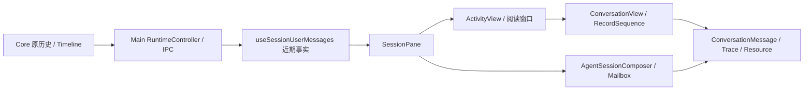

# 对话模式的机制与接线

本文说明当前源码怎样把原生记录、Core 捕获记录和客户端阅读面接起来。必须满足的结果归[对话行为 SSOT](../design/behavior/conversation-mode.md)，视觉归[对话呈现 SSOT](../design/presentation/conversation-mode.md)，字段与读取合同归[公共协议](../specs/conversation-protocol.md)；这里的接线说明不代表构建、安装或运行验收已通过。

## 记录、身份与唯一 owner

| 事实 | 当前 owner 与源码入口 |
| --- | --- |
| 原生对话、内容 parts、回合、问题与用量的原生含义 | Provider；[`AgentProvider`](../../packages/core/src/agent-provider.ts) 的 history/record/changes 能力，公共形状为 [`AgentSessionHistoryItem` / `AgentSessionHistoryContentPart`](../../packages/core/src/types.ts) |
| AgentSession、native handle、captured Timeline、输入和交互回执 | Core；[`AgentMuxClient`](../../packages/core/src/client.ts)、[`AgentSessionStore`](../../packages/core/src/agent-session-store.ts) |
| 通用 Run、PTY ordered bytes 与 Replay | ctxmux；Core 经 [`CtxmuxRunAdapter`](../../packages/core/src/ctxmux-run-adapter.ts) 消费，字节到画面见[Terminal Runtime](terminal-runtime.md) |
| 消息和过程的共同呈现 | `client-ui`；[`ConversationView`](../../packages/client-ui/src/components/ConversationView.tsx)、[`ConversationRecordSequence`](../../packages/client-ui/src/components/ConversationRecordSequence.tsx)、[`ConversationMessage`](../../packages/client-ui/src/components/ConversationMessage.tsx) |
| 草稿、阅读窗口、DOM 选区、展开、可见性和导航 | 各客户端；宿主通过 props 与 [`ClientUiPlatform`](../../packages/client-ui/src/platform.tsx) 注入能力 |

[`projectConversationRecords`](../../packages/core/src/conversation.ts) 是对已接受页和 Timeline 的纯投影，没有 Reader、缓存或新的对话生命周期。native 记录身份由 Host、AgentSession、Provider、nativeSessionId、recordId 限定；captured 使用同一 Host／AgentSession 下的 captured recordId。相同正文或同裸 ID 不关联两种来源。`conversationItemRef` 仅在调用方提供执行 Host 时返回完整引用；缺 Host 不补当前焦点，也不隐藏正文。UI 的 [`conversation-records`](../../packages/client-ui/src/lib/conversation-records.ts) adapter 只添加 speaker 呈现。

## 三种来源怎样读取

| 来源 | 读取路径 | 观察范围 |
| --- | --- | --- |
| Provider 原生记录 | `AgentMuxClient.sessionHistoryPage` → `nativeHistoryBinding` → Provider.readSessionHistoryPage | 已确认 native source 的有界页；页内保持来源顺序，opaque cursor 继续更早范围 |
| Core captured 记录 | `AgentMuxClient.sessionTimeline` → Session Store | Core 捕获的输入、回答或工作事件；投递确认与原生采用分别解释 |
| Terminal Replay | 原 Run 的 output／Attachment → terminal viewport | PTY 原字节与缺口；不转换成完整原生对话或作者事实 |

前两条还可通过 [`readAgentSessionHistory`](../../packages/core/src/session-history-reader.ts) 得到同一有界读信封；`AgentMuxClient.readAgentConversation` 直接委托这个 owner。信封内的完整记录才进入语义投影；记录分片与 deferred content-part 的区别见[资源协议](../specs/conversation-protocol.md#recorded-resources-and-content-fragments)。

读取页面、观察变化和耐久补读各有用途：[`observeSessionHistory`](../../packages/core/src/client.ts) 经 [`SessionHistoryObservationPool`](../../packages/core/src/session-history-observation-pool.ts) 按准确 Session／调用选项共享 Provider watch，通知只使已读来源失效；`conversationCheckpoint`／`readConversationChanges` 使用 Provider 的持久 source continuation，独立于 UI cursor。当前 [`Claude`](../../packages/core/src/providers/claude.ts) 和 [`Codex`](../../packages/core/src/providers/codex.ts) 注册 durable changes，其余 Provider 是否支持以对应能力为准。取消读取或一个观察消费者不终止原 Run。

## Desktop 的共同阅读链

[`SessionPane`](../../apps/desktop/src/renderer/src/components/SessionPane.tsx) 以实际可见阅读面计算 `activityDemand`，从 [`useSessionUserMessages`](../../apps/desktop/src/renderer/src/lib/session-user-messages.ts) 取得近期原生页、输入投影和观察结果。后者按 Host／Session／Run 共享近期读取需求，`fetchSessionHistoryPage` 先取得观察再首读；隐藏消费者释放需求，已有正文与服务窗仍由宿主保留。

[`ActivityView`](../../apps/desktop/src/renderer/src/components/ActivityView.tsx) 使用 [`useSessionConversationWindow`](../../apps/desktop/src/renderer/src/lib/session-conversation-window.ts) 持有已提交窗口、返回位置与阅读锚点；更早／较新页仍调用同一 `readSessionConversationPage`，`protectsConversationWindow` 检查选区与已读节点。窗口是客户端阅读状态，事实仍来自 Core／Provider。当前 Activity 和 History 把已提交 page 交给同一 `ConversationView`，captured supplement 保持独立来源；退休 Session 的只读入口也使用 `ActivityView`。

`ConversationView` 给每条消息传入原 source／record／turn 和 ordered parts。`ConversationRecordSequence` 组织过程披露，宿主注入共同 [`NativeProcessObservation`](../../packages/client-ui/src/components/NativeProcessObservation.tsx)；Message 对 text、reasoning、tool、resource 使用同一套正文与 trace 组件。Gallery 使用这些生产组件的隔离输入，不能成为生产数据来源。

图片有两条 IO 路径。原生 resource 经 `SessionPane.readHistoryResource` → [`sessions:historyResource`](../../apps/desktop/src/main/ipc.ts) → [`RuntimeController.sessionHistoryResource`](../../apps/desktop/src/main/runtime-controller.ts) → Core 的准确原记录读取；[`ConversationResourceImage`](../../packages/client-ui/src/components/ConversationResourceImage.tsx) 核对回执后交共同缩略图／灯箱。正文中的 pasted 引用经 `readPastedImage` → Main [`readPastedImage`](../../apps/desktop/src/main/pasted-image-read.ts) 读取受限 pasted 目录，不能替代原生资源 owner。deferred text 由 [`readSessionHistoryTextResource`](../../packages/core/src/session-history-content.ts) 重组校验，Message 的完整 Copy 也复用它。

## Mobile、样式与宿主差异

[`MobileConversationSurface`](../../apps/mobile/src/conversation/MobileConversationSurface.tsx) 使用 [`useHostedConversation`](../../apps/mobile/src/conversation/use-hosted-conversation.ts) 通过 Hosted SDK 读取原 Host 的 Timeline／native page 并观察相关来源；native、captured 消息和过程分别消费同一 `ConversationView`、`ConversationMessage` 与 `NativeProcessObservation`。连接、草稿和未确认操作归本端既有 owner，原生读取失败不自动撤销普通输入。

Mobile 自己持有单页阅读状态，没有使用 Desktop 的连续窗口 Hook。当前 `readingProps` 未向主 `ConversationView` 注入 `readHistoryResource` 和执行 Host；同组件却为 `MobileMailbox` 单独注入资源 reader。因此主对话的原生 image／deferred-text part 会落入 Message 的引用分支，无法据此宣称两端资源能力已一致；缺 Host 的记录也没有完整 `ConversationItemRef`。这说明接线范围，不删减[共同阅读要求](../design/behavior/conversation-mode.md#共同阅读组件与完整原生内容)。

两端样式来自共同 [`client-ui/styles`](../../packages/client-ui/src/styles/index.css)：Desktop 在 [`styles/index.css`](../../apps/desktop/src/renderer/src/styles/index.css) 分项导入，Mobile 在 [`main.tsx`](../../apps/mobile/src/main.tsx) 导入整包，再由 [`conversation.css`](../../apps/mobile/src/conversation/conversation.css) 覆盖触控尺寸、气泡和容器。其中对共享 `.log-turn` 的气泡、padding、字号和消息间距的直接覆写，与[共享样式 owner](../design/presentation/shared-rules.md#样式表的组织)要求存在差异；不能把共享组件的 import 当作两端布局和视觉已经统一的证明。触控和外层容器适配与共同消息本身的样式职责须分别核对。

## 阅读入口与控制入口

| 动作 | 当前接线与独立事实 |
| --- | --- |
| 普通消息、Queue／steer | [`AgentSessionComposer`](../../apps/desktop/src/renderer/src/components/AgentSessionComposer.tsx) 回到原 store.send／enqueueAgentSteer；Mobile 回到 Hosted Core 输入。草稿与已入队不代替投递回执。 |
| 当前同步问题／权限请求 | [`AgentInteractionCard`](../../packages/client-ui/src/components/AgentInteractionCard.tsx) 回原 interaction response owner；历史卡片不产生当前 pending 资格。 |
| 原生异步问题答复 | [`projectConversationQuestions`](../../packages/core/src/conversation-questions.ts) → 共同 question card → `replySessionQuestion`；原 native answer、submitted receipt 与本端未知意图分别持有。 |
| reaction 快捷回复 | [`useConversationReactions`](../../apps/desktop/src/renderer/src/lib/conversation-reactions.tsx) 沿原输入队列发送带回复引用的新人工消息。 |
| Mailbox 阅读／定位 | [`SessionMailbox`](../../apps/desktop/src/renderer/src/components/SessionMailbox.tsx) 及 [`mailboxMessages`](../../apps/desktop/src/renderer/src/lib/session-mailbox-messages.ts) 消费原输入投影与准确记录引用，保留原 row／read-marker；详情复用 Message。 |
| Activity／Terminal 切换 | [`AgentComposerTools`](../../apps/desktop/src/renderer/src/components/AgentComposerTools.tsx) → store.setViewMode；`SessionPane` 保留已打开 Terminal，用可见性切换表面，不向 CLI 注入模式按键。 |

各输入与 Mailbox 的行为归[范围与唯一归属](../design/behavior/conversation-mode.md#范围与唯一归属)指向的原专题；查看、复制、标注与发送仍是不同动作。

## 公共消费者与证据范围

[`AgentMuxRpcService`](../../packages/core/src/public-rpc-service.ts) 把 `agent.conversation.inspect` 委托原 `agent.history`，watch 委托原 `observeSessionHistory`，资源走 `agent.history.resource`，checkpoint／changes 走原 Core API；[`CLI 命令树`](../../packages/core/src/agentmux-cli-commands.ts) 消费同一服务。[`Hosted 方法合同`](../../packages/core/src/hosted-client-contract.ts) 公开 `readAgentSessionHistory`、historyPage/resource、checkpoint/changes，未公开本地 class 的 `readAgentConversation` alias。GUI 经 IPC 或 Hosted 调同 owner，不要求先绕一层 alias。

上述结论来自源码与产品消费者的静态核对。Mobile 先读页后建立 watch、较早页替换单页而未使用 Desktop 锚点保护，是待复现的观察／阅读风险，不能写成已证实用户故障。真实进程重启、活跃终端连续阅读、选区、性能、视觉及安装身份要由各自实际验收证明；验证方法归[测试策略](../testing/strategy.md#任务验收与假绿防护)，本页不持有任务状态或通过记录。
