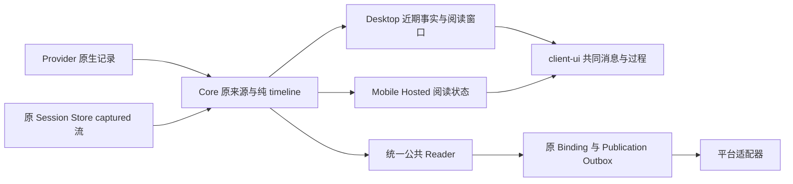

# 对话模式的机制与接线

本文说明当前源码的 owner 与调用链。行为归[对话行为 SSOT](../design/behavior/conversation-mode.md)，呈现归[对话呈现 SSOT](../design/presentation/conversation-mode.md)，字段、关系、分页与覆盖合同归[公共协议](../specs/conversation-protocol.md)；本页不持有任务、构建、安装或运行验收状态。

## 记录、身份与唯一 owner

| 事实 | owner 与源码入口 |
| --- | --- |
| 原生记录、parts、回合、问题与原生延续位置 | Provider；[`AgentProvider`](../../packages/core/src/agent-provider.ts)、[`AgentSessionHistoryItem`](../../packages/core/src/types.ts) |
| Session、原生绑定、输入／交互回执与 captured 原记录 | Core；[`AgentMuxClient`](../../packages/core/src/client.ts)、[`AgentSessionStore`](../../packages/core/src/agent-session-store.ts) |
| captured 流、提交序号及旧版本 | 原 Session Store 的 [`captured-history`](../../packages/core/src/captured-history.ts)；[`captured-history-import`](../../packages/core/src/captured-history-import.ts) 在原 writer／事务内接管旧记录，保留原始文件 |
| 记录到事件、角色、作者、顺序、关系与内容归属 | Core 的纯 [`projectConversationTimeline`](../../packages/core/src/conversation-timeline.ts)；浏览器和 Node 消费同一实现 |
| 通用 Run、PTY ordered bytes、Replay 与 Gap | ctxmux；Core 经 [`CtxmuxRunAdapter`](../../packages/core/src/ctxmux-run-adapter.ts) 消费，见[Terminal Runtime](terminal-runtime.md) |
| 消息、过程、Question、来源和载荷的共同呈现 | [`client-ui`](../../packages/client-ui/src/components/ConversationView.tsx)；宿主注入 [`ClientUiPlatform`](../../packages/client-ui/src/platform.tsx) 能力 |
| 公共读取的已接受贡献、原页邻接和有界临时窗 | 原 [`conversation-reader`](../../packages/core/src/conversation-reader.ts)；持久原记录仍归各原 owner |
| 草稿、阅读位置、选区、展开、可见性与 caret 意图 | 原客户端 owner；不是第二份对话事实 |
| 外部受众、内容表示、待投意图及平台回执 | 原 connector Binding／Publication Store；不拥有原生或 captured 记录 |

[`projectConversationReading`](../../packages/core/src/conversation.ts) 把同一个 Core timeline 适配为共同消息行及可访问的 originals；`projectConversationRecords` 复用这个 facade。UI 的 [`conversation-records`](../../packages/client-ui/src/lib/conversation-records.ts) 添加 speaker、来源标签及 coverage 的呈现。缺少原 source Host 时仍保留正文，不从当前焦点补一个引用。原 source namespace 与 client route 的区别见[协议](../specs/conversation-protocol.md#unified-reading-and-changes)。

## 三种来源怎样读取

Provider 的原生历史解释与 Hook 回调解释消费不同的原信号，提交记录则由 Core 输入 writer 产生；出现多路记录本身不表示同一 payload 被解析两次。它们进入同一 Conversation 处理边界，接入方不承担厂商信号整合。Core 原 Reader 持有有界接受窗口与跨批贡献；下文列出的 Desktop、Mobile raw 读窗仍是独立的消费路径，不能以公共 Reader 的接线代签客户端切换。

| 来源／需求 | 原读取 owner |
| --- | --- |
| Provider 原生页、精确记录及资源 | `sessionHistoryPage`／Provider history 能力；精确回读保持原 Provider source 和签名资源引用 |
| captured 近期快照、完整分页及旧版本 | `sessionTimeline`／`readAgentSessionHistory` → 原 Session Store；近期快照不代签全量历史 |
| 统一事件页、精确锚点、耐久变化 | [`conversation-reader`](../../packages/core/src/conversation-reader.ts) → 原 native/captured 端口 → `projectConversationTimeline` |
| Terminal Replay | 原 Run output／Attachment → terminal viewport；PTY 字节不自动成为对话或作者事实 |

`readAgentConversation`、`conversationCheckpoint`、`readConversationChanges` 与 `observeConversation` 持有统一公共读取合同。原 Reader 的临时 view 保留已接受原记录、版本、页邻接与切点；`consumeConversationWindowPage` 仅校验和重组完整替换窗口，客户端不做跨批语义合并。准确 watch 保持相关 view，最后一个绑定观察的 `dispose` 或显式 `releaseConversationView` 释放该临时资源；deferred part 仍沿原资源接口读取。窗口 cursor、耐久 source frontier 与通知分别由[协议](../specs/conversation-protocol.md)定义，通知只唤醒权威读取。`sessionHistoryCheckpoint`／`readSessionHistoryChanges` 保留为原生 primitive，原 `agent.history` 继续提供原来源读取。Claude／Codex 保存历史页由同一 [`NativeJsonlHistoryReader`](../../packages/core/src/native-jsonl-history-reader.ts) 给出准确页快照的 `changesCursor`，避免另一次 checkpoint 和页读取之间的同 ID 版本竞态。原 Store 事务仍返回准确 stream 与 changed position，经既有事件进入原 raw applier／Renderer；该路径的处理不由新 view 合同替代。

调用关联以每个准确 part 对原 scoped invocation 的 `invocation-member` 归属表达，单成员也保留；`conversationInvocationId` 由 Core 唯一定义。归属及其所在事件版本不依赖同批是否读到另一成员，公共 Reader 不反查全史。相同调用身份不合并父发言，也不表示未读的对端内容已经可读。

每条原生答案的 typed `questionAnswers` 独立产生 `answers`，目标只持原 source Host、Session、Provider/native source 与完整 opaque question ID，不要求同批读到问题，也不猜问题 record 或 turn。`conversation-questions` 共同限定读卡片的 Host／来源；`conversation-timeline` 的原记录关系函数同时供投影与严格 codec 使用。`answers`／`observes` 只归发起原记录所在事件，不能因读到目标而改变目标事件版本；未读目标仍保准确 gap。多条原答案分别保留，卡片显示选择不代替关系保全。

其他关系只对原 Reader 当前已接受的 records 闭合。后续 source page 或 changes 加入同一 view 后，纯投影重新形成完整窗口，晚到的准确 same-event 贡献保留先前原文并更新一个事件。暂未读取或已离开有界窗的关系目标仍有准确 gap；保留边界可沿原 versioned anchor 回读。当前 GUI 原 raw 读窗的较早／较新页、邻近锚点及 previous-source 导航能力仍由原客户端路径提供，不能在公共消费切换前删除。精确原文、来源覆盖与已闭合关系分别解释，接入方不另做关联。

Core 经 [`SessionHistoryObservationPool`](../../packages/core/src/session-history-observation-pool.ts) 共享准确 native source 的 watch；captured 通知沿原 Session Timeline publisher。取消一个 reader 不终止 Run。来源失败保留已接受的其他记录、准确 Gap 与重试位置，不用最新版本替换失效的原锚点。

## Desktop 的共同阅读链

[`SessionPane`](../../apps/desktop/src/renderer/src/components/SessionPane.tsx) 以实际阅读需求启用 [`useSessionUserMessages`](../../apps/desktop/src/renderer/src/lib/session-user-messages.ts)；近期 native 页和 captured 事实经同一 Core facade 投影。原生观察先于首读建立，隐藏消费者释放需求，原正文和服务窗仍保留。客户端按 Host／Session／Run 共享相关近期读取，不按所有 Session 放大热路径工作。

[`ActivityView`](../../apps/desktop/src/renderer/src/components/ActivityView.tsx) 使用 [`useSessionConversationWindow`](../../apps/desktop/src/renderer/src/lib/session-conversation-window.ts) 保持原页、阅读锚点、返回位置与选区；native 继续原 cursor，captured 较早页沿原 bounded reader 补读。窗口只持阅读状态，事件关联和顺序仍由 Core 决定。退休 Session、History 和当前对话复用共同读取与呈现；来源失败保原内容及恢复入口。

[`ConversationView`](../../packages/client-ui/src/components/ConversationView.tsx) 与 [`ConversationRecordSequence`](../../packages/client-ui/src/components/ConversationRecordSequence.tsx) 消费共同 records／originals；[`ConversationMessage`](../../packages/client-ui/src/components/ConversationMessage.tsx) 统一正文、完整 Copy、Question、reasoning、tool 与 resource。captured 输入保原输入身份，回复和系统记录由 [`CapturedConversationMessage`](../../packages/client-ui/src/components/CapturedConversationMessage.tsx) 薄适配。原生与 captured 过程使用共同 [`WorkflowObservation`](../../packages/client-ui/src/components/WorkflowObservation.tsx) 和 [`ConversationToolPayload`](../../packages/client-ui/src/components/ConversationToolPayload.tsx)。

来源标签集中在 [`conversation-sources`](../../packages/client-ui/src/lib/conversation-sources.ts)，只索引已接受 Core records 和精确关系；同一事件可有多个来源，invocation 来源按 Core 归属与唯一调用身份只标对应 selector。Focus、搜索与 Mobile 复用该映射；来源标签不产生关联、作者、采用或完成事实。

用户命名阅读点由 [`ConversationLandmarks`](../../apps/desktop/src/renderer/src/components/ConversationLandmarks.tsx) 经原 Main／公共控制服务到同一 [`ConversationLandmarkStore`](../../packages/core/src/conversation-landmark-store.ts)。该 Store 只持引用元数据。返回沿原 SessionPane 导航 owner；未确认写入保留原 operation 与暂存草稿，不建立第二份已保存事实。

资源读取沿原 `SessionPane.readHistoryResource` → IPC → [`RuntimeController`](../../apps/desktop/src/main/runtime-controller.ts) → `sessionHistoryResource`。共同 [`ConversationResourceImage`](../../packages/client-ui/src/components/ConversationResourceImage.tsx) 和 [`readSessionHistoryTextResource`](../../packages/core/src/session-history-content.ts) 校验准确原记录、part、引用、完整 extent 和 digest。pasted 图片另经 Main 的受限 [`readPastedImage`](../../apps/desktop/src/main/pasted-image-read.ts)，不能替代原生资源 owner。

## Mobile、样式与宿主差异

[`useHostedConversation`](../../apps/mobile/src/conversation/use-hosted-conversation.ts) 读取准确 Hosted Session 的 native 页与 captured 流，独立保留读失败及较早范围；[`MobileConversationSurface`](../../apps/mobile/src/conversation/MobileConversationSurface.tsx) 交同一 `ConversationView` 和 Core facade。Mobile 保留自己的窗口、连接、草稿及未确认操作，不照搬 Desktop 的窗口 Hook，也不另做语义 merge。保留页的资源继续使用其原 client／Session／Host，连接或 Session 改变后不接受旧结果。

共享样式归 [`client-ui/styles`](../../packages/client-ui/src/styles/index.css)，两端按宿主入口导入。Mobile 的触控尺寸、外层容器和本端覆盖归 [`conversation.css`](../../apps/mobile/src/conversation/conversation.css)；共同组件的存在不代签两端视觉、性能或交互验收。

## 阅读入口与控制入口

| 动作 | 接线与独立事实 |
| --- | --- |
| 普通消息、Queue／steer | Desktop [`AgentSessionComposer`](../../apps/desktop/src/renderer/src/components/AgentSessionComposer.tsx) → 原 store.send／enqueueAgentSteer；Mobile → Hosted Core 输入。草稿、入队、投递与原生采用分别解释。 |
| 当前同步问题／权限 | [`AgentInteractionCard`](../../packages/client-ui/src/components/AgentInteractionCard.tsx) → 原 interaction owner；历史记录不取得当前 pending 资格。 |
| 原生异步问题 | [`projectConversationQuestions`](../../packages/core/src/conversation-questions.ts) → [`AgentAsyncQuestionCard`](../../packages/client-ui/src/components/AgentAsyncQuestionCard.tsx) → Provider 声明的原 Terminal 路由；`replySessionQuestion` 明确拒绝无原生协议的自动回复。选项、草稿、Copy 和导航不派发输入。 |
| 显式打开原终端 | SessionPane 选择原展示 Region，再向原 caret owner 请求该终端；[`TerminalView`](../../apps/desktop/src/renderer/src/components/TerminalView.tsx) 只消费准确、可见且非 inert 的目标，保留后来的人工焦点。 |
| reaction／Mailbox | [`useConversationReactions`](../../apps/desktop/src/renderer/src/lib/conversation-reactions.tsx) 沿原输入队列；[`SessionMailbox`](../../apps/desktop/src/renderer/src/components/SessionMailbox.tsx) 保原消息和 read-marker，详情复用共同 Message。 |

外部入站 `DurableIngressHost.deliver` 调用原 `submitAgentMessage`，与本地输入复用原 `DurableAgentMuxMessageQueue`／input journal 及准入 owner。[`readAgentInputMailbox`](../../packages/core/src/client.ts) 沿同一 journal 既有 recipient/intent-sequence 索引有界读取 controlled input 与只读 submission 引用，SDK、`agent.input.ls` RPC／CLI 和 Hosted 消费同一严格结果合同；字节分片复用原 `JsonReadEntry`。新 claim CAS／typed launch commit 记录首次准确 key，旧 claim／unknown launch 不回填；每条 admission 仍从原 owner 读取，失败保该条原内容与缺口。

Desktop 的 [`SessionMailbox`](../../apps/desktop/src/renderer/src/components/SessionMailbox.tsx) 与 [`AgentSessionComposer`](../../apps/desktop/src/renderer/src/components/AgentSessionComposer.tsx)、Mobile 的 [`MobileMailbox`](../../apps/mobile/src/conversation/MobileMailbox.tsx) 通过共同 [`useAgentInputMailbox`](../../packages/client-ui/src/lib/use-agent-input-mailbox.ts) 消费这份原日志。Desktop 沿原 Host 路由和 typed IPC 调用，Mobile 使用原 Hosted 读口；完整条目通过严格分片校验后才进入当前读窗。共同 [`InputMailboxRecords`](../../packages/client-ui/src/components/InputMailboxRecords.tsx) 保留准确作者、正文、原回执与当前读取失败，原本地未发意图和可编辑控件仍归原输入 owner。信箱的来源历史与登记行按原显示时刻共同排序，只有准确原 input key 相同才连接已有本地操作，不按正文或时间认定原生采用。

当前 PTY 发送受据及 `inputRef` 尚不构成原生采用，不能由界面收起卡片来补造关联。准确来源意图和原 actor 写通道仍须沿原 Provider／输入边界实现与核验，不能借历史 reader 冒充控制口。

具体行为由[范围与唯一归属](../design/behavior/conversation-mode.md#范围与唯一归属)指向的原专题持有。普通输入和健康能力不以历史探测或 UI 阅读是否成功为门槛。

## 外部 publication 的接线

[`RoomBindingHost`](../../packages/connectors/src/room-binding.ts) 在原授权动作内冻结准确 source frontier；既有 native cut、Binding revision、scope 和受众保持其原含义。旧 Binding 缺少 captured 起点时保留明确 Gap，不用当前 discovery 重设历史起点。

[`createPublicationConversationPort`](../../packages/connectors/src/core-conversation-port.ts) 复用 Core checkpoint／changes／inspect／watch 和原 route/source fence；[`PublicationHost`](../../packages/connectors/src/publication-host.ts) 将后续读取和观察绑定到原 view，经共同 assembler 收到完整窗口后读取准确 deferred part，并交原 [`PublicationStore`](../../packages/connectors/src/publication-store.ts)。该 Store 在同一事务内持久化表示意图、准确 Gap 和下一读取 frontier；不再选择原生或 captured 角色、顺序、作者或关联。重开 owner 从原 durable cut 继续，精确 gap 沿原 anchor 恢复；临时 view 不成为第二份持久事实。

[`publication-content`](../../packages/connectors/src/publication-content.ts) 只决定已授权内容怎样由现有平台能力表示。原 Outbox 保留准确 part/revision 的平台表示及已确认映射；Core 后续 coalescence 更新这些表示，无权重做 unknown effect。无法表示的资源、未确认 public span、失效原版本或缺少准确关系仍可由原 `connection.delivery.ls` 查询，其他可投内容继续流转。原平台 ingress 的表示只由准确 durable ingress 与 Core 原 writer 的 `inputRef` 对账；作者和正文相同不是关联证据。

[`FeishuPublicationAdapter`](../../packages/connectors/src/adapters/feishu/publication.ts) 持有平台编码、请求容量、原 prepared bytes 和平台回执的解释，不持有 conversation merge。平台投递、原生采用与个人身份不互相代签；当前权限和 public-content producer 的能力边界见[公共协议](../specs/conversation-protocol.md#state-change-and-delivery)。

## 公共消费者与证据范围

[`AgentMuxRpcService`](../../packages/core/src/public-rpc-service.ts) 将 `agent.conversation.inspect`／checkpoint／changes／watch／release 接到原统一 Core owner；[`Hosted 合同`](../../packages/core/src/hosted-client-contract.ts)、本地 SDK 和 [`CLI 命令树`](../../packages/core/src/agentmux-cli-commands.ts) 消费同一类型与严格 codec。原 `agent.history` 和资源 API 保留自己的读取职责，GUI 不要求绕行 CLI。

当前机制与完整产品验收分别成立。未提供 native 采用、公有用户内容边界或可寻址答复能力的 Provider 不能由 UI 文案补齐；原记录、输入与准确缺口继续保留。真实跨接入一致性、进程重启、活跃终端阅读、选区、性能、视觉、安装与当前加载身份，由[测试策略](../testing/strategy.md#任务验收与假绿防护)规定的各类证据分别证明。
