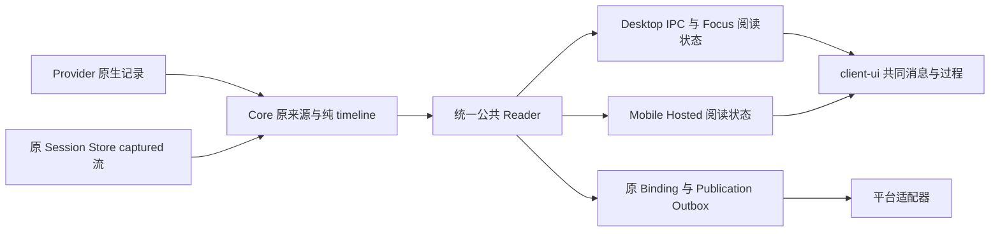

# 对话模式的机制与接线

本文说明当前源码的 owner 与调用链。行为归[对话行为 SSOT](../design/behavior/conversation-mode.md)，呈现归[对话呈现 SSOT](../design/presentation/conversation-mode.md)，字段、关系、分页与覆盖合同归[公共协议](../specs/conversation-protocol.md)。目标职责与渐进阅读的技术边界见[对话客户端分层](../design/conversation-client-architecture.md)，不代表已替换本页的现有实现；本页不持有任务、构建、安装或运行验收状态。

## 记录、身份与唯一 owner

| 事实 | owner 与源码入口 |
| --- | --- |
| 原生记录、parts、回合、问题与原生延续位置 | Provider；[`AgentProvider`](../../packages/core/src/agent-provider.ts)、[`AgentSessionHistoryItem`](../../packages/core/src/types.ts) |
| Session、原生绑定、输入／交互回执与 captured 原记录 | Core；[`AgentMuxClient`](../../packages/core/src/client.ts)、[`AgentSessionStore`](../../packages/core/src/agent-session-store.ts) |
| captured 流、提交序号及旧版本 | 原 Session Store 的 [`captured-history`](../../packages/core/src/captured-history.ts)；[`captured-history-import`](../../packages/core/src/captured-history-import.ts) 在原 writer／事务内接管旧记录，保留原始文件 |
| 记录到事件、角色、作者、顺序、关系与内容归属 | Core 的纯 [`projectConversationStream`](../../packages/core/src/conversation-stream.ts)；浏览器和 Node 消费同一实现 |
| 通用 Run、PTY ordered bytes、Replay 与 Gap | ctxmux；Core 经 [`CtxmuxRunAdapter`](../../packages/core/src/ctxmux-run-adapter.ts) 消费，见[Terminal Runtime](terminal-runtime.md) |
| 消息、过程、Question、来源和载荷的共同呈现 | [`client-ui`](../../packages/client-ui/src/components/ConversationView.tsx)；宿主注入 [`ClientUiPlatform`](../../packages/client-ui/src/platform.tsx) 能力 |
| 公共读取的已接受贡献、原页邻接和有界临时窗 | 原 [`conversation-reader`](../../packages/core/src/conversation-reader.ts)；持久原记录仍归各原 owner |
| 草稿、阅读位置、选区、展开、可见性与 caret 意图 | 原客户端 owner；不是第二份对话事实 |
| 外部受众、内容表示、待投意图及平台回执 | 原 connector Binding／Publication Store；不拥有原生或 captured 记录 |

公共 Reader 的完整窗口经 [`projectConversationWindow`](../../packages/core/src/conversation.ts) 适配为共同消息行及可访问的 originals；适配保留已接受的事件、角色和原顺序，不重新关联原记录。`projectConversationReading`／`projectConversationRecords` 仍提供纯投影能力。共同 `useConversationView` 为已接受窗口生成 Core reading；Desktop、Mobile 与 Focus 复用该结果，经 UI 的 [`describeConversationWindow`](../../packages/client-ui/src/lib/conversation-records.ts) 添加 speaker、来源标签及 coverage 的呈现。提交前的候选仍经同模块 `projectConversationWindow(snapshot)` 独立投影，不使用当前保留帧。缺少原 source Host 时仍保留正文，不从当前焦点补一个引用。原 source namespace 与 client route 的区别见[协议](../specs/conversation-protocol.md#unified-reading-and-changes)。

共同输入消费直接使用该投影的 `inputs` 实体列表，保留 canonical event、revision、作者与全部原贡献；原 `record.input` 仍供单来源详情使用。Desktop 的 [`useSessionUserMessages`](../../apps/desktop/src/renderer/src/lib/session-user-messages.ts) 与 Agent 卡片 Recent inputs 直接消费实体。Desktop Composer 和 Mobile 邮箱的原来源检索则以 `originalRecords` 中的 raw inputs 作为种子，与原 `agent.history` 的原记录身份对应；不把实体 ID 混入来源分页。固定预览补入原在途实体时经 Core 的纯 `retainConversationInputs` 按准确当前 coalescence 保留已显示实体及原阅读版本，不按 native 原记录 ID 再拼一次消息列表。

## 可读信封与原输入

Core 的 [`agent-outbound-message`](../../packages/core/src/agent-outbound-message.ts) 生成无 `from` 属性的 `<amux>` 平台说明；[`agent-message-render`](../../packages/core/src/agent-message-render.ts) 生成并共享解析 `amux:a2a` 的 canonical `from`、稳定 `msg-id`、原正文及末尾 Core reminder。该 codec 无 Node 或 UI 依赖；精确语法由 [amux 可读协议](../specs/amux-protocol.md)唯一持有，共同记录和资源的消费合同归[对话协议](../specs/conversation-protocol.md#readable-agentmux-envelopes)。外部来源继续保其 typed participant，人工／未核原文不会被格式化成 Agent 身份。客户端读取声明不改变原作者、投递和权限事实；共同 [`ConversationInputText`](../../packages/client-ui/src/components/ConversationInputText.tsx) 只呈现 Core 返回的上下文、正文、既有 packet 引用及末尾 reminder，不重新解析。消息首 text part 与显式打开的首 part 完整文本资源复用同一阅读面；后续 parts 保其原正文。Copy 继续从原 parts／资源取完整 wire，与阅读投影分离。

原输入 coordinator 的 admission intent 保存实际 wire 与 producer 事实。`AgentMuxClient` 重试已保存 A2A Input 时复用该原配方；人工 note 的重试还需原显式正文、平台内容及来源一致。原 claim、条件和当前授权继续核验，unknown 不因格式更新获得第二次发送。Connector publication 沿原 captured writer 的 typed `inputRef`／`publicContent` 核对来源，不重算当前显示模板比较历史 wire；普通正文编辑仍由原 reducer 取消该已核边界。

## 注入上下文与发现入口

下表记录当前 producer 与原输入 owner 的接线；产品要求仍归[注入上下文行为](../design/behavior/agent-capabilities-and-messaging.md#agentmux-注入上下文)，具体格式归 [amux 协议](../specs/amux-protocol.md)。独立热上下文、用户正文与首次 Input 的 producer 分界不会因为共享 formatter 而合并。

| 当前路径 | 实际接线 |
| --- | --- |
| 启动 guide、Scratch Topic/Wiki/SOUL | [Core `composeAgentLaunchPrompt`](../../packages/core/src/agent-outbound-message.ts) 将 guide 与 `agentMuxNote` 放在同一 amux 包装；[Desktop `RuntimeController`](../../apps/desktop/src/main/runtime-controller.ts) 提供 Topic note，[Core Client](../../packages/core/src/client.ts) 从实际 producer 保留独立 `systemContext` 记录。 |
| Goal/PMO 任务上下文 | [Desktop `openGoalPmo`](../../apps/desktop/src/renderer/src/store.ts) 将职责、项目与执行上下文作为显式 `agentMuxNote`，与原用户请求分开交给 Core；队列与同 Region 启动器分别保留原 note 和可编辑正文，重试不重算已冻结上下文，正文中的 amux 标签不升级为平台来源。 |
| Goals 探索与 Browser annotations | [Goals `startGoalExploration`](../../apps/desktop/src/renderer/src/lib/goals-entry-actions.ts) 在原请求发起时冻结项目说明，以显式 `agentMuxNote` 沿原 Region 草稿与启动通路交给 Core，原正文独立保留；缺 Executor 或准备未确认时两者仍留在同一启动器。[Browser context formatter](../../apps/desktop/src/renderer/src/lib/browser-annotations.ts) 沿共用分享外框，经 [Browser Tools Panel](../../apps/desktop/src/renderer/src/components/BrowserToolsPanel.tsx) 加入可编辑草稿，用户编辑、审批后的整段仍按用户正文发送。两者均不新增专用信封或从正文标签恢复平台来源。 |
| Core 的普通提交、恢复与 Host 通路 | [Core `composeAgentPrompt`](../../packages/core/src/agent-outbound-message.ts) 统一组合显式平台内容与原用户正文，启动引导委托同一组合 owner；独立热上下文不附加启动等待语。公开 SDK、Hosted RPC、Main 和 Preload 显式传递 `agentMuxNote`，Core 分别记录平台与原正文来源。首次 Input 的完整 wire、原来源分界与作者冻结在既有持久意图中；同一 operation 的相同 wire 不允许变更来源，缺原来源事实明确未知，保留原 Input 与健康 Run。原生 resume 保留用户空白与换行。 |
| Mailbox Progress | [Host Loop Manager](../../apps/host/src/continuous-progress-loop-manager.ts) 在原符合资格的发送首次 claim 时保存原 `loop.prompt` 与 Core 同源共享消息规则；[Host `deliverContinuousProgress`](../../apps/host/src/continuous-progress-delivery.ts) 将冻结的原正文与显式平台说明分开提交。同一次重试或冷恢复沿原 operation、condition 与内容；缺原内容事实明确未知，保留健康 Run 与手动输入。规则只伴随既有自动发送，无新增 Reminder 周期、任务或配置，用户 continuation prompt 不升级为平台自产内容。 |

启动引导和非空 resume 由 [`agent-outbound-message`](../../packages/core/src/agent-outbound-message.ts) 组合；[`agent-messaging-guidance`](../../packages/core/src/agent-messaging-guidance.ts) 持有完整协作合同、短通信入口与 A2A 接收提醒。启动给出短发现路线，resume 和新的 Progress 输入用短通信入口；完整协作合同只由 `message --skill` 展开。已冻结的输入与安排保留原平台内容，不按新版指南重组。

`whoami` 的[原公共类型、服务和严格 codec](../specs/public-capabilities.md)只返回原 Session、状态、View 与 unavailable，不带静态 Topic 提示或通信指南。模块目录及本地 Skill 生成来自 [`agentmux-cli-module-skills`](../../packages/core/src/agentmux-cli-module-skills.ts)的实际命令根；基础目录不内联模块全文。已知任务域可直接读取其模块，root／object help 由原注册表列下一层，叶子 help 提供该操作的参数、选项与回执说明。Browser program／task、原生恢复、空间 playbook 等分别在相关原入口可达，不在所有相邻模块与叶子重复展开。确切路由由 [`agentmux-cli-help`](../../packages/core/src/agentmux-cli-help.ts)持有，不新增规则或已读状态 Store。实际文本可达和读取不证明当前模型已经采用。

## 语义流的模块边界

公开入口保持 `@agentmux/core/conversation`。来源适配、语义归一、读取协调和客户端呈现分别持有自己的事实：

| 边界 | 实现与责任 |
| --- | --- |
| 来源适配 | [`conversation-timeline`](../../packages/core/src/conversation-timeline.ts) 将 SDK 的 native page／captured timeline 转为原记录，保原 Host、来源顺序与 writer 版本。Provider 继续解释各自原生协议。 |
| 纯语义流 | [`conversation-stream`](../../packages/core/src/conversation-stream.ts) 的 `projectConversationStream` 消费已接受 `ConversationSourceRecord`，统一事件、作者、关系、版本、覆盖与部分顺序；无 IO、订阅或持久 Store，不决定输入资格。 |
| 读取协调 | [`conversation-reader`](../../packages/core/src/conversation-reader.ts) 持有来源读取、cut、分页及临时阅读窗，直接将原版本化 records 交给语义流；不还原 page／timeline 再造记录或重算原版本。页预算在本次读取内累计已接受 entry 的 JSON 字节与分隔符，候选保留准确游标和 envelope 大小，避免逐项重编码整个已接受前缀；最终完整页仍执行原字节预算与严格解析。 |
| 公共输送 | [`conversation-changes`](../../packages/core/src/conversation-changes.ts) 校验和组装完整版本化窗口；未收齐的 wire fragments 不表示语义节点处于半开状态。 |
| 客户端消费 | Desktop、Mobile 和 Connectors 消费同一公共 Reader；`projectConversationWindow` 只适配已接受事件，不重判关联、作者或顺序。 |

当前实时合同是来源 `invalidated`／`unavailable` 通知唤醒准确读取，再交付新版完整窗口。`ConversationEvent` 保留贡献版本与关系，没有一个包办身份、正文结束、投递和采用的 `final` 位；各项确认沿原协议事实。晚到准确关系由同一语义流更新事件和 coalescence，关联缺证仍保独立原记录，不能从同文、时间或终端 ACK 补造。

## 原生结果的接线与能力边界

[`AgentTurnOutcome`](../../packages/core/src/types.ts) 是原记录上的结果合同，与计量、当前活动和 Run 健康分开。Codex 的 [`codexTurnOutcome`](../../packages/core/src/providers/codex-turn-outcome.ts) 由原生状态观察、输入完成证据和 saved-history 共用；[`codexFailure`](../../packages/core/src/providers/codex-errors.ts) 保原生码、有限诊断及 Provider 明确提供的公开摘要。Claude 的准确结构化主轮错误由自己的 Hook 适配贡献，缺少可信 turn 身份的信号只留诊断。

Core 在当前活动排序与显示资格判断之前保存准确原结果。历史归一、公共 wire、changes 和 deferred header 保留 `turnOutcome`，原 native record 与 captured witness 仅凭明确 `same-event` 关系归并；迟到失败不覆盖新轮，也不被新轮抹去。共享 [`ConversationView`](../../packages/client-ui/src/components/ConversationView.tsx) 将失败卡置于过程折叠之外，原始详情按需读取。外部 [`publication-content`](../../packages/connectors/src/publication-content.ts) 只选已授权公开摘要，沿原 outbox 发布；[`publication-query-feedback`](../../packages/connectors/src/publication-query-feedback.ts) 以准确采用关系及结果决定完成、失败或中断反馈，不再读取 metrics 状态。

Provider catalog 的 `turnOutcomes.observation`／`history` 只声明对应适配器已验证能解释的结果类别，不保证所有来源完整。Codex 的有界 app-server indexed history 尚未提供轮结果 envelope，因此不声明 history 结果覆盖；其准确 saved JSONL 与实时观察仍可提供结果，缺字段不补成功，也不为了补结果无界读取所有 turns。读取故障和模型请求失败由不同 owner 表达。协议唯一见[原生结果协议](../specs/conversation-protocol.md#native-request-and-turn-outcomes)，呈现边界见[共同消费设计](../design/conversation-client-architecture.md#原生结果的共同消费)；源码接线不代签安装实例或未验证平台。

## 三种来源怎样读取

Provider 的原生历史解释与 Hook 回调解释消费不同的原信号，提交记录则由 Core 输入 writer 产生；出现多路记录本身不表示同一 payload 被解析两次。它们进入同一 Conversation 处理边界，接入方不承担厂商信号整合。Core 原 Reader 持有有界接受窗口与跨批贡献，Desktop、Mobile 和 Focus 消费该 Reader 的完整窗口。

准确历史来源由原 [`AgentSessionStore.readHistorySource`](../../packages/core/src/agent-session-store.ts) 按 Session ID 读取。SQLite 的活跃记录只校验、投影原 Host、Provider 及当前／观察／已确认前序来源，不为读取描述重新校验或克隆无关恢复账本；原行 JSON 解析仍保留。完整元数据读写继续执行完整校验，退休与 reopen 关联沿原分支，历史描述不授予输入或生命周期权限。

Hook 声明由原 [`AgentManagedHookInstaller`](../../packages/core/src/managed-hook-installer.ts) 在受管创建／恢复时安装。安装器在原 receipt／backup owner 内保留按 Provider、准确目标及 merge 范围限定的实际新增声明；后续更新经 [`prepareMergedHookContent`](../../packages/core/src/hook-config-merge.ts) 只替换能够精确确认的旧自有声明，保留用户、手改及未知历史条目。目标和声明归属同时参与预览校验，同一准确目标的写入由文件锁互斥，并在锁内复核；写入前保留 pending 的前后哈希，重建实例据准确字节判定所属代次。竞争或归属未知保留原回调与具名问题，不阻断健康 Agent。该机制防止安装更新继续累加采集入口，不补造旧回复快照的消息关联，也不改变已有 Conversation 或原记录读取接口。

客户端的 [`useConversationView`](../../packages/client-ui/src/lib/use-conversation-view.ts) 在原读取状态中保留当前操作和失败操作的种类。后台变化更新或保留帧回放成功，不结算另一次失败的相邻页读取；原操作重试成功或新的明确读取成功后才收起其失败。已接受帧的来源不可用继续归原来源服务反馈，不能借自动补读意图把它改称分页操作失败。这些呈现事实不改变 Core 窗口、游标、来源覆盖或公开读取回执。

| 来源／需求 | 原读取 owner |
| --- | --- |
| Provider 原生页、精确记录及资源 | `sessionHistoryPage`／Provider history 能力；精确回读保持原 Provider source 和签名资源引用 |
| captured 近期快照、完整分页及旧版本 | `sessionTimeline`／`readAgentSessionHistory` → 原 Session Store；近期快照不代签全量历史 |
| 统一事件页、精确锚点、耐久变化 | [`conversation-reader`](../../packages/core/src/conversation-reader.ts) → 原 native/captured 端口 → `projectConversationStream` |
| Terminal Replay | 原 Run output／Attachment → terminal viewport；PTY 字节不自动成为对话或作者事实 |

Inputs 的有界搜索／分页由原 `agent.history` 与 `agent.input.ls` 提供；[`projectSessionInputs`](../../packages/core/src/session-inputs.ts) 在 Core 内复用同一 same-event／adoption 判定，将准确 input key、已查询的原记录及当前 accepted input 关系投影为阅读组。当前实体只贡献关联证明，不把未命中查询的正文塞回结果。原记录版本改变或 native 采用出现歧义时撤销相应归并，保留原正文与未知回执；原 Host 未确认时不拿路由 Host 替代。Desktop Composer／Mailbox 和 Mobile Mailbox 消费这一个纯投影，发送回执占主行时，其来源正文在同一详情逐份展开；没有回执的组使用原生记录优先的原记录作为主行。所有 Copy、填草稿、资源读取和定位仍指向准确原记录，列表不创建新发送或第二份事实 Store。

共同 [`inputHistoryText`](../../packages/client-ui/src/lib/input-history-text.ts) 在一次准确资源读取中保留两种结果：`text` 沿原答案与阅读范围投影供填入草稿，`originalText` 按原 text parts 顺序保留完整正文供 Copy。Desktop 的 [`useComposerInputHistory`](../../apps/desktop/src/renderer/src/lib/use-composer-input-history.tsx) 与 Mobile 的 [`MobileConversationSurface`](../../apps/mobile/src/conversation/MobileConversationSurface.tsx) 消费同一结果，各自保留原目标取消、平台回执和编辑器 Undo；不从可读答案反推原 wire。复制与回填的行为合同仍归[对话消息的阅读、复制与标注](../design/behavior/conversation-mode.md#对话消息的阅读复制与标注)。

`readAgentConversation`、`conversationCheckpoint`、`readConversationChanges` 与 `observeConversation` 持有统一公共读取合同。原 Reader 的临时 view 保留已接受原记录、版本、页邻接与切点；`consumeConversationWindowPage` 仅校验和重组完整替换窗口，客户端不做跨批语义合并。准确 watch 保持相关 view，绑定观察的 `dispose` 只解除 pin，原 frame 在既有有界暂存区停放；显式 `releaseConversationView` 或 Client dispose 才释放该临时资源；deferred part 仍沿原资源接口读取。窗口 cursor、耐久 source frontier 与通知分别由[协议](../specs/conversation-protocol.md)定义，通知只唤醒权威读取。`sessionHistoryCheckpoint`／`readSessionHistoryChanges` 保留为原生 primitive，原 `agent.history` 继续提供原来源读取。Claude／Codex／Pi 保存历史页由同一 [`NativeJsonlHistoryReader`](../../packages/core/src/native-jsonl-history-reader.ts) 给出准确页快照的 `changesCursor` 和原页位置 `replayCursor`，避免另一次 checkpoint 和页读取之间的同 ID 版本竞态。Pi 的 [`readPiConversationChanges`](../../packages/core/src/providers/pi-native-history.ts) 从该切点前的原叶记录继续校验逐项 parent 关系；分支改变由统一 Reader 表达为原来源 gap，后续 Current 重新读取选中分支。原 Store 事务仍返回准确 stream 与 changed position，经既有事件进入原 raw applier／Renderer；该路径的处理不由新 view 合同替代。

调用关联以每个准确 part 对原 scoped invocation 的 `invocation-member` 归属表达，单成员也保留；`conversationInvocationId` 由 Core 唯一定义。归属及其所在事件版本不依赖同批是否读到另一成员，公共 Reader 不反查全史。相同调用身份不合并父发言，也不表示未读的对端内容已经可读。

每条原生答案的 typed `questionAnswers` 独立产生 `answers`，目标只持原 source Host、Session、Provider/native source 与完整 opaque question ID，不要求同批读到问题，也不猜问题 record 或 turn。`conversation-questions` 共同限定读卡片的 Host／来源；`conversation-stream` 的原记录关系函数同时供投影与严格 codec 使用。`answers`／`observes` 只归发起原记录所在事件，不能因读到目标而改变目标事件版本；未读目标仍保准确 gap。多条原答案分别保留，卡片显示选择不代替关系保全。

其他关系只对原 Reader 当前已接受的 records 闭合。后续 source page 或 changes 加入同一 view 后，纯投影重新形成完整窗口，晚到的准确 same-event 贡献保留先前原文并更新一个事件。暂未读取或已离开有界窗的关系目标仍有准确 gap；保留边界可沿原 versioned anchor 回读。较早／较新页沿 Core 签发的原页邻接位置读取；previous-source 意图只选择 Session 保留的准确原生绑定。客户端保存 DOM 锚点、选区和已接受 frame，不解码 Provider cursor 或重新拼接贡献。原 `window.anchor` 表明精确单记录 inspect，与可前后翻页的历史窗分开；park/resume 保留该原版本，后到通知不令它自动跟随，显式返回当前历史重新打开正常窗口。自动预读较早页而首页仍在窗口中时，`navigation.newer` 为空，实时尾部仍继续接入；实际逐出首页才保留历史位置，沿 newer 返回后从原 cut 补齐变化。精确原文、来源覆盖与已闭合关系分别解释。

Core 经 [`SessionHistoryObservationPool`](../../packages/core/src/session-history-observation-pool.ts) 共享准确 native source 的 watch；captured 通知沿原 Session Timeline publisher。取消一个 reader 不终止 Run。来源失败保留已接受的其他记录、准确 Gap 与重试位置，不用最新版本替换失效的原锚点。

## Desktop 的共同阅读链

Composer 通过 `useComposerInputHistory` 持有 Inputs 的原生阅读窗；`SessionMailbox` 接到该 owner 时复用原记录、输入实体、读取错误、观察失败、冻结及刷新动作，不再激活第二份 native view。联合刷新重读原查询与原生归属，主刷新另更新原 input mailbox；独立 Mailbox 仍持有自己的 scoped reader。

[`SessionPane`](../../apps/desktop/src/renderer/src/components/SessionPane.tsx) 以实际阅读需求启用 [`useSessionUserMessages`](../../apps/desktop/src/renderer/src/lib/session-user-messages.ts)。共同 [`useConversationView`](../../packages/client-ui/src/lib/use-conversation-view.ts) 经 Desktop 的 [`conversation-read-api`](../../apps/desktop/src/renderer/src/lib/conversation-read-api.ts)、preload 与 Main [`conversation-read-ipc`](../../apps/desktop/src/main/conversation-read-ipc.ts) 调用原公共服务。IPC 只持 sender trust、取消与观察资源；完整窗口严格校验后才交呈现。首读的同页 changes cut 关闭 read→watch 间隙；短暂通知合并只唤醒变化读取。隐藏时取消观察而保留原 frame，重新可见按原 view 恢复；卸载或身份切换显式释放。观察断开在仍相关的消费者内重开原 view，不更换来源或重放输入。首读与显式 Current 在同一次操作内先尝试取得当前来源观察，再交接给该窗口的观察；Core 的 `activeNativeHistoryBinding` 从原观察资源借用尚未保存的 locator，准确来源参数贯穿页、切点和变化读取。固定 view、cursor 与记录定位沿原来源读取，临时观察随原操作释放，不形成会话级来源缓存。

Renderer 桥使用 Core [`conversation-changes`](../../packages/core/src/conversation-changes.ts) 的 `parseConversationReadPageForWindow`／`parseConversationChangesPageForWindow`，严格解析后持有本次响应的不可变副本。窗口组装只复用该准确对象已经完成的 unit 校验，不重复规范化原记录和计算 revision；拷贝或 raw 页仍走原严格校验，fragment 完整后仍校验其原内容。该私有持有权不跨响应缓存或 wire，不改变普通 SDK parser 的可变 DTO，也不授予作者、输入或恢复权限。

[`PublicationStore.commitPage`](../../packages/connectors/src/publication-store.ts) 在核对当前页请求后，复用同一 Core owner 的 `parseConversationUnitsForPage`：只有该不可变页内的原 item 对象免去重复正文校验；复制、其他页或跨页组装的单位仍严格解析。成员身份只在本次调用内比较，不建立另一份长期缓存；Binding 授权、原 frontier 与发布事务不变。

内容恢复的 `recoverableGaps` 查询与派生索引共享原完整资格条件，按准确 Binding 修订和原 rowid 分页，只扫描可恢复候选。原 Store 初始化时退役被替代的宽 gap 索引；诊断 gap 仍由原覆盖读取及其现有索引保留。增加无可读原对象的历史不扩大每页恢复工作，不改变 gap 状态或原恢复顺序。

[`ActivityView`](../../apps/desktop/src/renderer/src/components/ActivityView.tsx) 使用 [`useSessionConversationWindow`](../../apps/desktop/src/renderer/src/lib/session-conversation-window.ts) 保持阅读锚点和返回位置，沿同一 view 的 `navigation.older`／`navigation.newer` 补充相邻范围。时间范围读取、Current／Previous source 仍是明确阅读意图。退休 Session、History 和当前对话复用共同读取与呈现；来源失败保原内容及恢复入口。窗口提交调用共同呈现端口，待提交数据仍由原 Reader 持有；Focus pin 保留完整 accepted frame，不裁出 records 再重投影。

[`RecentFocusTimeline`](../../apps/desktop/src/renderer/src/components/RecentFocusTimeline.tsx) 仅为已选择的 Context 挂载共同 view；已读 Context 的完整 frame 在原呈现预算内保留，未选中的观察停放且不读。淘汰以完整 frame 为单位，当前和 pin 的原内容保留；Core 暂存已过期时明确显示错误，不能把旧 frame 当可继续的 cursor。Context 目录、已记录工作区间与时间尺仍由原 Focus owner 提供，不成为对话关联来源。

[`ConversationView`](../../packages/client-ui/src/components/ConversationView.tsx) 将统一有序 records 直接交给 [`ConversationRecordSequence`](../../packages/client-ui/src/components/ConversationRecordSequence.tsx)。纯 [`conversation-record-sequence`](../../packages/client-ui/src/lib/conversation-record-sequence.ts) 只按 `role === 'process'` 聚合连续过程，保留原贡献与 canonical 定位／展开 key；历史分界和尾部标记是独立的纯视图锚点。Desktop 从同一记录取得宿主标尺和定位节点，不再拆出 native 主干、captured 插入表或不可达的 user-message 分支；已删除无消费者的 `items`／`timelineSnapshot` props。

共同呈现准入通过 [`useConversationReadingSelection`](../../packages/client-ui/src/lib/use-conversation-reading-selection.ts) 把原 DOM 的选区端点和焦点接入 React 提交前一致性检查；每个候选重新核对真实 DOM，不以 `selectionchange` 已交付为前提。活动阅读位置只保一套相应订阅，停用、换 document 和卸载时释放。该快照不持有另一份消息或窗口。无 DOM 包裹的 [`ConversationReadingCommit`](../../packages/client-ui/src/components/ConversationReadingCommit.tsx) 在 mutation 前让原 [`ConversationBodyWork`](../../packages/client-ui/src/lib/conversation-body-work.ts) 采样当前锚点，提交后沿原几何恢复；整帧和首次正文挂载复用该边界。Desktop 的显式几何端口更新同一个宿主锚点，Current 与贴底意图仍由原宿主持有。

[`ConversationMessage`](../../packages/client-ui/src/components/ConversationMessage.tsx) 统一正文、Question、reasoning、tool、resource、来源详情与批注；[`ConversationMessageCard`](../../packages/client-ui/src/components/ConversationMessageCard.tsx) 中的普通发言、协作回报和系统记录薄外壳分别持有头部与披露，`compact` 仍是密度维度。captured 输入、回复与系统记录由 [`CapturedConversationMessage`](../../packages/client-ui/src/components/CapturedConversationMessage.tsx) 适配。

共享的[消息样式](../../packages/client-ui/src/styles/conversation-message.css)与[协作样式](../../packages/client-ui/src/styles/conversation-collaboration.css)通过 `client-ui` 样式入口供各宿主消费，变体选择器定位到本卡片所属的槽。Core 的 `conversationA2ANotificationId` 从原 producer／adoption 事实适配通知身份，Desktop、Mobile 与 Focus 交给共享 `ConversationMessage`；首个原文本为引用通知时，`ConversationA2AReferences` 按准确来源范围只读 journal，并以普通 Agent 消息卡直接呈现原信。`ConversationNotificationDetails` 在同一通知位置保留原协议及全部原贡献的按需原文／JSON，不再次调用消息 renderer。Mobile 沿选定 hosted client 的既有 `readMessage` 读取，Desktop 沿原 Host 路由；原通知、原信与来源身份各自保留。样式与宿主的责任合同见[共同过程、正文与卡片外壳](../design/conversation-client-architecture.md#共同过程正文与卡片外壳)。

整条、SID 与局部 Copy 共用 [`useContentCopyAction`](../../packages/client-ui/src/lib/use-content-copy-action.ts) 的动作原语，各自持有原操作、反馈与到期状态；整条 Copy 继续沿资源 reader 异步取得 deferred 原文。同一消息中的后续 Copy 取消旧整条 Copy 尚未完成的准备，已经发往平台的写入仍等待自己的回执；切换来源、卸载和迟到完成各按原动作身份处理。 原生工具与思考详情的动作身份沿原消息来源和 trace 保持，工具调用／结果另外区分字段种类；同字节的新 part 快照不重建动作。`ContentCopyButton` 仍负责原文字节真正改变时的重置，缺少稳定 trace／来源身份的独立 part 保持自身归属。

Desktop 与 Mobile 共用 [`CapturedProcessRecord`](../../packages/client-ui/src/components/CapturedProcessRecord.tsx)、[`WorkflowObservation`](../../packages/client-ui/src/components/WorkflowObservation.tsx) 和 [`ConversationToolPayload`](../../packages/client-ui/src/components/ConversationToolPayload.tsx)，保留参数摘要、来源、完整原文 Copy、编辑差异、定位展开和 `aria-controls`。首次披露后保留详情节点，关闭只隐藏；宿主 wrapper 只提供自己的标尺／定位引用。captured 图标按记录 kind，原生步骤图标按调用／结果 part；工具名称不决定图标种类。

纯 SDK 组合函数 [`capturedToolEdit`](../../packages/core/src/conversation-tool-edit.ts) 只接受准确 toolInput invocation 的原 Provider 来源；Claude 参数由原 [`Provider 解释器`](../../packages/core/src/providers/claude-tool-edit.ts) 规范化为请求的编辑，未知／歧义保完整载荷。它复用既有 wire 和来源合同，不新增 RPC、CLI 或输入权限。共享 [`conversation-tool-diff`](../../packages/client-ui/src/lib/conversation-tool-diff.ts) 负责通用 diff 排版与有界预览；[`ConversationToolDiff`](../../packages/client-ui/src/components/ConversationToolDiff.tsx) 使用共同样式及显式增删符号。预览截断不裁剪原文，也不证明编辑已执行。

### 当前阅读保护与成本边界

共同 [`useConversationRecordLayout`](../../packages/client-ui/src/lib/use-conversation-record-layout.ts) 是每个阅读位置唯一的呈现准入 owner：同时比较准确版本、canonical 代表项、角色、过程父节点和纯视图锚点，沿实际 `ownerDocument` 保护原 Range、焦点与阅读偏移。`beforeCommit` 调用同一端口；直接传入 records 的共同消费者也通过该边界。records、originals、coverage 与布局保同一接受版本，解除后由原 Reader 核对当前意图并提交；Desktop 段落和 Sequence 不再各自保留候选或订阅 `selectionchange`。普通滚动及选区通知复用既有序列和 placement，不重复重算全窗记录。独立输入／权限回执继续由各原 owner 更新，保护不会冻结这些操作事实；事务合同见[呈现事务](../design/conversation-client-architecture.md#一个阅读位置的呈现事务)。

读取侧已有原 Core 窗口预算和相邻页游标。Desktop 首窗／时间范围补读与 [`useConversationReadAhead`](../../apps/desktop/src/renderer/src/lib/use-conversation-read-ahead.ts) 的方向性需求分别计数：一次 wheel／scroll 的有效边缘需求最多补三页，一次只读一页；提交后仍处于约两视口的原边缘才继续剩余额度。布局反馈不产生新批次，反向阅读、隐藏、Current、换来源、错误或保护取消剩余需求。较早自动读取复用原 `preserveCurrent`，原窗口预算不足停止自动补充，显式 Earlier 仍沿原导航可用。

[`ConversationReadingRuler`](../../apps/desktop/src/renderer/src/components/ConversationReadingRuler.tsx) 独立持有可见区状态，IntersectionObserver 更新只重绘标尺；原已观察节点同时作为 [`conversationReadingAnchor`](../../packages/client-ui/src/lib/conversation-reading-anchor.ts) 的候选，wheel／scroll 优先测量可见节点，不逐条测量历史前缀。观察尚未建立或候选失效时仍可从当前实际 DOM 取得锚点。

共同布局为每个阅读位置持有一个 [`ConversationBodyWork`](../../packages/client-ui/src/lib/conversation-body-work.ts)，经原 `ownerDocument` 的 IntersectionObserver 维护邻近候选，每次动画帧最多启动一个重正文的首次挂载，等待实际组件提交后再继续。短正文即时呈现，重 Markdown、代码、图片及已展开工具载荷通过 [`ConversationProgressiveBody`](../../packages/client-ui/src/components/ConversationProgressiveBody.tsx) 延后首次工作；原记录壳、来源与 Copy 仍可达。未自动呈现的正文保留显式展开入口，键盘焦点所在占位不被后台挂载替换。

Desktop 将原滚动锚点及跟随动作交给共同布局，Mobile 复用原跟随意图；尺寸变化与首次正文提交只恢复原屏幕位置，不产生新的跟随或读取意图。已读正文离屏、隐藏或收起后保留节点，换原内容或离开 Core 窗口时才随所属组件释放；隐藏及换 document 解除相应观察，旧回调不能更新新的阅读位置。Sequence 仍遍历完整已载序列，因此这是有界窗口内的渐进首次挂载，不是固定 DOM 数量的完整虚拟列表。实际性能与选区、返程的验证责任见[渐进阅读设计](../design/conversation-client-architecture.md#数据准备与渐进呈现)，源码机制不代签用户现场测量。

来源标签集中在 [`conversation-sources`](../../packages/client-ui/src/lib/conversation-sources.ts)，只索引已接受 Core records 和精确关系；同一事件可有多个来源，invocation 来源按 Core 归属与唯一调用身份只标对应 selector。Focus、搜索与 Mobile 复用该映射；来源标签不产生关联、作者、采用或完成事实。

原生协作回报由 Provider 历史适配解释，沿既有 `collaboration.kind = message` 保留原 source、发送者、接收者、记录和回合；[`session-history`](../../packages/core/src/session-history.ts) 核对其原生命名空间，[Core 语义流](../../packages/core/src/conversation-stream.ts) 将其作为真实消息边界且不借父 Session 作者。共同 `ConversationView` 显示原生参与者及正文，不以 actor 字符串查询 AgentMux 身份或补头像。无准确原消息关联的 Hook 快照仍是独立观察；[`conversation-reply-preview`](../../packages/client-ui/src/lib/conversation-reply-preview.ts) 只生成有界阅读摘要，不持有关联或正文事实。观察沿同一过程的固定原节点披露，过程开合只隐藏步骤；连续已核作者的进度只收敛重复装饰，准确消息、SID、时间与动作仍独立保留。

公开消息的 `messagePhase` 由原 Provider 解释。[Claude](../../packages/core/src/providers/claude-native-history.ts) 对未中断的真实助手消息读取自身 `message.stop_reason`，将 `tool_use`／`end_turn` 分别映射为 progress／final；未知原因保留未分类正文。[Codex](../../packages/core/src/providers/codex-saved-history.ts) 消费原消息的 commentary／final_answer。[Grok](../../packages/core/src/providers/grok-native-history.ts) 将同一原 Session／prompt 的连续公开文本块组成一个消息，首块字节位置持有稳定身份，后续文字和成功终局更新该消息；工具、思考与其他原生记录仍保各自用途。组装只存在于本次 Provider 读取中，历史页保原快照切点，精确读取沿原字节位置定位，旧成功终局引用仍可读取完整原回复。公共 `agent.history`、`agent.conversation.inspect/changes` 与共同 UI 直接消费这些原记录和阶段，不按厂商另分消息呈现或从正文推断完成。

用户命名阅读点由 [`ConversationLandmarks`](../../apps/desktop/src/renderer/src/components/ConversationLandmarks.tsx) 经原 Main／公共控制服务到同一 [`ConversationLandmarkStore`](../../packages/core/src/conversation-landmark-store.ts)。该 Store 只持引用元数据。返回沿原 SessionPane 导航 owner；未确认写入保留原 operation 与暂存草稿，不建立第二份已保存事实。

资源读取沿原 `SessionPane.readHistoryResource` → IPC → [`RuntimeController`](../../apps/desktop/src/main/runtime-controller.ts) → `sessionHistoryResource`。共同 [`ConversationResourceImage`](../../packages/client-ui/src/components/ConversationResourceImage.tsx) 和 [`readSessionHistoryTextResource`](../../packages/core/src/session-history-content.ts) 校验准确原记录、part、引用、完整 extent 和 digest。pasted 图片另经 Main 的受限 [`readPastedImage`](../../apps/desktop/src/main/pasted-image-read.ts)，不能替代原生资源 owner。

## Mobile、样式与宿主差异

[`useHostedConversation`](../../apps/mobile/src/conversation/use-hosted-conversation.ts) 将准确 Hosted Session 交给同一 `useConversationView`；[`MobileConversationSurface`](../../apps/mobile/src/conversation/MobileConversationSurface.tsx) 以完整窗口驱动 `ConversationView`。Mobile 的连接、草稿、未确认操作与活动状态保留原 owner；历史窗口中存在 Question 时才挂载同来源的当前答案读取需求。保留页的资源继续使用其原 client／Session／Host，连接或 Session 改变后不接受旧结果。

Hosted Client 已通过选定连接绑定 semantic Host，读取中的 `hostId: 'local'` 是该接收方的 route-local namespace。[Core `readAgentSessionHistory`](../../packages/core/src/client.ts) 先按 Session descriptor 取得原执行 Host，再将响应路由映回 `local`；Desktop 的 [`RuntimeController.readSessionHistory`](../../apps/desktop/src/main/runtime-controller.ts) 对远端也先选择 client、发送 `local`、最后映回外侧 Host。MobileMailbox 传给 `useAgentInputMailbox` 的 Host 用于本地读窗作用域／key，并不是该 mailbox RPC 的 Host 参数。它们不能仅按同名字符串比较或相互替换；原 source Host、执行 Host 与连接路由分别核对。当前单一已选 semantic Host 的接线不等于 Mobile 已支持浏览该 Host 登记的全部其他 Host。

Mobile Surface 组合两个独立控制器：[`useMobilePromptController`](../../apps/mobile/src/conversation/use-mobile-prompt-controller.ts) 保留原 CAS、冻结正文、原 operation／waiting generation 与重连核对；[`useMobileInteractionController`](../../apps/mobile/src/conversation/use-mobile-interaction-controller.ts) 核对原请求和同步答复回执。设备意图仍归 [`local-drafts`](../../apps/mobile/src/conversation/local-drafts.ts)，准入／权限与操作回执仍归 Core。原生异步问题的宿主适配由 [`question-replies`](../../apps/mobile/src/conversation/question-replies.ts) 承接；能力目录观察失败在 Surface 提供原核对动作，不阻断普通输入或清除草稿。控制器没有新增发送协议或原操作副本。

共享样式归 [`client-ui/styles`](../../packages/client-ui/src/styles/index.css)，两端按宿主入口导入。Mobile 的触控尺寸、外层容器和本端覆盖归 [`conversation.css`](../../apps/mobile/src/conversation/conversation.css)；共同组件的存在不代签两端视觉、性能或交互验收。

## 阅读入口与控制入口

| 动作 | 接线与独立事实 |
| --- | --- |
| 普通消息、Queue／steer | Desktop [`AgentSessionComposer`](../../apps/desktop/src/renderer/src/components/AgentSessionComposer.tsx) → 原 store.send／enqueueAgentSteer；Mobile → Hosted Core 输入。草稿、入队、投递与原生采用分别解释。 |
| 当前同步问题／权限 | [`AgentInteractionCard`](../../packages/client-ui/src/components/AgentInteractionCard.tsx) → 原 interaction owner；历史记录不取得当前 pending 资格。 |
| 原生异步问题 | [`projectConversationQuestions`](../../packages/core/src/conversation-questions.ts) → [`AgentAsyncQuestionCard`](../../packages/client-ui/src/components/AgentAsyncQuestionCard.tsx) → 共同 [`submitQuestionReply`](../../packages/client-ui/src/lib/conversation-question-reply.ts)；Desktop／Mobile 原宿主先保存完整意图，再调用既有 `agent.question.reply`／`replySessionQuestion`。Provider 读取准确原记录并编码原生异步答复；Core 复用原输入 journal、条件与 native input owner。选项、草稿、Copy 和导航不派发输入，未知结果只续接原操作。 |
| 显式打开原终端 | SessionPane 选择原展示 Region，再向原 caret owner 请求该终端；[`TerminalView`](../../apps/desktop/src/renderer/src/components/TerminalView.tsx) 只消费准确、可见且非 inert 的目标，保留后来的人工焦点。 |
| reaction／Mailbox | [`useConversationReactions`](../../apps/desktop/src/renderer/src/lib/conversation-reactions.tsx) 沿原输入队列；[`SessionMailbox`](../../apps/desktop/src/renderer/src/components/SessionMailbox.tsx) 保原消息和 read-marker，详情复用共同 Message。 |

显式 `native-conversation` 意图仍进入原输入 journal／admission，由 [`prompt-submission`](../../packages/core/src/prompt-submission.ts) 在首次派发前保存准确 InputKey、Run、目标和 client correlation；同 key 的未知结果只读原回执，不重新发送。Provider 的原生接纳与原生记录采用分别成立，普通终端发送不改默认目标。外部输入沿原 Binding 的显式 `inputTarget` 进入同一准入链，不从发布 frontier 推导写授权。

沿原正文投递合同进入 Core 的语义 message key，在首次准入时可由同一输入 owner 选择 Provider 确认的原生通道；普通受管 A2A 的默认引用通知仍持有独立 prompt key，不提前输入原正文。目标是 Core 已确认保存的原 Provider source，不是 TUI 当前选择。原进程／FD 采集与保存 ACK 提供来源，已有 binding 如存在须属于同 Run，当前来源有缺口不关闭原终端通路；不新增 binding producer。Provider 的准备结果在认领前及派发前重核准确来源；Core 的 CAS 重核前序、原来源和私有 actor 快照，不要求 Provider 所选通道与平台私有 actor 同形。冻结后不升级旧 PTY 计划、不重发未知原生请求。Provider planner 与采用校验复用同一机器来源 tuple，原精确条件不改成另一种调用者意图。公共 RPC／CLI 复用原消息入口，不增加另一个 reader、journal 或客户端 matcher。

当前 Codex 原 actor 写通道由 [`codex-native-input`](../../packages/core/src/providers/codex-native-input.ts) 在原 executable probe 之后、Runtime prepare 之前，对准确 create 与明确 UUID 的有限 resume 形状选择受管启动。原 ctxmux Run 内的 [`helper`](../../packages/core/src/providers/codex-managed-run.ts) 启动同一认证 app-server：create 仍由 TUI 创建初始 thread；resume 则先由同 actor 的生命周期准备向准确原 thread 发出原生恢复请求，核对实际有效 sandbox／approval、明确 model／cwd 后，再让 TUI 接回同一已加载会话。原订阅保持至后台 Run 结束；前台退出不停止仍健康的原 actor。Provider 的私有认证控制通道报告准确前台代次，Core 将安全的 `terminalFrontend` 事实投影到原 Session；明确 Resume 沿同一 actor／Run／原生 thread 重开前台，使用原 Run 的有序输出观察确认新握手，不释放客户端已有 Attachment。只有首次恢复的原启动输入由该次 TUI 携带，前台接回不重放它；消息 writer 不承担恢复。相对 cwd 在原 Run 内解析。正常 Core sandbox／approval 选择均进入准确请求；既有 `--dangerously-bypass-approvals-and-sandbox` 参数在 create 时保给原 TUI，在 resume 时由同 helper 按原生语义传递 `danger-full-access`／`never`，只移除该 TUI 权限 token；重复或混用权限形式不升级。自定义 profile、任意配置覆盖、未知参数／版本及 fork 仍保原启动计划。

认证 token 与实际 TUI invocation 只保存在原 StoredSession 的私有 lifecycle 字段，原请求权限沿原生命周期计划保留，公开 Session 不展开它们。原进程／FD 采集和保存确认核对实际 TUI，不能用转换前 argv 代签。每次原生派发仍核对同一 Run 的进程 birth、监听者、认证及准确 thread；受管计划冻结后，请求未知或有效策略不符在 TUI 提示词交接前明确失败，保留原失败阶段和恢复身份，不转成另一 actor。旧 Run 不迁移，原 Hook 安装及终端输入仍走原 owner。

没有平台私有 actor 的 Codex Run，由同一 Provider 的 [`原生持久队列适配`](../../packages/core/src/providers/codex-native-queue.ts)核对准确主记录 writer、内核进程代次、映射的可执行文件与其实际打开的原生 queue／state 文件对象。私有 stdio helper 只初始化、读准确 thread 并提交原 `thread/queue/add`；它使用隔离配置，须打开与原 writer 相同的原生存储对象，不加载、恢复或开始另一个模型会话。它只贡献 `queue-idle`，不能代签 direct input 或 steer。原生 watcher 的传播时机沿原协议，持久队列接纳不表示原会话已经取用；采用仍由原生记录上的原 correlation 与完整 wire 核对。准备与派发后的 helper 清理分别结算，清理故障沿原 Run 诊断，不覆盖原输入回执。

外部入站 `DurableIngressHost.deliver` 调用原 `submitAgentMessage`，与本地输入复用原 `DurableAgentMuxMessageQueue`／input journal 及准入 owner。[`readAgentInputMailbox`](../../packages/core/src/client.ts) 沿同一 journal 既有 recipient/intent-sequence 索引有界读取 controlled input 与只读 submission 引用，SDK、`agent.input.ls` RPC／CLI 和 Hosted 消费同一严格结果合同；字节分片复用原 `JsonReadEntry`。新 claim CAS／typed launch commit 记录首次准确 key，旧 claim／unknown launch 不回填；每条 admission 仍从原 owner 读取，失败保该条原内容与缺口。

Desktop 的 [`SessionMailbox`](../../apps/desktop/src/renderer/src/components/SessionMailbox.tsx) 与 [`AgentSessionComposer`](../../apps/desktop/src/renderer/src/components/AgentSessionComposer.tsx)、Mobile 的 [`MobileMailbox`](../../apps/mobile/src/conversation/MobileMailbox.tsx) 通过共同 [`useAgentInputMailbox`](../../packages/client-ui/src/lib/use-agent-input-mailbox.ts) 消费这份原日志。Desktop 沿原 Host 路由和 typed IPC 调用，Mobile 使用原 Hosted 读口；完整条目通过严格分片校验后才进入当前读窗。共同 [`InputMailboxRecords`](../../packages/client-ui/src/components/InputMailboxRecords.tsx) 保留准确作者、正文、原回执与当前读取失败，原本地未发意图和可编辑控件仍归原输入 owner。信箱的来源历史与登记行按原显示时刻共同排序，只有准确原 input key 相同才连接已有本地操作，不按正文或时间认定原生采用。

PTY 字节回执及 `inputRef` 本身不构成原生采用。原 Provider saved-history owner 保留 canonical user item 的准确 client correlation、语义 item ID 与来源；[`native-input-adoption`](../../packages/core/src/native-input-adoption.ts) 沿原历史页、changes 和 exact-record 读取入口核对原持久 claim，不派发输入或改写回执。共同 timeline 与严格 codec 复用同一采用边规则，临时 Reader 仅保有界原引用反证；后到歧义撤销归并，溢出明确未知。客户端和 connector 直接消费原生主消息及完整提交贡献，不解码 token 或匹配正文。原 actor 写通道不授予历史 reader 控制权，公开内容及原投递授权仍逐原 part 判断。

Desktop Inputs 组合本地队列、Core mailbox 和来源输入历史；各有独立覆盖与游标，不能相互代签。Core 的 [`projectSessionInputs`](../../packages/core/src/session-inputs.ts) 唯一解释原输入关联；纯 [`projectMailboxInputs`](../../apps/desktop/src/renderer/src/lib/mailbox-input-projection.ts) 消费已关联的组和准确 scoped input 引用，输出 journal／history／local 行及原队列对象。它不按正文、时间或裸 ID 去重，不从 journal 推断本地操作已确认。已打开的本地编辑器在晚到 journal 后保持原节点及未保存正文，原 unknown 操作仍可核对。

[`SessionMailbox`](../../apps/desktop/src/renderer/src/components/SessionMailbox.tsx) 直接呈现这些行；共同 `InputMailboxRecord` 只呈现一条原登记，`InputMailboxFrame` 保留读取覆盖与恢复入口，`InputHistoryList` 接收已组合内容。当前选中的原贡献、版本、原位置与原 Copy／Fill 目标由原阅读意图保留；关联和作者更新不会暗中改读另一个版本。hover、pin、键盘与控件仍由视图持有，语义关联和投递事实不进入第二套客户端 matcher；职责合同见[三类输入的派生投影](../design/conversation-client-architecture.md#三类输入的派生投影)。

[`SessionPane`](../../apps/desktop/src/renderer/src/components/SessionPane.tsx) 通过 [`usePendingDeliveryLayout`](../../apps/desktop/src/renderer/src/lib/pending-delivery-layout.ts) 提供当前工作面边界及原 interaction wrapper／card 的显式 ref；只有显示终端的原 Region 提供准确 Session／Run 的 [`TerminalInputGeometry`](../../apps/desktop/src/renderer/src/lib/terminal-view-observation.ts)。辅助阅读面使用自己的边界，不借主终端几何。端口沿 Composer／Mailbox 传给 [`ComposerPendingDelivery`](../../apps/desktop/src/renderer/src/components/ComposerPendingDelivery.tsx)，浮层测量自己的 composer 并复用 Floating UI 与 RAF 合并；不从祖先或兄弟节点发现终端／请求。原终端 owner 保留有界输入行与 textarea 观察，可见性及身份变化解除相应订阅。这些引用仅服务呈现，不授予发送或权限资格，也不进入父工作面的高频 React state。

具体行为由[范围与唯一归属](../design/behavior/conversation-mode.md#范围与唯一归属)指向的原专题持有。普通输入和健康能力不以历史探测或 UI 阅读是否成功为门槛。

## 连接器的 Host 组合与设置路由

[`startAgentMuxHost`](../../apps/host/src/host.ts) 将连接器挂在原语义 Host 上；[`createHostConnectionOwner`](../../apps/host/src/connections.ts) 组合一份连接存储、接收器、publication、外部输入授权以及 Mote 私聊和资料操作。普通 `MOTE.md` 偏好与默认身份写入由 Host 内部的原文件 owner 消费；公开 profile／PNG 由显式 client 准备，后续 parent 推进不依赖 Desktop 回调。已配置的执行客户端来自同一 Host 的原配置，连接器托管身份与 Agent 执行身份分别保留。

Desktop 的 [`desktop-host`](../../apps/desktop/src/main/desktop-host.ts) 启动或连接后台 Host，关闭客户端只释放读取连接；Main 不再另建连接器收发 owner。[`connection-host-ipc`](../../apps/desktop/src/main/connection-host-ipc.ts) 经原 RuntimeController 和公共 transport 传递准确托管目标。设置页的 [`ConnectionHostingSettings`](../../apps/desktop/src/renderer/src/components/settings/ConnectionHostingSettings.tsx) 只为全新访问发现默认 Host；已有保存、扫码、Mote 选择和群操作使用各自保留的 Host／Runtime。设置页的手工保存、凭据与 profile 读取复用 [`connectionSettingsPort`](../../apps/desktop/src/renderer/src/lib/connection-settings-port.ts)，其余原操作查询同样携带各自冻结的目标；未记录原 owner 的引用不会绑定到后来选中的 Host。

[`ConnectionSecrets`](../../packages/connectors/src/connection-secrets.ts) 使用原连接数据库及操作回执保存私有凭据，依赖 Host 文件权限保护，不调用 Electron safeStorage 或系统钥匙串。专用写入口由 [`createCredentialAdministration`](../../apps/host/src/credential-administration.ts) 核对原认证身份与当前实例。旧格式字节保留并报告格式不支持，不增加双格式解析；现有 owner 的交接和用户确认边界归[常驻托管合同](../design/behavior/conversation-mode.md#host-常驻托管)。这些是源码接线，不能代替旧凭据交接、安装加载或实际远端收发的验收。

## 外部 publication 的接线

[`RoomBindingHost`](../../packages/connectors/src/room-binding.ts) 在原授权动作内冻结准确 source frontier；既有 native cut、Binding revision、scope 和受众保持其原含义。旧 Binding 缺少 captured 起点时保留明确 Gap，不用当前 discovery 重设历史起点。

[`createPublicationConversationPort`](../../packages/connectors/src/core-conversation-port.ts) 复用 Core checkpoint／changes／inspect／watch 和原 route/source fence；[`PublicationHost`](../../packages/connectors/src/publication-host.ts) 将后续读取和观察绑定到原 view，经共同 assembler 收到完整窗口后读取准确 deferred part，并交原 [`PublicationStore`](../../packages/connectors/src/publication-store.ts)。该 Store 在同一事务内持久化表示意图、准确 Gap 和下一读取 frontier；不再选择原生或 captured 角色、顺序、作者或关联。重开 owner 从原 durable cut 继续，精确 gap 沿原 anchor 恢复；临时 view 不成为第二份持久事实。

[`publication-content`](../../packages/connectors/src/publication-content.ts) 只决定已授权内容怎样由现有平台能力表示。原 Outbox 保留准确 part/revision 的平台表示及已确认映射；Core 后续 coalescence 更新这些表示，无权重做 unknown effect。无法表示的资源、未确认 public span、失效原版本或缺少准确关系仍可由原 `connection.delivery.ls` 查询，其他可投内容继续流转。原平台 ingress 的表示只由准确 durable ingress 与 Core 原 writer 的 `inputRef` 对账；作者和正文相同不是关联证据。

公开作者资料与头像媒体沿同一可复用链路接入：可信用户输入由 [`preparePublicUserProfile`](../../apps/host/src/public-author-profile.ts) 准备资料，原 Input 保存 `authorProfile`，头像字节沿 [`agent.input.resource`](../../packages/core/src/agent-input-resource.ts) 的 `author-avatar` 用途读取；[`publicationSpeaker`](../../packages/connectors/src/publication-speaker.ts) 消费准确原作者及资料，Agent／A2A 则读取其原作者 owner。`PublicationHost` 共用相关资料与媒体的真实在途准备，`PublicationStore` 在原连接、应用与原图内容范围内复用已确认上传回执；角色卡与 Question 只消费结果，不各自读取配置、上传头像或维护缓存。该接线复用原公开输入与资源合同，不扩展 Agent Provider 输入语义，也不新增身份或资源 Store；展示弱依赖与迟到补齐的行为边界见[共同来源与双向交付](../design/behavior/conversation-mode.md#共同来源与双向交付)。

[`FeishuPublicationAdapter`](../../packages/connectors/src/adapters/feishu/publication.ts) 持有平台编码、请求容量、原 prepared bytes 和平台回执的解释，不持有 conversation merge。平台投递、原生采用与个人身份不互相代签；当前权限和 public-content producer 的能力边界见[公共协议](../specs/conversation-protocol.md#state-change-and-delivery)。

## 公共消费者与证据范围

[`AgentMuxRpcService`](../../packages/core/src/public-rpc-service.ts) 将 `agent.conversation.inspect`／checkpoint／changes／watch／release 接到原统一 Core owner；[`Hosted 合同`](../../packages/core/src/hosted-client-contract.ts)、本地 SDK 和 [`CLI 命令树`](../../packages/core/src/agentmux-cli-commands.ts) 消费同一类型与严格 codec。原 `agent.history` 和资源 API 保留自己的读取职责，GUI 不要求绕行 CLI。

当前机制与完整产品验收分别成立。未提供 native 采用、公有用户内容边界或可寻址答复能力的 Provider 不能由 UI 文案补齐；原记录、输入与准确缺口继续保留。真实跨接入一致性、进程重启、活跃终端阅读、选区、性能、视觉、安装与当前加载身份，由[测试策略](../testing/strategy.md#任务验收与假绿防护)规定的各类证据分别证明。
