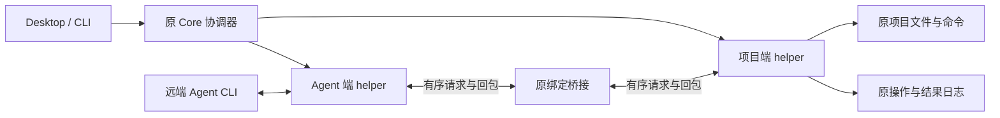

# 跨设备执行架构

跨设备工作涉及三个位置。项目资源由其原 Host 持有，Agent 进程在所选执行 Host 运行，Desktop、CLI 或其他客户端通过已授权的路径访问这些对象。项目和 Agent 可同机，也可分端。客户端换设备、移动 Tab 或切换观察路径时，原项目、AgentSession 和工具绑定仍沿原身份寻址。模式选择与产品行为见 [Remote](../design/behavior/remote-management.md#远程-agent-的能力方向)。

## 身份、路由与授权

| 对象 | 权威身份与职责 |
| --- | --- |
| 项目及空间 | 项目侧 Core 持有原资源 Runtime、Workspace、目录和空间地址。显示位置由原空间身份和客户端的实际工作面决定。 |
| AgentSession | 执行侧 Core 持有原 Session、Executor 与 Provider 原生会话身份。Agent 与 helper 各自的 Run、进程、有序字节和输入回执由所在 Host 的 ctxmux 持有。 |
| 工具绑定 | 原 Core [协调器](../../packages/core/src/agent-execution-coordinator.ts)持有准确两端、授权、原创建操作和桥接游标，并继续或重接这一绑定。 |
| 原工具请求 | 项目侧 [操作日志](../../packages/core/src/agent-execution/journal.ts)以绑定、原生连接代次与请求 ID 关联操作。已见原生结果和持久状态由原资源侧确认。 |

Host 配置说明怎样找到某个 Runtime。执行路径与观察者到两端的访问路径各自有来源和回执。一条路径可达时，接收方仍核对实际 Runtime、原调用者与本次资源授权。路径变更只影响本次传输观察；已经接纳的创建和工具操作继续使用其原目标。详细授权边界见 [Remote 路径和来源核验](../design/behavior/remote-management.md#来源核验与业务信任)。

## 从启动到工具返回

协调器先冻结请求、准确两端和授权，再准备两个 helper，并在绑定原 Run 后启动 Agent。Provider 贡献原生工具协议及启动方式。共享的 [执行模块](../../packages/core/src/agent-execution/)取得原两端的 Run 和资源授权，经 [桥接](../../packages/core/src/agent-execution/bridge.ts)及原 helper 转发请求。文件与命令的副作用落在项目端。读取的文件内容和工具结果可进入 Agent 的上下文。

资源侧在派发工具前保全原请求，记录结果后用同一原生请求 ID 回包。诊断用于观察和追查；诊断投影失败时，已持久的结果仍可沿原通道交付，并能使用原公开操作检查入口查询。桌面、CLI 和 SDK 消费同一业务服务，接入点见 [公共能力](../specs/public-capabilities.md)。

## 断连、积压与恢复

| 发生的事 | 结果与恢复边界 |
| --- | --- |
| 一方向等待输入回执 | 另一方向可以推进。两方向各保留有序字节游标和原输入操作，合并持久状态时使用同一绑定写者。 |
| Reader 退出或 Core 重启 | 重接原 helper，沿已确认游标读回。同一个未决字节写入使用原 operation ID、原字节范围及原 Runtime；重接期间保留原工具操作的效果状态。 |
| 工具进程退出 | 先读完原输出中的完整回复。仍缺结果的原生请求返回结果未确认，已经由 helper 独立执行的操作继续结算。 |
| 存储或诊断不可确认 | 已知步骤和原操作用于查询。持久业务结果、已执行的资源副作用、传输回执和诊断可用性分别观察。 |
| 原 Agent Run 丢失 | 语义恢复沿原 Provider 原生身份。能否接回原对话由 [Session 恢复合同](../design/behavior/session-recovery.md#durable-runtime-健康)判定。 |

桥接保留原 Replay 与输入回执的关联，避免为每次请求复制历史或工作区。资源授权和正确的原 Run 是业务输入的边界。诊断处理、观察者退出和超时不会自动重放文件修改、命令或用户输入。双向同时有未决输入后，绑定日志记录所需的格式版本，旧 Core 会保留该日志并拒绝以旧格式读取。

工具桥的 reader 或回执传输确认中断后，原协调器按绑定安排重接。连接持续波动时逐步拉长间隔，原 attachment 已自行恢复时撤销待重接。客户端的绑定观察收到原连接诊断和恢复结果。排队期间已经恢复的连接由同一绑定后续的重接请求复用。路由和 ctxmux 各自重新确认原身份，协议 Gap 或身份不符时保留诊断及原工作。用户选择继续创建和输入仍经过各自入口。
