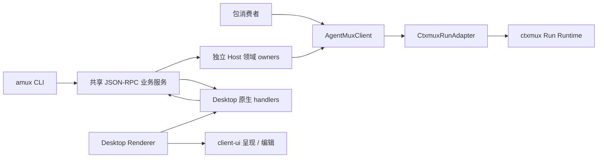

# 系统分层、身份与事实归属

本文以当前已提交源码说明 Core、ctxmux 与客户端如何分工，以及接入时应向哪个 owner 读取事实。产品必须满足的约束归 [交互设计](../design/agentmux-desktop-interaction.md)；源码合同、工作树副本、安装包与实际运行能力分别核对。

对话模式的原生／captured／PTY 来源、共享呈现与 Desktop／Mobile 消费链见[对话机制与接线](conversation.md)；本页继续持有系统分层，不复制对话细则。

## 从哪一层接入

AgentMux 的优先目标是可独立消费的本地 Agent Core；Desktop 是它的第一方 client。包消费者从 [Core 接入说明](../../packages/core/README.md) 开始，了解导出边界见 [公共能力来源导航](../specs/public-capabilities.md)。

| 层或模块 | 持有的事实与职责 | 当前来源 |
| --- | --- | --- |
| ctxmux | 通用 Run、PTY、进程生命周期、ordered bytes、Replay、Gap 与 Attachment | [随包 artifact manifest](../../packages/core/vendor/ctxmux/darwin-arm64/manifest.json)、[Core 的唯一适配器](../../packages/core/src/ctxmux-run-adapter.ts) |
| AgentMux Core | AgentSession 语义，以及与前端无关的持久空间身份、拓扑与绑定 | [Client](../../packages/core/src/client.ts)、[Session Store](../../packages/core/src/agent-session-store.ts)、[空间 owner](../../packages/core/src/spatial-state.ts) |
| Provider | 解释原生 Agent 协议，贡献启动／恢复计划、输入协议、Hook 归一化与原生历史能力 | [`AgentProvider` / `defineAgentProvider`](../../packages/core/src/agent-provider.ts)、[内置 Provider](../../packages/core/src/providers/) |
| 独立 Host | 组合唯一 Core 语义 owner，提供 Relay／设备、原文件／Note／Topic、Goal 领域组合与后台安排、资源配置读取与观察；不持有真实屏幕焦点 | [Host](../../apps/host/src/host.ts)、[内容 owner](../../apps/host/src/content-owner.ts)、[平台服务](../../apps/host/src/macos-service.ts) |
| Desktop Main | 宿主配置写入、原生文件适配／Git、Browser 与 Toolkit；连接原 Host 并通过 Core 公共 API 管理 Agent | [RuntimeController](../../apps/desktop/src/main/runtime-controller.ts)、[IPC 接线](../../apps/desktop/src/main/ipc.ts)、[ConfigOwner](../../apps/desktop/src/main/config-owner.ts) |
| Desktop Renderer | 消费 Core 的拓扑与绑定；持有屏幕投影、焦点、草稿与客户端资源元数据 | [Store](../../apps/desktop/src/renderer/src/store.ts)、[空间状态机制](spatial-state.md) |
| `@agentmux/client-ui` | 消息、原生历史、Trace、结构化请求卡片与 Composer 的共享呈现和编辑，以及共享 Note 格式工具；宿主能力经平台适配器与 typed props 注入 | [包说明及 Node 入口职责](../../packages/client-ui/README.md#node-consumers)、[导出入口](../../packages/client-ui/src/index.ts)、[`ClientUiPlatform`](../../packages/client-ui/src/platform.tsx) |
| Core `spatial-layout` / `@agentmux/layout` | Core 持有分屏树结构、比例、几何寻址与布局 reducer 的纯代数；`@agentmux/layout` 仅重导出该公共能力，不另持有空间状态或 Session 生命周期 | [Core 代数](../../packages/core/src/spatial-layout.ts)、[重导出入口](../../packages/layout/src/index.ts) |
| `@agentmux/demand` | Demand／Goal 的 durable 文件事实、关联、决策、目标确认和结果接受的状态 | [包说明](../../packages/demand/README.md)、[Store](../../packages/demand/src/demand-store.ts)、[Goal 类型与规则](../../packages/demand/src/goals.ts) |

Provider 是 Core 内部的原生协议边界，不是另一套 Runtime。Core 通过 `CtxmuxRunAdapter` 消费 ctxmux SDK；不向公共 API 导出其 wire 类型。包的当前版本、平台、依赖与 artifact 身份分别读取 [Core package](../../packages/core/package.json) 和 manifest，不在本页重列。

共享 UI 由 `ClientUiProvider` 接收显式平台适配器，注入剪贴板错误报告、overlay 目标、编辑器焦点登记及身份／图标呈现；文件打开、导航、图片 IO、发送／排队／中断与结构化回答沿组件 props 回到宿主。Desktop 的实际入口是 [`DesktopClientUiProvider`](../../apps/desktop/src/renderer/src/components/DesktopClientUiProvider.tsx) 和 [Renderer main](../../apps/desktop/src/renderer/src/main.tsx)。`client-ui` 不持有 Runtime client、Provider adapter、Session Store 或会话日志；Core 不依赖它、React 或 Electron，原事实 owner 与工作面焦点仍各归其层。

App 品牌的稳定选择、默认值与各图标所属的境由共享纯目录 [`app-icon-catalog.ts`](../../packages/client-ui/src/lib/app-icon-catalog.ts) 持有。全部品牌位图的唯一源目录是 [`client-ui/brand`](../../packages/client-ui/brand/)，由[品牌清单](../../packages/client-ui/brand/brand-manifest.json)登记，按包路径 `@agentmux/client-ui/brand/*` 引用；App 图标原图在其中的 `app-icons`，[构建脚本](../../apps/desktop/scripts/build-brand-assets.mjs) 派生浏览器位图、原生资源与默认包图；macOS 专属轮廓与透明留白只在构建层派生，Dock 与默认 icns 共用，原图和 Web/iOS 不承接该留白。Classic 的原始透明龙 PNG 保留不改，由同一构建 owner 与共享 SVG 底板组合，所有该款消费者读取组合后的位图，页面与 Native 不各补背景。共享 [`BrandIcon`](../../packages/client-ui/src/components/BrandIcon.tsx) 只消费显式选择；[Desktop 适配](../../apps/desktop/src/renderer/src/components/BrandIcon.tsx) 从原配置取值，[Main 适配](../../apps/desktop/src/main/app-brand-icon.ts) 订阅 ConfigOwner 已提交值，Mobile 沿原 appearance 观察流读取，不各建 Store。欢迎页和新 bot 头像复用同一资源投影，已冻结的创建请求保留原头像。启动、Launcher 与 Settings 概览的大图由 [Renderer 大图解析](../../apps/desktop/src/renderer/src/lib/brand-hero.ts)按已保存选择取图，启动面从同步主题快照读取同一选择；规则见[品牌架构](../design/presentation/brand-identity.md)。`ProjectIcon` 的项目资源发现、`SpaceObjectIcon` 的对象外观及 Provider/Mote 身份仍各归原 owner；品牌选择不改变这些对象的身份或状态。

弹窗、附件作用域与 Desktop 原生 Browser 投影的具体分工见 [UI 弹层的实现归属](ui-layering.md)；全局层级 token 和 Modal 入口由共享 UI 持有，Main 只投影准确对象上的展示与输入，不另造业务 owner。

Desktop 二级内容由 [`WorkspaceFilesTool`](../../apps/desktop/src/renderer/src/components/WorkspaceFilesTool.tsx) 按原对象选择组装，统一的 [`WorkspaceFilesFrame`](../../apps/desktop/src/renderer/src/components/WorkspaceFilesFrame.tsx) 只持有上下文栏、文件树和分割布局。[Project](../../apps/desktop/src/renderer/src/components/ProjectFilesTool.tsx)、[Topic](../../apps/desktop/src/renderer/src/components/TopicFilesTool.tsx)、[Mote](../../apps/desktop/src/renderer/src/components/MoteFilesTool.tsx) 各自提供原数据、准确文件范围、动作和内容；普通项目不自动订阅 Scratch 目录或分类，Git 历史缓存由分割框架上方的原 Git owner 保留。显式知识收集仍沿原操作读取来源，不建立另一份空间或业务状态。

局部模式的业务选择仍由调用者持有；[`SurfaceModeSwitch`](../../apps/desktop/src/renderer/src/components/SurfaceModeSwitch.tsx) 统一原生选择和焦点机制，[`LiquidSelectionSurface`](../../apps/desktop/src/renderer/src/components/LiquidSelectionSurface.tsx) 只提供局部装饰。两者及其样式属于通用呈现，不依附设置或 Git；行为与视觉约束分别引用[统一工作面框架](../design/behavior/spaces-and-layout.md#space-的统一工作面框架)和[工作面框架的呈现](../design/presentation/spaces-and-layout.md#space-的统一工作面框架)。

## 文件格式的扩展位置

格式编辑、呈现与原生工具留在 Desktop，沿原 FileRegion 和 FileDocument 派发；可移植文件与知识领域 owner 由 Host 提供，Core 只公开准确目标、动作和结果类型。行为要求见[格式能力与按需扩展](../design/behavior/files-and-git.md#格式能力与按需扩展)，当前模块按以下职责增长。

| 职责 | 当前来源与扩展方式 |
| --- | --- |
| 轻量格式能力 | [`editor-extensions/catalog`](../../packages/editor-extensions/src/catalog.ts) 集中后缀、复合后缀、语言、MIME、预览、格式化和默认模式；查询不导入引擎。二进制格式继续消费原 `workspace-file-preview` 元数据。 |
| 原工作面与正文 | [`FileSurfaceView`](../../apps/desktop/src/renderer/src/components/FileSurfaceView.tsx) 保有原 Region／正文／模式上下文；[`SourceFilePreview`](../../apps/desktop/src/renderer/src/components/file-preview/SourceFilePreview.tsx) 只选择当前可见格式的 lazy 组件。 |
| 格式实现 | [`components/file-preview/`](../../apps/desktop/src/renderer/src/components/file-preview/) 放呈现与临时资源生命周期，[`lib/file-formats/`](../../apps/desktop/src/renderer/src/lib/file-formats/) 放解析、诊断、Worker 和引擎适配；类型模块不加载重依赖。 |
| 源码着色与格式化 | [`register-file-formats`](../../apps/desktop/src/renderer/src/lib/monaco-languages/register-file-formats.ts) 注册轻量语言规则；[`format-file-region`](../../apps/desktop/src/renderer/src/lib/file-formats/format-file-region.ts) 经原 Monaco adapter 对同一草稿作一次可撤销编辑，显式 Worker 才导入格式化器。 |
| 宿主隔离与文件资源 | [`WorkspaceFiles`](../../apps/desktop/src/main/workspace-files.ts) 持有原资源与读取边界；[`FileDiagramRenderer`](../../apps/desktop/src/main/file-diagram-renderer.ts) 持有独立图计算页面；[`FileBuilds`](../../apps/desktop/src/main/file-builds.ts) 持有显式编译的进程组、日志和私有产物。 |
| 公共消费 | Core [`space-control`](../../packages/core/src/space-control.ts)／[`public-rpc`](../../packages/core/src/public-rpc.ts) 定义目标和回执，Renderer [`store`](../../apps/desktop/src/renderer/src/store.ts) 将公开请求委托给 GUI 同一格式化／构建 owner。Core 不导入格式库。 |

新增格式先补轻量能力声明，再添加所属适配器并接入可穷尽派发；已有 parser、Worker、PDF reader 与资源 owner 可直接复用。格式各自持有适合自身的语义，不强行转成统一 AST，也不为后缀建立独立 editor 包、文件 watcher 或可执行插件层。Markdown 的图通过 `ClientUiPlatform.renderMarkdownDiagram` 注入宿主能力，共享 UI 不依赖 Desktop Main。

编译 owner 当前只在原本地 Host 显式启动本机 Tectonic／Typst，不自动安装编译器或在本地执行远程 Host 的请求。Tectonic 仅使用已有缓存；Typst 遵循已安装 CLI 的包缓存与下载行为，联网或依赖失败保留编译诊断和 Source。Typst 的私有草稿 overlay 保留原工作区相对引用，产物进入原 PDF reader；用户文件与持久工作面不存储编译器临时文件或 PDF bytes。

## 身份与位置分开

| 要定位的对象 | 身份表示及来源 | 不能代替什么 |
| --- | --- | --- |
| Agent 语义会话 | `agentSessionId`；[Session Registry](../../packages/core/src/agent-session-registry.ts) 解释 Core／Provider-native lookup | Run、原生会话 handle、Tab 或 Region |
| 一次执行 | `AgentMuxRunRef` 的 `runId`；[Runtime 类型](../../packages/core/src/types.ts) 与 ctxmux 事实 | AgentSession 或业务操作 ID |
| 展示位置 | Space／Zone／Tab／Region 与 display Workspace／Group；[空间 Control 类型](../../packages/core/src/space-control.ts) | Project／Workspace 资源身份或执行 cwd |
| 执行事实投影 | `AgentMuxRuntimeSubject`；[Runtime Projection](../../packages/core/src/runtime.ts) | Desktop View 或另一份 Session registry |
| 一次请求或业务操作 | JSON-RPC 的 `id` 关联一次输送；业务 `operationId` 标识可查询的操作；[公共 RPC 类型](../../packages/core/src/public-rpc.ts)、[wire 定义](../../packages/core/src/public-rpc-wire.ts) | Session／Run，也不自动证明副作用未发生或完成 |

完整空间定义和行为约束只在 [统一概念与空间寻址](../design/behavior/spaces-and-layout.md#统一概念与空间寻址)。Provider-native resume 可以保留 AgentSession 并创建新 Run；移动一个展示不改变原执行目录。恢复判定从 Core 的 [continuity](../../packages/core/src/agent-session-recovery/continuity-policy.ts) 与 Provider provenance 取得，不从 Tab 标题或终端文字猜身份。

## 当前执行与展示链路

[`agentmux.ts`](../../packages/core/src/agentmux.ts) 解析 CLI 后通过 `connectAgentMuxRpc` 调用共享 [`AgentMuxRpcService`](../../packages/core/src/public-rpc-service.ts)。图中的「共享 JSON-RPC 业务服务」由两个 [`AgentMuxControlServer`](../../packages/core/src/public-rpc-server.ts) 实例承载：

- 独立 [Host](../../apps/host/src/host.ts) 的实例监听 `control.sock`（`defaultAgentMuxControlSocketPath`，[runtime-paths.ts](../../packages/core/src/runtime-paths.ts)），接入 Core clients、可移植领域 owner 和事实观察入口。CLI 默认连接这个 socket，Core 也把它作为 `AGENTMUX_RPC_ENDPOINT` 注入托管 Agent。
- Desktop Main 在 [IPC 入口](../../apps/desktop/src/main/ipc.ts) 另起一个实例，监听 `control.sock.desktop`（`desktopBusinessSocketPath`，[desktop-host.ts](../../apps/desktop/src/main/desktop-host.ts)），提供原生宿主能力。Host 本身未注入的 Desktop 原生方法（工作面控制等）由 Host 服务的 `forwardControl`／`forwardSubscription` 转到这个 socket，携带原调用者凭据；设备主体另带一份只能认领一次的 forwarding 授权。两侧的 `forwardingPeer` 分别指向对端 socket（Host 指向 `control.sock.desktop`，Main 指向 `control.sock`），只用于接收方回到对端认领这份授权（[rpc-forwarding.ts](../../packages/core/src/rpc-forwarding.ts) 的 `receiveForwardedCall`），不是请求的转发通道。

业务服务向各 owner 委托操作，不复制其事实。工作面操作经 [DesktopControlIpcBridge](../../apps/desktop/src/main/control-ipc-bridge.ts) 和 Renderer 的 [Control 接收入口](../../apps/desktop/src/renderer/src/lib/control-api.ts) 进入 [Store 的 `executeControl`](../../apps/desktop/src/renderer/src/store.ts)，空间判定复用 [Control helpers](../../apps/desktop/src/renderer/src/lib/control.ts)。

Agent 生命周期由 Host 的 Core owner 持有；Main 的 `RuntimeController` 沿原 Hosted client 调用公共 API。Browser 操作事实和订阅由准确 Browser 宿主消费共享的 [operation journal](../../packages/browser/src/browser-operation-journal.ts) 提供，Toolkit 能力由 [ToolkitOwner](../../apps/desktop/src/main/toolkit-owner.ts) 提供。Session lookup、角色绑定和消息编排归共享业务服务；CLI 不直接读写这些本地业务事实。独立 Host 不依赖 Main 提供内容与配置读取；真实焦点、窗口、Browser 等原生 owner 离线时明确局部不可用，服务存在不证明这些宿主能力已经就绪。

## 持久事实与观察投影

| 事实 | 持有与恢复入口 |
| --- | --- |
| 通用 Run 及其字节、生命周期 | ctxmux；Core 经 `CtxmuxRunAdapter` 核对身份并消费 |
| AgentSession、原生 handle、当前 Run 关联与 Timeline | [Core Session Store](../../packages/core/src/agent-session-store.ts)；默认目录由 [runtime-paths.ts](../../packages/core/src/runtime-paths.ts) 决定，Desktop 注入 [userData Store 路径](../../apps/desktop/src/main/agent-session-store-path.ts) |
| 宿主配置、Executor 与 Workspace 配置 | [ConfigOwner](../../apps/desktop/src/main/config-owner.ts) 串行提交，[ConfigStore](../../apps/desktop/src/main/config-store.ts) 保存；未确认保存先在同队列读原文件，经[原 Runtime 配置接缝](../../apps/desktop/src/main/runtime-config-transaction.ts)准备／验证、确认准确文件及父目录后提交并发布实际值，随后合入新 edit；读回不再 save 或重放 Toolkit 准备 |
| Tab／Region／布局及展示偏好 | [Core Spatial owner](../../packages/core/src/spatial-state.ts) 持有身份与布局；Renderer Store 的 `initialize` / `projectPersistedWorkbench` / `restorePersistedWorkbench` 读取并投影，偏好和草稿归 client |
| Goal／Demand 内容与确认记录 | [Demand Store](../../packages/demand/src/demand-store.ts)；宿主提供明确 root，读取失败不替换成空 Store |
| Note 正文与稳定块／引用 | 原 Files owner 的 `.note.md`；共享 [Markdown codec](../../packages/client-ui/src/note/note-markdown.ts) 供 Desktop／Mobile 编辑和读取、Host 处理同一格式，写入与 CAS 仍归原 Files owner；Core [轻量格式入口](../../packages/core/src/note-format.ts) 只解释身份头 |
| Notebook 目录、关注、操作轨迹、块归因与历史 | 原 [NotebookStore](../../packages/core/src/notebook-store.ts)／[本地文件后端](../../packages/core/src/notebook-files.ts)；[NotesStorage](../../packages/core/src/notes-storage.ts) 持有目录搬迁与显式转换 journal；[Desktop Main 的 NotesStorageOwner](../../apps/desktop/src/main/notes-storage-owner.ts) 组织原资源确认。文件组织见 [Note Markdown](../specs/note-markdown.md#元数据与公共消费) |

Note 的内存编辑树不另行存为正文。共享的原 NoteFileWriter 在 Files CAS 成功后将可信 actor 的块归因绑定到同一正文 revision；
元数据失败保留已写结果，正文读取失败和归因未确认分别表达。Graph 与搜索从正文派生，普通图观察不加载块作者历史。
具体格式、转换与草稿保全见 [Note Markdown 与元数据](../specs/note-markdown.md)。

通用 Core 的默认目录策略和 Desktop 的宿主目录策略是不同接入上下文，不能把一种路径套给所有消费者。布局记录先恢复，再核对其引用的执行事实；Core snapshot、展示位置和保存回执不互相代签。要求归 [工作面恢复与终端阅读](../../AGENTS.md#工作面恢复与终端阅读)，终端机制另见 [Terminal Runtime](terminal-runtime.md)。

Core Session Store 在原 Session 路径使用 SQLite 保存身份与生命周期事实，物理事务和一次格式切换归 [Session database](../../packages/core/src/agent-session-database.ts)。原稳定 inode 的跨进程锁持续保护写入；旧完整文档先校验全部事实、按内容摘要保全原字节，再以已同步事务原子切换，完成身份标记防止后来替换文件被误当作旧事实重新导入。切换中断从原文件或已发布事务重开，不另建空 Session。损坏旧文档的局部救援保持只读，不把部分救回的事实发布为完整转换结果。

Session 元数据与每条未来消息正文分行持久化。Registry 只保留元数据，目录读取不带累计未来正文；准确 Session 读取、元数据 CAS 与单条未来消息读写只访问目标事实。未来消息正文、原 Session／Run 与 occurrence 领取在同一事务内核对，元数据更新不会因未携带正文而删除它。显式 `Store.load()`／完整 CAS 保持完整业务事实合同；普通控制使用名称明确的 metadata／单条／有界分页接口。SQLite 提交及文件、目录同步分别确认；提交结果未知或同步未确认不冒充未发生，也不停止健康 Run，原绑定可重新读取并在同一 owner 确认保存。

Session 元数据与历史贡献可以在一次提交中合并：

- 普通 Tool Hook 由 [`AgentMuxClient`](../../packages/core/src/client.ts) 在 Registry 更新队列中先计算 current→next，再判断这一条历史贡献能否与回执合并。只有不带 outcome、活动边界、待 flush、交互或 continuity 变更的稳态贡献，才调用 Store 接口 `AgentMuxAgentSessionStore`（[agent-session-store.ts](../../packages/core/src/agent-session-store.ts)）的 `compareAndSwapMetadataWithTimeline`；首次 handover 与复杂贡献仍走各自的路径。Registry 复用同一 CAS、身份与 durability owner，Session 与历史的提交结果分别返回。
- File Store（代码名 `AgentMuxFileAgentSessionStore`）在 timeline 顺序、writer 与 SQLite 事务中保存 metadata，用内部 SAVEPOINT 隔离可选的历史。只有 writer 确认 COMMIT 从未尝试、整个事务已回滚、handle 与 lease 已释放时，才允许按同一 expected／next 只做 metadata CAS；COMMIT 结果未知或提交后 sync 失败时不重写。
- Memory Store（代码名 `AgentMuxMemoryAgentSessionStore`）先同步 stage 受影响的 metadata、输入记录与一条历史版本，再修改内存中的 map。
- 必需 metadata 的错误保留真实类型与原因，历史错误只作为辅助明细；仅在准备阶段出现的错误不会把本次回执标为保存未确认。保存承诺见[本地持久化合同](../design/behavior/persistence.md#保存合同)。

Desktop 的 `RuntimeController.snapshot` 分别读取 Runtime membership 与 Session Timeline：

- 单个 Session 的 Timeline 读不到时，已确认的同 Host 成员与 Run 事实照常发布；失败只附在该 Session 的 `SessionSnapshot.timelineObservation` 上，带着它的 Run 与具体原因。
- Renderer 对齐成员时保留该 Session 最后一次可读的页，[`sessionServiceNotices`](../../apps/desktop/src/renderer/src/lib/session-service-notices.ts) 在该 Session 的本地与全局服务窗里说明重读动作。整个 Host 不因此被标为不可用，缺页也不被补成成功的空记录。
- 只有该 Host／Session／Run 的 Timeline 在完整快照中读成功，或被显式重读成功，才收起这次观察失败；别的 Session、Run 或连接的恢复不能代替。
- 状态读取已明确切换到新 Run 时，旧 Run 的观察诊断不再投影；旧页仍由持久 Session 保留，旧 Run 迟到的读取不能清除新 Run 的失败。Timeline 返回另一个 Session 的身份时明确拒绝。

## Markdown 渲染与主题运行时

共享 Markdown 预览的安全与预算由 [`packages/client-ui/src/lib/markdown-render.ts`](../../packages/client-ui/src/lib/markdown-render.ts) 持有：数学源上限 `MARKDOWN_MATH_SOURCE_LIMIT`（4 KiB）、代码源上限 `MARKDOWN_CODE_SOURCE_LIMIT`（64 KiB）、生成 HTML 上限 `MARKDOWN_HTML_LIMIT`（256 KiB）与元素数上限 `MARKDOWN_ELEMENT_LIMIT`（3000）。KaTeX 以 `trust: false`、`strict: 'error'` 渲染；超预算时回退为原文并给出说明。`markdownRenderLimit` 在启动 worker 前准入有界源，原文始终保留为 fallback；`renderMarkdown` 只在可终止的 worker 内生成 DOM，并把生成结果再按同一 HTML／元素预算裁切后传回。

主题不写在静态 CSS `:root` 里。Desktop preload 的 [`projectInitialTheme`](../../apps/desktop/src/preload/theme-bootstrap.ts) 先把同步快照涂到文档根；随后 [`mountThemeRuntime`](../../packages/client-ui/src/theme/runtime.ts) 成为该窗口唯一的 media／选择订阅，经 [`themeCssVariables`](../../packages/client-ui/src/theme/css-variables.ts) 把解析后的颜色、字体与 elevation 写成 `documentElement` 的 CSS 变量并派发 `agentmux-theme-change`。消费者只观察这份投影，不再各自 resolve 主题。

## 当前接入边界

对象优先 CLI 与共享类型化 JSON-RPC 2.0 服务已经接入当前源码。[Server](../../packages/core/src/public-rpc-server.ts) 默认使用 Unix socket 的有界 JSON-lines framing；显式配置 `AGENTMUX_RPC_HTTP_BIND` 和 `AGENTMUX_RPC_HTTP_TOKEN` 后提供 HTTP POST 与 SSE 订阅，HTTP 默认关闭且不内建 TLS。[Client](../../packages/core/src/public-rpc-client.ts) 的 SSH 与 Tailcat 传输调用远端 CLI 的 [stdio 转发](../../packages/core/src/agentmux-rpc-stdio.ts)，连接远端已运行 owner 的 Unix socket，要求已有远端 CLI 与 SSH 授权或已保存的 Tailcat client key；端到端加密 [Relay](../../packages/core/src/public-rpc-relay.ts) 承载已认证设备的连接。公共方法与参数归 [公共 RPC 类型](../../packages/core/src/public-rpc.ts)；[Control 定义](../../packages/core/src/control.ts) 中的信封保留为内部 owner DTO。行为合同归 [对象优先 CLI 与统一公共业务服务](../design/behavior/public-control.md#对象优先-cli-与统一公共业务服务)。

Runtime 语义服务由 Core 的 [Headless owner](../../packages/core/src/headless-runtime.ts) 组合唯一 `AgentMuxClient`、durable Session Store 与 [Hosted Runtime service](../../packages/core/src/hosted-runtime-service.ts)。宿主服务组合该 owner 及自己的私网、设备和 Desktop ports；不会再建立另一套 Agent 语义 Runtime。

[`connectHostedAgentMux`](../../packages/core/src/hosted-client.ts) 是公共 RPC 的唯一类型化 Runtime client；[`connectSshAgentMux`](../../packages/core/src/runtime-client.ts) 只负责组合系统 SSH 传输与同一 Hosted client。Desktop 的 [Host connector](../../apps/desktop/src/main/desktop-host.ts) 连接语义 owner；原生工作面、文件格式工具与 Git 继续归 Desktop，可移植内容消费同一 Host owner。客户端的最后观察、durable Runtime 身份、当前 owner 进程代次与 ctxmux 身份分别保留；缓存不成为授权或当前运行事实。

Hosted consumer 可为 `runtime.bootstrap` 与 `runtime.events` 选择 `sessions: 'summary'`，缺省仍为完整 Session。[`AgentMuxHostedAgentSessionSummary`](../../packages/core/src/hosted-session-summary.ts) 明确排除冻结的 prompt intent 正文，保留原 submission／operation、输入阶段和 UTF-8 正文字节数；SDK 的摘要缓存与事件持续采用同一投影，精确的 `readAgentSession` 始终返回完整 Session，且不把正文重新填入摘要缓存。摘要模式的初始进程观察只读取既有 `listRuns`，避免从全局 RuntimeProjection 再传一遍完整 Session；操作回执也先按同一投影比较，未变化的读取不重复发布。这只改变该 consumer 的传输投影，不改持久 Session 或其他 consumer。参数、类型和字段的准确合同归 [Hosted contract](../../packages/core/src/hosted-client-contract.ts)，投影与序列化由同一 Hosted service 持有。

SSH 公共服务连接与远端 shell／文件能力是不同能力。[`SshExecutionHost`](../../packages/core/src/execution-host.ts) 不持有 Agent 生命周期；Core 远程管理连接的是远端 AgentMux owner，由它消费当地 ctxmux。此实现不声称 ctxmux 具有独立 Remote Runtime 协议。源码、编译、安装包和当前连接能力仍分别核对；来源不可用保持未知，恢复行为唯一见[联邦 Runtime 与远端恢复边界](../design/behavior/session-recovery.md#联邦-runtime-与远端恢复边界)。
