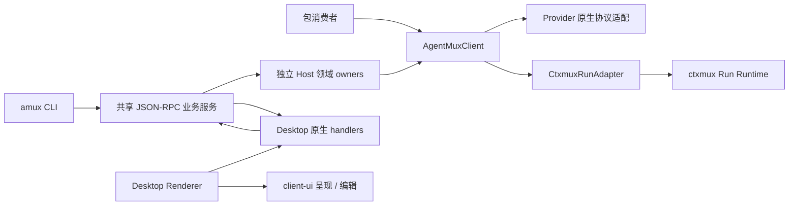

# 系统分层、身份与事实归属

本文以当前已提交源码说明 Core、ctxmux 与客户端如何分工，以及接入时应向哪个 owner 读取事实。产品必须满足的约束归 [交互设计](../design/agentmux-desktop-interaction.md)；源码合同、工作树副本、安装包与实际运行能力分别核对。

对话模式的原生／captured／PTY 来源、共享呈现与 Desktop／Mobile 消费链见[对话机制与接线](conversation.md)；本页继续持有系统分层，不复制对话细则。

## 从哪一层接入

AgentMux 的优先目标是可独立消费的本地 Agent Core；Desktop 是它的第一方 client。包消费者从 [Core 接入说明](../../packages/core/README.md) 开始，了解导出边界见 [公共能力来源导航](../specs/public-capabilities.md)。

| 层或模块 | 持有的事实与职责 | 当前来源 |
| --- | --- | --- |
| ctxmux | 通用 Run、PTY、进程生命周期、ordered bytes、Replay、Gap 与 Attachment | [随包 artifact manifest](../../packages/core/vendor/ctxmux/darwin-arm64/manifest.json)、[Core 的唯一适配器](../../packages/core/src/ctxmux-run-adapter.ts) |
| AgentMux Core | 持有 AgentSession、语义恢复、输入准入与回执，以及与前端无关的持久空间身份、拓扑与绑定。定义 Provider 契约并装配内置适配器 | [Client](../../packages/core/src/client.ts)、[Session Store](../../packages/core/src/agent-session-store.ts)、[Provider 契约](../../packages/core/src/agent-provider.ts)、[空间 owner](../../packages/core/src/spatial-state.ts) |
| Provider | 解释各 Agent CLI 的原生协议，贡献启动与恢复计划、输入协议、Hook 归一化与原生历史能力 | [`@agentmux/providers` 实现](../../packages/providers/src/)、[Core 内置 Provider 装配](../../packages/core/src/providers/index.ts) |
| `@agentmux/conversation` | 将已接受的来源记录投影为统一对话事件、关系与缺口。Core 负责来源读取和窗口管理，并调用同一投影 | [对话模块边界](conversation.md#语义流的模块边界) |
| 独立 Host | 在执行机器上准备和刷新 shell 环境，运行 Core 服务，并组合 Relay／设备、原文件／Note／Topic、Goal、后台安排及资源配置读取与观察 | [执行环境入口](../../apps/host/src/index.ts)、[Host 服务](../../apps/host/src/host.ts)、[内容 owner](../../apps/host/src/content-owner.ts)、[平台服务](../../apps/host/src/macos-service.ts) |
| Desktop Main | 宿主配置写入、原生文件适配／Git、Browser 与 Toolkit；连接原 Host 并通过 Core 公共 API 管理 Agent | [RuntimeController](../../apps/desktop/src/main/runtime-controller.ts)、[IPC 接线](../../apps/desktop/src/main/ipc.ts)、[ConfigOwner](../../apps/desktop/src/main/config-owner.ts) |
| Desktop Renderer | 消费 Core 的拓扑与绑定；持有屏幕投影、焦点、草稿与客户端资源元数据 | [Store](../../apps/desktop/src/renderer/src/store.ts)、[空间状态机制](spatial-state.md) |
| `@agentmux/client-ui` | 消息、原生历史、Trace、结构化请求卡片与 Composer 的共享呈现和编辑，以及共享 Note 格式工具；宿主能力经平台适配器与 typed props 注入 | [具名子路径](../../packages/client-ui/README.md#workspace-modules)、[Node 入口职责](../../packages/client-ui/README.md#node-consumers)、[`ClientUiPlatform`](../../packages/client-ui/src/platform.tsx) |
| Core `spatial-layout` / `@agentmux/layout` | Core 持有分屏树结构、比例、几何寻址与布局 reducer 的纯代数；`@agentmux/layout` 仅重导出该公共能力，不另持有空间状态或 Session 生命周期 | [Core 代数](../../packages/core/src/spatial-layout.ts)、[重导出入口](../../packages/layout/src/index.ts) |
| `@agentmux/demand` | Demand／Goal 的 durable 文件事实、关联、决策、目标确认和结果接受的状态 | [包说明](../../packages/demand/README.md)、[Store](../../packages/demand/src/demand-store.ts)、[Goal 类型与规则](../../packages/demand/src/goals.ts) |

Core 通过 Provider 契约取得原生协议事实，通过 `CtxmuxRunAdapter` 取得通用 Run 事实。公共 API 使用 Core 定义的 Run 类型。包版本、平台、依赖与 artifact 身份见 [Core manifest](../../packages/core/package.json)、[Providers manifest](../../packages/providers/package.json) 和上表的 ctxmux manifest。具体分工见 [Provider 移植](../design/behavior/agent-capabilities-and-messaging.md#provider-能力对齐与移植边界)、[Session 恢复架构](agent-session-recovery.md)和[对话输入接线](conversation.md#输入与-mailbox)。

共享 UI 由 `ClientUiProvider` 接收显式平台适配器，注入剪贴板错误报告、overlay 目标、编辑器焦点登记及身份／图标呈现；文件打开、导航、图片 IO、发送／排队／中断与结构化回答沿组件 props 回到宿主。Desktop 的实际入口是 [`DesktopClientUiProvider`](../../apps/desktop/src/renderer/src/components/DesktopClientUiProvider.tsx) 和 [Renderer main](../../apps/desktop/src/renderer/src/main.tsx)。`client-ui` 不持有 Runtime client、Provider adapter、Session Store 或会话日志；Core 不依赖它、React 或 Electron，原事实 owner 与工作面焦点仍各归其层。

客户端的专题机制见[文件工作面](files-and-git.md#文件工作面的宿主组装)与[格式扩展](files-and-git.md#文件格式的扩展位置)、[UI 弹层](ui-layering.md)、[工作面模式](spatial-state.md#工作面模式与局部控件)和[品牌资源链](../../packages/client-ui/brand/README.md#app-icon-and-hero-projection)。

## 身份与位置分开

| 要定位的对象 | 身份表示及来源 | 不能代替什么 |
| --- | --- | --- |
| Agent 语义会话 | `agentSessionId`；[Session Registry](../../packages/core/src/agent-session-registry.ts) 解释 Core／Provider-native lookup | Run、原生会话 handle、Tab 或 Region |
| 一次执行 | `AgentMuxRunRef` 的 `runId`；[Runtime 类型](../../packages/core/src/types.ts) 与 ctxmux 事实 | AgentSession 或业务操作 ID |
| 展示位置 | Space／Zone／Tab／Region 与 display Workspace／Group；[空间 Control 类型](../../packages/core/src/space-control.ts) | Project／Workspace 资源身份或执行 cwd |
| 执行事实投影 | `AgentMuxRuntimeSubject`；[Runtime Projection](../../packages/core/src/runtime.ts) | Desktop View 或另一份 Session registry |
| 一次请求或业务操作 | JSON-RPC 的 `id` 关联一次输送；业务 `operationId` 标识可查询的操作；[公共 RPC 类型](../../packages/core/src/public-rpc.ts)、[wire 定义](../../packages/core/src/public-rpc-wire.ts) | Session／Run，也不自动证明副作用未发生或完成 |

完整空间定义和行为约束只在 [统一概念与空间寻址](../design/behavior/spaces-and-layout.md#统一概念与空间寻址)。Provider-native resume 可以保留 AgentSession 并创建新 Run；移动一个展示不改变原执行目录。恢复判定从 Core 的 [continuity](../../packages/core/src/agent-session-recovery/continuity-policy.ts) 与 Provider provenance 取得，不从 Tab 标题或终端文字猜身份。

## 当前执行与展示链路

[`agentmux.ts`](../../packages/core/src/agentmux.ts) 解析 CLI 后通过 `connectAgentMuxRpc` 调用共享 [`AgentMuxRpcService`](../../packages/core/src/public-rpc-service.ts)。图中的「共享 JSON-RPC 业务服务」由两个 [`AgentMuxControlServer`](../../packages/core/src/public-rpc-server.ts) 实例承载：

- 独立 [Host](../../apps/host/src/host.ts) 的实例监听 `control.sock`（`defaultAgentMuxControlSocketPath`，[runtime-paths.ts](../../packages/core/src/runtime-paths.ts)），接入 Core clients、可移植领域 owner 和事实观察入口。CLI 默认连接这个 socket，Core 也把它作为 `AGENTMUX_RPC_ENDPOINT` 注入托管 Agent。
- Desktop Main 在 [IPC 入口](../../apps/desktop/src/main/ipc.ts) 另起一个实例，监听 `control.sock.desktop`（`desktopBusinessSocketPath`，[desktop-host.ts](../../apps/desktop/src/main/desktop-host.ts)），提供原生宿主能力。Host 本身未注入的 Desktop 原生方法（工作面控制等）由 Host 服务的 `forwardControl`／`forwardSubscription` 转到这个 socket，携带原调用者凭据；设备主体另带一份只能认领一次的 forwarding 授权。两侧的 `forwardingPeer` 分别指向对端 socket（Host 指向 `control.sock.desktop`，Main 指向 `control.sock`），只用于接收方回到对端认领这份授权（[rpc-forwarding.ts](../../packages/core/src/rpc-forwarding.ts) 的 `receiveForwardedCall`），不是请求的转发通道。

业务服务向各 owner 委托操作，不复制其事实。工作面操作经 [DesktopControlIpcBridge](../../apps/desktop/src/main/control-ipc-bridge.ts) 和 Renderer 的 [Control 接收入口](../../apps/desktop/src/renderer/src/lib/control-api.ts) 进入 [Store 的 `executeControl`](../../apps/desktop/src/renderer/src/store.ts)，空间判定复用 [Control helpers](../../apps/desktop/src/renderer/src/lib/control.ts)。

Agent 生命周期由 Host 的 Core owner 持有；Main 的 `RuntimeController` 沿原 Hosted client 调用公共 API。Browser 操作事实和订阅由准确 Browser 宿主消费共享的 [operation journal](../../packages/browser/src/browser-operation-journal.ts) 提供，Toolkit 能力由 [ToolkitOwner](../../apps/desktop/src/main/toolkit-owner.ts) 提供。Session lookup、角色绑定和消息编排归共享业务服务；CLI 不直接读写这些本地业务事实。独立 Host 不依赖 Main 提供内容与配置读取；真实焦点、窗口、Browser 等原生 owner 离线时明确局部不可用，服务存在不证明这些宿主能力已经就绪。

## 持久事实与观察投影

| 事实 | 持有与恢复入口 |
| --- | --- |
| 通用 Run 及其字节、生命周期 | ctxmux；Core 经 `CtxmuxRunAdapter` 核对身份并消费 |
| AgentSession、原生 handle、当前 Run 关联与 Timeline | [Core Session Store](../../packages/core/src/agent-session-store.ts)；默认目录由 [runtime-paths.ts](../../packages/core/src/runtime-paths.ts) 决定，Desktop 注入 [userData Store 路径](../../apps/desktop/src/main/agent-session-store-path.ts) |
| Desktop 宿主配置、全局 Executor 模板与 Workspace 配置 | [ConfigOwner](../../apps/desktop/src/main/config-owner.ts) 串行提交，[ConfigStore](../../apps/desktop/src/main/config-store.ts) 保存；未确认保存先在同队列读原文件，经[原 Runtime 配置接缝](../../apps/desktop/src/main/runtime-config-transaction.ts)准备／验证、确认准确文件及父目录后提交并发布实际值，随后合入新 edit；读回不再 save 或重放 Toolkit 准备 |
| 执行 Host 的 Executor 注册与命令可用性 | [Core Executor owner](../../packages/core/src/executor-owner.ts) 持有 Host 注册。[Host 启动入口](../../apps/host/src/index.ts)为 Core 提供环境准备，[`listHostExecutors`](../../packages/core/src/client.ts) 在需要探测时调用它。命令可用性是本次执行环境的观察结果，模板、注册、当前探测与 Run 所用命令分别表达。见[配置生效与可用性刷新](../design/behavior/settings-and-observation.md#分区资源与配置生效) |
| Tab／Region／布局及展示偏好 | [Core Spatial owner](../../packages/core/src/spatial-state.ts) 持有身份与布局；Renderer Store 的 `initialize` / `projectPersistedWorkbench` / `restorePersistedWorkbench` 读取并投影，偏好和草稿归 client |
| Goal／Demand 内容与确认记录 | [Demand Store](../../packages/demand/src/demand-store.ts)；宿主提供明确 root，读取失败不替换成空 Store |
| Note 正文与稳定块／引用 | 原 Files owner 的 `.note.md`；共享 [Markdown codec](../../packages/client-ui/src/note/note-markdown.ts) 供 Desktop／Mobile 编辑和读取、Host 处理同一格式，写入与 CAS 仍归原 Files owner；Core [轻量格式入口](../../packages/core/src/note-format.ts) 只解释身份头 |
| Notebook 目录、关注、操作轨迹、块归因与历史 | 原 [NotebookStore](../../packages/core/src/notebook-store.ts)／[本地文件后端](../../packages/core/src/notebook-files.ts)；[NotesStorage](../../packages/core/src/notes-storage.ts) 持有目录搬迁与显式转换 journal；[Desktop Main 的 NotesStorageOwner](../../apps/desktop/src/main/notes-storage-owner.ts) 组织原资源确认。文件组织见 [Note Markdown](../specs/note-markdown.md#元数据与公共消费) |

Note 的内存编辑树不另行存为正文。共享的原 NoteFileWriter 在 Files CAS 成功后将可信 actor 的块归因绑定到同一正文 revision；
元数据失败保留已写结果，正文读取失败和归因未确认分别表达。Graph 与搜索从正文派生，普通图观察不加载块作者历史。
具体格式、转换与草稿保全见 [Note Markdown 与元数据](../specs/note-markdown.md)。

通用 Core 的默认目录策略和 Desktop 的宿主目录策略是不同接入上下文，不能把一种路径套给所有消费者。布局记录先恢复，再核对其引用的执行事实；Core snapshot、展示位置和保存回执不互相代签。要求归 [工作面恢复与终端阅读](../../AGENTS.md#工作面恢复与终端阅读)，终端机制另见 [Terminal Runtime](terminal-runtime.md)。

Session Store 的事务、持久边界与确认见[持久 Session 与保存确认](agent-session-recovery.md#持久-session-与保存确认)。Desktop 单个 Session 的历史观察失败沿原 Host／Session／Run 投影，已确认的成员和 Run 继续可用，见 [Timeline 快照与观察失败](conversation.md#session-timeline-的快照与观察失败)。

## 当前接入边界

对象优先 CLI 与共享 JSON-RPC 服务共用业务入口。默认 Unix socket、HTTP／SSE、SSH、Tailcat 和 Relay 的接入条件见[公共能力的服务传输](../specs/public-capabilities.md#服务传输与接入层)。

Runtime 语义服务由 Core 的 [Headless owner](../../packages/core/src/headless-runtime.ts) 组合唯一 `AgentMuxClient`、durable Session Store 与 [Hosted Runtime service](../../packages/core/src/hosted-runtime-service.ts)。宿主服务组合该 owner 及自己的私网、设备和 Desktop ports；不会再建立另一套 Agent 语义 Runtime。

[`connectHostedAgentMux`](../../packages/core/src/hosted-client.ts) 是公共 RPC 的唯一类型化 Runtime client；[`connectSshAgentMux`](../../packages/core/src/runtime-client.ts) 只负责组合系统 SSH 传输与同一 Hosted client。Desktop 的 [Host connector](../../apps/desktop/src/main/desktop-host.ts) 连接语义 owner；原生工作面、文件格式工具与 Git 继续归 Desktop，可移植内容消费同一 Host owner。客户端的最后观察、durable Runtime 身份、当前 owner 进程代次与 ctxmux 身份分别保留；缓存不成为授权或当前运行事实。

Hosted consumer 可按[接口合同](../specs/public-capabilities.md#hosted-session-摘要投影)选择完整 Session 或摘要投影。准确 Session 读取仍由原 owner 提供。

SSH 公共服务连接与远端 shell／文件能力是不同能力。[`SshExecutionHost`](../../packages/core/src/execution-host.ts) 不持有 Agent 生命周期；Core 远程管理连接的是远端 AgentMux owner，由它消费当地 ctxmux。此实现不声称 ctxmux 具有独立 Remote Runtime 协议。源码、编译、安装包和当前连接能力仍分别核对；来源不可用保持未知，恢复行为唯一见[联邦 Runtime 与远端恢复边界](../design/behavior/session-recovery.md#联邦-runtime-与远端恢复边界)。
