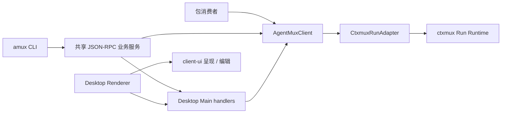

# 系统分层、身份与事实归属

本文以当前已提交源码说明 Core、ctxmux 与客户端如何分工，以及接入时应向哪个 owner 读取事实。产品必须满足的约束归 [交互设计](../design/agentmux-desktop-interaction.md)；源码合同、工作树副本、安装包与实际运行能力分别核对。

## 从哪一层接入

AgentMux 的优先目标是可独立消费的本地 Agent Core；Desktop 是它的第一方 client。包消费者从 [Core 接入说明](../../packages/core/README.md) 开始，了解导出边界见 [公共能力来源导航](../specs/public-capabilities.md)。

| 层或模块 | 持有的事实与职责 | 当前来源 |
| --- | --- | --- |
| ctxmux | 通用 Run、PTY、进程生命周期、ordered bytes、Replay、Gap 与 Attachment | [随包 artifact manifest](../../packages/core/vendor/ctxmux/darwin-arm64/manifest.json)、[Core 的唯一适配器](../../packages/core/src/ctxmux-run-adapter.ts) |
| AgentMux Core | AgentSession semantics and frontend-independent durable spatial identities, topology and bindings | [Client](../../packages/core/src/client.ts), [Session Store](../../packages/core/src/agent-session-store.ts), [Spatial owner](../../packages/core/src/spatial-state.ts) |
| Provider | 解释原生 Agent 协议，贡献启动／恢复计划、输入协议、Hook 归一化与原生历史能力 | [`AgentProvider` / `defineAgentProvider`](../../packages/core/src/agent-provider.ts)、[内置 Provider](../../packages/core/src/providers/) |
| Desktop Main | 宿主配置、文件／Git／Topic、Browser 与 Toolkit 等能力；通过 Core 管理 Agent 与 Run | [RuntimeController](../../apps/desktop/src/main/runtime-controller.ts)、[IPC 接线](../../apps/desktop/src/main/ipc.ts)、[ConfigOwner](../../apps/desktop/src/main/config-owner.ts) |
| Desktop Renderer | Spatial projection, screen layout, focus, input and client resource metadata; legacy persistence is replaced in the tracked consumer cutover | [Store](../../apps/desktop/src/renderer/src/store.ts), [Spatial ownership](spatial-state.md) |
| `@agentmux/client-ui` | 消息、原生历史、Trace、结构化请求卡片与 Composer 的共享 React 呈现和编辑；宿主能力经平台适配器与 typed props 注入 | [包说明](../../packages/client-ui/README.md)、[导出入口](../../packages/client-ui/src/index.ts)、[`ClientUiPlatform`](../../packages/client-ui/src/platform.tsx) |
| `@agentmux/layout` | 分屏树结构、比例、几何寻址与布局 reducer 的纯代数；不持有展示记录或 Session 生命周期 | [包说明](../../packages/layout/README.md)、[导出入口](../../packages/layout/src/index.ts) |
| `@agentmux/demand` | Demand／Goal 的 durable 文件事实、关联、决策、目标确认和结果接受的状态 | [包说明](../../packages/demand/README.md)、[Store](../../packages/demand/src/demand-store.ts)、[Goal 类型与规则](../../packages/demand/src/goals.ts) |

Provider 是 Core 内部的原生协议边界，不是另一套 Runtime。Core 通过 `CtxmuxRunAdapter` 消费 ctxmux SDK；不向公共 API 导出其 wire 类型。包的当前版本、平台、依赖与 artifact 身份分别读取 [Core package](../../packages/core/package.json) 和 manifest，不在本页重列。

共享 UI 由 `ClientUiProvider` 接收显式平台适配器，注入剪贴板错误报告、overlay 目标、编辑器焦点登记及身份／图标呈现；文件打开、导航、图片 IO、发送／排队／中断与结构化回答沿组件 props 回到宿主。Desktop 的实际入口是 [`DesktopClientUiProvider`](../../apps/desktop/src/renderer/src/components/DesktopClientUiProvider.tsx) 和 [Renderer main](../../apps/desktop/src/renderer/src/main.tsx)。`client-ui` 不持有 Runtime client、Provider adapter、Session Store 或会话日志；Core 不依赖它、React 或 Electron，原事实 owner 与工作面焦点仍各归其层。

Desktop 二级内容由 [`WorkspaceFilesTool`](../../apps/desktop/src/renderer/src/components/WorkspaceFilesTool.tsx) 按原对象选择组装，统一的 [`WorkspaceFilesFrame`](../../apps/desktop/src/renderer/src/components/WorkspaceFilesFrame.tsx) 只持有上下文栏、文件树和分割布局。[Project](../../apps/desktop/src/renderer/src/components/ProjectFilesTool.tsx)、[Topic](../../apps/desktop/src/renderer/src/components/TopicFilesTool.tsx)、[Mote](../../apps/desktop/src/renderer/src/components/MoteFilesTool.tsx) 各自提供原数据、准确文件范围、动作和内容；普通项目不自动订阅 Scratch 目录或分类，Git 历史缓存由分割框架上方的原 Git owner 保留。显式知识收集仍沿原操作读取来源，不建立另一份空间或业务状态。

局部模式的业务选择仍由调用者持有；[`SurfaceModeSwitch`](../../apps/desktop/src/renderer/src/components/SurfaceModeSwitch.tsx) 统一原生选择和焦点机制，[`LiquidSelectionSurface`](../../apps/desktop/src/renderer/src/components/LiquidSelectionSurface.tsx) 只提供局部装饰。两者及其样式属于通用呈现，不依附设置或 Git；行为与视觉约束分别引用[统一工作面框架](../design/behavior/spaces-and-layout.md#space-的统一工作面框架)和[工作面框架的呈现](../design/presentation/spaces-and-layout.md#space-的统一工作面框架)。

## 文件格式的扩展位置

文件能力留在 Desktop，沿原 FileRegion 和 FileDocument 派发；Core 只公开准确目标、动作和结果类型。行为要求见[格式能力与按需扩展](../design/behavior/files-and-git.md#格式能力与按需扩展)，当前模块按以下职责增长。

| 职责 | 当前来源与扩展方式 |
| --- | --- |
| 轻量格式能力 | [`workspace-file-format.ts`](../../apps/desktop/src/shared/workspace-file-format.ts) 集中后缀、复合后缀、语言、MIME、预览、格式化和默认模式；查询不导入引擎。二进制格式继续消费原 `workspace-file-preview` 元数据。 |
| 原工作面与正文 | [`FileSurfaceView`](../../apps/desktop/src/renderer/src/components/FileSurfaceView.tsx) 保有原 Region／正文／模式上下文；[`SourceFilePreview`](../../apps/desktop/src/renderer/src/components/file-preview/SourceFilePreview.tsx) 只选择当前可见格式的 lazy 组件。 |
| 格式实现 | [`components/file-preview/`](../../apps/desktop/src/renderer/src/components/file-preview/) 放呈现与临时资源生命周期，[`lib/file-formats/`](../../apps/desktop/src/renderer/src/lib/file-formats/) 放解析、诊断、Worker 和引擎适配；类型模块不加载重依赖。 |
| 源码着色与格式化 | [`register-file-formats`](../../apps/desktop/src/renderer/src/lib/monaco-languages/register-file-formats.ts) 注册轻量语言规则；[`format-file-region`](../../apps/desktop/src/renderer/src/lib/file-formats/format-file-region.ts) 经原 Monaco adapter 对同一草稿作一次可撤销编辑，显式 Worker 才导入格式化器。 |
| 宿主隔离与文件资源 | [`WorkspaceFiles`](../../apps/desktop/src/main/workspace-files.ts) 持有原资源与读取边界；[`FileDiagramRenderer`](../../apps/desktop/src/main/file-diagram-renderer.ts) 持有独立图计算页面；[`FileBuilds`](../../apps/desktop/src/main/file-builds.ts) 持有显式编译的进程组、日志和私有产物。 |
| 公共消费 | Core [`space-control`](../../packages/core/src/space-control.ts)／[`public-rpc`](../../packages/core/src/public-rpc.ts) 定义目标和回执，Renderer [`store`](../../apps/desktop/src/renderer/src/store.ts) 将公开请求委托给 GUI 同一格式化／构建 owner。Core 不导入格式库。 |

新增格式先补轻量能力声明，再添加所属适配器并接入可穷尽派发；已有 parser、Worker、PDF reader 与资源 owner 可直接复用。格式各自持有适合自身的语义，不强行转成统一 AST，也不为后缀建立独立 editor 包、文件 watcher 或可执行插件层。Markdown 的图通过 `ClientUiPlatform.renderMarkdownDiagram` 注入宿主能力，共享 UI 不依赖 Desktop Main。

编译 owner 当前只在原本地 Host 显式启动本机 Tectonic／Typst，不自动安装编译器或在本地执行远程 Host 的请求。Tectonic 仅使用已有缓存；Typst 遵循已安装 CLI 的包缓存与下载行为，联网或依赖失败保留编译诊断和 Source。Typst 的私有草稿 overlay 保留原工作区相对引用，产物进入原 PDF reader；用户文件与持久工作面不存储编译器临时文件或 PDF bytes。

## 身份与位置分开

| 要定位的对象 | 身份表示及来源 | 不能代替什么 |
| --- | --- | --- |
| Agent 语义会话 | `agentSessionId`；[Session Registry](../../packages/core/src/agent-session-registry.ts) 解释 Core／Provider-native lookup | Run、原生会话 handle、Tab 或 Region |
| 一次执行 | `AgentMuxRunRef` 的 `runId`；[Runtime 类型](../../packages/core/src/types.ts) 与 ctxmux 事实 | AgentSession 或业务操作 ID |
| 展示位置 | Space／Zone／Tab／Region 与 display Workspace／Group；[空间 Control 类型](../../packages/core/src/space-control.ts) | Project／Workspace 资源身份或执行 cwd |
| 执行事实投影 | `AgentMuxRuntimeSubject`；[Runtime Projection](../../packages/core/src/runtime.ts) | Desktop View 或另一份 Session registry |
| 一次请求或业务操作 | JSON-RPC 的 `id` 关联一次输送；业务 `operationId` 标识可查询的操作；[公共 RPC 类型](../../packages/core/src/public-rpc.ts)、[wire 定义](../../packages/core/src/public-rpc-wire.ts) | Session／Run，也不自动证明副作用未发生或完成 |

完整空间定义和行为约束只在 [统一概念与空间寻址](../design/behavior/spaces-and-layout.md#统一概念与空间寻址)。Provider-native resume 可以保留 AgentSession 并创建新 Run；移动一个展示不改变原执行目录。恢复判定从 Core 的 [continuity](../../packages/core/src/agent-session-continuity.ts) 与 Provider provenance 取得，不从 Tab 标题或终端文字猜身份。

## 当前执行与展示链路

[`agentmux.ts`](../../packages/core/src/agentmux.ts) 解析 CLI 后通过 `connectAgentMuxRpc` 调用共享 [`AgentMuxRpcService`](../../packages/core/src/public-rpc-service.ts)。[`AgentMuxControlServer`](../../packages/core/src/public-rpc-server.ts) 在 Main 的 [IPC 入口](../../apps/desktop/src/main/ipc.ts) 接入原宿主 handlers、Core clients 和事实观察入口；业务服务向这些 owner 委托操作，不复制它们的事实。工作面操作经 [DesktopControlIpcBridge](../../apps/desktop/src/main/control-ipc-bridge.ts) 和 Renderer 的 [Control 接收入口](../../apps/desktop/src/renderer/src/lib/control-api.ts) 进入 [Store 的 `executeControl`](../../apps/desktop/src/renderer/src/store.ts)，空间判定复用 [Control helpers](../../apps/desktop/src/renderer/src/lib/control.ts)。

Agent 生命周期由 Main 的 `RuntimeController` 调用 Core 公共 API。Browser 操作事实和订阅由 Main 的 [operation journal](../../apps/desktop/src/main/browser-operation-journal.ts) 提供，Toolkit 能力由 [ToolkitOwner](../../apps/desktop/src/main/toolkit-owner.ts) 提供。Session lookup、角色绑定和消息编排归共享业务服务；CLI 不直接读写这些本地业务事实。独立服务可连接本地 Core，但未注入的空间、文件或配置 owner 明确返回不可用，服务存在不证明完整宿主能力已经就绪。

## 持久事实与观察投影

| 事实 | 持有与恢复入口 |
| --- | --- |
| 通用 Run 及其字节、生命周期 | ctxmux；Core 经 `CtxmuxRunAdapter` 核对身份并消费 |
| AgentSession、原生 handle、当前 Run 关联与 Timeline | [Core Session Store](../../packages/core/src/agent-session-store.ts)；默认目录由 [runtime-paths.ts](../../packages/core/src/runtime-paths.ts) 决定，Desktop 注入 [userData Store 路径](../../apps/desktop/src/main/agent-session-store-path.ts) |
| 宿主配置、Executor 与 Workspace 配置 | [ConfigOwner](../../apps/desktop/src/main/config-owner.ts) 串行提交，[config-store.ts](../../apps/desktop/src/main/config-store.ts) 保存 |
| Tab／Region／布局及展示偏好 | [Core Spatial owner](../../packages/core/src/spatial-state.ts) 持有身份与布局；Renderer Store 的 `initialize` / `projectPersistedWorkbench` / `restorePersistedWorkbench` 读取并投影，偏好和草稿归 client |
| Goal／Demand 内容与确认记录 | [Demand Store](../../packages/demand/src/demand-store.ts)；宿主提供明确 root，读取失败不替换成空 Store |

通用 Core 的默认目录策略和 Desktop 的宿主目录策略是不同接入上下文，不能把一种路径套给所有消费者。布局记录先恢复，再核对其引用的执行事实；Core snapshot、展示位置和保存回执不互相代签。要求归 [工作面恢复与终端阅读](../../AGENTS.md#工作面恢复与终端阅读)，终端机制另见 [Terminal Runtime](terminal-runtime.md)。

Core Session Store 在原 Session 路径使用 SQLite 保存身份与生命周期事实，物理事务和一次格式切换归 [Session database](../../packages/core/src/agent-session-database.ts)。原稳定 inode 的跨进程锁持续保护写入；旧完整文档先校验全部事实、按内容摘要保全原字节，再以已同步事务原子切换，完成身份标记防止后来替换文件被误当作旧事实重新导入。切换中断从原文件或已发布事务重开，不另建空 Session。损坏旧文档的局部救援保持只读，不把部分救回的事实发布为完整转换结果。

Session 元数据与每条未来消息正文分行持久化。Registry 只保留元数据，目录读取不带累计未来正文；准确 Session 读取、元数据 CAS 与单条未来消息读写只访问目标事实。未来消息正文、原 Session／Run 与 occurrence 领取在同一事务内核对，元数据更新不会因未携带正文而删除它。显式 `Store.load()`／完整 CAS 保持完整业务事实合同；普通控制使用名称明确的 metadata／单条／有界分页接口。SQLite 提交及文件、目录同步分别确认；提交结果未知或同步未确认不冒充未发生，也不停止健康 Run，原绑定可重新读取并在同一 owner 确认保存。

## 当前接入边界

对象优先 CLI 与共享类型化 JSON-RPC 2.0 服务已经接入当前源码。[Server](../../packages/core/src/public-rpc-server.ts) 默认使用 Unix socket 的有界 JSON-lines framing；显式配置 `AGENTMUX_RPC_HTTP_BIND` 和 `AGENTMUX_RPC_HTTP_TOKEN` 后提供 HTTP POST 与 SSE 订阅，HTTP 默认关闭且不内建 TLS。[Client](../../packages/core/src/public-rpc-client.ts) 的 SSH 传输调用远端 CLI 的 [stdio 转发](../../packages/core/src/agentmux-rpc-stdio.ts)，连接远端已运行 owner 的 Unix socket，要求已有远端 CLI 与 SSH 授权。公共方法与参数归 [公共 RPC 类型](../../packages/core/src/public-rpc.ts)；[Control 定义](../../packages/core/src/control.ts) 中的信封保留为内部 owner DTO。行为合同归 [对象优先 CLI 与统一公共业务服务](../design/behavior/public-control.md#对象优先-cli-与统一公共业务服务)。

Runtime 语义服务由 Core 的 [Headless owner](../../packages/core/src/headless-runtime.ts) 组合唯一 `AgentMuxClient`、durable Session Store 与 [Hosted Runtime service](../../packages/core/src/hosted-runtime-service.ts)。宿主服务组合该 owner 及自己的私网、设备和 Desktop ports；不会再建立另一套 Agent 语义 Runtime。

[`connectHostedAgentMux`](../../packages/core/src/hosted-client.ts) 是公共 RPC 的唯一类型化 Runtime client；[`connectSshAgentMux`](../../packages/core/src/runtime-client.ts) 只负责组合系统 SSH 传输与同一 Hosted client。Desktop 的 [Host connector](../../apps/desktop/src/main/desktop-host.ts) 连接语义 owner，工作面与文件／Git 能力继续归 Desktop。客户端的最后观察、durable Runtime 身份、当前 owner 进程代次与 ctxmux 身份分别保留；缓存不成为授权或当前运行事实。

SSH 公共服务连接与远端 shell／文件能力是不同能力。[`SshExecutionHost`](../../packages/core/src/execution-host.ts) 不持有 Agent 生命周期；Core 远程管理连接的是远端 AgentMux owner，由它消费当地 ctxmux。此实现不声称 ctxmux 具有独立 Remote Runtime 协议。源码、编译、安装包和当前连接能力仍分别核对；来源不可用保持未知，恢复行为唯一见[联邦 Runtime 与远端恢复边界](../design/behavior/session-recovery.md#联邦-runtime-与远端恢复边界)。

## Frontend-independent spatial owner

The Core filesystem owner and public API for stable entities, position topology and bindings are defined in [Durable spatial state](spatial-state.md). Desktop screen layout and focus consume these facts through the same Core owner; client preferences and drafts remain separate. Do not confuse lookup caches with durable spatial relationships.
