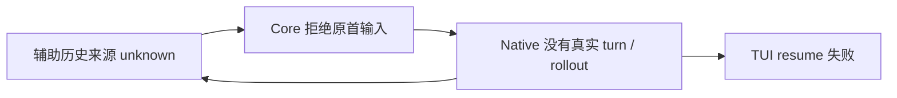

# 新 Agent 的终端退出，原后台却等不到首条输入

## 定性

P0。Core 把辅助历史来源未知当成原初始化输入不可发送，撤销了准确 Native 对象已经具备的输入能力；用户的真实首条输入留在准备态，前台恢复又依赖这条输入尚未产生的历史。本案例记录该次故障与源码修复，不代表已安装或原用户会话已恢复。行为要求沿 [Session 恢复](../design/behavior/session-recovery.md)。

## 用户可见症状

新建 Agent 的终端显示退出码 1；原后台 Run 仍是 running，初始化报告 ready 和原 Native ID。前台原始错误的关键部分为：

> `thread/resume failed: no rollout found for thread id <原 threadId> (code -32600)`

此处省略用户路径和准确身份。后台存活、初始化 ready、可输入、历史持久化和前台接回是五个不同事实。用户担心元数据损坏，但调查没有取得损坏证据；进程存活也不能证明任务已经执行。这个机制与同批调查中的连接容量自限、通知放大分别处理。

## 影响面

已确认范围是 Codex 受管启动：Native 已创建并加载零 turn 对象，Core 保存了原 `prepared/post-launch` 初始化输入，原 key 还没有 admission claim，辅助 `nativeSourceObservation` 为 unknown。

| 能力或对象 | 当时结果与证据边界 |
| --- | --- |
| 原首条真实输入 | 被 Core 拒绝，原 `initialInput` 仍 prepared，准确 `input.inspect` 返回 null |
| 原 remote TUI | resume 找不到 rollout，退出；重复新建前台不能生成首条输入 |
| 原 SID、Native ID、Run、进程 | 保留；Runtime 确认 running / input open，不据此宣称业务成功 |
| 已有 claim 的未知输入 | 仍只能对账；本修复不授权重放 |
| 普通已持久 Native 会话、其他 Provider | 没有证据表明受本互锁影响，不把本例扩大成全部恢复故障 |

以下不受本修复影响：手动终端输入与已冻结的字节计划保持原 owner；错误目标、改变的来源、权限撤销和原 claim 的防重边界保留。可核对 [Coordinator 的 `defaultNativeSource` / `onlyIfUnclaimed`](../../packages/core/src/prompt-submission.ts) 与 [Provider 的 `prepareCodexNativeInput`](../../packages/core/src/providers/codex-native-input.ts)。

## 止血措施

故障版本没有已证明有效的带内恢复办法：反复 Resume 只会遇到同一个缺 rollout 对象。先保留原后台、SID、Native ID、Run、工作面和输入 key，不 Stop、不另建空 Agent、不重发未知输入，也不写占位 prompt、标题或元数据来制造历史。

源码修复后，原 Core 恢复 owner 可核对未 claim 的原输入及授权，沿原 key 继续真实内容，让 Native 自行生成来源，再用原公共 Resume 接回前台。这是已通过私有真实链路的恢复路径；原用户会话仍缺安装后同身份输入与前台接回的实际回执，不能写成已脱困。

## 引入时间线

历史沿 `git log -S 'nativeSourceObservation.state'`、`git log -S 'requiredNativeSource'`、`git log -L 693,707:packages/core/src/prompt-submission.ts` 和该文件的 `git log --follow` 核对。区分旧判定的引入与后来使新启动进入该判定的组合变化：

| 原提交 | 变化及遗漏 |
| --- | --- |
| `12c904600d`，`fix(core): correlate default semantic messages with native input` | 引入共享默认 Native 来源判定；把当前 Run 存在来源观察一并排除，没有区分历史定位 unknown 与准确对象输入资格 |
| `4007b52cac`，`feat(core): send exact question replies through the native input owner` | 扩展 `requiredNativeSource` 消费，仍保留上述判定 |
| `0ea7e890f9`，`feat(core): admit A2A reference inputs through native idle queue` | 扩展 idle-only 路径，没有验证零 turn 首输入 |
| `651cd0e8d5`，`fix(core): deliver idle references through the original native queue` | 移除对 nativeActor 存在的旧限制；历史未知的否决仍在 |
| `2ec3020309`，`feat(core): encapsulate durable agent session recovery` | 新建改成 Native `thread/start` 确认对象后启动 TUI，并由 Core post-launch owner 发送原输入；与旧来源否决组合形成这条互锁 |
| `066b64bde5`，`fix(core): retain original managed initialization beyond observation deadlines` | 保留超时后的原初始化，未验证真实零 turn 对象能否被 TUI resume |
| `5d66549daf`，`feat(core): retain explicit native targets through input and recovery` | 保护显式目标并重组同一默认来源分支，原初始化的 unknown 仍被挡住 |
| `7f4ac9d06d` | 调查所绑定的故障包源码，不是缺陷引入提交 |
| `7e46c11d08`，`fix(core): retain original input through native source initialization` | 修正原首输入误拒，Provider 前台恢复先取得同对象真实 join 回执；兼容测试 30 条通过 |
| `fa35d8ff3d` / `12df295a46` | 分别区分 Native 用户输入与模型请求计数，并把失败进度、取消绑定到准确 Native 事实；补齐最终真实验证口径 |

`git log -L` 在默认来源判定内部还显示上述四次扩展/重组；相邻的 `f7905c6dff`（初始 idle 通知）及 `5bc10e8866`（发送前重核恢复授权）处理了其他正确性问题，也没有覆盖本次“对象已加载、首输入未 claim、来源未知”的顺序。

## 根因分析

**直接原因**有两端。Core 的 `defaultNativeSource` 因当前 Run 的辅助观察 unknown 返回空，拒绝进入已经能认证原 actor / thread 的 Native 输入准备。前台端则把 loaded / ready 当成可恢复，派发 TUI resume；真实 Native 此时尚无 rollout。

**根因**是恢复流程把不同能力的前置事实合并了。准确 Native 对象的输入资格由原生协议确认；历史定位只是另一条观察。历史恰要由首条真实输入产生，却被提升成首输入的先决条件。反过来，初始化 ready 又被提升成前台可 join，缺少那个具体操作的完成证据。

**为什么没更早发现**：此前测试分别覆盖初始化 ready、输入防重和恢复授权，没有把真实空 Thread、历史读取产生 unknown、Core owner 重启、原首输入与立即 Resume 的先后关系放进同一链路。只断言前台 spawn / attached，也可能让测试随后主动 resume 替候选补完缺失步骤。

已有 [健康能力与未知状态规则](../../AGENTS.md#健康能力与未知状态) 与 [RED-LINES](../../RED-LINES.md) 当时已禁止用观察失败收回健康能力。规则没有约束住，是因为评审把“保护准确来源”的统一否决当成安全结论，未用可工作的真实原输入反证，也未区分来源 unknown 与输入结果 unknown。重抄规则无法填补这个验证缺口。

## 改进措施

1. **在原输入 owner 内移除错误的辅助来源否决。** 只允许内部 `onlyIfUnclaimed + requiredNativeSource` 的准确原初始化输入继续；Provider 仍认证原 actor、Run 和 thread，原 key / 内容 / 授权 / claim 不变。**是否足够 root**：处理一个共享裁决点，覆盖创建首输入与恢复 post-launch 输入两个内部消费者；真实 Native 证据限 Codex 的普通目录、Git 目录两种场景。**能否彻底避免**：能阻止本次原未 claim 输入被 history unknown 误挡，不能替未知 claim 授权重发。**是否降低系统熵**：收窄旧否决，复用既有 Coordinator，没有新 Store、重试层或业务开关；更简单的“全删来源检查”会放过错目标，因此保留准确对象边界。

2. **前台恢复由 Provider 准备同对象 join，再派发原 control 操作。** 核原 handle、进程与 listener 身份、认证及 `thread/read`，再以 `thread/resume({threadId, excludeTurns:false})` 核同 ID、同 loaded sessionId 和输入资格，重核权限后才派发。**是否足够 root**：覆盖 Codex 一个 Provider 前台准备点、Core 一个公共恢复消费者；兼容仍存活的旧 wrapper。**能否彻底避免**：阻止未能 join 就消耗新前台代次；缺来源时保留原 operation，等待原输入进展。**是否降低系统熵**：增加一次原协议准备，不增加恢复 owner。更简单的“只看文件存在 / ready”不能证明 join，写 metadata 或假输入则会改变用户事实，因此均不采用。

3. **复用真实 Native / Core / TUI 证据校准验收。** **是否足够 root**：覆盖两种 cwd、跨两个 Core 进程和六类承重变异。**能否彻底避免**：只能让这类回归更早暴露，不能证明所有 Provider 或现场状态。**是否降低系统熵**：复用原公共输入、Resume 与回执，不新增产品门禁；分别记录用户 turn 和模型请求，避免把一次 turn 内多次请求误判为重复输入。

## 验证

复用准确候选的 `node packages/core/scripts/verify-native-initial-input.mjs --mutations` 结果，不为本文重跑。私有环境隔离用户 Runtime、Home、Store 和配置；Native 是真实 Codex 0.163，模型 HTTP 端点由私有夹具控制，不声称验证了远端模型服务。原生基础调查另在 0.164 重现了零 turn loaded 对象没有 rollout 的行为。

真实消费链为 Core 原初始化输入 → 公共 Unix RPC / Hosted owner 重建 → 原 Coordinator / Native 输入 → 原 `agent.resume` → 原 remote TUI。普通目录与 Git 目录均先重现旧 TUI 退出 1、来源 unknown、原 key 无 claim；确定性调度让 Resume 早于原输入。修复先保留同前台代次，随后原真实输入仅发送一次，Native 自产来源，同 SID / Native ID / Run / PID 接回，真实 TUI 后续输入对应下一 turn。Git 捕获的 SHA 保留。

最终候选 9 条通过；六个独立源码变异分别恢复旧 unknown 否决、跳过前台 join、跳过最终授权、忽略准确来源、借用已有 claim、把例外授予普通问题，均使对应业务判据变红。变异只作用于各自加载产物，原源码前后 hash 保持相同；没有另记一轮恢复测试。源码与调用链可从 [真实集成测试](../../packages/core/test/native-initial-input.integration.test.ts)、[验证入口](../../packages/core/scripts/verify-native-initial-input.mjs)、[恢复 reconciler](../../packages/core/src/agent-session-recovery/reconciliation.ts) 和 [Provider 前台 owner](../../packages/core/src/providers/codex-managed-frontend.ts) 核对。

本机保留原始私有验证回执，绑定到 `12df295a46` 的已集成源码；这些过程资料不构成长久文档依赖。源码验证、正式包安装和原用户会话恢复分别结算。

## 遗留

- 原用户会话尚无修复后同身份恢复回执；本文不宣称已安装、原首输入已执行或用户已恢复工作。
- 没有原真实输入的空白零 turn 对象不借本修复生成占位内容；其原生前台连接需要独立证明。
- 其他 Provider、所有 Codex 版本及所有断线原因均不在本次实测范围。输入已 claim 但施效未知时，继续原 key 对账，不因本例绕过防重。
