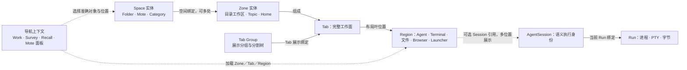

# 空间、导航与工作面

本文定义产品分组、空间实体、展示绑定、导航选择与布局操作。先读产品分组与空间模型，再按导航、对象和工作面操作定位规则；已确认约束定义必须成立的结果，不代表当前实现通过验收。当前机制与源码来源见[空间状态与导航机制](../../architecture/spatial-state.md)，视觉只见[同主题呈现](../presentation/spaces-and-layout.md)。

[返回交互合同](../agentmux-desktop-interaction.md)

| 产品分组 | 面向用户的入口 | 职责与正文 |
| --- | --- | --- |
| **Mote** | 独立协调快捷面与持久 Mote 对象 | 人格与协调沿[Mote 合同](motes-and-coordination.md)；Mote 本体可基于 Space，快捷面有自己的选择。 |
| **Work** | **Space、Focus、Goals** | 工作现场、执行关注与目标闭环；Goal 的持久实体仍为 Demand，见[Goals 合同](goals-and-demand.md)。 |
| **Know** | **Survey、Recall** | 浏览探索与知识积累；两工作面分别保留导航选择，具体流程见[Survey 与 Recall 工作流](knowledge-workflows.md#survey-与-recall-工作流)。 |

分组用于表达产品职责，不重新分配实体或内容归属；Mote、Category、Topic 的原工作面仍可在 Space 视图中加载，具体范围沿[实体与展示绑定](#zonetabsregions-的实体与展示绑定)。Settings 是配置动作，沿[设置合同](settings-and-observation.md)，不新增导航上下文。分组与共享空间底座、导航同步范围是不同问题，后者只由[导航上下文](#worksurveyrecall-与-mote-的导航上下文)定义。

**阅读顺序**

- [空间模型与实体绑定](#空间模型与实体绑定)：模型、词典、准确位置、共同框架与资源边界。
- [导航上下文与入口](#导航上下文与入口)：Work 的共享选择，以及 Survey、Recall、Mote 面板的独立选择。
- [Space 对象与知识组织](#space-对象与知识组织)：Folder、Mote、Category／Topic 的映射、创建、成员、拓扑与注意力。
- [Tab Group 与分屏布局](#tab-group-与分屏布局)：完整工作面、展示组织、分屏、保活与关闭。
- [导航操作与可读性](#导航操作与可读性)：名称、路径、公共空间操作与控件交互。
- [具体工作流](#具体工作流)：Survey／Recall 的浏览与知识流程，以及 Launcher 的工作起点。

## 空间模型与实体绑定

### 空间模型

**空间模型（Spatial Model）** 是 AgentMux 用于组织、寻址、组合和复用工作面的持久实体与关系模型。其核心实体为 **Space、Zone、Tab、Region**；模型同时描述实体组成、空间绑定、展示位置及持久布局，具体实体身份与操作边界由下文[概念词典](#统一概念与空间寻址)和[实体与展示绑定](#zonetabsregions-的实体与展示绑定)定义。

对外寻址按 Space／Zone／Tab／Region 表达；这些层级之间的绑定和组成关系按原合同成立，不能把全部关系简化为单父目录树。Tab Group 负责组织 Tabs 的展示及其分割树，属于模型的展示组织关系，不改变四级公开对象层级；准确展示位置仍保留 display Workspace／Group 引用，见[Tab Group 与 Region](#tabtab-group-与-region)。

这套模型由 Core 持有稳定身份、拓扑、布局与全部绑定，独立于图形客户端。Work、Survey、Recall 与 Mote 面板复用同一模型；各自导航选择的共享或隔离沿[导航上下文](#worksurveyrecall-与-mote-的导航上下文)，不因共用模型而合并当前选择。AgentSession／Run、资源 Host／Workspace 与执行 cwd 仍沿原 owner，空间展示不改变执行身份或目录。

整体体系称**空间模型**；**Space** 是其中的具体实体；**Space 入口**是 Work 下查看和操作这些对象的主视图，其完整定义见[Space 入口与实体的关系](#space-入口与实体的关系)。**空间图**是模型中实体、关系和布局的持久数据表示，当前实现与来源见[空间状态与导航机制](../../architecture/spatial-state.md)；增加整体定义不创建新的实体、注册表或存储 owner。

图中的关系须沿[实体与展示绑定](#zonetabsregions-的实体与展示绑定)和[Tab Group 布局](#tabtab-group-与-region)解释；它不是严格单父目录树。Project／Workspace 提供原 Host 的资源来源，见[Project 与 Workspace](#project-与-workspace)，不替代 Space 身份或按展示位置改写 cwd。

### 统一概念与空间寻址

本节是产品文档、公开控制协议与 CLI 的唯一概念词典。空间寻址描述实体与展示位置；产品入口和树上的组织视角消费这些身份，不能从名称、当前 Session 或执行目录重新定义对象。源码旧字段的当前含义只作来源证据，不反过来改变产品定义。

| 概念 | 必须成立的含义与身份 | 权威事实归属 |
| --- | --- | --- |
| **Space** | 用户选择的持久工作上下文。Folder、Mote 与知识库的 Topic Category 在此层表达；普通 Topic 对应 Zone，见[知识库层级](#topics-知识库的层级与沉淀)。Folder/Mote 的来源身份仍是 Host 与对象的绝对持久目录；Category 使用耐久分类身份，名称和归属不是身份。当前 Session、是否打开 Tab 均不构成身份，Space 不等同于 Project。 | Core 保存原空间身份与绑定；Folder 的目录/项目记录、Topic/Mote 的真实持久目录由原 Host 提供。分类描述沿原 Host 的独立持久目录与 `category.md` 内容 owner，分类归属只由 Core 空间绑定持有；发现复用原来源，不建第二份 Space 注册表。 |
| **Zone** | Space 内的一条工作分区/上下文，承载 Tab；知识库中的具体 Topic 对应此层。worktree、普通目录和 Topic/Mote 的 home 上下文均可绑定 Zone，不能把 Zone 限定为 Git 或全量改名 Workspace。 | Core 保存稳定 Zone 身份、组成与全部空间绑定。Folder 的 Workspace、Topic/Mote 的 home 来源沿原 Host 的资源事实；展示地址与查询索引从 Core 空间图派生，不重新铸造 Zone，不复制目录、Git 或 Session 真相。 |
| **Project** | 围绕项目目录组织的来源项目事实，可关联多个实际 checkout/Workspace；Git 能力按真实仓库事实提供。它是 Space 的可选项目上下文，不能冒充所有 Space，也不能用单个 worktree Workspace ID 冒充项目 ID。 | 已有 Host、项目根目录和 Workspace 分组来源；不另建项目注册表。 |
| **Workspace** | 宿主在特定 Host 上登记的实际工作目录记录。folder/worktree、路径、仓库根与分支是该记录的事实；Scratch Workspace 是既有 Topic 收纳和布局容器，不是每个 Topic 的身份。 | 原宿主配置/目录 owner；Git checkout 事实由现有 Git owner 提供，Core 的空间绑定不改写资源事实。 |
| **Tab** | Zone 中的一张完整工作面，拥有持久身份、分割布局与多个 Region。首张 Tab 不以另一张 Tab 为存在前提。 | Core 的同一持久空间图保存身份、布局、选择与全部展示绑定；Topic 来源身份仍由原目录 owner 提供。 |
| **Region** | Tab 布局的一块精确 leaf 位置，承载 Agent/Terminal、文件、Browser 或启动面。它是空间位置，不是 Session 身份。 | Core 的同一持久空间图；移动、分割和关闭绑定明确 Region，Client 呈现与内容 owner 消费原位置。 |
| **AgentSession** | Core 持有的 Agent 语义会话，包含 Provider/Executor、原生会话身份、执行目录与恢复事实。它可以在多个 Region 展示；空间归属不能改写其执行事实。 | AgentMux Core 的公开 API。 |
| **Run** | ctxmux 持有的一次真实执行及其进程、PTY、ordered bytes、Replay 与 Attachment 事实。Session 与当前 Run 的绑定不把两个身份合并。 | ctxmux；client 只消费公开事实。 |

对外空间层级统一为 **Space / Zone / Tab / Region**。公开 discovery、inspect 与动作回执分别给出空间位置、可选 Project/Workspace 绑定及 Session/Run 执行事实，所有可寻址 ID 均可原样用作下一次输入。精确 Region 或 Tab 可反推其上层；额外给出的父层必须一致。目标不依赖调用者工作目录、当前 Workspace、焦点、标题或最近 Session；存在多个候选时返回真实候选，不猜唯一目标。

`space mv` 只改变 AgentMux 中的空间位置。移动保留同一 AgentSession、Run、cwd 与原生句柄，不停止健康 Agent，也不复制所选投影。跨 Zone 时，目标空间归属与 Agent 原执行目录分别如实可读。Session 的额外展示与移动是两种明确动作，不能用创建副本或复用第一块同 Session Region 代替移动。

已有 Session 投影的进入动作（包括观察面里的 Open Session 与 Continue in Session）以该投影持久保存的 Workspace/Tab/Region 位置为导航事实。执行 cwd 只能为没有投影的 Session 提供新展示来源，不能在进入已有展示时把整个 Tab、Topic 或其他 Region 搬回执行目录所属 Workspace、重复加入另一个布局或改写额外投影。启动快照暂时没有 Session 事实时，仍可进入已保留的持久投影查看恢复状态；导航不能伪造新的 Session/Run 或触发重新启动。

普通 Topic 对应原 Zone，Category 对应 Space；该知识层级及本地承接只见[《Topics 知识库的层级与沉淀》](#topics-知识库的层级与沉淀)。公共发现、目标语法及实施边界见[《公共控制与跨客户端接入》](public-control.md)，本节不代签 CUI、实际工作面或迁移验收。既有 Renderer 文案与视觉不作全仓机械改名。 原实体、目录和合法绑定继续保全。

#### Frontend-independent positions

The stable spatial graph is part of amux and is maintained by Core even on a remote host without an App. Identities, topology, ordering, split ratios, selection and every binding are durable; only lookup caches, screen geometry and UI mounts are derived. All clients and the public CLI consume the same owner. Loading a Zone uses its stable identity and complete composition, without a saved display-coordinate gate. Unknown presentation coordinates do not remove original content, references or healthy Runs. Technical ownership and persistence are defined in [Durable spatial state](../../architecture/spatial-state.md). A failed initial read retains the current workbench and later edits. Save Retry reads the same owner again, applies disjoint edits against the retained baseline, and keeps conflicting local and durable facts until the user resolves them; it does not require an App restart or replace a healthy Run.

#### Space 入口与实体的关系

「Space」在阅读时有三个视角，身份定义仍只有上表的一份：

| 出现位置 | 指什么 | 与实体的关系 |
| --- | --- | --- |
| Work 下的 **Space 入口** | 查看和操作工作现场的主视图，和 Focus、Goals 并列。 | 视图选择已有 Space／Zone／Tab／Region，不因进入该视图创建一个 Space。 |
| **Space 实体** | Folder、Mote、Topic Category 等持久工作上下文。 | 由 Core 空间图持有身份与绑定；对象树是它的导航投影，分区或目录外观不另造身份。 |
| Agent 的 **Space／Zone／Tab／Region 地址** | Agent 工作面在空间图中的位置。 | 使用同一批实体和准确展示绑定，不另建「Agent 组织 Space」；它定位展示，不定义 Agent 的职责或执行归属。 |

因此，组织工作面的 Space 和实体 Space 使用同一身份，是模型约束，不是名称碰巧相同；Space 视图本身则是入口。树中的父子关系帮助查找，实体的全部合法绑定和多个展示位置仍可查询。一个 Session 可以在多个 Region 展示；它的 cwd、Host、Provider／Executor、Run 和协调角色继续由原 owner 持有。Mote 是可作为 Space 的持久产品对象，左下 Mote 面板是该对象的快捷呈现；两个入口不产生两个 Mote，也不合并面板与 Work 的选择。

### 产品实体 ID 分配

AgentMux 自主发号的可寻址产品实体统一使用固定12位 Base58 新 ID，包括 AgentSession、Tab、TabGroup、Region，以及自主创建的目录／知识／目标／消息／资源记录；对象类型由类型字段或 URI 路径表达，各类身份仍独立，不由显示名、位置或共同编码合并。目录 `[host,path]` 的 Space／Project 身份、Zone 资源坐标、文档键与 Git 对象坐标继续按原资源合同确定，不为统一发号改写资源寻址。原外部 Provider 身份、ctxmux Run、operation／request／lease、内容哈希及安全令牌沿各自 owner 和用途，不强制12位。

编码与安全随机分配由同一无 UI、无宿主依赖的工具持有，Core 提供公开出口，依赖 Core 的领域包也消费同一底层工具，不复制实现或增加发号服务。随机分配取9字节密码学安全样本；确定性分配按无歧义的业务域及原业务键派生。两者共用整样本溢出拒绝与左补 `1` 至12位规则，空间为 `58^12`（约70.3bit），不截断或取模，不把 ID 当权限凭证。

已存在的 ID、链接、目录与持久引用不重写；显式合法原 ID 不按新格式收紧。文件Tab、Session Tab、首个Region等确定性展示身份保留同一资源查重、恢复、重试和关系语义，先沿原已存事实取回身份，再为新对象按独立业务域派生；不能机械随机化、从短 ID 反推资源、凭格式猜类型或另建别名注册表。原资源坐标的解释仍由原资源 owner 持有。所有生产消费者与公开发现／inspect／动作回执准确传递原身份，未知或冲突如实保留原对象，不猜首目标。Session 持久创建／首句操作的身份保全继续见[Session、Run 与 View](session-recovery.md#sessionrun-与-view)。

### Zone→Tabs→Regions 的实体与展示绑定

同一个 Zone→Tabs→Regions 组件须能在 Space、Focus、Survey、Recall、Mote 等位置灵活加载任一级。同一实体与其资源 Workspace／Host／目录、Session／Run，以及展示绑定各自可辨；一个实体可以有多个准确可枚举的位置，不从某个 surface、Topic 或 Group 重新铸身份或指定唯一归属。每次加载明确来源实体与本次绑定，复用原组成、内容和动作 owner，不复制布局或生命周期。某处收起、遮挡或取消绑定不搬走其它位置、不关闭实体、不改资源或后来焦点；显式关闭实体仍沿原确认与清理合同。位置查询、导航及关系增删消费同一全位置事实，不取首地址代替明确目标。各导航上下文的选择范围只见[Work、Survey、Recall 与 Mote 的导航上下文](#worksurveyrecall-与-mote-的导航上下文)；共用组件不要求共用当前目标。Focus 内明确选择文件、Browser、Launcher 或其他原内容时，只改变当前 Work 的空间展示引用，原语义 Agent 与执行历史保持；展示位置独立于初始 Agent 定位，同一上下文内不另建平行选择字段。原持久关联必须保留，重启保原实体、所有持久绑定与选择，foreign 展示位置或暂缺恢复事实不构成删除理由。同实体多处实际显示须由真实呈现能力证明，引用、单宿主搬移、截图、重复新页面或 Run 都不能冒充实时并显；输入／尺寸与遮挡沿原权威 owner，隐藏或目录中未显示的绑定不新增页读、bytes 订阅或 fit。

#### 实体加载与准确位置

**Zone 按实体引用加载，展示索引不成为门槛。** 打开 Zone 只需稳定 Zone ID，共用工作面从原成员和布局 owner 解析已有 Tabs、Regions、Group 与分割；不要求保存的展示坐标仍有效。所选 Tab／Region 是所属导航上下文的呈现偏好，失效时仍打开完整 Zone；多个真实展示位置完整保留，不取第一个位置冒充实体组成。展示位置索引由当前事实派生，不另存第二份索引，也不在 Survey 复制布局、内容或生命周期。重启保存原对象、成员、布局、关系与稳定成员选择偏好，重新解析展示地址。明确操作某个位置仍使用当下准确地址，不以旧坐标执行动作。只有整个 Zone 暂时不可用时才用完整状态页说明；空 Zone 可继续起步，局部内容失败在对应 Region 说明，不要求跳回 Space 才能加载。

完整 Zone 的成员偏好加载与明确继续某一展示位置是两种呈现选择。前者沿原组成解析可用成员；后者逐个确认当下完整的展示 Workspace／Group／Tab／Region 引用，所选 Group 的引用不能借给另一个 Group。明确位置尚未确认时保原实体、健康输入、引用与可选原位置，不猜其他位置；同一目标已经显示的原分屏、内容节点与输入继续留在原处，未知地址不把它们替换成另一页或另一套组成。可读、可输入不意味着地址已确认：改变展示位置、分割比例或创建内容仍须核对当前有效位置，旧回调不能写回旧布局；目标改变后的迟到动作拒绝原请求，保留后来选择。聚焦或继续输入原内容不清除尚未确认的引用，只有明确选择当下有效的原位置才更新它。原 Tab 按钮沿自己的 Group 动作选择，不再由同一次原生事件补发无位置的选择。选择某一位置不裁掉 Zone 的其他成员或合法展示绑定，也不冒称同一内容已支持多处同时实时呈现。

#### Tab／Region 加载层级

Focus 的标题行可自定义，并可明确加载 Tab。明确加载 Tab 时只呈现该 Tab 的原 Regions 工作面，不把其上层 Zone／Group 的整行页签、Split 与新增 Tab 入口再次带入。标题及操作带由本次展示位置提供，原 Region Provider、菜单、单格 Header 呈现与内容实例保持；Zone 级仍保原 Tab／Group 工具带，级别或精确位置未确认时保原地址与服务说明，不伪称完成下钻。

Focus 默认仍加载完整 Tab；用户明确选择“只看此 Region”时，只展示当前准确引用的原 Region，返回整个 Tab 则恢复原 Tab 工作面。该选择只决定本次临时呈现层级，不增设另一份地址或持久化选择；原完整位置引用、Tab 分割与其他 Regions、草稿、选区、Provider、菜单、脏文件关闭确认和 Session／Run 保持。收起这份展示使原内容返回原叶，不关闭实体；未知或迟到目标保原引用与可达说明。隐藏的兄弟内容不因单 Region 下钻被重新判为可见或增加读取、bytes 订阅及 fit。原内容改变展示位置后，正文阅读选区仍指向原节点与端点；用户后来主动选择或输入始终优先，不因恢复旧选区夺走新焦点。

#### 回执与内容打开位置

明确导航的公开回执按本次实际显示位置核对请求；请求中的显示 Workspace 与回执已确认显示 Workspace 即使字段名不同，也保同一含义。资源 Workspace 不代替显示位置，正确已应用导航不因字段对照失败被误判，真正不符的父位置仍拒绝；原工作面与健康输入保留。

在任一展示位置打开正文里的网页或项目文件，内容解析沿原资源，打开位置沿当前准确的展示 Workspace／Group／Tab／Region；跨工作区或同一 Tab 的非首位置不转到别处，也不从当前焦点猜落点。位置已改变或无法确认时保留原工作面并说明，系统打开不被工作面位置校验挡住；未实际挂入目标位置不能冒充打开成功。

### Space 的统一工作面框架

各类 Space 都在既有工作面框架内设计。本节定义共用框架中的职责与区域；实体身份和资源事实仍见[《统一概念与空间寻址》](#统一概念与空间寻址)，实体与展示位置的关系仍见[《Zone→Tabs→Regions 的实体与展示绑定》](#zonetabsregions-的实体与展示绑定)，树上层级不成为实体的唯一父归属。

| 层级 | 框架中的职责 |
| --- | --- |
| **Space** | 承载所选对象的导航上下文、功能组与资源入口；Folder、Mote 与知识库 Category 的差异在共同框架内表达。 |
| **Zone** | 原公共工作面容器，承载其 Tab、Group 与分割布局；不是因打开某个功能组而重新生成的一份页面。 |
| **Tab** | 一张完整工作面，承载原 Region 组合、布局和动作；Tab 不与 Session 同义。 |
| **Region** | 最小内容与交互承载位置，显示原 Agent、Terminal、文件、Browser 或启动面。Agent 在界面中通过原 Region 工作；其 Session/Run 仍由 Core/ctxmux 持有，展示不另造执行生命周期。 |

一级菜单是选择 Space 的对象树，Topics 分区只列 Category，具体 Topic 在该 Category 的中间二级目录中查看；选择 Topic 后，分类目录仍在原位，右侧进入该 Topic 的原 Zone/Tabs/Regions。二级菜单顶部切换明确所选 Space 的功能组，Topics 分类的 Topics／Knowledge 范围沿[Topic 导航合同](#topic-导航与成员范围)，不因 Topic 选择再造一层 Chat 目录。明确的 Topics 总览可展示跨分类发现，Mote 展示该持久对象的内容；共享 Scratch 不把全局 Topic 列表变成每个对象的成员。不同 Space 可以包装不同的二级内容和对象能力，但导航层级、文件树与内容动作沿同一公共 owner。Mote 与 Topic 使用同一文件树；资源根或目标范围的变化只是原文件能力的作用域，不成为另一套树。

功能组与成员导航各有范围：知识分类下选择具体 Topic 是 Zone 选择，中间的 Category 成员目录与右侧当前 Topic 的 Tabs/Regions 各有明确作用域。右侧只消费当前 Topic 的原组成；知识检索、Topic 知识与资料保真实来源和范围，跨分类总览和发现保留在明确的 Topics 知识库入口。对象范围、当前展示位置和资源 Workspace 分别保留，共享 Scratch 资源容器不授予所有内容当前成员身份。

主区域显示原 Zone 工作面，其内容可在其他位置按 Zone、Tab 或 Region 任一级加载。每次加载使用原实体与完整准确的展示位置引用（displayWorkspaceId/groupId/tabId/regionId），继续同一内容、输入与动作 owner；加载较低层级不带上层多余 chrome，具体边界见[《Zone→Tabs→Regions 的实体与展示绑定》](#zonetabsregions-的实体与展示绑定)。切换功能组本身不新建 Zone、Tab 或 Session，不清草稿；明确创建与文件动作仍由原能力消费用户意图，不把 Space 写成 Zone 的唯一父或为每处加载启动新 Agent。

新增一种 Space 不能重新实现整套 Zone、Tab/Group/Region、分割、焦点、文件动作或恢复；只在底层调用共享组件，却另造一套 Zone 导航、文件树或 Tab 管理，也不满足共同框架约束。对象选择和专属二级内容在上述框架内表达，工作面操作仍沿公共实现。框架确有能力缺口时在公共 owner 补全，不在单类对象造旁路，也不抹去其必要的二级内容。设计与能力补全保原身份、全部合法展示绑定、健康 Session/Run、草稿、焦点和恢复；位置、握手或恢复未确认不拿走已有可用内容，保原工作面与持续服务窗。共同机制仍遵守 Core、ctxmux 与 client 的原分层及相关消费者成本。

- Workspace Tools 位于主工作区左侧，负责 Files + Branches、Agents 和 Browser Favorites。

- Project Rail 与 Workspace Tools 分别开关，不能共享状态或互相改变布局身份。

### Project 与 Workspace

Project 是来源项目事实，Workspace 是特定 Host 上登记的实际工作目录；二者提供空间实体的资源上下文，其身份与 owner 见[概念词典](#统一概念与空间寻址)。资源 Host、目录、仓库根与分支不由展示位置改写。

同一 Host 的目录树分组从路径派生，属于对象导航；它既不是[持久 Project Group](#跨设备关联项目组)，也不是[Tab Group](#tabtab-group-与-region)。目录导航、移除入口及路径恢复见[Folder 与项目树](#folder-与项目树)，Topic 的成员及工作面选择见[Topic 导航与成员范围](#topic-导航与成员范围)。

## 导航上下文与入口

### 左下角导航、Space 与 Goals

窗口只有一组主导航，固定顺序为 **Mote、Space、Focus、Goals、Survey、Recall**，在所有主工作面及 Project Rail 开合状态下都位于窗口左下角。Know 组内 Survey 在 Recall 之前；Settings 位于 Know 组之外，与 Recall 保有可辨分隔，不夹在 Survey 与 Recall 之间。Survey 的职责和 Browser 入口归属见[《Survey、临时 Zone 工作面与知识入口》](knowledge-workflows.md#survey临时-zone-工作面与知识入口)。

- **Mote** 是固定协调对象的快捷入口：打开或收起同一快捷面，保留当前主工作面的选中状态和执行焦点。Mote 排第一不意味着启动默认进入 Mote；启动仍恢复用户上一次工作面。PMO 是其初始化默认角色之一，产品身份见[《Space、Folder 与 Topic》](#spacefolder-与-topic)。
- **Space** 是实际工作现场，承载既有 Agent、Terminal、文件、Browser、Tab 与 Region；顶级入口、说明和可访问名称使用 Space。Space 作为共同外层产品对象，其 Folder、Mote 与知识分类的定义见[《Space、Folder 与 Topic》](#spacefolder-与-topic)；Workspace 继续表达底层工作区对象。
- **Focus** 查看执行状态、最近上下文与需要用户处理的事项；进入已有 Session 时继续复用原 Tab/Region。
- **Goals** 是全局目标集合，单项显示为 Goal。标题、创建、搜索、详情、清单和统计使用同一名称；显式创建后记录真实 Goal 草稿，待澄清的想法由 Mote 整理目标与完成标准，具体闭环见[《Goals 的 Grill 与 Grounding》](goals-and-demand.md#goals-的-grill-与-grounding)。Goal 沿用原 Demand 的持久身份；原内部类型与存储名称不改变公开 Goal 词汇，Goal 状态与执行 Session 状态独立。
- **Survey** 先提供日常浏览，再承载明确创建的研究及初步成果，向 Recall 和 Topic 显式输送；入口资格、与项目 Browser 的区分及成果流转只见[《Survey、临时 Zone 工作面与知识入口》](knowledge-workflows.md#survey临时-zone-工作面与知识入口)。
- **Recall** 是积累、组织和回顾知识的独立主工作面，以 Notebook 和页面为入口；与 Survey 并列，不藏在 Survey 左侧顶部切换器内。笔记、来源与块引用沿[《Recall、Notebook 与块知识》](knowledge-workflows.md#recallnotebook-与块知识)，存储沿[《笔记目录、设置与搬迁》](knowledge-workflows.md#笔记目录设置与搬迁)。

Mote 作为独立协调入口，与 Work、Know 的工作面导航分开；Settings 打开既有设置面，不改变当前工作面选中状态和执行焦点。Settings 的入口归属，以及 Toolkit、快捷键帮助与状态提醒的右侧工具排列，统一见[《Toolkit 与官方 Performance 工具》](settings-and-observation.md#toolkit-与官方-performance-工具)。窄窗口保留全部入口与需要用户处理的状态，长摘要可以收紧，控件不能重叠或被裁掉；这些规则不依赖 Project Rail 是否可见。底栏高度与局部尺寸约束只定义在密度 SSOT[《左下角导航与右下角工具组》](../presentation/spaces-and-layout.md#左下角导航与右下角工具组)。

### Work、Survey、Recall 与 Mote 的导航上下文

Work 是 Space、Focus、Goals 共同的产品工作范围；Know 是 Survey、Recall 共同的知识探索与积累范围。两者是产品分组，不是新增的 Space 实体、空间层级或导航按钮。Know 分组不产生一份共享的 Survey／Recall 选择。Work、Survey、Recall 与左下角 Mote 面板分别保留自己的导航与选择上下文；复用空间底座不合并各自当前目标。

| 上下文 | 导航与选择范围 |
| --- | --- |
| **Work** | Space、Focus、Goals 共用当前 Space／Zone／Tab／Region 的准确定位语义；AgentSession 是可选关联，不是工作目标存在或可导航的前提。 |
| **Survey** | 保留自己明确创建／保存的浏览研究入口、当前 Zone／Tab／Region 与恢复引用；普通浏览不跟随 Work 的项目选择。 |
| **Recall** | 保留自己的 Notebook、页面、原 Zone／Tab／Region 与块选择；进入知识目录不接管 Survey 正在浏览的页，也不跟随 Work 项目。 |
| **Mote 面板** | 保留左下快捷面自己的 Mote 对象、Tab／Region 与恢复引用；Mote 实体在 Space 中复用共同框架，不把面板的导航并入 Work。 |

Work 内从树、Tab／Region、Focus、Goals 或其他明确入口选择同一目标，消费同一份准确空间引用和定位规则；文件、Browser、Launcher 等没有 Agent 的内容同样成立，不为每个表面另猜最近 Session 或保存一份相互竞争的工作目标。切换 Space、Focus、Goals 读取当前 Work 上下文：Space 继续原工作面，Focus 按已确认引用呈现原 Tab／Region；已有表面选择不能阻止沿当前准确引用继续。Goals 保留 Goal 自身身份及原多 Session 关联，只在已有准确关联能确认目标时定位对应行或卡片；没有唯一已知关联时保留原 Goal 选择与 Work 引用，不按当前 Session、名称或最近活动猜一个 Goal。Focus 的执行 Agent 资格与语义关注仍沿[Focus 合同](focus-context.md#执行-agent-焦点历史与-pmo-上下文隔离)，没有 Agent 不清除已选空间目标。

Survey、Recall 与 Mote 面板中的局部对象、Tab／Region 选择只更新各自上下文，不覆盖 Work 或其他上下文。进入、收起或返回一个上下文时继续它自己保存的目标；背景更新、目录或 Session 顺序、共享实体在别处被选择、切换主表面和迟到恢复都不能替换该目标。关闭 Mote 面板只收起它的呈现，背景继续所属上下文的当前引用；背景是 Work 时，不能用打开面板时的快照覆盖用户后来已选的 Work 目标。普通重启分别恢复各上下文的原目标与引用；目标或位置未知时保原引用、已确认内容与可行动说明，不改选邻居或首位置。

`Open Mote Space`、打开来源、从 Focus／Goal 显式打开 Mote 面板中的讨论等跨上下文动作，只在这次明确操作中将准确对象及位置带入目标上下文，来源上下文继续保留自己的选择。动作完成后各自保存后续导航，不建立持续跟随或双向选择同步。未确认准确目标时保留原工作、引用与失败说明；迟到结果不能覆盖后来选择。选择与 DOM 输入焦点分开，输入交接沿[公共导航与对话输入合同](public-control.md#agent-操作桌面主画面与保留对话输入)，较晚主动焦点继续优先。

独立导航不复制实体、内容、布局、Session／Run 或模式事实；这些仍消费各自原 owner，同一实体在多处的合法展示绑定继续保留，见[实体与展示绑定](#zonetabsregions-的实体与展示绑定)。执行与协调 Session 的语义角色不因展示在 Work、Survey、Recall 或 Mote 面板而改变；空间选择不冒充执行聚焦事件，具体语义焦点和历史政策只见[Focus 合同](focus-context.md#执行-agent-焦点历史与-pmo-上下文隔离)。Goal 专属讨论属于主 Mote 的关系继续沿[Goals 合同](goals-and-demand.md#goals-的-grill-与-grounding)，不据此将 Goals 归入 Mote 面板。

## Space 对象与知识组织

### Space、Folder 与 Topic

Space 是共同的外层产品概念，Project 表达可选项目来源，不能与 Space 等同；当前词典见[《统一概念与空间寻址》](#统一概念与空间寻址)。Folder 围绕目录，Topics 围绕知识分类与具体主题，Mote 围绕持久协作对象，组织特点必须可辨认。知识库的 Category/Topic 分层以[《Topics 知识库的层级与沉淀》](#topics-知识库的层级与沉淀)为准，取代普通 Topic 直接作为 Space Item 的旧层级。共同工作能力不变，树中使用可读分组、类型图标和父子层级帮助定位，目标是好懂好找；历史 Folder/Project 文案不能改变当前含义。

- Folder/Project 类围绕已有目录组织工作。Project 可以由普通目录承载，Git 能力按真实仓库事实提供；不因采用 Space 概念就要求目录使用 Topic 的 Wiki 脚手架。
- Topic 类围绕一件事情组织工作，保留独立 Wiki、资料、产出与 Agent 铭牌。它为日常临时讨论提供低门槛起点，让相似讨论在同一 Topic 持续聚集，并从交流中积累可长期使用的知识。Topic 的存在与耐久内容不依赖 Agent 或 Tab 是否仍打开。
- Folder、Topic 与 Mote 的共同工作能力遵守[《Space 的统一工作面框架》](#space-的统一工作面框架)及同一重启恢复与健康 Session 保留合同。Space 不复制 Core 的 Session/Agent 状态或 ctxmux 的 Run 事实，启动继续恢复用户上次工作面。

#### 对象发现与创建

创建入口必须按对象范围区分：打开已有目录沿 Folder/Project，Topics 分区创建 Category，具体 Topic 的创建在分类页中进行，顶部通用创建继续保留准确的跨类型菜单。

- Space 导航与分类页对 Folder/Project 与 Topic 使用各自适合的内容来源。Folder/Project 表达打开的目录与实际项目事实；Topic 按识别规则自动发现，从该目录的 `topic.md` 读取人类可读标题、摘要等显示信息。Topic 不要求用户手动注册或绑定，发现与显示不依赖当前 Tab、Region 或 Session。
- Space 树保留用特殊图标识别的 Topics 总入口与已 polish 的总览列表；树与分类页的导航范围沿知识库合同，使用同一分类、Topic 集合、选中与工作面事实。分类层不改变 Topic 的自动发现，不把每个 Topic 的二级内容恢复成全局列表。总览页的视觉与控件约束只定义在 surface-density[《Project Rail 与 Topic 行密度》](../presentation/spaces-and-layout.md#project-rail-与-topic-行密度)。
- Space 左侧树负责工作上下文导航。Mote、Topics 与 Folders 在同一导航滚动区内保持可达，顶部创建与侧栏动作共用一层固定控制行，密度动作紧邻就地查找；展开与收起只改变树的显示，不启动、停止或替换 Session。长标题可通过 hover 信息和可访问名称读全；名称打开对象，折叠动作与 Mote 人格编辑各自有完整命中区，键盘操作能清楚看到当前焦点。窄栏与短窗口继续保留原对象、选中、折叠和工作面事实。对齐、缩进及视觉节奏只定义在 surface-density[《Project Rail 与 Topic 行密度》](../presentation/spaces-and-layout.md#project-rail-与-topic-行密度)。
- 树需要承担快速找 Space、辨认当前位置和继续操作的完整导航职责。就地查找只筛选已知的 Mote、Category、Topic 和 Folder 名称、摘要、路径及 Host，不扫描磁盘、不启动 Agent；命中具体 Topic 时定位其分类与分类页内结果，不重新把 Topic 叶项铺回 Space 树。匹配项的导航上下文临时可见，清除查找后还原用户原有折叠与滚动位置。无结果必须明确可恢复，不能表现为对象被删除。键盘可沿当前可见对象连续移动、到达首尾、展开或收起分组，Enter 打开明确聚焦的对象；移动焦点本身不改变工作面。Topic 的 pin 等既有事实、原总览入口和 Folder 导航身份继续共用原 owner。状态摘要优先展示需要用户处理的情况，完整分类与准确数量仍在同一入口的提示、无障碍名称与展开面中可读；收敛常驻信息不能把未知当作正常，或隐藏待回答与错误。视觉层级与信息预算只定义在密度 SSOT 同节。
- 创建入口必须明确区分打开已有目录、创建 Category 与在分类中创建 Topic。Topics 分区原创建槽位用于创建 Category，不再同时保留一条文字创建分类按钮；分类页的新建动作形成 Topic 原持久目录与 Wiki、资料、产出、Agent 铭牌结构，创建后在准确分类可见可进入。图标及列表层级只见呈现合同的知识库章节。
- 显示信息读取失败属于流程状态：保留已有 Space 与工作面，在对应条目或服务窗明确说明问题。一个 Topic 的读取失败不能隐藏其他健康 Topic，也不能清空其已有 Tab/Region 或停止健康 Agent。

### Folder 与项目树

- 导航围绕 Space 的工作上下文组织；Folder/Project、Mote 与知识分类／Topic 的产品归属见[《Space、Folder 与 Topic》](#spacefolder-与-topic)。当前 Project Rail 负责选择工作上下文、显示紧凑状态和进入 Settings/Hosts。

- **选中和运行是两件独立的事实**。选中项目只用中性的整行 Surface 与 `aria-current` 表达；项目下存在处于 Board `working` 列（`starting`/`running`/`working`）的 Agent 时，在该行的独立尾部状态槽显示运行标记。这个标记对所有有运行中 Agent 的项目都显示，不能因为项目未选中而隐藏，也不能因为项目选中而变亮。运行标记必须复用 `sessionBoardColumn` 的判定，不维护第二份 Session 状态。

- **“活着”和“正在产出”分开说**。`running` 表示进程可用但当前回合安静，只在 Project/Scratch 行显示为 muted 的 `idle` 数量；`starting`/`working` 才进入行内的 `Agent is working` 文案。独立的运行标记仍覆盖整个 Board working 列，让健康但安静的 Session 可被找到，却不能让同一 Agent 同时读成 working 和 idle。

- **Project 的共同父目录与真实嵌套必须可辨。** 同目录的项目按组呈现，真实子项目相邻缩进；判据如下：
  - **分组的键是「同 host + 共同父目录」**，不是路径字面相同。`~/proj/agentmux` 与 `~/proj/bagakit` 归到 `~/proj` 一组；远程 host 上的 `~/proj` 与本机 `~/proj` **不同组**——路径字符串一样不代表是同一个地方，跨 host 混排会让用户点错机器。
  - **真嵌套才缩进**：一个 Project 位于另一个 Project 的目录内时，两者相邻排列、子项向前缩进成树。
  - **判断"在里面"必须按路径段边界，不能用裸字符串前缀**。`bagakit/agentmux-preview` 以 `bagakit/agentmux` 开头，但它不在 `agentmux` 里面，是它的兄弟。比较前给祖先补上分隔符（`ancestor + '/'`）才是"位于其目录内"。同理，一个 Project 嵌在多个 Project 里时**认最深的那个祖先**做父节点——挂到更浅的祖先上会让中间那层凭空消失。
  - **单例不成组**。一个分组里只有一个顶层 Project 时不显示分组头，它直接平铺。分组头的价值在于表达"这几个是一伙的"，只领一个成员时它不携带信息，只是又一行占位——与[《控件语言》](../presentation/shared-rules.md#控件语言)「一列全同的图标不是信息」同一条理由。**数的是顶层成员，不是节点总数**：一个独苗项目底下挂着一串嵌套子项目时，那些子孙并不在这个父目录里（它们的归属由缩进表达），分组头同样只领一个成员。
  - **分组头不是可选中的行**。它是分组标签（`Projects` 那一档的元信息层级），不承担选中、不显示计数、不接收点击——它不是一个 Project，点它没有任何东西可以被激活。
  - **worktree 不进这棵树**。`defaultWorktreePath` 把 worktree 放在 `<repo>/.worktrees/<branch>`，它天然是子目录，但它已经是所属 Project 的一个 Workspace（在 Project 内部展开）。按路径包含关系再把它变成一个子节点，同一个东西就有了两套嵌套，用户无从判断该点哪个。**归属只有一种表达**：worktree 归它的 repo，树只表达 Project 之间的真实嵌套。

- 这里只是**呈现**变了。分组与缩进从原 Workspace 的路径与 Host 身份派生，不新增第二份 Project 注册表，也不把层级写进配置——路径是唯一真相，用户在磁盘上移动了目录，这棵树就该跟着变。

- 左侧 Project Rail 的项目行支持“从侧栏移除视图”。这只撤销该 Project 的 Workspace 注册与导航入口，不删除磁盘目录、文件、布局、Session 或正在运行的 Agent；移除当前项目后应落到仍可用的 Scratch/其他 Project，并保留 Runtime 中未被停止的事实。

- 当已登记的本地 Workspace 目录被移动、导致 Explorer 报 `Could not read workspace` 时，错误面必须提供“选择新目录/重设路径”出口。重设更新原 Workspace 的路径并保留 Workspace id、Session 归属与已有工作面；取消选择或选择失败不应清空原记录。仅把失败重试留给用户是不完整的恢复路径。

- Projects 必须能区分项目、路径自动聚合分组与实际目录；父子关系可扫读。有项目自身图标时优先使用，缺失时按项目／目录类型显示图标。分组仍是路径派生事实，不新增实体。
- 活动提示应直接说明正在运行的 Agent；通知必须能解释哪个 Agent 在等什么或出了什么问题，悬停显示明细，点击直达对应会话。已读提醒可消退，但尚待回答的请求不可伪装成已解决；查看后继续显示明确的待处理原因，处理后由 Session 事实自动消失。

- **文件树目录是可操作的项目入口**。目录右键菜单提供“作为项目打开”：把该目录注册为新项目并立即切换到该项目；动作只对目录显示，复用既有 Workspace 创建/选择 seam。失败时保留当前项目，并用持续可见的服务窗提示说明恢复动作。

- 用户对 Space「顶部 icon 有两层、有多余标题、目录和功能区没有 `+`」的反馈同时约束 Workspace tools：工具选择和工具创建必须各有清楚作用域。Agents 的就地 `+` 打开已有 Launcher 让用户选择 Executor；Files 已有 New File、New Folder 和刷新动作继续在文件工具的原上下文生效。不为所有工具发明一个无定义的通用 `+`，不因收敛标题重写文件树，没有可用创建动作的工具不显示假按钮。Browser 的创建、导航与管理在所在工作面就地可达，各入口复用同一 Browser 动作与配置 owner；不以管理操作强制进入 Survey。项目 Browser 的「在 Survey 进一步研究」创建及成果整理只见[《Survey、临时 Zone 工作面与知识入口》](knowledge-workflows.md#survey临时-zone-工作面与知识入口)。工具切换、菜单开合和创建失败保留原工作面与健康 Session。视觉层数和重复标签约束归密度 SSOT[《顶行与 Tabbar》](../presentation/spaces-and-layout.md#顶行与-tabbar)。

- **Branch/Worktree 条与 Topic 条共用交互，保原资源与空间事实。** 两者都沿“挑一个条目 → 进入原 Tab/Region 工作面”呈现（见密度合同[《控件语言》](../presentation/shared-rules.md#控件语言)）。worktree 的目录与 Workspace 是原资源事实，Topic 的内容身份与 Zone 也是原事实；选择从同一空间图定位准确工作面，Tab/Group/Region 不另复制。共享 Scratch 不把 Topic 降为临时活动 Tab 标签，也不要求另建每 Topic 的 layout 或选中 registry；对象选择、全局未绑定内容及局部落焦只遵守[Topic 导航与成员范围](#topic-导航与成员范围)的同一范围合同。

- **注意力沿导航树上卷**：某一层内有 Agent 需要你时，该层的折叠行也必须表达出来，否则折起来的项目与空闲项目无法区分，"先处理谁"就退化成逐层展开去找。上卷复用同一份 Session 投影与共享状态语汇，不建第二个聚合管线；needs-you 与 error 同时存在时保留两类准确 icon+count，其他安静活动按[《Space、Folder 与 Topic》](#spacefolder-与-topic)的预算渐进展示，不靠颜色猜状态。`done` 不升级为待处理告警，`disconnected` 保持中性。

### 对象树与真实注意力

Space 导航必须同时回答「这是什么、在哪里、是否需要我、怎样继续」，顶栏、分区和对象动作各有明确作用域。

- 导航按 Motes、Topics 与 Folders 分区。Mote 是持久人格对象，Topic 是围绕事情的知识空间，Folder 是已打开的目录；这些类别只投影既有对象，不能为视觉分组新增注册表或改变对象归属。Topics 总入口继续打开现有总览，Category 入口显示自身二级 Topic 目录，目录内具体 Topic 打开右侧自己的完整工作面。
- 各分区就地提供明确的 `+`：Motes 创建 Mote，Topics 创建 Category，Folders 打开已有目录作为 Project；Category 页的新建动作创建该分类中的 Topic。顶部通用创建保留跨类型菜单。分区的 `+` 不折叠分区、不切换到其他对象、不要求用户先进入默认 Topics；路径派生分组不是可创建、重命名或删除的实体，不给它伪造管理动作。
- 「热度」使用已有 Session 的真实 working、needs-you、error、idle 与 completed 事实。Topic/Mote 的成员状态按 Core 的准确 Zone/Tab/Region 关系聚合，保全部合法外来绑定；后台协作者沿原 Host 与持久内容来源确认，不以 cwd 或共用 Scratch 补造成员。资源相对显示目录仍锚定准确内容根，不与 Session 的绝对路径直接混比；Folder 沿现有 Workspace/Project 归属。名字相同、父目录相邻或属于另一个 Host 都不能串状态。需要回答与错误同时存在时都可见，展开面继续给出准确分类和原 Session 的进入动作；折叠分区或父目录时把所有被隐藏后代的注意力卷上来，同一 Session 不重复计数。没有真实活动不显示虚假热度，不以读取失败推断空闲，不新增后台轮询或状态账本；导航投影的工作量随已加载对象和相关 Session 增长，不允许每行重复扫描全部 Session。 活动控件只订阅其所属 Session 的时间线事实；空对象不增加活动消费者，无关 Session 的时间线更新不能唤醒这些控件。
- 标记由用户拥有。Topic/Mote 的 pin 操作与既有 Topics 总览复用同一 `pinnedItems` 与 toggle owner，标记在 Mote 树行及 Topic 分类页／总览行中可读、可操作、可撤销；已有 Branch pin 仍从属于原 Folder。pin、选中与运行状态表达不同事实，不能相互冒充。热度变化不重新排序对象；沿用已有用户顺序和置顶规则，保持空间记忆。
- 分区开合、查找、pin、密度和人格入口不改写 Session/Run、Tab/Region 或布局；查找继续暂时显示命中上下文并在清除时恢复原折叠与滚动。进程重启后保留原对象、分区折叠、pin、密度、选中及工作面，并沿既有恢复路径继续原 Session；探测或显示信息失败按原服务窗合同保留健康工作面。顶部层数、左缘、折叠字形与无连线层级的视觉约束只定义在 surface-density[《Project Rail 与 Topic 行密度》](../presentation/spaces-and-layout.md#project-rail-与-topic-行密度)。

Space 导航已交付的对象、创建、查找、标记、真实注意力与恢复行为继续成立；本次视觉收敛只调整顶部开关的静息选中重量与三档分区节奏，不能借调整外观改写对象归属、工作面、焦点、Session/Run 或健康 Agent 的可用性。视觉约束唯一见 surface-density[《Project Rail 与 Topic 行密度》](../presentation/spaces-and-layout.md#project-rail-与-topic-行密度)，不扩展 Agents、Browser 主体或其他工作面。

### 用户图标与近期活动

一级归属、身份槽、分类与聚合组的辨认、pin 尺度和目录背景的视觉约束唯一见 surface-density[《Project Rail 与 Topic 行密度》](../presentation/spaces-and-layout.md#project-rail-与-topic-行密度)。

- Mote、Topic、Folder 共用用户拥有的图标选择、恢复自动和显示规则。手动选择优先于已有自动项目图标或自动身份，树与 Topics 总览消费同一选择；自动图标稍后读到不能覆盖用户选择。恢复自动只撤销该对象的手动选择，不修改标题、Topic 内容或已有项目图标。
- 手动图标属于 Workbench 的持久界面身份元数据，沿用现有唯一保存与恢复 owner，不进入 Core/ctxmux、Runtime 配置或 Topic 内容。身份由 Host 与对象的绝对持久目录共同确定：Folder 围绕原 Project 目录，Topic/Mote 围绕其持久 Topic 目录；名称、分类、当前 Session 和工作面都不构成身份。改名、Topic 转为 Mote、进入同一 Project 的 worktree 不丢失选择；不同 Host 或不同持久根下的同名对象不串图标。
- 图标动作在已有对象菜单中可达，鼠标与键盘使用同一紧凑选择面；可预览、选择、恢复自动和取消。保存失败保留选择草稿与原工作面，明确指出失败步骤并可重试，不能假装保存成功后关闭。保存请求的成功不冒称磁盘确认；进程重启后的实际读回才证明该选择恢复。一次保存不覆盖另一个对象的选择，也不丢 pin、布局或并发工作面变更。
- 图标选择不改变导航、折叠、pin、真实注意力、排序、Session/Run、Tab/Region 或焦点恢复。没有手动选择时继续使用已有自动来源；不新增磁盘扫描、后台轮询、状态账本或无关 Session 的图标工作。重启保留对象选择及原工作面，显示与保存失败仍按既有服务窗合同保全健康 Agent。

近期活跃只辅助 Space 中 Folder 行首的彩色自动项目图像与后续「优化吧」要求中的自动字母牌；Topic 字母牌、Mote 类型图形、手动线型图标和其他表面的项目身份沿原规则。三档视觉与时间边界唯一见 surface-density[《Folder 自动图像的近期活跃色调》](../presentation/spaces-and-layout.md#folder-自动图像的近期活跃色调)。

- 近期活跃依据本 Project 所属已加载 Agent 的最后确认语义观察，沿 Core 已保留的原生 Hook/ACP 活动事实，不在图像层重复判断语义状态。当前状态未知不否定一次真实工作观察；「近期未知」指缺少可信活动时间。进程健康、仅打开或切换、后台探测、终端字节、文件时间与显示刷新都不是该来源，重复快照不生成新活动。只有有限、正数且不超前的既有时刻可表达年龄；时间未知、无效或超前时不编造当前时间，也不把安静外观称作「从未活跃」或已证实超过某个时长。
- 同一 Project 的所有 worktree 共用所属 Session 的最近可信时刻；按现有 Host、Project 与 Workspace 归属，不能因同名、相邻目录或折叠而把独立子 Project 的活动算到父 Project 图像上。折叠后的尾部注意力仍沿原汇总规则，图像的近期程度不改变该规则。
- 色调只辅助表达最近确认观察的年龄，不代替当前选中、真实运行状态、需要回答或错误；图像来源、手动优先、对象顺序、导航、工作面和健康 Session/Run 保持原事实。不新增持久活跃时间、权限或状态 owner；显示更新只消费已有相关事实与时间边界，不增加后台轮询、时间线或终端扫描。

近期色调必须在用户实际使用的 Space Folder 行上成立：已有彩色自动图像且所属 Agent 有近期可信观察时，该行必须消费该事实并可见对应色调，不能让安装版本、事实传递或呈现链的缺项把所有项目一律当成未知灰态。缺少图像、可信活动时间或显示读取失败时如实区分，不能伪造活动来染色，也不能以受控图像和受控 Session 的测试通过替代用户工作面上的实际结果。三档视觉与时间边界仍唯一见 surface-density[《Folder 自动图像的近期活跃色调》](../presentation/spaces-and-layout.md#folder-自动图像的近期活跃色调)，不改变原工作面或健康 Agent。

已有项目图像的发现必须有界，隐藏与临时工具目录不能耗尽扫描预算、遮蔽正常项目目录中已有的图标，也不能让隐藏工具目录的图像冒充项目身份。不因单个项目或厂商增加专用路径分支；真正没有图像时保留字母牌或图形，不能为表现热度伪造项目图像。自动字母牌的身份色与近期程度遵守下述「优化吧」约束；没有可显示字素的图形仍保持中性。该来源约束不扩大到 Focus、Mote、Topic 或手动图标。

Space 左侧 Folders 即使确认没有原图，也要从自动字母图标看出近期活跃程度，并保持克制。已有项目图像仍优先；确认无图且名称提供可显示字素时，沿已有字母牌呈现稳定身份色，并消费与原图相同的可信活动时间和三档规则。身份色只辅助辨认项目，不能冒充当前状态、选中、需要回答或错误；未知活动仍明确未知，不因无图伪造活动。

- 身份色由原 Host 与 Project 的绝对持久根身份确定，不随名称、当前 worktree、所属 Session、渲染顺序、焦点或刷新改变；同一 Project 的各 worktree 共享身份，不同 Host 或根各按自身身份派生，不承诺有限颜色绝不重复。重启后仍从同一原身份得到同一颜色，不新增持久化配色配置或注册表。
- 只扩展 Space Folder 的自动字母牌；Topic/Mote 字母牌、手动图标、其他表面的项目身份与没有可显示字素的默认图形保留原规则。探测未完成时保留原未知呈现，不提前闪一枚彩色牌，图像稍后读到时仍优先显示原图。原手动优先、归属、名称、顺序、pin、导航、布局与健康 Session/Run 保留。
- 活跃字母牌沿原相关事实立即更新，实际时间越过边界也无需点击；隐藏或卸载停止无效唤醒，恢复可见校准当前年龄。原图与字母牌复用已有时间边界，不增加活动 owner、轮询、终端或磁盘扫描、每行全局 Session 遍历及无关 Session 消费者。视觉强度、主题可读性与正常/窄栏的约束只见 surface-density 同节。

### Topic 导航与成员范围

- Scratch 使用同一工具槽，内容按明确的对象范围提供。Category 的二级 Topic 目录在选中具体 Topic 后仍保该分类范围；Topics／Knowledge 功能及右侧 Chat 导航只见[Topic 导航合同](#topic-导航与成员范围)。明确 Topics 总览与 Mote 保各自对象范围，不能只因它们使用 Scratch 就统一挂上全局 Files + Topics。Topic 来自文件系统，不从打开的 View 反推；文件树沿同一公共能力和准确资源根。

- **一个 Topic 容纳多个 Agent，不是一 Agent 一 Topic**。同一 Topic 里的参与者关系在磁盘侧以 collaborators 表达（Scratch 文件系统是唯一真相），不另建 UI 侧的 Topic Registry；Topic 之间的切换归 Topic 面板，不靠 View 或 Tab 的开合暗中改绑。因此 `topicId` **绝不由 `tabId` 派生**——把当前 Tab 的 id 当作 topicId 会让每开一个 Tab 就凭空多出一个 Topic，与"一 Topic 多 Agent"直接矛盾；目标 Topic 由启动意图显式携带，缺失时不绑定任何 Topic 而非发明一个。

- Topic 条目的目录动作只在内置 Explorer 中展开、选中并滚动到对应目录，不调用 Finder 或其他系统文件管理器。

- Topic 条目的改名是对 `topic.md` 一级标题的语义编辑；`topic--*` 目录、`topicId`、Agent cwd 和 View 绑定保持稳定，Explorer 不向这些顶层目录暴露通用 Rename。

- Topic 的「Reveal in Files」明确展开二级栏的 Files，并显示被操作 Topic 的原目录；从当前 Topic 定位另一 Topic 的文件时，只改变文件辅助区的范围，不切换当前讨论、Tab、Region、Session 或草稿。随后显式选择 Topic 时，文件区重新随该 Topic 显示。折叠只收起文件呈现，原目录能力与用户显式偏好仍保留。

- **切 Topic 就换它的 Chat/Tab 工作面，和项目里选 Branch 是同一种体验。** Topic 是 Zone，选择具体 Topic 即打开该 Zone 的成员 Tabs；不能把 Topic 当成 Tab Group，或只切换共享 Scratch 的一个 Group。Group 只组织成员 Tabs 的展示布局，不决定 Topic 身份或成员；Tab 列表沿准确 Zone 成员筛选，同一 Zone 分布在不同 Group 的 Tabs 仍属于该 Topic，原准确展示绑定保留。当前 Topic 的原 Zone 成员、布局和全部合法绑定是投影来源，不建每 Topic 一份 UI Tab 状态。活动 Tab 要属于所选 Topic，不能以未绑定 Tab 仍可见为理由让切换无效。未绑定内容在 Scratch／Topics 总览的明确入口继续可达，不默认混入具体 Topic 或 Mote，也不因对象范围变化而删除、关闭或改绑。

- **对象选择不能被局部落焦清掉。** 树、总览、恢复及公共导航进入具体 Topic/Mote 时都确认准确对象与原 Zone/Tab/Region 引用；在其工作面选择 Tab、Group、Region、编辑文件或继续输入，仍保当前对象范围。已有显式对象选择不被活动 Tab 的旧字段、资源 Workspace 或 cwd 覆盖；无显式范围的通用入口可由准确空间绑定定位，多个绑定返回候选。未绑定、失效或暂未知位置不等于用户选择了全局 Topics；保原对象、内容和服务窗，不退回全部 Scratch。

- **从当前工作线新建的 Tab 必须继承明确的对象／Zone 展示范围。** 点击 Tabbar 的 `+`、从当前 View 打开 Browser/Terminal/Agent，或由 Control/链接创建新 Tab 时，沿已确认当前目标创建和绑定；不能因新建 `WorkbenchTab` 退回未绑定。无对象范围时仍可保未绑定，显式指定另一个目标时以显式意图为准；已有 Session 的执行目录与展示归属仍是两种事实。继承不新增布局、Topic 注册表或另一份当前状态。

- 用户从 Category 的二级 Topic 目录或明确的 Topics 总览点击具体 Topic 后，右侧必须直接显示该 Topic 已有的 Tabs、Region 和焦点；不能只改后台选中项而让工作面留在 Board 或 Agents。Topic 的 Zone 成员与 Group 布局范围沿[Topic 导航与成员范围](#topic-导航与成员范围)的同一合同。
- Category 的 Topic 目录持续位于中间二级菜单。选择具体 Topic 只切换右侧原 Zone 工作面，二级目录保当前 Category 的准确成员、滚动位置与当前 Topic 标记；不换成 Chat 目录，也不在右侧重复铺同一分类目录。Chat／Tab 导航直接沿右侧原 Tabstrip，包含跨 Group 的准确 Zone 成员；明确选择 Chat 沿其原展示位置落焦，保当前 Topic，不猜当前 Group 或第一个位置。
- 二级菜单顶部提供 Topics／Knowledge 切换：Topics 为分类 Topic 目录，Knowledge 复用现有知识搜索与内容 owner：已选 Topic 时检索该 Topic，仅选 Category 且未选 Topic 时复用全局搜索并明确标为 All Topics。未输入查询不把全库搜索冒充知识列表，结果保准确来源 Topic；不声称未实现的分类检索范围。切换二级功能本身保检索输入和已确认结果、原 Topic、右侧工作面、草稿与执行焦点，不启动 Agent。层级、入口和密度只见[知识库呈现合同](../presentation/spaces-and-layout.md#topics-知识库的导航与内容层级)。
- 一次点击只建立被点中 Topic 的这一次导航。首次显示可以复用该 Topic 原已选 Chat／Tab／Region；后续元数据读取、后台准备和恢复回执不能再把工作面切到另一个 Topic、Chat、Agent 或其他对象。Chat／Agent 的独立入口只响应自己的显式动作，不冒泡叠加 Topic 行的导航。
- 已有持久化工作面应先可见；读取 Topic 元数据的流程不能挡住已存在 Tabs。读取失败或分类归属、准确工作面位置尚未确认时，保留原内容、工作面与健康 Run，明确说明失败或未知及恢复动作，不能清空 Tabs、猜另一个对象或另建 Session。
- 分类描述的显式刷新复用原分类只读能力，只更新准确原分类的描述；不改变 Core 分类归属、当前选择或工作面。读取仍未知时保留原描述、目录及真实原因，迟到结果不能重放导航。
- 用户随后选择 Category、Topic、Tab、Region 或其他工作面时，新导航优先；迟到的读取、准备或恢复结果可以更新同一对象已确认的事实，不能重放旧导航、夺回焦点。仍在同一 Workspace 不代表旧导航仍有效。
- Leader Topic 浮层的后台准备不能抢普通 Topic 的导航焦点，也不能重复挂载其他 Topic 的终端；重启后保留原工作面。

### Topic 的打开与默认终端

- 首次打开没有已绑定 Tab／Region 的普通 Scratch Topic，进入该 Topic 的原 Workbench，并在确认落点形成一个可用 Terminal；仅 Launcher、后台选中或空白右侧不算打开成功。Scratch 工作面与其他 Workspace 一样进入窗口级 registry，Wiki 收纳身份不能把它过滤掉。
- 已有工作面只聚焦原 Tab／Region／Session。重复点击、创建完成后的打开、恢复或另一投影的挂载不能增加第二个默认 Terminal；用户主动分割或打开的多个终端保真实布局，不隐藏、清空或删除健康 Run。
- 启动或准备沿原 loading／失败服务窗，保留 Topic 的可见工作面、原因与可重试动作。重启先恢复既有分割与引用，不重跑首次创建；后台准备固定协调对象时可明确不抢当前目标。
- 关闭入口在当前 Tab／Region 附近可发现，复用原精确关闭／停止、未保存确认与资源处理 owner；取消或关闭另一格不影响未选健康工作。
- Topic 列表行与 Board 行的标题、摘要和主要内容响应同一次 Topic 导航；复制、定位、头像及右键动作独立阻止冒泡，不要求命中孤立小图标。
- 每件事情的 Wiki、资料、产出和 collaborators 铭牌持续保留，存在及耐久参与身份不依赖 Tab 是否打开；真实运行状态消费 Core。用户能辨认当前对象、工作面和资料／参与者归属，Scratch 的资源收纳不成为另一套产品或导航身份。

### Topic 工作面拓扑与在场状态

Topic 的工作面摘要区分 Tab、Region 布局及内容身份，使用原 Workspace／Session／Timeline 的真实事实。Tab 顺序、标题、Region 边界、Executor、surface 类型、最近活动及焦点均可核对，不另存布局、活动或 Session 状态。

- **收起态**横向呈现该 Topic 全部原 Tab；每张 Tab 只占一个紧凑缩略图位，不另加总计块或 `Tn`、`nR`。单 Region 显示该内容的身份图标，Agent 使用真实头像；Terminal、Browser、File、Launcher 使用原类型图标。多 Region 使用原 bounds 比例构成的方形分栏轮廓。Tab 数量和 Region 数量仍可在详情中明确核对。
- **导航**按真实 Tab 顺序，点击或键盘确认缩略图直接激活该 Tab 的准确 Workspace／Group／Tab／Region。当前 Tab 可辨；每枚都是独立 hover／focus 目标，被指向或聚焦的图标浮到上层并完整可读，轻微叠压只表达同 Topic 的一组工作面。
- **详情**只使用一个顶层 topology inspector。标题与上下文位于上方，主体按原 Region bounds 绘制所选 Tab 的工作面小地图；每格显示准确 Executor／类型与 Agent 头像，真实名称和最近活动属于对应格，不在地图下重复列同一批 Region。详情不被列表、滚动容器或工具面 overflow 裁掉，靠边时在锚点上方或下方选择可见位置。hover 是快捷阅读，键盘能取得等价信息，Topic 行原打开动作保持。
- **在场状态**把已展示 Agent 嵌入对应 Region，不另列重复头像。没有挂载到可见 Region 的健康后台 Agent 仍在同一行可见可达；已明确结束的进程退出在场名额，unknown／断连不冒充关闭，关闭 Tab 不等于结束 Agent。历史 Session 与 collaborators 铭牌保留。
- **最近活动**消费原 timeline／first prompt 投影中最近可读的用户／Agent 摘要；没有摘要明确为 `No recent activity`，不编造内容或以 Session ID 代替。Branch／Topic 等同形列表使用同一可复用投影组件，仅注入原数据与准确定位动作。

缩略图、头像状态、叠压、选中和详情密度只见[Topic 拓扑呈现](../presentation/spaces-and-layout.md#topic-拓扑与工作面反馈)。

### Topics 知识库的层级与沉淀

Topics 是从日常讨论持续积累知识的入口。临时交流可以先开始，再按实际聚集的主题整理；分类不是开始聊天的前置手续。「自然沉淀」要求知识能被找回、引用、修订和继续讨论，不把全部聊天自动当成已确认知识。

| 公共空间层级 | 知识库中的含义 | 用户面对的对象 |
| --- | --- | --- |
| Space Item | Topic Category | 工作、学习、Idea 等知识分类／大主题。 |
| Zone | Topic | 分类中的具体主题，保有自身知识与持续讨论。 |
| Tab | Chat | 围绕该主题的一次具体讨论，可承载多个 Region。 |
| Region（Agent） | Thread | Chat 内一条 Agent 讨论线，复用原 Region、正文与输入。 |

该映射是确认的产品层级，不是仅替换标签，也不新建聊天、Session 或 Runtime 系统。Thread 不等同于 Session/Run；同一 Session 的合法多位置展示继续成立。普通 Region 仍能承载文件、Browser、Terminal 与 Launcher，不因知识库术语制造虚假 Agent。消息回复形成的子线程并非这里已确认的另一个层级。

**导航与持久归属。** Space 树的 Topics 分区只列 Category，点击分类在中间二级菜单显示该分类的 Topic 目录，再查找、创建和打开具体 Topic；树不展开 Topic 子项，进入分类不默认替用户打开任一 Topic 或 Chat。选择 Topic 时目录留在原位，右侧直达该 Topic 的原 Zone 工作面，不再把分类目录铺成右侧主页面。二级功能和 Chat 导航边界见[Topic 点击必须打开可见 Tabs](#topic-导航与成员范围)。Topics 总览继续可达，与分类二级目录消费同一分类和 Topic 来源。Category 有自己的耐久身份与名称，Topic 保原耐久内容身份和 Zone；标题、当前 Chat、目录外观或分类改变不重发身份。原 `topic.md`、Wiki、资料、产出、协作者、pin 与已有工作面继续保全。Category 描述由原 Host 目录中的 `category.md` 持有，改名不改其持久目录或身份；明确创建与改名沿原内容 owner 保存，并表达真实持久确认，取消不写入。Category 是持久分类对象，不是只存于内存的筛选标签。分类目录承载分类自身的描述，不作为成员 Topic 内容目录的物理父；分类详情与 Topic 的目录动作分别呈现各自准确内容根，不能让分类导航冒充磁盘目录嵌套。Topic 与 Category 的主归属只取 Core 空间绑定，不在文件另存一份分类关系；转移分类保原内容目录，物理目录规则仍见[《Topic 与 Mote 的物理目录》](motes-and-coordination.md#topic-与-mote-的物理目录)。默认分类名为「未分类」：旧内容未明确归类、新讨论没有指定分类时在此可达并能继续讨论，不据标题猜工作／学习／Idea、不隐藏旧 Topic，也不先搬目录才可使用。已有明确分类保持；工作／学习／Idea 示例不强制建成固定目录。目录或分类读取暂失败属于未知，保原绑定与引用，不凭未知将已分类对象写回「未分类」。Note 的正文、结构与来源继续沿原内容 owner，见[《Recall、Notebook 与块知识》](knowledge-workflows.md#recallnotebook-与块知识)，不与 Topic 分类合并。

**本地内容承接新层级。** 旧 Topic 的目录与原内容身份保持，`topic.md`、Wiki、refs、outcome、协作者铭牌和任意用户文件保全；原 Home Zone、Chat/Tab、Group、Thread/Region、全部合法展示、文件逻辑引用、pin、图标、输入草稿与脏文件保留。旧 Topic-as-Space 导航节点按精确名单一次转换到 Category→Topic，旧目录 Space ID 保为 Topic 内容／来源身份，不作为另一套可导航 Space 并行保留，也不保留永久旧导航解析或分类 registry。Mote 的原 Space/Zone 与 Scratch 全局 Zone/Tab 不进入此转换；未绑定 Topic 的内容继续通过明确全局入口找到，不默认塞进 Mote 或丢弃。未明确归类的旧 Topic 原样进入「未分类」，不复制正文或强制重组用户知识。转换先保留原图、内容清单及受影响元数据并预演精确改动，再经同一业务 owner 调用 Core 的 exact-revision 提交；陈旧 revision 拒绝本次写入，并发或未知不覆盖较新工作。未确认回执核读同一对象与操作，不能盲重放创建；重启读回同一图，重复已完成的转换不再改动，旧图保存不能复活过时导航。分类转移及层级转换不搬执行目录、不停止或重建健康 Session/Run；已授权的物理目录承接及临时旧文件地址仍只见[《Topic 与 Mote 的物理目录》](motes-and-coordination.md#topic-与-mote-的物理目录)，不与永久旧空间 owner 混同。

**整个 Topic 可以转移分类。** 用户或已获授权的 Agent 能选择准确 Topic 和目标 Category，看清当前与目标归属，再改变同一 Topic 的分类关系。从分类二级目录可以直接对准确 Topic 发起此操作，不要求先打开其 Chat 或启动 Agent；具体 Topic 内也能发起同一操作，两处复用同一转移 owner 和公共能力，不能另存 UI 分类关系。转移后其所有 Chat、Thread、知识和来源在目标分类继续可达，源分类不再将其列作该次转移的原成员；这是归属转移，不是复制内容或 Agent 移动。原 Topic/Zone/Tab/Region、Session/Run、cwd、布局、草稿与其他合法展示绑定保持。取消不写入，保存未确认保原引用与当下工作并提供核对／重试；成功回执区分关系已应用与持久确认。跨分类引用不等同于转移，多分类同时作为主归属的规则另行确定。

**讨论与可复用知识分开可读。** Topic 同时保有原 Chat 和已沉淀知识；知识可以是笔记、结论、资料或原内容引用，不要求每次交流先写文档。条目保可确认的来源 Topic/Chat/Thread、Note/Block、Notebook、Survey 或项目资源，以及确认范围与修订事实；事实、推测、提案与已确认决定不得混成同一种结论。可以回原来源继续讨论、更新原知识，内容正文仍由原文件／笔记 owner 持有。Wiki 注入与普通知识资料是不同用途，继续遵守[Topic Wiki 注入合同](motes-and-coordination.md#wiki-与应用协调指令)；新增条目不自动变成整库 prompt。

**其他工作面的内容能流入 Topic。** 在 Survey、Folder/项目、Mote 或其他讨论中，用户及已获授权的 Agent 可以选择有价值的原内容或研究范围，指定已有 Topic 或明确创建新 Topic，然后保存引用或派生知识。操作说明来源、目标、所选范围及是引用还是新内容，保原资源和未选内容；不因浏览、聊天或创建 Browser 自动收集全项目、全文历史或 Mote 记忆。Topic 内的 Agent 也可按真实授权访问相关项目，将所得结论及依据保存回同一明确 Topic；读取项目、得出结论、写入成功分别如实表达。

Survey 的整理入口沿[《Survey、临时 Zone 工作面与知识入口》](knowledge-workflows.md#survey临时-zone-工作面与知识入口)继续。普通 Topic 对应 Zone，不能再把另一套 Zone 嵌在 Topic 下；整项研究成为新 Topic 时保原研究 Zone 身份，加入所选 Category。整理到已有 Topic 时，以原内容引用、知识条目或准确 Tab/Region 展示关系进入目标 Topic，原研究 Zone、Note/Block 和其他绑定保留，不压扁研究布局或复制生命周期。

**CUI 将 Topics 用作真实知识库。** 人与 Agent 经公共控制界面发现 Category/Topic，按范围搜索与读取知识及来源，创建讨论／知识、修订条目、转移 Topic 归属，并读取真实结果。GUI 与 CUI 消费同一内容、关系、权限与修订 owner；返回可继续寻址的稳定 ID、来源和准确目标，不从调用者 cwd、最近 Tab 或默认 Mote 猜目标。歧义返回候选，局部读取失败表达部分／未知，未知保存不冒成功，也不盲重放创建。并发编辑沿原 revision-aware 保存与冲突合同，写入不隐式启动、发消息或续跑 Agent。具体命令、权限粒度与存储格式由实施评审明确；这些设计要求不声称当前 CLI 已交付全部知识能力，公共接入与分层仍见[《公共控制与跨客户端接入》](public-control.md)。

**Mote 与普通 Topic 分开组织。** Mote 是带持久人格的协作对象，继续作为自己的 Space；Topics 是知识组织入口，普通 Topic 是 Category 中的主题 Zone。复用公共文件与工作面能力、具有全局工作能力或共享 Scratch，均不使普通 Topic/未绑定 Tab 自动属于某个 Mote。成员可包含通过原空间关系明确绑定的外来内容，不能按 cwd、标题、相邻位置或所有 Scratch Tab 猜成员。Mote 的选择、恢复和同一对象内操作须保持对象范围，具体约束见[《Mote 快捷入口与当前协调上下文》](motes-and-coordination.md#mote-快捷入口与当前协调上下文)。

### 跨设备关联项目组

出现 Remote 时，Space 中的本机目录分区明确标为本机（例如 `This Mac`），各 Remote 以可读机器名称呈现自己的 Folders 分区，与本机并列；未出现 Remote 时保留 `Folders`。不能把 Remote 埋成混合 Folders 内的路径组。目录按原 Host 身份归属，不能混入其他机器的分区。设备暂不可用仍保留其原目录投影，折叠与过滤不改变资源或 Session。

Space 中通过 Git 仓库来源提示已登记项目的跨设备关联，用户手动选择成员创建独立项目组，并可随时解散。Git 识别只提供建议：优先使用 `origin` 的 fetch 来源；没有 `origin` 时只有唯一 remote 才可确定来源。HTTPS、SSH 与 scp 的等价仓库来源统一比较，不以同名、目录名或相同提交猜项目身份，不把 fork 的共同 upstream 当成同一项目。来源歧义、非 Git、无 remote 和连接未知分别如实表达；识别不 fetch、不改 Git，也不阻断手动编组。

项目组有稳定身份、可编辑名称和原 Project 引用，持久组织事实由 Core spatial 持有。成员由用户按工作需要自由选择，不要求来自不同设备或具有同一 Git 来源；同一个 Folder/Project 允许同时加入多个项目组。组自身没有 Host、cwd 或执行资源。已登记 Host、Workspace 和 Git 目录继续由原 owner 持有，缺失或暂不可用的设备不删除组及成员。

存在项目组时才显示 Space 的 Project Groups 分区；无组时通过通用创建入口创建首组。每个成员保留机器与目录身份，选择成员沿其原 Workspace 展示原工作面。原目录树中的项目项始终保留且可以直接选择，不能因多组归属任意跳到某一个组。同 Git origin 的关联提示始终位于原 Folder 上，无论是否归组；提示可核对相关机器和目录，不要求据此创建组或把所有关联项目加入同一组。Git 提示与已经归组是两种不同事实，不能共用含义不明的标记。过滤、键盘导航和窄栏也能找到组与成员，并核对完整路径与可读机器名称。

组建、改名与解散只改变组织关系，不改成员目录、执行 Host、cwd、Zone、Tab、Region、Session 或 Run。解散只移除当前组的成员关系，其他组的同一 Folder 归属与当前成员工作面保留。解散提交须携带 Core 的精确组删除意图（[`AgentMuxSpatialCommit.removedProjectGroupIds`](../../../packages/core/src/spatial-graph.ts)）；仅在新图中省略组不构成授权，该意图不授予实体删除能力。

保存 ACK 和普通进程重启恢复原组与工作面；不同组的并发编辑可合并，同组冲突保留原内容并提供恢复动作，不能覆盖他人的组织或因观察失败自动拆组。

### Mote 与共同空间框架

Mote 保持自己的 Space 身份并复用共同框架；其持久人格、SOUL、新会话加载与预制创建只见[Mote 预制与持久人格](motes-and-coordination.md#mote-预制与持久人格)。快捷面与 Work 各有原选择，边界见[导航上下文](#worksurveyrecall-与-mote-的导航上下文)。

## Tab Group 与分屏布局

### Tab、Tab Group 与 Region

- `View` 是用户认知里的一张完整工作视图，在 Desktop 中表现为一个 Tab。

- `Tab Group` 用来整理整张 View；移动 Tab 不改变 View 内部内容布局。

- `Region` 是 View 内的内容 leaf，可展示 Agent、Terminal、File、Browser 或 Launcher。

- `split-left|right|up|down` 只修改目标 View 的 Region 树；`placement=tab` 创建新 View。用户明确给定的目标、Tab 或分屏方向优先；未指定时，Agent 可在已授权的开启范围内依据任务用途、当前布局与可读空间选择，并简短说明。选择与核验见[开启工作面的意图与落点](#开启工作面的意图与落点)，不把未指定位置视为必须再问一次的条件。

- Workspace 保存 Tab Group 树，每个 View 保存自己的 Region 树。两个树使用不同 ID、焦点、resize 状态和操作入口。

- **眼前的分屏比例必须与已保存布局一致。** 用户或公开 Control 追加、重排及改变分屏比例后，已打开的原 Region 立即按同一布局显示；不能只写持久树、等重启才变成真实尺寸。拖动仍由原分隔条表达当前意图，不被过时投影拉回。同步尺寸保留 Tab、Group、Region、焦点、原内容实例与健康 Run；普通重启在同窗口尺寸与字体条件下恢复同一最终比例和终端网格。

- **关闭当前格、按序号切 Tab、分屏、切换焦点格都必须能纯键盘完成**，不该只有鼠标一条路。窗口级只补这四个高价值动作，**不建 action catalog、不做用户改键**——那是预防性抽象，与"最简实现"相悖。键位跟随成熟终端/编辑器的既有惯例而非自创：关闭当前 Region 用平台的关闭键（mac `Cmd+W`／其他平台 `Ctrl+Shift+W`），按序号切 Tab 用 `Cmd/Ctrl+1..9`（第 9 键恒指最后一张），分屏用 mac `Cmd+D`（右）/`Cmd+Shift+D`（下）、其他平台 `Ctrl+Shift+E`（右）/`Ctrl+Shift+O`（下），切换焦点格用 `Cmd/Ctrl+Alt+方向键`。**平台底线：非 macOS 绝不接管裸 `Ctrl+字母`**——那些是 shell/readline 的地盘（`Ctrl+W` 删词、`Ctrl+D` 是 EOF），接管会让用户在终端里丢掉肌肉记忆；数字与 `Ctrl+Alt+方向` 不落在 readline 键上，可安全使用。新键位不得与终端作用域键（`Cmd+F/C/K`、`Shift+Enter`）冲突，冲突判断按键位比对、不靠猜。判定及落点解析共用原 owner；接线验证见[工作面键盘与地址验证](../../testing/strategy.md#工作面键盘与地址验证)。焦点格的"相邻"按屏幕几何（Region 归一化 bounds）判定，不按分屏树的父子深度，与上文「哪个算右边」同一处轴向定义。

持久布局与 Session 的恢复顺序、未知状态保留和启动边界只见[工作面持久恢复与启动边界](session-recovery.md#工作面持久恢复与启动边界)。

### 开启工作面的意图与落点

打开 Agent 和文件都要分清内容用途与空间意图：是否需要和原内容同时阅读、是否需要一张完整工作面、是否需要方便来回切换。执行机制的选择只见[协作执行机制与下属关系](agent-capabilities-and-messaging.md#协作执行机制与下属关系)；本节只定义空间判断与核验，不新增启动或派发授权。

- **先观察准确的工作面。** 以本次真实展示 Workspace／Group／Tab／Region、可见内容和当前几何判断，不从执行 cwd、旧焦点、Tab 标题或树深度猜位置。新 Tab 与左／右／上／下 Region 都应纳入判断；分割后的宽高和内容用途、原工作面的可用性与焦点影响共同决定选择，不固定默认右侧，也不为获得空位搬走现有内容。具体偏好属于建议级 playbook；真实目标歧义仍沿原公开能力返回候选。
- **相邻 Tab 与同屏分栏分别核对。** 用户明确要求某方向的新分栏时，沿[原方向语义](public-control.md#对象地址分享与方向)创建 Region；明确要求相邻 Tab 时，则按实际 Tab 顺序与能力判断。选择新 Tab 时，可以考虑是否需要紧邻来源 Tab，但创建新 Tab、查询邻居与调整 Tab 顺序是不同能力：只使用本次已确认支持的落点操作，不把同一 Group 的新建成功、列表次序或另一对象的参数当成相邻保证。无法直接指定相邻位置时，如实说明实际落点；任何组合操作都须保留原身份，逐步核对回执，不自动搬动已复用的旧内容。
- **原工作与后来的人类选择保持。** 开启、分割或检查不覆盖已有草稿、未保存文件、选区、内容实例与原 Session／Run，不改变执行 cwd。焦点变化应符合本次开启或导航意图；操作会切换 Tab 或焦点时纳入选择并如实说明，不借整理布局抢走交流输入，也不以迟到的核验或焦点恢复覆盖用户后来主动选择。
- **结果以准确落点为准。** 读取动作后的真实展示位置与归属，核对目标 Tab／Region、方向或已请求的相邻关系，再简短说明内容在哪、是否已展示及焦点是否改变。准确落点尚未确认或实际能力不足时保原工作面、内容与健康 Run，明确未知或不满足的范围，不凭计划宣称成功，也不重复创建替代 Session。

可读性与落点辨识只见[开启内容的可读性与落点呈现](../presentation/spaces-and-layout.md#开启内容的可读性与落点呈现)。具体创建、分割、方向查询、移动和失败恢复继续消费[原公共空间能力](public-control.md#agent-自助创建与空间操作)，本节不复制命令语法或建立另一套布局规则。

### 单格临时铺满 Tab 后还原

- 用户读终端或 diff 时，可把当前一格临时铺满所在 Tab 的内容区，再恢复原分屏；其他 Tab Group 和窗口工具区不受影响。只有一格的 Tab 不提供无意义的铺满动作。
- 原分屏树、比例、Region 身份和内容保持原样，铺满不是关掉其他格或重新打开终端。未保存文件、草稿、历史、Session 与 Run 仍归原 owner；隐藏格不可交互，并沿既有可见性约束暂停原生表面及尺寸同步，不把零尺寸写给健康 PTY。
- 铺满跟随该 Tab 的现有焦点，不再保存另一份目标或旧焦点。切到另一格时它成为铺满格；还原保留当前焦点。铺满期间方向导航仍按原分屏几何定位；显式新增、删除、换位、重排或拖动比例先退出铺满。
- 原树、比例、焦点与铺满状态一起耐久保存；普通重启后先恢复工作面，再接回原 Session/Run。变成单格时不保留无意义的铺满状态，未知 Runtime 事实不能删原 Region。
- 按钮、Region 右键菜单、既有快捷键入口和 typed Control 表达同一操作。inspect 区分原布局几何与 Tab 内当前呈现几何：铺满格占整 Tab，隐藏格当前 bounds 为 null；null 只表示在该 Tab 内隐藏，不表示 Region/Session 不存在。布局结构缩略图明确展示原结构。
- 局部显示或尺寸握手失败留下范围明确的服务窗，健康 Agent 仍能输入；铺满/还原不启动、恢复、停止或替换 Run。

### Tab 与 Pane

- Agent/Terminal 内容上方只保留一行 Tabbar，不再显示第二条 Session Info Bar。
- Agent Tab 使用 Provider 图标并叠加语义状态点；Terminal Tab 使用 Terminal 图标，不能用同形状态点同时表达内容身份。
- 语义状态点是全窗口共享语汇（StatusDot 与 Attention Bar 的 StatusCount 同源）：`waiting`/`blocked`（"需要你"）带 `?` 字形而非仅靠颜色，`disconnected` 用中性空心环从琥珀让出，使琥珀唯一表示"需要你"；字形只在全尺寸点上浮现，Tab 角与 Rail 行的 5px 角标仍只用颜色加位置区分。详见 `agentmux-surface-density.md`「响应式与可访问性」。
- Tab 保持稳定可读宽度和单行名称；窄 Pane 使用自身横向 overflow、左右导航和自动滚入可见区。
- Active Run 的 Stop 是 Tabbar 内的图标动作，继续使用统一确认和 Core stop owner。
- `Split` 表示拆分当前 View 内容；移动整张 Tab 使用独立命令和拖拽落点，两种预览和结果不能混用。
- **切回已打开的 Tab 保留原实例，不重复恢复与重放。** 非活动 Tab 保持挂载并隐藏，不能因切换卸载原 xterm 与内容子树。保活须满足以下边界：
  - **保住实例的代价必须为零**，这是首要约束不是优化项。不可见的 Region 里终端与原生表面一律
    停工——不 fit、不 resize、不渲染，且不新增常驻定时器或监听；否则开十个 Tab 就是十份持续开销，
    等于拿一种卡顿换另一种。这类退化不会让任何行为测试变红（画面仍然正确），必须显式断言。
  - **实例的存活边界严格等于 Region 的存活边界**：关闭 Region 即销毁实例。**不建终端实例缓存池**
    ——那会造出第二套终端生命周期，谁回收、何时回收都无人负责，与 Region 是展示身份 SSOT 直接冲突。
  - **恢复态本身不删**。真的没有内容可显示时——首次 attach、断连重连、replay 有缺口——仍要如实说
    正在恢复。删掉它会更安静，但那是拿谎报换安静：用户会盯着一个空白终端不知道在等什么。
  - 隐藏用 `visibility` 而非 `display:none`：后者的子树量不到尺寸，切回时得先重新 fit 一次才显示对的
    行列数，那正是要消掉的那一帧。隐藏格必须 absolute 叠放，留在文档流里会把活动格挤变形。
- **切换 Project/Workspace 也遵守同一条保活合同**。所有已打开 Workspace 的 Workbench 由窗口级 owner 保持挂载；非当前 Workspace 只隐藏并停工，不卸载其 Session Region。切换回来不得重新 attach、重新 loading TUI 或从 replay 起点重放一遍。Workbench 真的关闭、Region 被删除或 Session 被用户明确停止时，才释放对应实例与 attachment。
- **保活不等于无限常驻重资源**。活动 Workspace 与近期访问的工作面保持 warm，确保回访不触发恢复态；长期隐藏、超出明确 hot-retain 数量的 Terminal/Monaco/Browser surface 可以进入 cold-park，但只能在该 surface 有可验证的重建或 replay 路径、且不切断 Core Session/Run 事实时进行。cold-park 必须有 TTL、数量上限与 cooldown，避免在项目来回切换时反复卸载/挂载；语义 Session、Topic/Region 布局和可恢复的 attachment 归属不得因内存预算被删除。
- **项目切换本身不得触发 cold-park**。非当前 Workspace 的 Workbench 虽然隐藏，仍受保活合同保护；只有当前 Workspace 内长期隐藏且满足重建条件的非活动 Tab 才能进入 cold-park。这样切换项目后立即回来不会因为 30 秒计时器卸载 TerminalView/attachment，因而不会凭空制造 replay gap；真正关闭 Workbench/Region 或用户明确停止 Session 的释放边界不变。
- **内存归因必须按进程和 owner 分层**。比较 AgentMux 与其他客户端时，不能把 Chromium helper 的 RSS、共享页或 V8 保留容量直接相加后称为“应用泄漏”；至少要分别记录 Main、Renderer、GPU/Utility、Browser target，以及 Terminal/Monaco/Browser/attachment owner。只有在同一场景的 working-set 与 owner count 同时收敛时，才把 cold-park 记为有效回收；没有证据的数值不得写成产品承诺。

### Agent Region 关闭与身份入口

- **Region 的关闭入口始终可达。** 多 Region 时，原 Region 关闭按钮始终可见、可点击且键盘可达；Terminal、显式 History、待恢复记录与流程告示都不能遮挡它的完整命中区。Tab 关闭成功不能代替 Region 关闭验收。
- History 只保留一个应用入口，使用现有记录阅读与返回 owner，不争用关闭位置。中间的 `Full-screen history` 是 TerminalView 的阅读边界状态告示，不是第二个手动入口，须保留其诚实边界。CLI 原生画面不冒充另一应用按钮，也不能靠遮盖正文掩饰重复内容 owner。
- Region 身份与动作沿同一个入口，消费现有 Agent 语义显示名与 Session 事实；用户名称、first prompt、Session label、Provider label 沿既有名字 owner 派生，完整名字与 Executor/Provider、Session 身份沿现 tooltip/可访问名称按需可读。Terminal、Activity、显式 History、冷态内联记录与只读观察共用这一位置；无 Agent 的 Terminal/File/Browser 不制造 Agent 身份。输入区不复制第二名称或身份条。固定 X 与显式 More 保留原完整命中区，长名字先收窄；只读状态仍可辨认。右上自适应角标与正文、命中区的呈现边界只见密度合同[《Agent Region 的关闭与动作密度》](../presentation/spaces-and-layout.md#agent-region-的关闭与动作密度)，原精确 Region 菜单、关闭与 Focus 合并入口仍消费同一 owner，不能以隐藏未知或流程服务窗的三事实换取紧凑。
- Agent 与普通 Terminal Region 的执行 Host 沿原身份入口准确可辨，按需可读原 Host 身份与 cwd。已确认本机不常驻机器标记，已确认远端保留轻量标记，未知归属仍明确可辨；具体图形与密度见同一呈现合同。归属来自原 Session/Terminal 的执行控制事实，空间与执行关系沿[统一概念与空间寻址](#统一概念与空间寻址)；切焦点或移动展示不改变归属，不从显示 Workspace 或同名机器猜执行身份。快照暂未到达的服务面与已结束会话的历史面仍沿原入口提供已提交目标或 Core 保存的准确机器身份；没有记录时如实未知，不根据缺失快照猜本机。已配置 Host 不冒服务健康；标识不另加创建、恢复、输入或停止动作。
- History 进入 More 单一应用入口，继续由原读取与返回 owner 控制；复制地址、分割、交换、移至新 Tab 复用原精确 Region 回调，菜单不从当前焦点猜目标、不另建动作注册表、地址格式、配置或后台查询。打开、悬停或关闭菜单/tooltip 不改变终端容器尺寸、权威 PTY 尺寸或 xterm 实例；工作量随本格相关事实增长。
- 从 Terminal 或 Activity 的同一 History 入口进入，原 Session 的记录都必须实际可读，并有明确返回进入前视图的动作；查看和返回不强切 Terminal，不重建原 Activity 或终端，不丢原内容、阅读位置、选区与草稿。返回后键盘能继续操作原视图，较晚主动焦点优先。阅读 History 时，被覆盖的原视图保留状态，但其不可见控件不能进入键盘焦点顺序；返回后原控件恢复可操作。隐藏后的读取和迟到结果沿现持久会话阅读合同处理，不能为入口另建 reader、缓存或消息账本。
- 交换目标中的 Agent 名称与该格当前的语义显示名一致，用户改名与首条 prompt 变化沿[《显示名与身份》](#显示名与身份)的同一优先级链反映。重名按同一 Tab 的视觉顺序区分，唯一名不无谓编号；名称、截断与编号只用于辨认，动作仍绑定原精确 Region 身份。
- 关闭继续走现有精确 Tab/Region、未保存确认与资源处理 owner；同一 Session 的视图切换、History、冷态内联记录及服务窗不另建 Terminal、Session 或 Run。正常与恢复状态、窄分屏、记录面和进程重启后都保持这一合同；无关 Session 不产生额外处理。

### Region 移位入口

Region 的右键菜单必须提供“移位”入口，允许在当前工作面把 Region 与目标位置交换/移动；动作使用统一布局 owner，执行后保留 Session 与 Region 身份，不通过标题或视觉位置猜测目标。

## 导航操作与可读性

### 路径显示与复制

- **项目路径统一遵守路径表示设置。** 所有客户端自行呈现的项目／工作区路径，包括 hover，其正文、摘要、tooltip、菜单与复制同时遵守现有路径样式设置，范围包括 Explorer／Git、相邻 Sidebar／Launcher 和其他确实呈现该路径的 typed metadata；同一准确资源在这些入口采用同一偏好，不再出现正文已缩写而 hover 又露出另一套路径风格。只改变表示，资源身份、原始路径、Host、文件事务、执行 argv 与 Runtime 字节保持；相对路径仍保其真实坐标，不为视觉拼成另一资源。不对文档、Markdown、终端或任意系统字符串猜路径。缩写继续只依据所属主机与真实 home，本机其他用户、未知 home 和远程路径不猜；原边界见本节路径缩写条目。Explorer 的去重与视觉唯一见密度文档[《Explorer 与快捷输入区》](../presentation/conversation-input.md#explorer-与快捷输入区)。

- **路径默认以 `~` 表示已确认本机当前用户的真实家目录，用户可切回绝对路径。** 复制与显示使用同一偏好。
  - **缩写只在"这确实是当前用户的家目录"时发生，判据是真实 home 值而不是路径长相。** 不得用形如 `任意用户目录前缀` 的正则去猜（那会把**别人的**家目录也改写成 `~`，粘给对方时指向错的地方）。边界必须是 `home` 本身或 `home + '/'`，不是 `startsWith(home)`——否则 `${USER_HOME}OTHER/x` 会被剥成 `~OTHER/x`，一个看起来合法、实则不存在的路径。这条与 Terminal 路径识别那侧的根内判据同源，两侧不得各写一份边界。
  - **远程主机的路径绝不套用本机家目录。** Workspace 可以挂在 SSH 主机上，而"我的 home"是本机事实；把本机 home 从远程路径上剥掉会产出一个在对面根本不存在的路径。所以缩写以**该路径所属主机是本机**为前置条件；非本机一律原样给绝对路径。这属于"分不清就如实说"的同一条纪律：宁可长，不可错。
  - **一个概念一个出口。** 今天"复制路径"有多处各自拼接（其中若干直接把绝对路径递给剪贴板，绕过了既有的路径格式化出口），这条能力**必须先把它们收成一处**再实现缩写；分散实现意味着开关只对一部分入口生效，而用户看到的是"有时缩写有时不缩写"。已知的相邻事实：剪贴板写入本身已经只有一个出口，但它同时承载终端选区与分支名等非路径文本，**不是**缩写该发生的层——缩写属于"路径怎么表示"，不属于"文本怎么写进剪贴板"。

### 公共空间操作与分享

创建、分割、方向查询、移动、寻址与对象分享消费原公共能力；动作结果、目标歧义及失败恢复只见[对象地址、分享与方向](public-control.md#对象地址分享与方向)和[Agent 自助创建与空间操作](public-control.md#agent-自助创建与空间操作)。终端输出复制见[终端复制范围](terminal-reading.md#终端复制范围与空结果)，不与对象链接混同。

### 少一步操作

- **能一下解决的，就不要让用户多点一下。** 顶部 Split 和同类仅用于展开选项的下拉入口，鼠标悬停即显示菜单，选择动作只需点击一次；不要求先点开再点选。悬停本身只展示选项，不执行命令。

- 指针从触发器移进菜单（包括间隙与子菜单）时菜单保持可用，离开后收起；禁用入口不展开。悬停不抢走编辑器或终端的输入焦点，Escape、外部点击和选择后正常关闭；点击、键盘与触屏仍能完整操作。同一时刻只显示正在使用的菜单。

- 直接执行的按钮仍直接执行；右键菜单、编辑弹窗与需要确认的动作不改成悬停执行。悬停菜单继续使用既有原生 Browser 让位与资源订阅的开关，不留隐藏遮挡或后台采样。

### 显示名与身份

- **显示名与身份严格分离**。名字只用于显示，绝不进入 id、寻址 key 或持久化路径。改名因此永远不会破坏引用——这条不是优化，是前置约束：一旦名字进了 key，后面就只能靠别名表和"已删名不复用"打补丁。
- **Agent 与 Tab 各有自己的名字，因为它们是两级身份**。Tab 比 Agent 所在的 Region 高一级（与上文 Tab/Region 的层级同源）：Agent 名回答"**这个 Agent 在做什么**"，Tab 名回答"**这张工作面是什么**"。把两者合成一个字段，就等于假设一张 View 永远只有一个 Agent——而分屏恰恰是常态。
- **Tab 菜单的改名作用域明确。** Tabstrip 的 Tab 菜单只提供一个改名入口：多个 Region 时为 `Rename tab`；仅有一个已确认的 Agent Region 且当前 Tab 显示名与该 Agent 显示名相同时，为 `Rename tab and agent`，本次编辑同时落实到原准确 Tab 与 Session 的名称。单 Agent 异名以及其它单 Region 类型仅改 Tab，Agent 的独立改名继续由原 Agent 菜单提供，Tab 菜单不重复放置 `Rename Agent`。资格按实际 Region 组成和同一显示优先级链判断，不按唯一不同 SID、title Region、截断文字或当前焦点猜测。两级身份、各自名称 revision 与既有派生策略保留；合并编辑的各目标按原 owner 写入与留痕，只有两者均已完成且持久确认时才表示整体成功。冲突、局部完成或磁盘未确认就地说明准确目标与已应用范围，保留原编辑稿、工作面和健康能力，不自动重放或回滚另一目标。
- **Tab 名的默认策略随 Region 数量变化，这正是分开存的价值**：
  - **一个 Agent 时，Tab 名默认对齐该 Agent 的名字**——此时两级身份指向同一件事，让用户填一次名字就够。
  - **再开 Region 之后，Tab 名要体现这是一个 Agent 家族**，而不是继续显示其中某一个 Agent 的名字（那会让另外几个 Agent 在这张 View 上失去表示，也会让 Tab 名随"哪个 Region 是 title region"而跳变）。家族名从成员派生，不要求用户手填。
  - 用户显式改过 Tab 名之后，上面两条自动策略对这个 Tab 永久停手——它变成一个手改名，不再随成员增减而变。
- **名字有一条统一的优先级链**，只有一处定义：`用户手改 > 启动时指定 > 从成员/首条 prompt 派生 > Provider·Workspace 派生`。任何展示名字的地方都经这条链求值，不各自拼一份。
- **自动命名绝不覆盖用户意图**。派生名只在当前名仍是系统生成时才更新；用户手改过一次之后，自动机制对这个名字永久停手。
- **CLI 改名沿同一显示身份。** Agent 改名只针对精确 Session ID；Tab 改名只针对精确 Tab ID，改名或清除都不改变执行目录、Session／Run、工作面位置、焦点或草稿。Tab 的名字属于该实体，跨显示工作区时仍按它自己的 ID 修改，不由当前项目或资源归属猜目标；这不是 Space、Zone 或 Topic 标题改名。当前客户端尚未观察到 Agent 事实时如实报告未知，不能称为已退休。回执给出实际覆盖名或清除、这次是否改动和已观察到的保存结果；保存失败保留已应用名字并说明部分完成，不回滚原工作面或假称已经确认磁盘持久。 Agent 可按同一精确 Session ID 只读当前桌面显示覆盖；这个读取不改变名字或触发恢复，也不声称先前请求成功、Agent 健康或 Session 已不存在。此前 Core 的会话事实查询不冒充该显示名读取。Tab 名继续沿已有工作面查询可读。
- **名称写入与展示同守优先级。** 手动命名、手动清除和启动指定具有明确来源与目标名称 revision；手动清除保留清除意图，不能靠删键遗忘。迟到的启动请求、旧编辑草稿、旧快照与无关布局提交不得覆盖后来已确认的手动意图。较早保存期间继续输入的新稿须保留且能继续提交；较早回复只推进同一编辑已确认的提交基线，不关闭新稿或影响取消后重开的编辑。冲突只拒绝或保留该次名称编辑，返回当前名称和可继续的动作，不改变 Session、Run、执行目录或原工作面。
- **重启恢复保留原名称意图。** 已确认持久的 Agent／Tab 名称、来源、名称 revision 与手动清除意图随原准确实体恢复；冷启动、Runtime 暂不可用、原生身份尚未重新观察到或原生标题读取失败，不使已有手改名退回首条 prompt 或 Provider 派生名。名称读取未知时保留最后已确认的名称并说明读取步骤及恢复动作，不能用原始 query 填回覆盖名，不能为读取名字启动、替换或删除原 Session。
- **Agent 改名同时核对原生名称。** Provider 支持原生会话改名时，Core 通过该 Provider 的原生能力将明确的新 Agent 名落实到已确认绑定的准确原生会话，使原生 Resume 列表能辨认同一会话；Desktop 与公共改名入口消费同一能力，不以终端注入命令或客户端特例代替 Provider 协议。显示名称保存与原生名称修改分别给出真实回执；只改了 AgentMux 显示名不能声称原生会话已同步。原生能力未实现、不支持、目标未确认或调用失败时，保留已应用显示名、原 Session／Run 和工作面，明确未同步的原因及可继续动作。响应未知时沿原改名 operation 与原生目标核对，不自动重放；后来已确认的手改名不被较早原生回执或标题观察覆盖。
- **每个改名入口留可核对记录。** Agent、Tab、Topic／Mote、探索名及设置或任务对象的现有改名入口均沿其实际 owner 记录准确目标、operation ID、改前改后、来源、revision／提交边界、发起时间及已知操作者与发起位置。可信身份来自实际认证或宿主调用上下文；调用者自报来源、当前显示名、当前布局和本地用户凭据都不能冒充已确认的人类操作者或历史位置。缺失和外部未归因修改明确记为未知；旧记录不按今天的名称或位置改写，对象删除后仍可按原准确目标读取已有历史。
- **名称与记录只有各自 owner 的提交真值。** Desktop 显示名称与 Core Session／Runtime 身份分开；名称 owner 发布的 revision 决定投影，Renderer 的缓存与全图重基不能成为第二写入权威。Agent／Tab 的名称、来源及记录在所属 durable spatial 提交中一致成立；不同对象无需共用存储或跨 owner 原子事务。独立记录步骤保留 intent 到 applied／failed／unknown 的状态；提交或记录未确认时不声称完整成功，不用 flush 请求或其他数据的 ACK 冒充名称与记录已落盘。
- **可追溯失败保留能力。** 记录失败只影响本次改名；名称、记录或提交结果部分完成时如实说明已经应用、尚未记录或尚未确认的事实及恢复动作，不自动重放改名、回滚工作面或关闭健康 Agent。恢复核对原 operation ID 与拥有者 revision；明确确认动作只对拥有者当前完整数据取得新的持久 ACK，不回放原名称编辑，不由无关保存清除名称未确认服务窗。记录的 applied 与磁盘确认分开，查询旧记录不冒新持久 ACK；不为未知历史补造操作者或成功记录。

## 具体工作流

| 要完成什么 | 唯一行为正文 |
| --- | --- |
| 日常浏览、创建研究、保存到 Recall 或整理到 Topic | [Survey 与 Recall 工作流](knowledge-workflows.md) |
| Notebook、页面、块引用与托管笔记目录搬迁 | [Recall 与笔记目录](knowledge-workflows.md#recallnotebook-与块知识) |
| 在新工作面选择环境、启动工具、委托 Mote 或继续 Session | [Launcher 工作起点](workface-launcher.md) |
| 编辑 Mote 人格、知识与协调职责 | [Mote 与 PMO 协调](motes-and-coordination.md) |
| 查看真实活动、通知和需要处理的事项 | [设置、状态与观测](settings-and-observation.md) |

当前空间持久化与导航机制见[空间状态与导航机制](../../architecture/spatial-state.md)。这些入口消费同一批实体与原 owner，独立选择和执行身份仍按前文成立。
